# Load Testing, Burst Traffic, and Scaling Failure

## Learning Objectives

By the end of this chapter, you should be able to:

- explain why production AI capacity must be validated experimentally rather than inferred only from planning models
- distinguish load, stress, burst, endurance, concurrency, and saturation testing
- design workloads that represent realistic production demand
- define measurable capacity-test success criteria
- validate whether autoscaling responds quickly enough to changing demand
- measure the difference between provisioned, available, ready, and useful capacity
- identify bottlenecks and resource-exhaustion conditions
- test burst absorption and scaling delay
- evaluate queue growth and queue recovery during changing demand
- determine whether additional capacity actually increases useful throughput
- identify under-scaling, over-scaling, oscillation, and scale-out failure
- test maximum-capacity behavior
- validate capacity under realistic dependency constraints
- use load-test evidence to establish a workload-dependent capacity envelope
- detect capacity regressions after production changes

---

## Prerequisites

You should already understand:

- basic production AI architecture
- workload and demand characterization
- capacity planning
- horizontal and vertical scaling
- autoscaling concepts
- CPU, memory, GPU, and accelerator resources
- concurrency and queue behavior at a conceptual level
- latency, throughput, and error measurements

The preceding PROD-07 chapters provide the required context:

- [01 — AI Capacity Planning and Scaling Models](./01-AI-Capacity-Planning-and-Scaling-Models.md)
- [02 — Autoscaling, Capacity, Concurrency, Queues, and GPU Resources](./02-Autoscaling-Capacity-Concurrency-Queues-and-GPU-Resources.md)

This chapter does not re-teach those concepts in depth. It focuses on **proving whether the planned and scaled system actually behaves as expected under controlled demand**.

---

## Estimated Reading Time

**45–60 minutes**

---

## Before We Start

The first two PROD-07 files answer two questions:

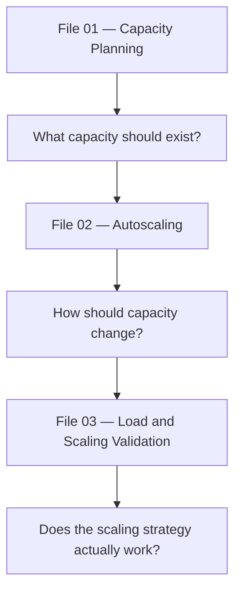

That distinction is important.

A capacity model can be mathematically reasonable and still fail in production.

An autoscaling policy can look sensible and still react too slowly.

A system can have enough nominal GPU capacity and still fail because GPUs are unavailable, fragmented, cold, or unable to provide useful throughput.

Therefore:

> **Capacity planning is a hypothesis. Load testing provides evidence.**

The goal of this chapter is not to produce a single universal capacity number.

The goal is to establish whether a system can operate acceptably across a defined workload range and to identify what happens when demand exceeds that range.

---

# Why Load Testing Exists

Capacity planning estimates what a system needs.

Load testing asks whether reality agrees with the estimate.

Consider an AI inference service planned for:

- 100 requests/second sustained demand
- 300 requests/second burst demand
- 500 ms target latency
- 8 GPU workers

The planning model may be correct.

But production behavior could still be:

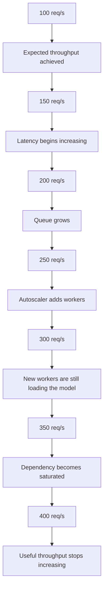

The important engineering question is not:

> "Did the system create more workers?"

It is:

> **"Did additional capacity allow the system to absorb additional demand while maintaining the intended operating behavior?"**

That distinction drives the entire chapter.

---

# Mental Model

Think of load testing as an engineering experiment.

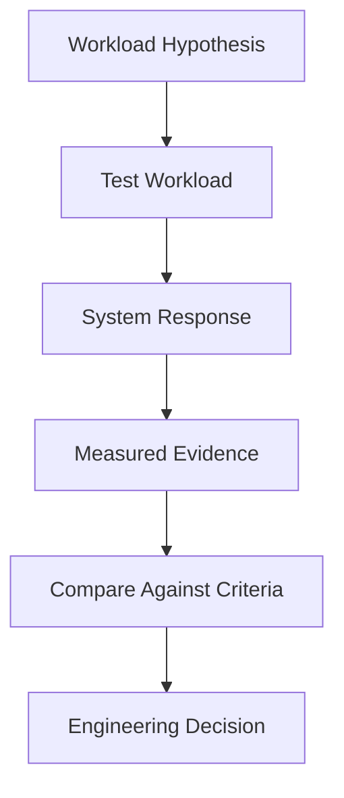

A useful test therefore contains five things:

1. **Workload**
2. **Expected behavior**
3. **Measurements**
4. **Success criteria**
5. **Decision rule**

Without these, a load test can generate large amounts of traffic without producing useful engineering evidence.

---

# Load Testing as an Engineering Experiment

A meaningful capacity test should answer a specific question.

Examples:

> Can the system sustain 200 requests/second for 30 minutes?

> Can the system absorb a 3× burst without permanently accumulating queue backlog?

> Can autoscaling increase useful capacity quickly enough to prevent unacceptable degradation?

> Does adding GPU workers continue to increase useful throughput?

> What happens when the system reaches its configured maximum capacity?

These are engineering questions.

"Run a load test" is not.

---

## Test Environment Validity

A load test is useful only when the test environment is representative enough for the question being asked.

The environment does not always need to be identical to production.

However, differences must be understood.

Important dimensions include:

| Dimension | Example |
|---|---|
| Compute | GPU model, CPU size |
| Memory | Available RAM / VRAM |
| Network | Bandwidth and latency |
| Storage | Local vs remote storage |
| Model | Same model/version |
| Runtime | Same serving/runtime configuration |
| Dependencies | Same or representative services |
| Autoscaling | Same policies and limits |
| Traffic | Similar request characteristics |
| Data | Representative request sizes |

A test on four local CPUs cannot reliably establish the scaling behavior of a production service running on eight GPUs.

It may still answer a smaller question, but the scope of the conclusion must match the environment.

---

## Test Reproducibility

A useful test should be repeatable.

Record at least:

- workload definition
- request distribution
- request size distribution
- arrival pattern
- concurrency
- duration
- ramp profile
- model version
- runtime configuration
- infrastructure configuration
- autoscaling configuration
- dependency configuration
- test start/end conditions
- success criteria

If the same test cannot reasonably be repeated, it becomes difficult to distinguish a genuine capacity change from test variability.

Repeated runs are especially useful when the system contains:

- cold starts
- caching
- asynchronous processing
- autoscaling delays
- variable request sizes
- shared dependencies

---

## Measurement Windows

Do not treat the entire test as one measurement.

A typical test may contain:

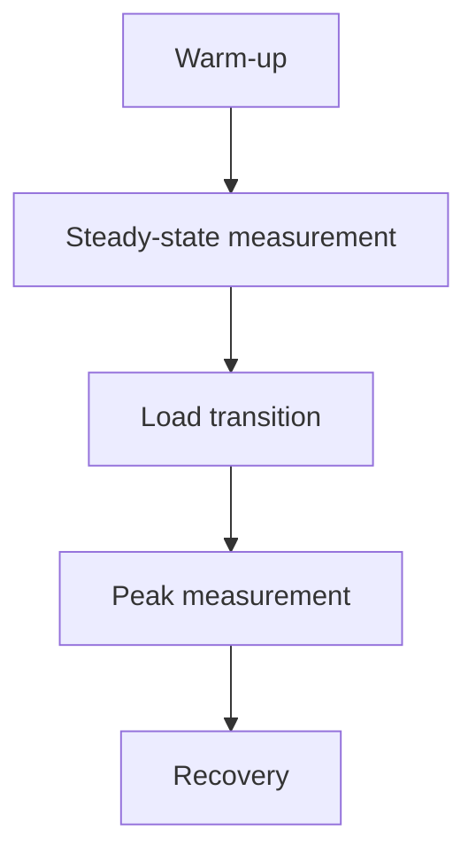

The warm-up period allows the system to reach the intended operating state.

The measurement period provides comparable evidence.

The transition period shows how the system reacts to changing demand.

The recovery period shows whether temporary overload or burst conditions leave residual backlog.

For scaling tests, recovery is particularly important.

A system that survives a burst but never drains the resulting queue has not fully demonstrated burst resilience.

---

# What to Measure

The measurements should answer capacity questions.

Typical measurements include:

### Demand

- request rate
- request arrival pattern
- request size
- token volume where relevant
- concurrency
- batch volume

### Useful system output

- successful throughput
- completed work
- useful tokens processed
- completed jobs

### Response behavior

- latency
- tail latency
- timeout rate
- capacity-induced errors

### Capacity state

- provisioned capacity
- available capacity
- ready capacity
- useful capacity
- active workers
- GPU availability

### Scaling behavior

- scale-out time
- scale-in time
- worker readiness time
- scaling lag
- maximum capacity reached

### Queue behavior

- queue depth
- queue waiting time
- queue growth rate
- queue drain time

These measurements are used here as **test evidence for capacity decisions**. The broader production observability architecture remains the responsibility of PROD-05.

---

## Tail Latency and Error Behavior

Average latency is insufficient for capacity validation.

Suppose:

```text
Average latency = 300 ms
p95 latency      = 450 ms
p99 latency      = 4.2 s
```

The average may appear healthy while a meaningful fraction of requests experiences severe delay.

Capacity tests should therefore examine appropriate latency percentiles.

Errors should also be classified by cause.

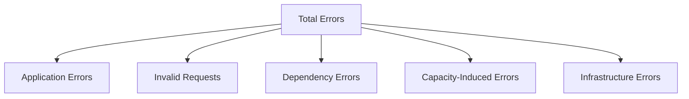

The goal is not to teach general error taxonomy.

The goal is to determine whether increasing demand produces failures that indicate insufficient capacity or a capacity-related bottleneck.

---

# Types of Capacity Tests

Different tests answer different questions.

| Test | Primary Question |
|---|---|
| Load test | Can the system sustain expected demand? |
| Stress test | What happens beyond expected demand? |
| Burst test | Can the system absorb rapid demand changes? |
| Endurance test | Can the system sustain demand for a long period? |
| Concurrency test | How does behavior change as simultaneous work increases? |
| Saturation test | What happens when a resource approaches its usable limit? |
| Scaling test | Does capacity change appropriately as demand changes? |
| Recovery test | Does the system return to a healthy operating state after overload? |

These tests can overlap.

For example, a burst test can also be a scaling test when the objective is to validate autoscaling during the burst.

---

## Load Testing

A load test applies a defined workload representing expected production demand.

Example:

```text
Target:
200 requests/second

Duration:
30 minutes

Expected:
Stable throughput
Acceptable tail latency
Stable error behavior
No unbounded queue growth
```

The purpose is to establish whether the system can sustain the intended operating point.

A successful load test does not prove that the system can handle every possible workload.

It proves something narrower:

> **The system demonstrated the tested behavior under the tested conditions.**

---

# Stress Testing

Stress testing deliberately pushes the system beyond expected operating demand.

Example:

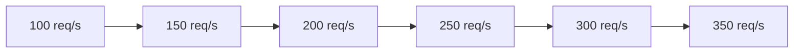

The objective is not necessarily to keep latency healthy forever.

Instead, determine:

- where degradation begins
- which resource becomes limiting
- whether scaling continues
- whether useful throughput continues increasing
- when errors begin
- what happens at maximum capacity
- whether recovery is possible

Stress testing should have explicit stopping or abort conditions.

---

# Controlled Stress Testing

Stress testing should be controlled.

Possible abort conditions include:

- uncontrolled resource exhaustion
- infrastructure instability
- cascading dependency impact
- irreversible test-state corruption
- unexpected production impact
- safety limits being exceeded

The objective is to learn the system's capacity boundary, not to damage the environment.

---

## Burst Testing

A burst test changes demand rapidly.

For example:

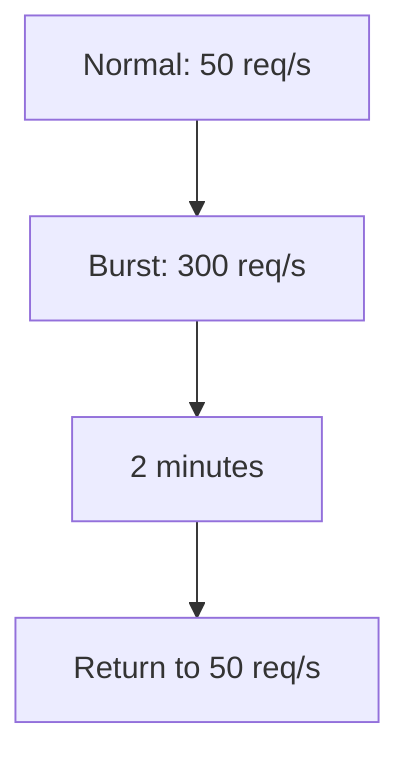

This tests a different problem from sustained capacity.

A system may have enough long-term capacity for 300 requests/second but still fail to absorb an instantaneous burst because new capacity takes time to become usable.

Therefore:

> **Sustained capacity and burst absorption are different engineering problems.**

---

# Burst Absorption

A burst can be absorbed through some combination of:

- existing warm capacity
- rapid scale-out
- queueing
- workload smoothing
- admission behavior
- temporary degradation

PROD-07 evaluates whether the available capacity and scaling behavior can handle the workload.

It does not define the reliability policies governing overload behavior; those belong to PROD-06.

The key test questions are:

```text
How large is the burst?
How quickly does it arrive?
How quickly can useful capacity increase?
How much backlog accumulates?
How long does recovery take?
```

---

# Scaling Delay Validation

Autoscaling decisions are not instantaneous.

A simplified test model is:

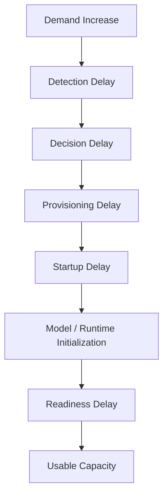

These phases may overlap.

The purpose of this decomposition is not to claim that every system implements these as separate sequential stages.

It is a diagnostic model for understanding why:

> "The autoscaler reacted"

does not necessarily mean:

> "The system gained useful capacity quickly enough."

---

# Scaling Delay Components

### Detection Delay

How long before the scaling signal reflects the increased workload?

### Decision Delay

How long before the scaling controller decides to change capacity?

### Provisioning Delay

How long before infrastructure or scheduling makes the new resource available?

### Startup Delay

How long does the worker take to start?

### Model Initialization Delay

How long does the model/runtime take to become usable?

### Readiness Delay

How long before the worker can actually receive production work?

The final measurement that matters is:

> **How long from increased demand until useful capacity becomes available?**

---

## Cold Starts

Cold starts are particularly important for AI workloads.

A new worker may need to:

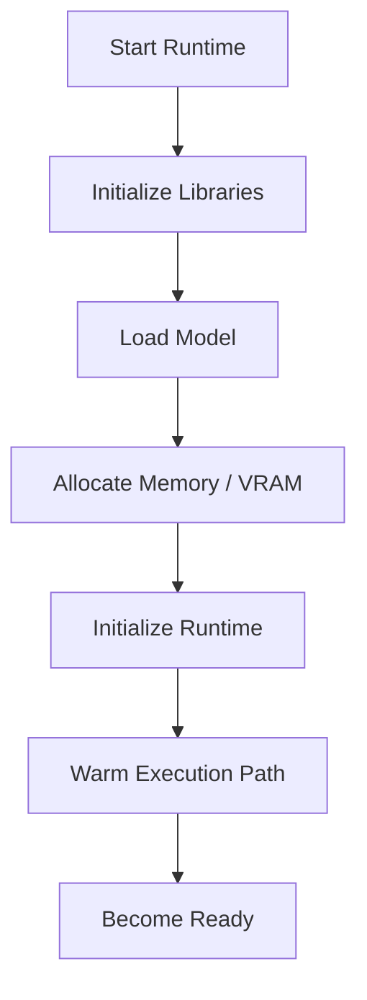

A GPU can therefore exist physically while remaining unavailable to the workload for a significant period.

This is why capacity testing should measure **usable capacity**, not merely infrastructure allocation.

---

# Cold-Start Test

A useful cold-start test should compare:

```text
Warm Capacity
vs
Cold Capacity
```

Measure:

- time to worker readiness
- time to first useful request
- model-loading duration
- temporary latency impact
- queue growth while capacity becomes ready
- recovery after new capacity arrives

This helps determine whether reactive scaling can respond quickly enough to the workload.

---

# Concurrency Testing

Concurrency testing increases simultaneous work and observes how system capacity changes.

For example:

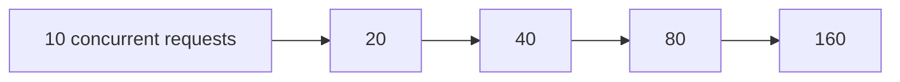

Measure:

- useful throughput
- tail latency
- queueing
- resource utilization
- error behavior
- saturation point

The objective is not to redesign the serving mechanism.

The objective is to determine the workload level at which additional simultaneous demand stops producing proportional useful output.

---

# Saturation Testing

A system is saturated when an important capacity constraint prevents additional demand from being converted into useful work at the expected rate.

Examples:

- GPU compute saturation
- GPU memory saturation
- CPU saturation
- memory pressure
- network bandwidth limits
- storage throughput limits
- dependency capacity limits

Saturation does not necessarily mean:

> "A metric reached 100%."

The important question is:

> **Has the constrained resource become the limiting factor for useful workload progress?**

---

## Finding the Bottleneck

A bottleneck should be identified through evidence.

Consider:

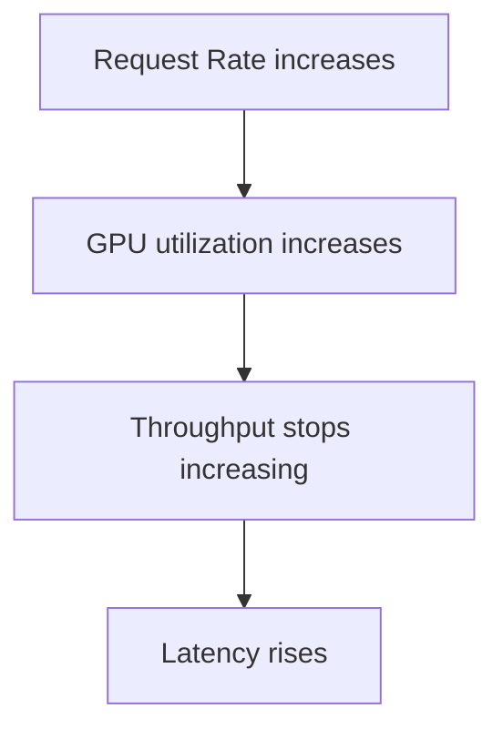

This is stronger evidence of a GPU-related bottleneck than simply observing high GPU utilization.

Compare:

```text
CPU = 90%
GPU = 30%
Throughput = still increasing
```

CPU may be highly utilized without being the limiting factor.

Therefore:

> **Highest utilization is not automatically the bottleneck.**

A bottleneck is the constraint whose additional capacity would materially increase useful system output under the tested workload.

---

# Queue Growth as a Capacity Signal

A queue can reveal a capacity mismatch.

Conceptually:

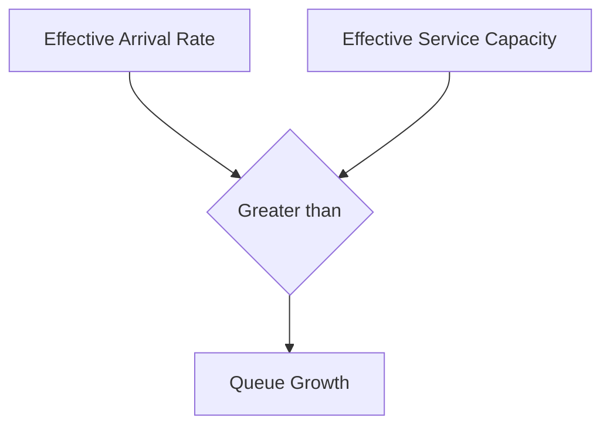

This relationship should be interpreted over a meaningful measurement interval rather than from a single instantaneous observation.

If the condition persists:

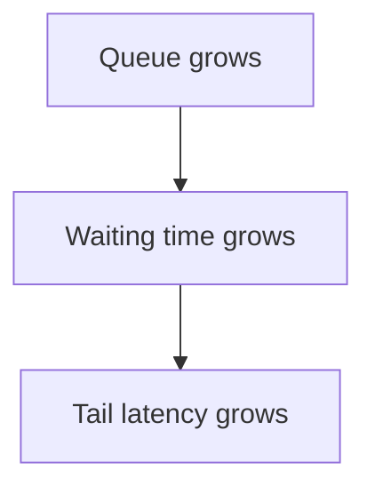

The test should determine whether scaling eventually increases useful service capacity enough to stop and reverse queue growth.

---

# Queue Growth During Scaling

A temporary queue increase during scale-out is not automatically a failure.

Consider:

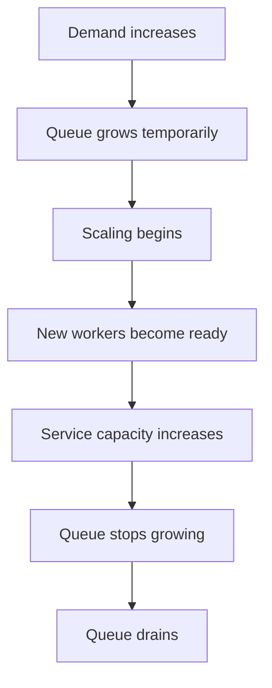

This may be acceptable if the resulting latency and recovery behavior remain within the defined test criteria.

The important question is:

> **Did the system recover within the required operating boundary?**

---

# Queue Drain Validation

A burst test should measure both:

```text
Time to Peak Backlog
```

and:

```text
Time to Drain Backlog
```

A system that survives a burst but leaves backlog permanently growing has not demonstrated sufficient capacity.

Recovery should therefore be treated as part of the capacity test.

---

# Autoscaling Validation

Autoscaling should be validated as a complete behavior:

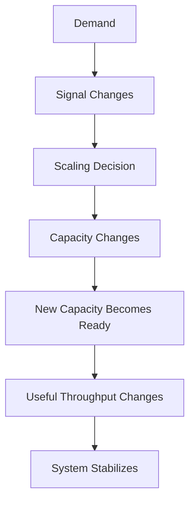

Do not treat:

> "Replica count increased"

as proof that autoscaling worked.

The relevant question is:

> **Did the increase in capacity improve the system's ability to process useful workload?**

---

# Under-Scaling

Under-scaling occurs when demand increases faster or further than useful capacity.

Typical evidence:

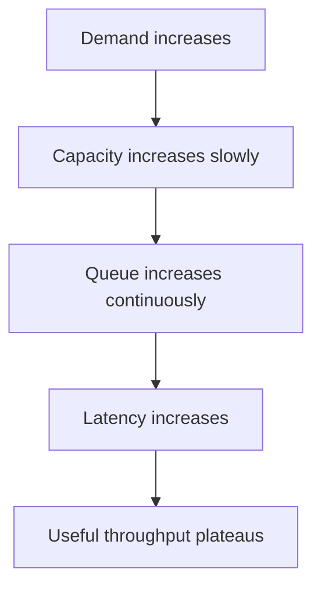

Possible causes include:

- scaling signal reacts too late
- scaling target is inappropriate
- maximum capacity is too low
- new workers take too long to become ready
- the scaled resource is not the actual bottleneck
- required dependency capacity is unavailable

---

# Over-Scaling

Over-scaling occurs when the system adds capacity without a corresponding workload requirement.

Possible causes include:

- noisy scaling signal
- poorly chosen target
- overly aggressive scaling policy
- latency being used as a misleading demand proxy
- conflicting signals
- scaling delay causing the controller to react to stale conditions

The test should determine whether additional capacity produces meaningful useful output.

---

## Oscillation

Oscillation occurs when capacity repeatedly moves up and down.

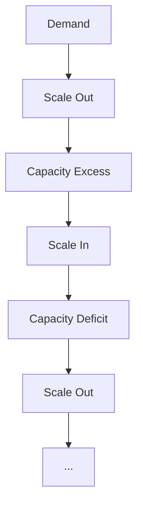

This can produce:

- unstable latency
- repeated worker startup
- unnecessary resource consumption
- inconsistent throughput
- unnecessary model loading

A scaling test should therefore evaluate behavior across repeated demand transitions rather than only one scale-out event.

---

# Positive Feedback During Scaling

A more dangerous failure mode occurs when scaling itself increases pressure on another component.

For example:

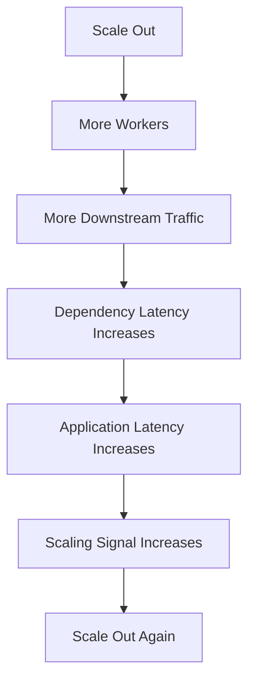

The result can be a positive feedback loop.

Load testing should therefore validate not only the application resource being scaled, but also the dependencies that receive additional work.

---

# Maximum Capacity Testing

Every scaling system should have a tested maximum capacity.

For example:

```text
Minimum = 2 workers
Maximum = 20 workers
```

A test should determine what happens when demand requires more than 20 workers.

Maximum capacity is a **policy boundary**.

It becomes an operational problem when:

- the limit is too low for intended demand
- the system reaches the limit too frequently
- useful throughput stops below the intended workload
- no appropriate behavior exists beyond the limit

Reaching maximum capacity during a stress test is therefore not automatically a system failure.

The question is whether the observed behavior matches the intended operating policy.

---

# Resource Exhaustion

Stress tests should identify how resource exhaustion appears.

Examples:

```text
GPU memory exhausted
CPU saturated
System memory exhausted
Network bandwidth saturated
Storage throughput exhausted
Dependency capacity exhausted
```

For each resource, determine:

1. what happens as the resource approaches its limit
2. whether useful throughput continues increasing
3. whether latency degrades
4. whether errors increase
5. whether scaling can relieve the constraint
6. whether another resource becomes the next bottleneck

This produces a more useful capacity model than simply recording utilization percentages.

---

# Dependency Saturation

Application capacity is often constrained by dependencies.

Examples:

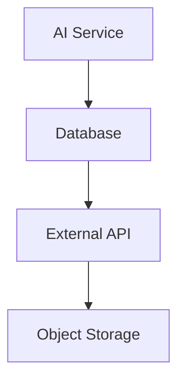

Suppose the AI service can process 500 requests/second, but a dependency can safely process only 200.

Then the application does not have 500 requests/second of useful end-to-end capacity.

Load testing should therefore include representative dependency behavior.

---

# Testing Dependency Constraints

When a dependency becomes the limiting factor, test whether scaling the application changes useful throughput.

Example:

```text
Application Workers
2 → 4 → 8 → 16

Dependency Capacity
200 req/s
```

If throughput remains near 200 requests/second as workers increase, the application is not gaining useful capacity from additional workers.

This is evidence that scaling the application alone does not solve the system-level capacity constraint.

Detailed dependency failure behavior belongs to PROD-06.

---

# Load-Test Workload Design

A workload should represent the dimensions that materially affect capacity.

For AI systems, these can include:

- request rate
- request size
- input token count
- output token count
- model selection
- batch size where applicable
- concurrency
- synchronous vs asynchronous workload
- request distribution
- workload mix
- burst characteristics

The objective is not to simulate every possible production request.

The objective is to simulate the workload dimensions that materially affect the capacity question being tested.

---

## Synthetic vs Production-Derived Workloads

### Synthetic Workloads

Synthetic requests are generated specifically for testing.

Advantages:

- controlled
- reproducible
- easy to scale
- easy to compare

Limitations:

- may not represent real request distributions
- may miss long-tail request sizes
- may underestimate dependency behavior

### Production-Derived Workloads

Production traffic characteristics are used to construct a representative test workload.

Advantages:

- more realistic
- captures actual distributions
- better reflects real workload behavior

Requirements may include:

- privacy protection
- anonymization
- de-identification
- removal of sensitive content
- controlled replay

The goal is representative behavior, not exposure of production data.

---

## Steady-State Load

A steady-state test keeps demand approximately constant.

```text
200 req/s
────────────────────────
```

This is useful for determining:

- sustainable throughput
- steady-state latency
- resource utilization
- queue stability
- long-duration behavior

---

# Ramp Test

A ramp test gradually increases demand.

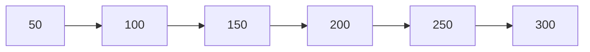

This helps identify where system behavior changes.

For example:

```mermaid
flowchart TD
    A["Throughput increases"] --> B["Latency stable"]
    B --> C["Throughput increases"]
    C --> D["Latency begins rising"]
    D --> E["Throughput plateaus"]
    E --> F["Latency rises sharply"]
```

The transition points provide evidence about the system's usable capacity envelope.

---

# Step Load Test

A step test changes demand in discrete levels.

```mermaid
flowchart TD
    A["100 req/s"] --> B["200 req/s"]
    B --> C["300 req/s"]
    C --> D["400 req/s"]
```

Each step should be maintained long enough to observe the system response.

This is particularly useful for validating autoscaling transitions.

---

# Burst Test Design

A burst test should define:

- baseline demand
- burst demand
- burst duration
- transition speed
- available warm capacity
- scaling limits
- recovery criteria

Example:

```mermaid
flowchart TD
    A["Baseline: 50 req/s"] --> B["Burst: 300 req/s"]
    B --> C["2 minutes"]
    C --> D["Return: 50 req/s"]
```

Measure:

- peak queue depth
- peak latency
- scale-out delay
- useful capacity gained
- maximum workers reached
- queue drain time
- post-burst stability

---

# Endurance Testing

Endurance testing runs the system for an extended period.

The objective is to detect behavior that does not appear in short tests.

Examples:

- memory growth
- gradual queue accumulation
- repeated scaling instability
- resource leakage
- long-term dependency pressure
- degradation after repeated model loading

Endurance testing is especially useful for workloads expected to run continuously.

---

## Test Matrix

A production-oriented test program should not depend on one workload.

A useful matrix may look like:

| Scenario | Demand | Duration | Purpose |
|---|---:|---:|---|
| Baseline | 50 req/s | 30 min | Establish baseline |
| Expected load | 100 req/s | 60 min | Validate planned load |
| Peak load | 200 req/s | 30 min | Validate peak |
| Ramp | 50→300 req/s | 30 min | Find capacity transition |
| Burst | 50→300 req/s | 2 min | Validate burst absorption |
| Stress | 100→500 req/s | Controlled | Find failure boundary |
| Endurance | 100 req/s | 4 hr | Validate long-term stability |
| Recovery | Peak→baseline | Defined | Validate queue drain |

The exact numbers depend on the workload.

---

## Test Success Criteria

A strong test defines success before execution.

Success criteria should include three categories.

## 1. Metric Thresholds

Numerical boundaries.

```text
p95 latency ≤ 500 ms
```

```text
Error rate ≤ defined threshold
```

## 2. Behavioral Invariants

Properties that must remain true.

```text
Queue must not grow indefinitely.
```

```text
System must eventually recover after a defined burst.
```

## 3. Expected System Transitions

Behaviors expected during the test.

```mermaid
flowchart TD
    A["Demand increases"] --> B["Scaling signal changes"]
    B --> C["Capacity increases"]
    C --> D["Useful throughput increases"]
```

This produces a stronger test definition than relying only on numerical thresholds.

---

# Observed Degradation vs Test Failure

Not every degradation observed during a stress test is a failure.

For example:

```mermaid
flowchart TD
    A["Demand exceeds planned capacity"] --> B["Latency increases"]
    B --> C["Queue grows"]
```

This may be expected during stress testing.

The test fails only if the observed behavior violates the predefined test criteria or exposes an unacceptable system property.

Therefore:

```mermaid
flowchart TD
    A["Observation"] --> B["Compare with Test Criteria"]
    B --> C{"Expected Behavior?"}
    C -->|Yes| D["Pass / Expected"]
    C -->|No| E["Investigate"]
```

This distinction prevents engineers from treating every stressed-system behavior as a defect.

---

# Example: Interactive AI Inference

Suppose an inference service has:

```text
Expected load:
100 req/s

Peak:
200 req/s

Burst:
400 req/s

Maximum:
20 workers
```

Test:

```mermaid
flowchart LR
    A["50 req/s"] --> B["100 req/s"]
    B --> C["200 req/s"]
    C --> D["400 req/s burst"]
    D --> E["100 req/s recovery"]
```

Observe:

- request throughput
- tail latency
- worker count
- worker readiness
- GPU utilization
- GPU memory
- queue depth
- queue drain time
- dependency pressure

Suppose the results show:

```text
100 req/s → stable
200 req/s → stable
400 req/s → queue grows
          → workers scale
          → new GPUs take 90 seconds to become ready
          → queue drains after 3 minutes
```

The conclusion is not simply:

> "400 req/s failed."

A better engineering conclusion is:

> Sustained capacity is adequate through 200 req/s, while the burst exceeds immediately available warm capacity. Reactive scaling eventually restores useful capacity, but the scaling delay creates a temporary backlog and recovery period.

That conclusion can drive an engineering decision about warm capacity, scaling policy, or workload expectations.

---

# Example: Batch AI Processing

Suppose a document-processing system processes:

```text
10,000 documents/day
```

A batch test can increase workload:

```mermaid
flowchart LR
    A["10k"] --> B["20k"]
    B --> C["40k"]
    C --> D["80k"]
```

Measure:

- documents completed/hour
- queue depth
- worker count
- processing time
- dependency capacity
- resource utilization
- backlog recovery

The important question is:

> **How much useful work can the system complete within the required processing window?**

This differs from an interactive latency-focused workload.

---

# Example: Embedding Workload

Suppose an embedding service processes large batches of documents.

Test variables may include:

- document count
- document length
- token count
- batch size
- concurrency
- GPU count

A test might show:

```mermaid
flowchart TD
    A["GPU count increases"] --> B["Throughput increases"]
    B --> C["Throughput increase slows"]
    C --> D["Dependency becomes saturated"]
    D --> E["Additional GPUs produce little useful gain"]
```

This demonstrates why scaling capacity should be evaluated using useful throughput rather than worker count alone.

---

# Practical Load-Test Workflow

A practical workflow is:

```mermaid
flowchart TD
    A["1. Define Question"] --> B["2. Define Workload"]
    B --> C["3. Define Success Criteria"]
    C --> D["4. Validate Test Environment"]
    D --> E["5. Establish Baseline"]
    E --> F["6. Run Controlled Load"]
    F --> G["7. Increase Demand"]
    G --> H["8. Observe Scaling Behavior"]
    H --> I["9. Observe Saturation / Failure"]
    I --> J["10. Validate Recovery"]
    J --> K["11. Analyze Bottleneck"]
    K --> L["12. Record Capacity Envelope"]
    L --> M["13. Convert Findings into Engineering Decisions"]
```

The final step matters.

A load test without an engineering decision is often just a benchmark.

---

# Capacity Envelope

A capacity envelope describes the workload range within which the tested system meets its defined operating criteria.

It is workload-dependent.

For example:

```mermaid
xychart-beta
    title "Illustrative Capacity Envelope"
    x-axis "Demand" [1, 2, 3, 4, 5, 6]
    y-axis "Latency" 0 --> 10
    line [1, 1.2, 1.5, 2, 4, 8]
```

The boundary may depend on:

- request size
- model
- concurrency
- workload mix
- dependency behavior
- infrastructure
- scaling policy

Therefore, capacity should not be treated as one universal scalar such as:

> "This service supports 500 requests/second."

A more useful statement is:

> "Under workload profile X, infrastructure configuration Y, and scaling policy Z, the system sustained approximately N requests/second while satisfying criteria A, B, and C."

---

# Scaling Benefit of Additional Capacity

Additional capacity should be evaluated by the useful work it enables.

For example:

```text
Workers:
4 → 8

Useful throughput:
100 → 190
```

The system gained substantial useful throughput.

Now compare:

```text
Workers:
8 → 16

Useful throughput:
190 → 205
```

The second capacity increase provides much less useful output.

This does not define a universal formal efficiency metric.

The important engineering question is:

> **Does additional capacity continue to produce meaningful additional useful work under the tested workload?**

This keeps the discussion focused on capacity validation rather than performance or cost optimization.

---

# Test Results and Engineering Decisions

A test should end with decisions.

Example:

```mermaid
flowchart TD
    A["Finding"] --> B["Burst causes 90 seconds of queue growth"]
    B --> C["Evidence"]
    C --> D["Cold workers require ~80 seconds to become useful"]
    D --> E["Decision"]
    E --> F["Increase warm capacity or change burst-handling strategy"]
    F --> G["Validation"]
    G --> H["Repeat burst test"]
```

Another example:

```text
Finding:
Adding GPUs beyond 8 does not increase throughput.

Evidence:
Dependency saturates at 400 req/s.

Decision:
Do not scale GPU capacity further until dependency capacity is addressed.
```

The test therefore becomes part of engineering feedback rather than a one-time benchmark.

---

# Capacity Regression Testing

Capacity can regress after changes.

Examples:

- new model version
- runtime upgrade
- dependency change
- infrastructure change
- request-schema change
- prompt-length increase
- tokenizer change
- model quantization change
- autoscaling-policy change

A previously successful workload can become slower or more resource-intensive.

Therefore, important capacity tests should be repeated after material changes.

A regression test might compare:

```text
Previous Version
vs
New Version
```

under the same workload and criteria.

The goal is to detect changes such as:

```mermaid
flowchart TD
    A["Same demand"] --> B["Higher resource consumption"]
    B --> C["Lower useful throughput"]
```

before the change becomes a production capacity problem.

---

# Production Perspective

Load testing is not a one-time activity.

A production AI system changes continuously.

```mermaid
flowchart TD
    A["Model Changes"] --> B["Runtime Changes"]
    B --> C["Workload Changes"]
    C --> D["Dependency Changes"]
    D --> E["Infrastructure Changes"]
    E --> F["Scaling Policy Changes"]
    F --> G["Capacity Changes"]
```

Therefore capacity validation should be repeated when changes materially affect workload or resource behavior.

Production measurements can also reveal that the original test assumptions are no longer valid.

This creates a continuous loop:

```mermaid
flowchart TD
    A["Production Evidence"] --> B["Capacity Assumptions"]
    B --> C["Load Test"]
    C --> D["Engineering Decision"]
    D --> E["Production Change"]
    E --> F["New Evidence"]
    F --> A
```

---

# Load Testing Before Production

Before a major production launch or scaling change, validate:

- expected load
- peak load
- burst behavior
- scaling delay
- maximum capacity
- queue recovery
- dependency constraints
- useful throughput
- failure boundary

The goal is not to predict every production event.

The goal is to reduce uncertainty around the most important capacity risks.

---

## Load Testing After Production Changes

Repeat relevant capacity tests after changes such as:

- model upgrades
- serving/runtime changes
- GPU changes
- autoscaling changes
- dependency changes
- workload-shape changes
- infrastructure changes

Not every code change requires a full capacity program.

The test scope should match the expected impact of the change.

---

## Common Mistakes

## Mistake 1 — Testing Only Average Load

Average demand can hide peak and burst behavior.

**Better:**

Test expected, peak, and burst workloads separately.

---

## Mistake 2 — Measuring Only CPU/GPU Utilization

High utilization does not automatically identify the bottleneck.

**Better:**

Connect utilization to useful throughput and workload progress.

---

## Mistake 3 — Treating Replica Count as Capacity

More workers do not necessarily mean more useful throughput.

**Better:**

Measure useful capacity.

---

## Mistake 4 — Testing Only Steady State

A system can perform well at steady state and fail during rapid demand changes.

**Better:**

Include burst and scaling-transition tests.

---

## Mistake 5 — Ignoring Cold Starts

AI workers may require substantial model initialization.

**Better:**

Measure time to useful capacity.

---

## Mistake 6 — Ignoring Dependencies

Scaling the application may overload another component.

**Better:**

Include representative dependency behavior.

---

## Mistake 7 — No Recovery Test

Surviving a burst is not enough if backlog never drains.

**Better:**

Measure recovery and queue-drain behavior.

---

## Mistake 8 — No Predefined Success Criteria

Without success criteria, engineers can interpret the same test differently.

**Better:**

Define thresholds, invariants, and expected transitions before testing.

---

## Mistake 9 — Treating Stress-Test Degradation as Automatically a Failure

Stress testing intentionally exceeds normal capacity.

**Better:**

Compare observations against the predefined test objective.

---

## Mistake 10 — Treating a Load Test as a Benchmark

A benchmark may produce numbers without producing engineering decisions.

**Better:**

End each meaningful test with a capacity conclusion and recommended action.

---

## Engineering Decisions and Trade-offs

## Warm Capacity vs Cost

More warm capacity can improve burst response.

But it also consumes resources during low demand.

The trade-off is:

```mermaid
flowchart TD
    A["More Warm Capacity"] --> B["Faster Burst Response"]
    A --> C["Higher Idle Cost"]
```

---

## Maximum Capacity vs Availability

A higher maximum provides more potential capacity.

But it may:

- increase infrastructure cost
- increase dependency pressure
- increase failure blast radius

Maximum capacity should therefore be treated as an architectural policy decision rather than an arbitrary large number.

---

## Aggressive Scaling vs Stability

Faster scaling may reduce queue growth.

But overly aggressive scaling can produce:

- oscillation
- dependency saturation
- unnecessary resource churn

Scaling behavior must therefore be validated empirically.

---

## Realistic Workloads vs Reproducibility

Production-derived workloads improve realism.

Synthetic workloads improve control.

A mature test program often uses both:

```mermaid
flowchart TD
    A["Synthetic Tests"] --> B["Controlled Engineering Questions"]
    C["Production-Derived Tests"] --> D["Realism Validation"]
```

---

# A Practical Scaling Validation Framework

Use this framework when evaluating a production AI scaling design.

## Step 1 — Define the Workload

Specify:

- request rate
- request size
- concurrency
- workload mix
- burst pattern
- duration

## Step 2 — Define the Capacity Question

Examples:

> Can the system sustain 200 req/s?

> Can it absorb a 4× burst?

> Can scaling restore capacity within 60 seconds?

## Step 3 — Define Success Criteria

Specify:

- metric thresholds
- behavioral invariants
- expected system transitions

## Step 4 — Establish Baseline

Measure the system under known demand before introducing scaling transitions.

## Step 5 — Increase Demand

Use:

- ramp
- step
- burst
- stress

as appropriate.

## Step 6 — Observe Useful Capacity

Measure completed work rather than infrastructure changes alone.

## Step 7 — Identify the Bottleneck

Determine which constraint prevents additional useful output.

## Step 8 — Validate Scaling

Measure:

```mermaid
flowchart LR
    A["Demand Change"] --> B["Scaling Response"]
    B --> C["Capacity Readiness"]
    C --> D["Useful Throughput"]
    D --> E["Stabilization"]
```

## Step 9 — Validate Recovery

Measure:

```mermaid
flowchart LR
    A["Peak"] --> B["Demand Reduction"]
    B --> C["Queue Drain"]
    C --> D["Stable State"]
```

## Step 10 — Establish Capacity Envelope

Document the workload conditions under which the system satisfies its criteria.

## Step 11 — Record Failure Boundary

Document what happens beyond the acceptable envelope.

## Step 12 — Convert Evidence into Engineering Decisions

Examples:

- increase warm capacity
- change scaling target
- increase maximum capacity
- address dependency bottleneck
- change infrastructure
- revise workload expectations
- redesign scaling strategy

---

# Relationship to the Other PROD-07 Files

The three files form one engineering workflow.

```mermaid
flowchart TD
    A["01 — Capacity Planning"] --> B["What capacity should exist?"]
    B --> C["02 — Autoscaling"]
    C --> D["How should capacity change?"]
    D --> E["03 — Load & Scaling Validation"]
    E --> F["Does the strategy actually work?"]
```

### File 01 owns

- demand modeling
- workload characterization
- resource sizing
- capacity planning
- planning headroom
- capacity assumptions

### File 02 owns

- autoscaling signals
- scaling policies
- scaling mechanisms
- scaling targets
- scaling limits
- scaling delays
- warm/cold capacity
- GPU scaling considerations

### File 03 owns

- load testing
- stress testing
- burst testing
- endurance testing
- saturation testing
- scaling validation
- bottleneck validation
- recovery validation
- capacity envelopes
- capacity regression

The files should reference each other rather than re-teach each other's primary concepts.

---

# Boundaries with Other Production Chapters

## PROD-03 — Inference and Serving

PROD-03 owns:

- inference serving
- serving architecture
- concurrency mechanisms
- queues as serving mechanisms
- batching
- streaming
- model routing

PROD-07 uses these concepts only when evaluating their **capacity implications**.

---

## PROD-04 — CI/CD and Deployment

PROD-04 owns:

- deployment
- release
- infrastructure provisioning
- progressive delivery
- rollback

PROD-07 may test capacity after infrastructure or deployment changes but does not teach deployment engineering.

---

## PROD-05 — Observability

PROD-05 owns:

- telemetry architecture
- logging
- metrics
- tracing
- AI-specific observability
- signal architecture

PROD-07 uses measurements as evidence during capacity validation.

---

## PROD-06 — Reliability

PROD-06 owns:

- SLI/SLO design
- error budgets
- timeouts
- retries
- backpressure
- failure isolation
- graceful degradation
- fallbacks
- dependency failure behavior

PROD-07 evaluates what happens when capacity is insufficient.

It does not define the system's reliability response to overload.

---

## PROD-08 — Performance and Cost

PROD-08 owns:

- performance optimization
- efficiency optimization
- cost optimization
- workload optimization

PROD-07 asks:

> "How much capacity is required and does scaling provide useful capacity?"

PROD-08 asks:

> "How can the workload perform more efficiently or at lower cost?"

---

## PROD-10 — Incident Management

PROD-10 owns:

- incident response
- diagnosis
- mitigation
- recovery
- postmortems
- operational runbooks

PROD-07 provides pre-production and engineering evidence about capacity behavior.

---

## Interview Questions

## 1. Why is load testing necessary if capacity planning has already been performed?

**Expected answer:**

Capacity planning relies on assumptions and models. Load testing validates those assumptions against actual system behavior, including resource limits, scaling delay, dependency constraints, cold starts, and workload variability.

---

## 2. Why is worker count not a sufficient capacity metric?

**Expected answer:**

Because a worker may be unavailable, not ready, model-loading, bottlenecked by another resource, or unable to increase useful throughput. Capacity should be evaluated using useful completed work.

---

## 3. Why can a system fail during a burst even when it has enough long-term capacity?

**Expected answer:**

Because long-term capacity and immediately available capacity are different. New workers may require provisioning, startup, model loading, and readiness time.

---

## 4. How would you identify the actual bottleneck?

**Expected answer:**

Correlate workload demand, useful throughput, latency, queue behavior, resource behavior, and dependency behavior. High utilization alone is not sufficient evidence.

---

## 5. Why can scaling out make a system worse?

**Expected answer:**

Additional workers may increase load on a shared dependency, causing dependency latency or saturation. That can reduce end-to-end useful throughput and potentially trigger further scaling.

---

## 6. What is the difference between scaling successfully and scaling effectively?

**Expected answer:**

Successful scaling means capacity changed as intended. Effective scaling means the additional capacity became usable and materially improved the system's ability to process workload.

---

## 7. Why should recovery be part of burst testing?

**Expected answer:**

Because a system may survive the peak while accumulating backlog that never drains. Recovery demonstrates whether the system can return to a stable operating state after demand falls.

---

## 8. What does reaching maximum capacity during a stress test tell you?

**Expected answer:**

It identifies a policy boundary. The important question is whether the maximum is appropriate for the intended workload and what behavior occurs when demand exceeds it.

---

## 9. What makes a load test reproducible?

**Expected answer:**

A defined workload, controlled environment, known model/runtime configuration, fixed scaling policy, defined duration, measurement windows, and explicit success criteria.

---

## 10. What is a capacity envelope?

**Expected answer:**

A workload-dependent range within which the system satisfies predefined operating criteria under specified infrastructure, dependency, and scaling conditions.

---

## Quick Revision

### Capacity validation

```mermaid
flowchart LR
    A["Plan"] --> B["Test"]
    B --> C["Measure"]
    C --> D["Compare"]
    D --> E["Decide"]
```

### Scaling validation

```mermaid
flowchart TD
    A["Demand Change"] --> B["Scaling Signal"]
    B --> C["Scaling Decision"]
    C --> D["Capacity Change"]
    D --> E["Ready Capacity"]
    E --> F["Useful Capacity"]
    F --> G["System Stabilization"]
```

### Burst validation

```mermaid
flowchart TD
    A["Baseline"] --> B["Burst"]
    B --> C["Queue Growth"]
    C --> D["Scale-Out"]
    D --> E["Useful Capacity"]
    E --> F["Queue Drain"]
    F --> G["Recovery"]
```

### Bottleneck reasoning

```mermaid
flowchart TD
    A["Demand increases"] --> B["Useful Throughput"]
    B --> C["Throughput Plateaus"]
    C --> D["Identify Constraint"]
    D --> E["Test Additional Capacity"]
    E --> F{"Does Useful Throughput Increase?"}
```

### Test criteria

```mermaid
flowchart TD
    A["Metric Thresholds"] --> C["Test Success Criteria"]
    B["Behavioral Invariants"] --> C
    D["Expected Transitions"] --> C
```

---

# Key Takeaways

1. Capacity planning produces a hypothesis; load testing provides evidence.
2. A load test must answer a defined engineering question.
3. Test environments must be representative enough for the conclusion being drawn.
4. Reproducibility is necessary for meaningful capacity comparisons.
5. Average latency alone is insufficient; tail behavior matters.
6. Load, stress, burst, endurance, concurrency, and saturation tests answer different questions.
7. Burst capacity and sustained capacity are different engineering problems.
8. Scaling delay includes more than the autoscaler decision itself.
9. A provisioned resource is not necessarily ready or useful.
10. High resource utilization does not automatically identify the bottleneck.
11. Queue growth can indicate that effective demand exceeds useful service capacity over a sustained interval.
12. Queue recovery is an important part of burst validation.
13. More workers do not automatically mean more useful throughput.
14. Scaling can fail because the wrong resource is being scaled.
15. Scaling can make the system worse when dependencies become saturated.
16. Maximum capacity is a policy boundary that should be tested explicitly.
17. Stress-test degradation is not automatically a test failure; it must be evaluated against predefined criteria.
18. Capacity envelopes are workload-dependent rather than universal single numbers.
19. Capacity testing should produce engineering decisions, not just benchmark numbers.
20. Capacity regression testing helps detect degradation after production changes.

---

## Further Reading

For deeper study, review:

- [01 — AI Capacity Planning and Scaling Models](./01-AI-Capacity-Planning-and-Scaling-Models.md)
- [02 — Autoscaling, Capacity, Concurrency, Queues, and GPU Resources](./02-Autoscaling-Capacity-Concurrency-Queues-and-GPU-Resources.md)
- PROD-03 — Production Inference and Model Serving
- PROD-05 — Production AI Observability and Telemetry
- PROD-06 — AI Service Reliability
- PROD-08 — Performance and Cost Engineering

The purpose of this chapter is to connect these areas through **capacity validation**, not to replace their primary teaching locations.

---

## Engineering Check

Before considering this chapter complete, you should be able to answer:

### Conceptual

- Why is capacity planning insufficient by itself?
- Why is burst capacity different from sustained capacity?
- What is useful capacity?
- Why is maximum utilization not automatically the bottleneck?
- Why can scaling out reduce system performance?

### Engineering

- How would you design a test for a 4× traffic burst?
- How would you determine whether autoscaling is fast enough?
- How would you distinguish scaling delay from dependency saturation?
- How would you determine whether additional GPUs provide useful capacity?
- How would you validate queue recovery?

### Architecture

Given:

```mermaid
flowchart TD
    A["AI API"] --> B["Inference Workers"]
    B --> C["GPU"]
    C --> D["Database / External Dependency"]
```

design a test that determines:

1. sustainable capacity
2. burst capacity
3. scaling delay
4. bottleneck location
5. maximum useful capacity
6. recovery behavior

Your analysis should distinguish:

```mermaid
flowchart TD
    A["Capacity Planning"] --> B["Autoscaling"]
    B --> C["Capacity Validation"]
```

and:

```mermaid
flowchart TD
    A["Observability Architecture"] --> B["Reliability Behavior"]
    B --> C["Capacity Testing"]
```

The goal is not merely to produce a number.

The goal is to produce **defensible engineering evidence about how the production AI system behaves as demand changes**.
