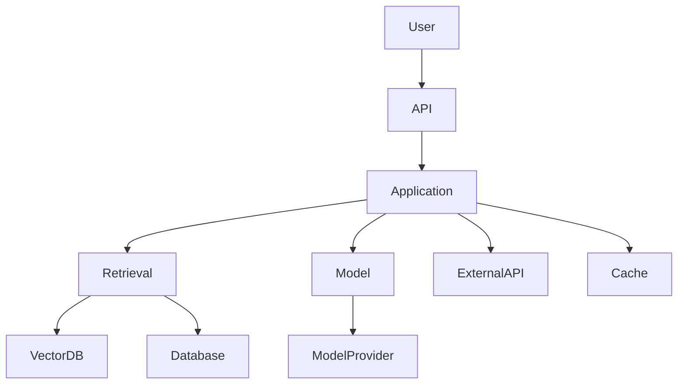

# AI Production Operations and On-Call Readiness

## Learning Objectives

By the end of this chapter, you should be able to:

- Explain why production operations is an engineering discipline rather than an administrative activity.
- Define operational ownership for a production AI service.
- Explain what on-call readiness means and what an on-call engineer needs to support a service responsibly.
- Identify the operational context required to safely support an AI system.
- Understand service ownership, dependency ownership, escalation paths, and support boundaries.
- Distinguish alerts from production incidents.
- Understand why operational teams need a shared understanding of severity and escalation expectations.
- Identify the documentation, dashboards, references, and access required for effective on-call support.
- Recognize operational readiness gaps before they become production problems.
- Identify AI-specific operational concerns such as model/provider dependencies, inference behavior, retrieval dependencies, and unexpected workload patterns.
- Distinguish operational readiness from observability architecture, reliability engineering, capacity planning, security engineering, deployment engineering, and AI lifecycle management.
- Assess whether a production AI service is realistically supportable by an engineering team.

---

## Prerequisites

You should already understand:

- Basic software service architecture.
- APIs and backend services.
- Dependencies and distributed systems at a high level.
- Basic production deployment concepts.
- Basic monitoring and logging concepts.
- The difference between application behavior and infrastructure behavior.

This chapter does not require deep knowledge of observability, Kubernetes, cloud infrastructure, model serving, or incident-management tooling.

Those technologies may appear in examples, but the focus is the **operational engineering discipline around the production AI system**.

---

## Estimated Reading Time

**35–45 minutes**

---

## Before We Start

A production AI system does not become operationally ready simply because:

- the application works,
- the model produces good responses,
- the API is deployed,
- monitoring exists,
- or an engineer can manually fix problems.

Production operation introduces another engineering requirement:

> **A team must be able to understand, support, and safely operate the system when reality differs from the expected path.**

Consider an AI application that works correctly during development.

The team deploys it.

Later, production behavior changes:

- model latency increases,
- a provider becomes less reliable,
- retrieval becomes slower,
- token usage increases unexpectedly,
- a model version changes,
- resource consumption changes,
- an external API becomes unavailable,
- or users report degraded behavior.

The technical system may still be running.

But the team may not be operationally ready to support it.

This creates an important distinction:

```text
Can we build the system?
        ↓
Can we deploy the system?
        ↓
Can we observe the system?
        ↓
Can we responsibly operate the system?
```

These are different engineering capabilities.

PROD-10 focuses on the last question.

---

# 1. Why Production Operations Exists

## 1.1 Production Is Different From Development

Development environments are relatively controlled.

Production environments are not.

In development, engineers generally know:

- what changed,
- what they are testing,
- which dependencies they are using,
- what workload is expected,
- and who is working on the system.

Production introduces uncertainty.

Users behave unpredictably.

Dependencies change.

Traffic changes.

External providers fail.

Infrastructure behaves differently under real workloads.

Configuration changes.

Models change.

Data changes.

Unexpected combinations of these events occur.

Therefore, production engineering needs more than application correctness.

It needs **operational readiness**.

---

## 1.2 Production Operations as an Engineering Discipline

Production operations is the engineering discipline of making a deployed service **understandable, supportable, and operable by its responsible team**.

A useful mental model is:

```text
                 Production Service
                        │
        ┌───────────────┼────────────────┐
        │               │                │
     Service          People          Operational
     Behavior        & Ownership        Context
        │               │                │
        └───────────────┼────────────────┘
                        ↓
                Operational Readiness
                        ↓
              Responsible Operation
```

A technically sophisticated system can still be operationally immature if the team cannot answer basic questions such as:

- Who owns this service?
- Who supports it?
- What does normal operation look like?
- Which dependencies does it require?
- Where are the relevant operational references?
- What should the on-call engineer know before responding?
- When should another team be involved?
- Where are the approved operational procedures?
- What access is required?

These are engineering questions.

---

# 2. Operational Ownership

## 2.1 What Does It Mean to Own a Production Service?

Ownership does not simply mean:

> "This team wrote the code."

Production ownership means the team accepts responsibility for understanding and supporting the service throughout its operational life.

An owning team should know:

- what the service does,
- who depends on it,
- what dependencies it requires,
- what normal operation looks like,
- what important operational conditions exist,
- how support is organized,
- how escalation works,
- and where operational procedures are documented.

A useful distinction is:

```text
Code Ownership
      ≠
Production Ownership
```

A team may own source code without being prepared to operate the resulting production system.

---

## 2.2 Service Ownership

A production AI service should have a clearly identifiable owner.

Ownership should answer:

| Question | Operational Requirement |
|---|---|
| Who owns the service? | Named team or accountable group |
| Who supports it? | Defined support responsibility |
| Who is on-call? | Defined operational responsibility |
| Who owns critical dependencies? | Dependency ownership identified |
| Who can escalate? | Defined escalation path |
| Who can make operational decisions? | Decision authority understood |
| Where is operational knowledge maintained? | Discoverable documentation |

The exact organizational structure may differ between companies.

The important principle is:

> **Responsibility must be explicit.**

If ownership is ambiguous, the team can lose valuable time determining responsibility instead of dealing with the technical problem.

---

# 3. On-Call Readiness

## 3.1 What Is On-Call?

On-call is the operational responsibility for supporting production during a defined support period.

But on-call should not mean:

> "Someone is available to receive alerts."

A mature on-call model means the engineer has enough **context, access, documentation, authority, and support** to perform the expected operational responsibilities.

```text
On-Call Readiness
       │
       ├── Service Knowledge
       ├── Operational Context
       ├── Access
       ├── Relevant Signals
       ├── Documentation
       ├── Dependency Knowledge
       ├── Escalation Paths
       └── Decision Authority
```

If critical elements are missing, the engineer may technically be on-call but operationally unprepared.

---

## 3.2 What an On-Call Engineer Should Know

An on-call engineer should be able to answer questions such as:

### Service

- What does this service do?
- Who uses it?
- What are its critical functions?
- What does normal operation look like?

### Dependencies

- Which services does it depend on?
- Which external providers are involved?
- Which data stores are critical?
- Which model or inference components are required?
- Who owns those dependencies?

### Operational Signals

- Which operational signals are relevant?
- Where are the important dashboards?
- Which alerts belong to this service?
- What context should be checked when an alert occurs?

### Support

- What procedures already exist?
- Which actions are within the team's responsibility?
- When should another team be contacted?
- Where are escalation instructions documented?

### Access

- Which systems must the on-call engineer be able to access?
- Are required permissions available?
- Are approved operational controls documented?

The goal is not for an on-call engineer to memorize the entire system.

The goal is to provide a reliable **operational map**.

---

# 4. Operational Context

A production service cannot be operated effectively without sufficient context.

A useful operational context model is:

```text
                 Service
                   │
       ┌───────────┼───────────┐
       ↓           ↓           ↓
   Purpose     Dependencies   Users
       │           │           │
       ↓           ↓           ↓
   Normal      Ownership      Impact
   Behavior    & Support      Context
       │           │           │
       └───────────┼───────────┘
                   ↓
          Operational Context
```

An engineer should not have to reconstruct this information from source code during a production problem.

---

## 4.1 Service Context

The team should understand:

- service purpose,
- critical user journeys,
- major interfaces,
- important workloads,
- operational dependencies,
- ownership boundaries,
- and expected operating characteristics.

For an AI application, the operational path may look like:

```text
User Request
     ↓
API
     ↓
Application
     ↓
Retrieval
     ↓
Model / Inference
     ↓
External Provider
     ↓
Response
```

The exact architecture varies.

The important point is that the operator understands the major components involved in serving a request.

This is **operational context**, not a replacement for detailed architecture documentation.

---

# 5. Dependency Awareness

Production AI systems are often dependency-heavy.

A single user request may depend on:

- API infrastructure,
- application services,
- databases,
- vector stores,
- model-serving infrastructure,
- external model providers,
- embedding services,
- retrieval systems,
- object storage,
- authentication systems,
- third-party APIs,
- network services,
- and cloud infrastructure.

Therefore:

> **Dependency awareness is part of operational readiness.**

---

## 5.1 Dependency Map

A simple dependency map can look like:



This is not an observability architecture.

It is an **operational context map**.

Its purpose is to help an engineer answer:

> "What else must work for this service to work?"

---

## 5.2 Dependency Ownership

Knowing that a dependency exists is not enough.

The team should know:

- who owns it,
- how to contact the owning team,
- what the support boundary is,
- what information should be provided when escalating,
- and where dependency-specific support procedures are documented.

For example:

```text
AI Application
     │
     ├── Vector Database
     │       └── Platform Team
     │
     ├── Model Provider
     │       └── External Provider
     │
     └── Identity Service
             └── Security / Platform Team
```

This prevents an on-call engineer from having to discover ownership during a production problem.

---

# 6. Operational Access

An engineer cannot operate a production system without appropriate access.

However, operational access should not mean unrestricted access.

The team needs the **minimum practical access required to perform its operational responsibilities**.

Examples may include access to:

- production dashboards,
- service logs,
- deployment/change references,
- configuration references,
- incident-management systems,
- runbooks,
- dependency status,
- approved operational controls,
- and recovery references.

Access should follow organizational security requirements.

The important operational question is:

> **Can the on-call engineer perform the expected responsibility without discovering during a production problem that required access does not exist?**

Detailed identity, authorization, secrets, and access-control engineering belong to **PROD-09**.

---

## 7. Operational Documentation

Documentation is an operational dependency.

A production system may be technically correct but difficult to support if critical knowledge exists only in one engineer's memory.

Useful operational documentation includes:

- service overview,
- architecture context,
- dependency map,
- ownership information,
- escalation contacts,
- operational dashboard references,
- alert references,
- known operational conditions,
- runbooks,
- recovery references,
- support boundaries,
- and important operational assumptions.

The objective is not to document everything.

The objective is:

> **Give the next responsible engineer enough reliable context to operate the service safely.**

---

## 7.1 Documentation Quality

Good operational documentation should be:

- discoverable,
- current,
- concise enough to use under pressure,
- specific enough to support decisions,
- linked to the relevant service,
- and maintained as the system changes.

Bad operational documentation often has one of two forms.

### Too little

```text
"If the service fails, contact the platform team."
```

This provides almost no operational context.

### Too much

A large architecture document containing everything about the system but failing to tell an operator where to find the information needed for their responsibility.

The objective is not maximum documentation.

The objective is **usable operational knowledge**.

---

# 8. Alert Ownership

Alerts are operational signals that may require attention.

However:

```text
Alert
  ≠
Incident
```

An alert may indicate abnormal behavior without requiring a full incident response.

For example:

```text
Alert
  ↓
Engineer evaluates signal
  ↓
Is there meaningful production impact?
  ├── No → Continue normal operational handling
  └── Yes → Follow incident-management process
```

Alert ownership therefore means more than configuring notification recipients.

The responsible team should understand:

- what the alert represents,
- why it exists,
- who receives it,
- where supporting context is available,
- what initial responsibility the team has,
- and when the issue should be escalated.

Detailed telemetry architecture and signal-generation design belong to **PROD-05**.

PROD-10 focuses on the **operational ownership and use of those signals**.

---

# 9. Severity and Escalation Awareness

Production problems do not all require the same organizational response.

An on-call engineer therefore needs to understand the organization's:

- severity model,
- escalation expectations,
- support boundaries,
- communication responsibilities,
- and decision authority.

The exact severity taxonomy is organization-specific.

A generic model might look like:

```text
Severity
   │
   ├── Critical
   │      Broad or severe impact
   │
   ├── High
   │      Significant production impact
   │
   ├── Medium
   │      Limited but meaningful impact
   │
   └── Low
          Minimal operational impact
```

The purpose of File 01 is not to teach incident classification in depth.

The on-call engineer needs to know:

> **What severity model does our organization use, what is my responsibility at each level, and when should I escalate?**

Detailed incident classification, impact assessment, and response belong to **File 02**.

---

# 10. Support Boundaries and Escalation

A production engineer cannot know everything.

Mature operational systems therefore define escalation boundaries.

For example:

```text
On-Call Engineer
       │
       ├── Application responsibility
       │        ↓
       │    Application Team
       │
       ├── Infrastructure responsibility
       │        ↓
       │    Platform Team
       │
       ├── Model/provider responsibility
       │        ↓
       │    ML / Provider Owner
       │
       └── Security responsibility
                ↓
            Security Team
```

The exact organizational structure differs between companies.

The principle remains:

> **Escalation paths should be established before production problems occur.**

An escalation path should make clear:

- who to contact,
- when to contact them,
- what information they need,
- and what responsibility transfers or remains with the original team.

---

# 11. Handoffs and Shift Changes

Operational ownership often moves between engineers.

A handoff should preserve operational context.

A useful handoff includes:

- current service state,
- active operational concerns,
- known problems,
- recent relevant changes,
- ongoing investigations,
- pending escalations,
- temporary operational conditions,
- and actions that still need to be performed.

A weak handoff creates a hidden operational dependency:

```text
Engineer A
   ↓
Incomplete handoff
   ↓
Engineer B
   ↓
Reconstructs context
   ↓
Delayed response
```

A strong handoff preserves continuity:

```text
Engineer A
   ↓
Operational state + context + pending actions
   ↓
Engineer B
   ↓
Continued support
```

The purpose of a handoff is not to transfer every detail about the system.

It is to transfer the **current operational state and necessary context**.

---

# 12. Production Change Awareness

Production operators need awareness of changes that may affect the service.

Relevant changes may include:

- application releases,
- configuration changes,
- model changes,
- prompt or policy changes,
- retrieval configuration changes,
- infrastructure changes,
- provider changes,
- or important data changes.

The operational requirement is simple:

> **The on-call team should be able to discover relevant recent changes when they need that context.**

This does not mean the on-call engineer owns release engineering.

Deployment, release strategy, progressive delivery, and rollback engineering belong to **PROD-04**.

PROD-10 only requires sufficient change awareness to support responsible production operation.

---

## 13. AI-Specific Operational Readiness

AI systems introduce operational characteristics that traditional software systems may not have.

A service can remain technically available while its behavior changes significantly.

This makes AI operational readiness especially important.

---

## 13.1 Model and Provider Dependencies

An AI application may depend on:

- hosted model providers,
- self-hosted models,
- embedding providers,
- reranking services,
- speech services,
- image models,
- moderation services,
- or other AI APIs.

Operational readiness should identify:

- which providers are critical,
- which components depend on them,
- what normal operational behavior looks like,
- who owns the dependency,
- and where provider support information is maintained.

The goal is not to teach provider-specific failure handling.

The goal is to ensure the dependency is visible to the operational team.

---

## 13.2 Model Version Awareness

A model change can affect operational behavior even when application code has not changed.

Possible effects include:

- latency changes,
- resource-usage changes,
- output-length changes,
- token-consumption changes,
- response-format changes,
- increased error rates,
- or changed downstream workload.

Therefore:

```text
Application Code
       │
       └──── unchanged
              │
        Model Changes
              ↓
      Runtime Behavior Changes
```

The on-call team should know where relevant model-change information is recorded.

Detailed model evaluation and lifecycle qualification belong to **PROD-11**.

---

## 13.3 Inference Behavior Awareness

AI inference can introduce variable operational behavior.

Relevant characteristics may include:

- input size,
- output size,
- model execution time,
- resource consumption,
- request concurrency,
- provider behavior,
- and downstream dependencies.

An operator should therefore understand that:

> **Observed service behavior may depend on the characteristics of the AI workload, not only on application code.**

Detailed inference optimization belongs to the appropriate performance and capacity chapters.

---

## 13.4 Token and Resource Behavior

AI workloads may have variable resource consumption.

For example:

```text
Longer Input
     ↓
More Processing
     ↓
Higher Resource Usage
     ↓
Potentially Higher Latency / Cost
```

Operational readiness should include awareness of important workload characteristics such as:

- unusually large prompts,
- unusually long responses,
- large retrieval contexts,
- sudden request-volume changes,
- or unexpected model usage.

Detailed capacity modeling and scaling engineering belong to **PROD-07**.

---

# 14. Retrieval and Data Dependencies

Many production AI systems depend on retrieval infrastructure.

A request may require:

```text
Application
    ↓
Query Processing
    ↓
Retrieval
    ↓
Vector / Database
    ↓
Context
    ↓
Model
```

Operational readiness should identify:

- retrieval dependencies,
- vector database dependencies,
- metadata/data dependencies,
- indexing dependencies,
- and important data availability assumptions.

An AI service can experience degraded behavior even when the model itself is healthy.

For example:

```text
Model Healthy
     +
Retrieval Dependency Degraded
     ↓
Overall AI Service Behavior Degraded
```

The important File 01 question is:

> **Does the operating team know that these dependencies exist and know where their ownership and support information are documented?**

Detailed retrieval diagnosis belongs to the retrieval curriculum and the incident-response process in File 02.

---

# 15. External API Dependencies

AI applications frequently depend on external services.

Examples include:

- identity providers,
- AI model providers,
- geocoding services,
- payment services,
- notification services,
- and third-party business APIs.

Operational readiness should identify:

- dependency purpose,
- criticality,
- ownership,
- support path,
- relevant operational references,
- and important assumptions about the dependency.

The purpose is not to redesign the dependency.

It is to ensure the operator understands that the dependency exists and knows where to find the information needed to support the service.

---

## 16. AI Quality Degradation as an Operational Concern

Some AI problems do not look like conventional application failures.

The API may return:

```text
HTTP 200
```

while users experience:

- irrelevant answers,
- incomplete responses,
- unexpected output formats,
- degraded retrieval results,
- incorrect routing,
- or significantly different model behavior.

Not every quality issue is an operational incident.

However, when AI behavior produces meaningful production impact, the operations team needs to recognize that possibility and know where the appropriate evaluation or owning team is.

The boundary is:

```text
AI Quality Evaluation
        ↓
PROD-11

Production Operational Impact
        ↓
PROD-10
```

PROD-10 does not own the methodology for determining whether an AI output is scientifically or product-quality acceptable.

It owns the operational readiness required to recognize and route meaningful production problems.

---

# 17. Cost and Workload Awareness

AI systems can create operational concerns through unexpected resource or cost behavior.

Examples include:

- unexpected token consumption,
- unexpected inference volume,
- expensive model usage,
- unusually large prompts,
- large retrieval contexts,
- or unexpected workload patterns.

The File 01 responsibility is not cost optimization.

Instead, the operating team should know:

- which cost or workload signals are operationally important,
- where those signals are available,
- who owns cost-related decisions,
- and when escalation is expected.

Detailed performance, capacity, and cost optimization belong to the relevant production engineering chapters.

---

## 18. Operational Readiness Checklist

Before a service is considered operationally supportable, the team should be able to answer the following.

### Ownership

- Is the service owner known?
- Is on-call ownership defined?
- Are dependency owners known?
- Are escalation paths documented?
- Are operational decision responsibilities clear?

### Service Context

- Is the service purpose documented?
- Are critical user journeys known?
- Is the major operational path understood?
- Are critical dependencies identified?
- Are important operating assumptions documented?

### Operational Signals

- Are relevant alerts known?
- Does the on-call team know where to find important dashboards?
- Can engineers distinguish alerts from production incidents?
- Is the expected initial responsibility for important alerts understood?

### Access

- Does the on-call engineer have required operational access?
- Are access boundaries understood?
- Are approved operational controls available?
- Are required permissions available before the service enters support?

### Documentation

- Is the service documentation discoverable?
- Are runbooks available for important operational conditions?
- Are escalation instructions available?
- Are recovery references available?
- Is ownership information current?

### Changes

- Can the team identify relevant recent production changes?
- Are model and configuration changes visible to operators?
- Are important dependency changes communicated or discoverable?

### AI-Specific Context

- Are model/provider dependencies known?
- Are retrieval dependencies known?
- Are important inference characteristics understood?
- Are token/resource anomalies recognizable?
- Are important AI-specific operational conditions documented?

If these questions cannot be answered, the service has an operational readiness gap.

---

## 19. Common On-Call Failure Modes

## 19.1 "Someone Will Figure It Out"

This is not an operational strategy.

If ownership is unclear, the support process begins with organizational discovery instead of technical work.

---

## 19.2 Alert Without Context

An alert says:

> "Latency high."

But the engineer does not know:

- what service is affected,
- what normal behavior looks like,
- where supporting context exists,
- who owns the dependency,
- or what responsibility the team has.

The problem is not necessarily the alert itself.

The problem is insufficient operational context.

---

## 19.3 Runbook Exists but Is Not Usable

A runbook may technically exist but still fail operationally because it is:

- outdated,
- difficult to find,
- too generic,
- dependent on unavailable access,
- or inconsistent with the current system.

Existence is not the same as readiness.

Detailed runbook design and maintenance are covered in **File 03**.

---

## 19.4 Single-Person Knowledge

If only one engineer understands:

- the model provider,
- the retrieval dependency,
- the production configuration,
- or an important operational procedure,

the organization has created an operational dependency on that individual.

That is a readiness risk.

---

## 19.5 Escalation Without Context

Poor escalation:

> "The AI service is broken. Please check."

Better operational handoff:

```text
Service:
AI Recommendation API

Observed condition:
Recommendation requests are experiencing elevated latency.

Start time:
10:42 UTC

Affected area:
Recommendation requests.

Relevant context:
A model configuration change occurred earlier in the day.

Current responsibility:
Application team is coordinating investigation.

Requested support:
Model-serving owner to confirm whether the recent model change
is associated with the observed behavior.
```

The purpose of this example is to demonstrate **operational context for escalation**, not to teach the incident-diagnosis process.

---

## 19.6 Treating Every Alert as an Incident

If every alert immediately becomes a high-severity incident, teams experience:

- alert fatigue,
- unnecessary escalation,
- reduced trust in operational signals,
- and poor prioritization.

Operational maturity requires judgment.

---

## 19.7 Treating Every AI Problem as a Model Problem

An AI service can behave incorrectly or slowly because of:

- application behavior,
- retrieval,
- databases,
- external providers,
- model serving,
- infrastructure,
- configuration,
- or workload behavior.

The model is only one component of the system.

---

# 20. Production Perspective

Operational readiness should be treated as part of the service lifecycle.

A simplified lifecycle is:

```text
Design
   ↓
Build
   ↓
Test
   ↓
Deploy
   ↓
Prepare to Operate
   ↓
Operate
   ↓
Learn
   ↓
Improve
```

Operational requirements should influence system design before production.

For example:

```text
Architecture Decision
        ↓
Operational Consequence
        ↓
Ownership
        ↓
Required Access
        ↓
Required Documentation
        ↓
Required Support Procedures
        ↓
Operational Readiness
```

A service should not reach production with the assumption that operational ownership, access, documentation, and support procedures can be invented later.

This is one of the central lessons of production engineering:

> **A system is not operationally complete when its code is complete.**

---

# 21. Engineering Decisions and Trade-offs

Operational readiness involves trade-offs.

## 21.1 Centralized vs Distributed Ownership

### Centralized

A single team owns operational support.

**Advantages:**

- clearer responsibility,
- consistent procedures,
- easier coordination.

**Trade-offs:**

- the team can become a bottleneck,
- domain knowledge may be weaker,
- operational load may become concentrated.

### Distributed

Different teams own different services.

**Advantages:**

- stronger domain knowledge,
- ownership stays close to implementation,
- better local decision-making.

**Trade-offs:**

- escalation becomes more complex,
- boundaries can become ambiguous,
- cross-service problems require coordination.

---

## 21.2 Detailed Documentation vs Maintainability

More documentation can improve operational knowledge.

But excessive documentation can become stale.

The engineering goal is:

> **Enough documentation to support reliable operational decisions without creating an unmaintainable knowledge burden.**

---

## 21.3 Broad Operational Access vs Controlled Access

Broad access can make operational work easier.

But excessive access increases security and operational risk.

The goal is:

```text
Required Operational Capability
            +
Controlled Access
            ↓
Safe Operational Readiness
```

---

## 21.4 Aggressive Alerting vs Alert Fatigue

More alerts can increase detection coverage.

But excessive alerts can reduce attention quality.

The goal is not:

> "Alert on everything."

The goal is:

> "Provide actionable operational signals that the responsible team can interpret and act upon."

Alert architecture itself belongs to **PROD-05**.

---

## 21.5 Standard Procedures vs Engineering Judgment

Standard procedures improve consistency.

But not every production condition will match a documented scenario.

Therefore:

```text
Operational Procedure
        +
Engineering Judgment
        +
Escalation
        ↓
Responsible Operation
```

Procedures should support engineering judgment rather than attempt to eliminate it.

---

# 22. Common Misconceptions

### Misconception 1: "Monitoring means the system is operationally ready."

False.

Monitoring provides signals.

Operational readiness additionally requires:

- ownership,
- access,
- documentation,
- dependency awareness,
- escalation,
- and support procedures.

---

### Misconception 2: "The development team owns the code, so they automatically own production."

Not necessarily.

Production ownership must be explicitly defined.

---

### Misconception 3: "On-call means being available."

Availability alone is insufficient.

An on-call engineer needs:

- context,
- access,
- authority,
- documentation,
- and escalation support.

---

### Misconception 4: "Every alert is an incident."

False.

An alert is a signal.

An incident is a production condition requiring coordinated operational response.

The detailed distinction and incident lifecycle are covered in **File 02**.

---

### Misconception 5: "AI production operations is just normal operations plus an LLM."

Not quite.

AI systems introduce additional operational concerns such as:

- model/provider dependencies,
- variable inference behavior,
- token/resource variability,
- retrieval dependencies,
- model changes,
- AI behavior degradation,
- and AI-specific workload patterns.

---

### Misconception 6: "If the API returns HTTP 200, the AI system is healthy."

False.

Technical availability does not guarantee acceptable production behavior.

The operational team therefore needs awareness of important AI-specific production signals and ownership boundaries.

---

## 23. Interview Questions

## Question 1

**What does production ownership mean?**

### Expected Answer

Production ownership means accepting responsibility for operating and supporting a service in production, including understanding its behavior, dependencies, operational context, access requirements, documentation, escalation paths, and support responsibilities.

It is broader than simply owning the source code.

---

## Question 2

**What should an on-call engineer know before supporting an AI service?**

### Expected Answer

At minimum:

- service purpose,
- normal operating context,
- critical dependencies,
- ownership boundaries,
- relevant operational signals,
- operational access,
- support procedures,
- escalation paths,
- recent relevant changes,
- and AI-specific operational characteristics.

---

## Question 3

**What is the difference between an alert and an incident?**

### Expected Answer

An alert is an operational signal indicating that something may require attention.

An incident is a production condition with meaningful impact or operational significance that requires coordinated response.

Not every alert becomes an incident.

---

## Question 4

**Why is dependency awareness especially important for AI systems?**

### Expected Answer

AI applications often depend on multiple components such as model providers, retrieval systems, vector databases, external APIs, and infrastructure.

A degradation in one dependency can affect overall user experience even when the application and model themselves appear healthy.

---

## Question 5

**Why should model changes be visible to on-call engineers?**

### Expected Answer

A model change can alter latency, resource usage, output behavior, token consumption, or downstream workload even when application code remains unchanged.

Therefore, model changes are important operational context.

---

## Question 6

**Why is operational documentation an engineering concern?**

### Expected Answer

Production support depends on shared knowledge.

Without usable documentation, engineers may waste time reconstructing architecture, dependencies, ownership, access requirements, and support procedures during production problems.

---

## Question 7

**What makes an escalation effective?**

### Expected Answer

An effective escalation provides enough context for another responsible team to act, including the affected service, observed condition, timing, relevant evidence or context, recent relevant changes, current responsibility, and the specific support required.

---

## Question 8

**Why is operational readiness different from observability?**

### Expected Answer

Observability focuses on producing and understanding telemetry such as metrics, logs, traces, and AI-specific signals.

Operational readiness focuses on whether the responsible team has the ownership, context, access, documentation, escalation paths, and procedures required to use those signals and support the service.

---

## Question 9

**You inherit an AI service with no clear owner, incomplete documentation, unknown dependencies, and an existing on-call rotation. What would you assess before accepting operational ownership?**

### Expected Answer

I would first establish:

1. service ownership,
2. critical user journeys,
3. architecture and dependency context,
4. dependency ownership,
5. on-call responsibilities,
6. required production access,
7. relevant operational signals,
8. escalation paths,
9. existing support procedures,
10. recent-change visibility,
11. AI-specific operational dependencies,
12. and documentation gaps.

The goal would be to identify whether the service is actually supportable before treating the existing on-call rotation as evidence of readiness.

---

## 24. Quick Revision

Remember these principles.

### 1. Ownership must be explicit

```text
No Clear Owner
      ↓
Unclear Responsibility
      ↓
Operational Risk
```

### 2. On-call requires context

```text
Availability
   ≠
Readiness
```

### 3. Alerts are not incidents

```text
Alert
 ↓
Evaluation
 ↓
Potential Incident
```

### 4. Dependencies matter

```text
Service
   ↓
Dependencies
   ↓
Overall Behavior
```

### 5. AI systems require additional operational awareness

```text
Model
Provider
Retrieval
Tokens
Resources
Workload
AI Behavior
```

### 6. Documentation is operational infrastructure

If engineers cannot find or understand the information they need, the system is harder to operate.

### 7. Escalation should be designed before failure

Do not discover ownership during a production problem.

### 8. Operational readiness is broader than monitoring

```text
Ownership
+
Context
+
Access
+
Signals
+
Documentation
+
Escalation
+
Support Procedures
=
Operational Readiness
```

---

# 25. Key Takeaways

Production operations is an engineering discipline concerned with making production systems **supportable, understandable, and operable by their responsible teams**.

A production AI service should have:

- clear ownership,
- defined on-call responsibilities,
- known dependencies,
- usable operational context,
- appropriate operational access,
- relevant operational signals,
- documented escalation paths,
- usable support procedures,
- awareness of relevant production changes,
- and AI-specific operational knowledge.

The most important mental model is:

```text
Build the system
      ↓
Understand the system
      ↓
Assign ownership
      ↓
Prepare operators
      ↓
Establish support paths
      ↓
Operate responsibly
```

AI systems add operational complexity because model behavior, inference characteristics, retrieval systems, external providers, resource usage, workload patterns, and AI behavior can all affect production operation.

The objective is not to make operators experts in every subsystem.

The objective is to ensure that operators have enough **context, ownership, access, documentation, and escalation support** to operate the system responsibly.

The key boundary for this chapter is:

```text
File 01
Prepare the team and system for responsible operation.
                    ↓
File 02
Respond to production incidents and recover the service.
                    ↓
File 03
Capture operational learning and improve the system.
```

---

# Further Reading

The following topics are intentionally owned by other chapters and should not be re-taught here:

- **PROD-04** — deployment and release engineering
- **PROD-05** — observability and telemetry
- **PROD-06** — reliability engineering and failure behavior
- **PROD-07** — capacity planning and scaling
- **PROD-09** — production security
- **PROD-11** — AI/model/application lifecycle and production evaluation
- **PROD-12** — production readiness assessment
- **AGT-11** — agent-specific failure and recovery behavior

File 01 establishes the operational context needed to work with those capabilities without transferring their teaching ownership into this chapter.

---

## Chapter Completion Check

You should be able to answer the following without referring back to this chapter:

1. What does production ownership actually mean?
2. What information must an on-call engineer have before supporting a service?
3. Why is operational readiness different from monitoring?
4. What is the difference between an alert and an incident?
5. How should dependency ownership affect escalation?
6. Why are model/provider changes operationally important?
7. What AI-specific characteristics should an on-call engineer be aware of?
8. What makes an operational handoff effective?
9. Why should escalation paths be defined before production problems occur?
10. What would make you conclude that an AI service is **not yet operationally ready**?

If you can answer these questions clearly and apply them to an unfamiliar production AI architecture, you have achieved the intended competency for this chapter.
