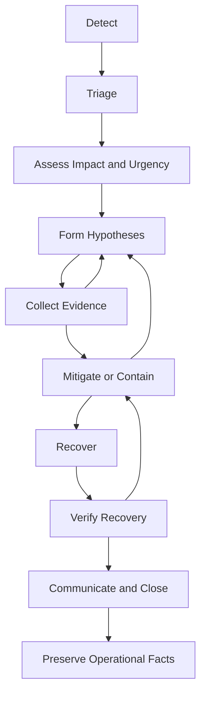
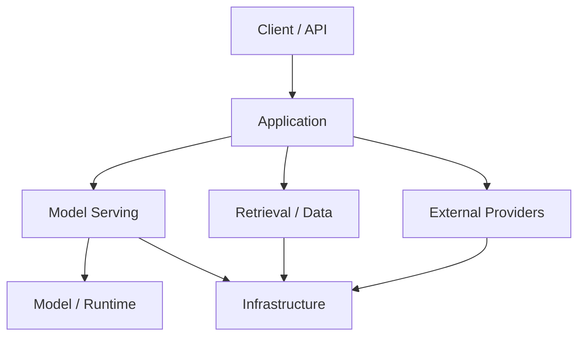
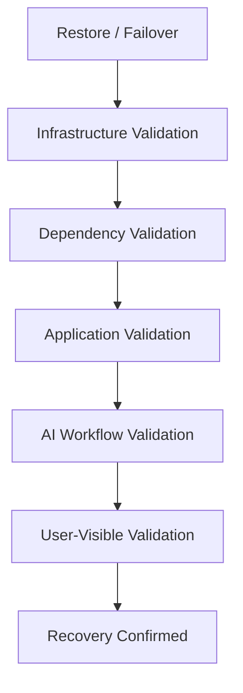

# PROD-10 — AI Incident Detection, Diagnosis, Recovery, and Disaster Readiness

## Learning Objectives

By the end of this chapter, you should be able to:

- Define what constitutes a production incident in an AI system.
- Distinguish an alert from an incident.
- Distinguish detection, triage, diagnosis, mitigation, recovery, and recovery verification.
- Assess incident impact, urgency, scope, and operational significance.
- Build a structured diagnosis process instead of guessing at causes.
- Form and test hypotheses using production evidence.
- Correlate symptoms with dependencies and recent changes.
- Select safe mitigation actions while diagnosis is still incomplete.
- Determine when escalation and coordinated response are required.
- Communicate clearly when incident information is incomplete or evolving.
- Reason about dependency, regional, data, model, configuration, and infrastructure failures.
- Understand disaster readiness, failover, backup/restore, continuity, RTO, and RPO.
- Evaluate whether a recovery capability has actually been proven.
- Validate that a recovered AI service is operational rather than merely reachable.
- Identify recovery assumptions, dependencies, sequencing, and limitations.
- Apply structured incident reasoning to AI-specific production failures.

---

## Prerequisites

You should already understand:

- Production operations and on-call readiness.
- Service ownership and operational responsibilities.
- Operational dependencies and support boundaries.
- Basic production observability concepts.
- Basic reliability concepts such as service degradation and dependency failure.
- The distinction between production operations and deployment/release engineering.

These concepts are introduced in earlier PROD chapters. This chapter focuses on **using operational information to respond to incidents and recover production systems**.

---

## Estimated Reading Time

**60–75 minutes**

---

## 1. Before We Start

A production AI system can fail in many different ways.

Sometimes the failure is obvious:

```text
API is returning 500 errors
```

Sometimes it is less obvious:

```text
Requests succeed
but latency has increased significantly
```

Sometimes the infrastructure appears healthy:

```text
CPU looks normal
GPU is available
database is reachable
```

yet users report:

```text
AI responses are suddenly poor
```

An operator therefore cannot treat incident response as:

> "Find the broken component."

The real problem is:

> **Determine what is happening, understand its impact, make the safest available intervention, restore service, and verify that the system has actually recovered.**

This requires structured reasoning under uncertainty.

---

# 2. Why Incident Management Exists

Production systems behave differently from development environments.

A development failure might mean:

```text
Developer notices
    ↓
Debug
    ↓
Fix
    ↓
Deploy
```

A production incident is different:

```text
Users are affected
        ↓
Time matters
        ↓
Evidence may be incomplete
        ↓
Multiple systems may be involved
        ↓
Changes may increase the damage
```

The operator therefore has two competing objectives:

1. **Understand the failure**
2. **Reduce user impact**

These objectives are related but are not identical.

A team may need to mitigate an incident before knowing its complete root cause.

That distinction is fundamental to production incident response.

---

# 3. Mental Model: Incident Response as a Controlled Reasoning Loop

A useful incident-response model is:



This diagram represents a reasoning model rather than a rigid procedure.

Real incidents are rarely perfectly linear.

For example:

```text
Detect
  ↓
Triage
  ↓
Hypothesis A
  ↓
Evidence disproves A
  ↓
Hypothesis B
  ↓
Mitigation
  ↓
Partial recovery
  ↓
New evidence
  ↓
Additional mitigation
  ↓
Recovery verification
```

The important principle is:

> **Incident response is an evidence-driven control loop, not a checklist that must always proceed in one direction.**

The stages have different purposes:

```text
Detection
Recognize abnormal or potentially harmful behavior.

Triage
Determine whether coordinated incident response is required and establish the initial impact.

Diagnosis
Determine what is causing or contributing to the problem.

Mitigation
Reduce current user or service impact.

Recovery
Restore the intended service state.

Recovery Verification
Prove that the service has actually recovered.

Closure
Confirm the incident is controlled and preserve the operational facts needed for later learning.
```

Detailed postmortem analysis and durable operational improvement belong to **File 03**.

---

# 4. What Is a Production Incident?

A **production incident** is an event or condition that causes, or has a credible risk of causing, unacceptable impact to a production service or its users and requires coordinated operational response.

The exact definition and severity criteria depend on organizational policy.

Examples include:

- sustained API failures
- severe latency degradation
- inability to generate AI responses
- widespread retrieval failures
- provider dependency outage
- model-serving failure
- unexpected resource exhaustion
- corrupted or unavailable production data
- regional infrastructure failure
- severe cost anomaly requiring intervention
- AI behavior that creates a significant operational impact

Not every unusual event is automatically an incident.

The operational question is:

> **Does this condition require coordinated response beyond normal service operation?**

---

## 5. Alert vs Incident

One of the most important distinctions in operations is:

```text
Alert ≠ Incident
```

An **alert** is a signal indicating that something may require attention.

An **incident** is a production condition requiring operational response because of actual or credible user/service impact.

For example:

```text
Alert:
Latency threshold exceeded for 5 minutes.

Possible outcomes:
    ↓
No meaningful user impact
    → investigate normally

OR

Significant user impact
    → incident response
```

Therefore:

> An alert is evidence that something may be wrong.  
> An incident is an operational situation that requires response.

This distinction prevents two common problems:

- treating every alert as a major incident
- ignoring real incidents because no alert fired

Detection may also originate from customer reports, support teams, engineers, or other operational sources even when an automated alert did not fire.

---

# 6. Detection

Incident detection is the recognition that production behavior may have moved outside acceptable operating conditions.

Detection may come from:

- automated alerts
- dashboards
- customer reports
- support teams
- engineers
- service owners
- dependency notifications
- operational checks
- unusual business behavior
- unexpected cost or usage behavior

For AI systems, useful detection signals may include:

```text
Request failures
Latency increases
Timeouts
Inference capacity problems
Provider failures
Retrieval failures
Unexpected token usage
Cost anomalies
AI quality degradation
Model-version-related behavior changes
```

Detailed telemetry architecture belongs to **PROD-05**.

This chapter focuses on how operators use available operational signals to recognize and respond to production incidents.

---

# 7. Triage

Triage is the process of quickly determining:

- what appears to be happening
- who or what is affected
- how significant the impact is
- how urgent the situation is
- whether the impact is increasing
- what immediate action may safely reduce impact
- who needs to be involved

Triage is **not full diagnosis**.

Its purpose is to establish enough understanding to make good early operational decisions.

A useful triage sequence is:

```text
What is happening?
        ↓
Who is affected?
        ↓
How large is the impact?
        ↓
How urgent is the situation?
        ↓
Is impact increasing?
        ↓
What changed recently?
        ↓
Which dependencies may be involved?
        ↓
What safe immediate action is available?
        ↓
Who needs to be engaged?
```

Triage therefore creates the initial decision frame for the incident.

---

# 8. Assessing Impact and Urgency

Incident response should be driven by **impact and urgency**, not technical curiosity.

Consider:

```text
5% of requests failing
```

versus:

```text
100% of requests failing
```

The underlying technical cause could be similar, but the operational response may be very different.

Impact assessment should consider:

### User impact

- number of affected users
- affected user segments
- critical workflows
- geographic scope
- request types

### Service impact

- availability
- latency
- functionality
- degraded quality
- dependency availability

### Business impact

- critical business operations
- financial impact
- contractual obligations
- customer commitments

### Duration and trajectory

- when the incident began
- current duration
- whether impact is increasing
- whether mitigation is working

### Urgency

Urgency considers how quickly action is required to prevent further impact or reduce existing harm.

Severity should therefore be treated as an **organizational classification based on the applicable impact, urgency, scope, business criticality, and organizational policy**, rather than as a universal mathematical calculation.

The key principle is:

> **Incident severity is a decision framework, not a formula that can be universally calculated.**

---

# 9. Incident Classification

Classification helps responders select the right investigation path.

An incident might primarily involve:

```text
Application
Model Serving
Model / Runtime
Retrieval / Data
External Provider
Infrastructure
Configuration / Change
Dependency
Capacity / Resource
Data Availability
```

The classification is provisional.

An incident initially classified as:

```text
Model serving failure
```

may later turn out to be:

```text
Database dependency failure
```

Therefore:

> **Classification should guide investigation, not lock the team into an early assumption.**

---

# 10. Diagnosis

Diagnosis answers:

> **Why is this happening?**

Diagnosis should be evidence-driven.

A weak approach is:

```text
AI is slow.
Probably the model.
Restart the model.
```

A stronger approach is:

```text
Observed:
Latency increased.

Hypothesis:
Inference latency increased.

Evidence needed:
Model-serving latency
Queue depth
Resource utilization
Model-load state
Recent changes

Result:
Inference latency is normal.

New hypothesis:
Retrieval dependency is slow.

Evidence:
Retrieval latency increased at the same time.

Conclusion:
Retrieval dependency is contributing to the incident.
```

The difference is disciplined reasoning.

---

# 11. Hypothesis-Driven Investigation

A practical diagnosis loop is:

```text
Symptom
   ↓
Hypothesis
   ↓
Expected evidence
   ↓
Collect evidence
   ↓
Compare expectation with reality
   ↓
Accept / reject / refine hypothesis
```

For example:

### Symptom

> AI responses became slow.

### Hypothesis A

The model inference path is slow.

### Expected evidence

- inference latency increased
- queueing increased
- resource contention increased
- model-serving behavior changed

### Evidence

Inference latency is normal.

### Conclusion

Reject or reduce confidence in Hypothesis A.

### Hypothesis B

Retrieval is slow.

### Evidence

Retrieval latency increased sharply.

### Conclusion

Hypothesis B becomes stronger.

This approach prevents operators from repeatedly applying random fixes.

---

# 12. Layered AI Incident Diagnosis

AI systems often span multiple layers.

A useful diagnostic model is:



When users report:

> "The AI response is slow."

Possible causes include:

- client/API behavior
- application processing
- queueing
- model serving
- model loading
- inference behavior
- GPU contention
- retrieval latency
- database latency
- external model-provider latency
- network problems
- downstream dependencies

The symptom alone does not identify the root cause.

Therefore:

> **Start from the symptom and systematically move through the dependency layers rather than guessing the component.**

---

# 13. Evidence Gathering

Good incident diagnosis depends on collecting evidence in a useful order.

Useful evidence may include:

- timeline
- affected request patterns
- error behavior
- latency behavior
- dependency status
- recent production changes
- model/configuration changes
- resource behavior
- external provider behavior
- affected regions
- affected workloads
- recovery behavior after mitigation

Evidence should answer a question.

Avoid collecting data simply because it is available.

A useful principle is:

> **Every diagnostic action should reduce uncertainty or test a hypothesis.**

This also helps protect responders from making unnecessary production changes merely to "see what happens."

---

## 14. Timeline Reconstruction

Time is one of the most valuable pieces of incident evidence.

Suppose:

```text
10:02 — latency normal
10:05 — model configuration changed
10:07 — latency begins increasing
10:09 — error rate increases
10:12 — customer reports arrive
```

The temporal relationship between events is important.

It does not prove causation.

But it creates a strong investigation path:

```text
What changed at 10:05?
Was the change applied successfully?
Did affected traffic receive it?
Did rollback or another mitigation alter the symptoms?
```

Therefore:

> **Correlation in time is evidence for investigation, not proof of root cause.**

---

# 15. Dependency Analysis

AI services rarely operate alone.

A simplified dependency chain might look like:

```text
Client
  ↓
AI API
  ↓
Application
  ↓
Retrieval Service
  ↓
Vector Database
  ↓
Model Provider
```

A failure in one dependency can appear as a failure of another layer.

For example:

```text
Vector database latency
        ↓
Retrieval latency
        ↓
Application latency
        ↓
AI API latency
        ↓
User reports "AI is slow"
```

The visible symptom appears at the API boundary.

The cause may be several layers deeper.

During diagnosis, ask:

> **Is the service broken, or is the service unable to reach something it depends on?**

This question often changes the investigation path.

---

# 16. Change Correlation

Recent changes are often important investigation clues.

Potential changes include:

- application configuration
- model version
- model configuration
- retrieval configuration
- infrastructure configuration
- dependency version
- traffic changes
- feature activation
- data changes

A useful investigation question is:

> **What changed shortly before the incident began?**

But responders should avoid assuming:

> "The most recent change caused the incident."

A recent change is a hypothesis source, not automatically the root cause.

Deployment and release engineering belong to **PROD-04**. This chapter focuses only on using production changes as diagnostic evidence.

---

## 17. Diagnosis vs Mitigation

These concepts must remain separate.

### Diagnosis

Determines:

> What is causing or contributing to the incident?

### Mitigation

Determines:

> What can we safely do now to reduce the impact?

You may know the mitigation without knowing the complete root cause.

Example:

```text
Problem:
Inference latency is extremely high.

Root cause:
Still uncertain.

Safe mitigation:
Route a portion of traffic to a healthy serving path.
```

The service may improve before the investigation is complete.

This is acceptable.

Production response prioritizes reducing harmful impact while preserving the ability to continue investigating.

---

# 18. Mitigation and Containment

**Mitigation** is an action intended to reduce current user or service impact.

**Containment** is a mitigation strategy that limits the spread, exposure, or severity of an incident.

For example:

```text
Bad behavior detected
        ↓
Identify affected traffic
        ↓
Limit exposure
        ↓
Protect healthy traffic
        ↓
Continue diagnosis
```

Possible mitigation or containment actions may include:

- reducing affected traffic
- disabling a problematic feature
- routing traffic away from a failing dependency
- switching to an available fallback
- reducing workload pressure
- isolating an unhealthy component
- reverting an unsafe operational state where appropriate

The specific mechanisms depend on the architecture.

Detailed mechanisms such as retries, backpressure, graceful degradation, and fallback design belong primarily to **PROD-06**.

Here the focus is:

> **Choosing and coordinating an operational response when those mechanisms are available.**

---

# 19. Mitigation Decision-Making

A mitigation should be evaluated before execution.

Ask:

```text
Will this reduce impact?
What could it break?
How reversible is it?
How quickly can we verify the result?
Could it affect more users?
Could it destroy useful diagnostic evidence?
Who needs to approve it?
```

This leads to an important production principle:

> **A fast action is not automatically a good action.**

An intervention that reduces latency but causes data corruption may make the incident substantially worse.

A good mitigation should therefore be evaluated for:

```text
Expected benefit
+
Blast radius
+
Reversibility
+
Verification speed
+
Operational authority
```

---

# 20. Service Restoration

Recovery begins when the team moves from reducing impact toward restoring normal or explicitly acceptable service behavior.

A useful distinction is:

```text
Mitigation
Reduce current impact.

Recovery
Restore the intended service state.

Recovery Verification
Prove that the service has actually recovered.
```

These are not interchangeable.

For example:

```text
Error rate falls
```

does not automatically mean:

```text
Service recovered.
```

The improvement could be temporary, partial, or caused by a degraded operating mode.

---

# 21. Recovery States

It is useful to distinguish several operational states:

```text
Normal
  ↓
Incident
  ↓
Mitigated
  ↓
Recovering
  ↓
Recovered
  ↓
Normal Operating State
```

### Mitigated

User impact has been reduced, but the underlying system may still be operating under emergency conditions.

### Recovering

Restoration actions are underway and the system is being returned to its intended operating state.

### Recovered

The required service behavior has been restored and validated.

### Normal operating state

Temporary emergency controls have been removed or the service has otherwise returned to its intended operating configuration.

This distinction matters because:

> **A system can be mitigated without being fully recovered.**

---

# 22. Recovery Verification

Recovery must be verified using evidence.

Verification may consider:

- error behavior
- latency
- request success
- affected user workflows
- dependency health
- model-serving behavior
- retrieval behavior
- resource state
- regional health
- business-critical functionality

The exact verification criteria depend on the service.

A strong recovery sequence is:

```text
Apply recovery action
        ↓
Observe system behavior
        ↓
Validate critical functions
        ↓
Confirm dependency health
        ↓
Confirm user impact has ended
        ↓
Remove or normalize temporary mitigation where appropriate
        ↓
Continue monitoring
```

The key principle is:

> **Do not confuse "the system is responding" with "the system has recovered."**

---

# 23. Recovery Is Not Complete Until the User-Visible Problem Is Resolved

Consider:

```text
API returns HTTP 200
```

but:

```text
retrieval is returning empty context
```

The infrastructure may appear healthy while the AI feature remains functionally broken.

Therefore recovery verification must consider the service contract, not merely infrastructure availability.

For AI systems this may include:

```text
Request succeeds
    +
Expected AI workflow executes
    +
Required dependencies work
    +
Expected output path is functioning
    +
User-visible impact is resolved
```

Recovery should also confirm that emergency mitigation has not left the service in an unintended degraded state.

For example:

```text
Traffic reduced
        ↓
Latency normal
        ↓
But 30% of normal capacity remains disabled
```

This is not necessarily full recovery.

The team must determine whether the remaining degraded state is acceptable or whether additional restoration is required.

---

# 24. Escalation

Escalation means involving the people or teams required to resolve the incident.

Escalation may be necessary when:

- the issue exceeds the current team's authority
- a dependency is owned by another team
- impact exceeds an agreed threshold
- specialized expertise is required
- recovery requires privileged access
- the incident is growing
- recovery decisions have significant risk

Escalation should not mean:

> "We don't know what is happening, so ask someone else."

Good escalation includes useful context:

```text
Current impact
What changed
What has been investigated
What evidence exists
Current hypotheses
Actions already taken
Current state
What help is needed
```

This allows the next team to start from evidence rather than repeating the same investigation.

---

# 25. Incident Communication

Incident communication has two objectives:

1. coordinate responders
2. keep relevant stakeholders informed

During incidents, information is often incomplete.

Therefore communication should distinguish:

```text
Known
Suspected
Unknown
Action in progress
Next decision point
```

For example:

```text
Known:
API latency has increased significantly.

Suspected:
Retrieval dependency may be contributing.

Unknown:
Root cause has not yet been confirmed.

Action:
Traffic is being reduced on the affected path.

Next:
Validate latency and retrieval behavior after mitigation.
```

This is better than communicating uncertain hypotheses as established facts.

---

# 26. Incident Coordination

As incidents become larger, coordination becomes increasingly important.

Responders may need to divide responsibilities:

```text
Incident coordination
        ↓
Diagnosis
        ↓
Mitigation / recovery
        ↓
Communication
        ↓
Dependency coordination
```

The exact organizational model varies by company.

The engineering principle remains:

> **Separate technical investigation from coordination when incident complexity requires it.**

Otherwise the same person may simultaneously attempt to:

- investigate
- make infrastructure changes
- communicate
- coordinate other teams
- document the timeline

This increases cognitive load and can reduce response quality.

---

# 27. Dependency Failure

A dependency failure may appear as a failure of the AI service itself.

For example:

```text
External provider outage
        ↓
Model requests fail
        ↓
Application errors increase
        ↓
Users report AI unavailable
```

Or:

```text
Database degradation
        ↓
Retrieval slows
        ↓
Application latency increases
        ↓
AI responses become slow
```

During diagnosis, ask:

```text
Is the service broken?
Or is the service unable to reach something it depends on?
```

This question often changes the investigation path.

---

# 28. Large-Scale and Regional Failures

Some incidents exceed the scope of a single service instance.

Examples include:

- regional infrastructure failure
- widespread dependency outage
- major network failure
- unavailable data systems
- loss of a model-serving environment
- configuration corruption affecting many services

At this point, incident response may become a recovery and continuity problem.

The team must reason about:

```text
What is still available?
What has been lost?
What can be restored?
What dependencies are required?
In what order?
How will recovery be validated?
```

This is where disaster readiness becomes important.

---

# 29. Disaster Readiness

Disaster readiness asks:

> **Can the organization recover the service when a failure exceeds normal incident-handling assumptions?**

A disaster may involve:

- infrastructure loss
- region loss
- critical dependency loss
- data availability problems
- configuration loss
- model artifact loss
- multiple simultaneous failures

Disaster readiness is therefore broader than ordinary incident response.

A useful model is:

```text
Normal Incident
    ↓
Service-level failure
    ↓
Mitigation / Recovery

Large Failure
    ↓
Broader system or dependency loss
    ↓
Continuity Decision
    ↓
Failover / Restore
    ↓
Recovery Validation
```

---

# 30. Failure Scope and Recovery Assumptions

Before initiating disaster recovery, determine the scope of failure.

Ask:

```text
What failed?

Service?
Dependency?
Region?
Data?
Configuration?
Model artifact?
Infrastructure?
Multiple layers?
```

Then ask:

```text
What remains available?
```

Recovery planning must also make its assumptions explicit.

Examples:

```text
Assumption:
Secondary region is available.

Assumption:
Required model artifacts are replicated.

Assumption:
Required credentials or access can be established.

Assumption:
Required data is within the defined RPO.

Assumption:
Operators can access the recovery environment.

Assumption:
External dependencies remain available.
```

These assumptions are operational dependencies.

If an assumption is false, the recovery plan may fail even when the documented procedure is executed correctly.

Therefore:

> **A recovery plan should make its assumptions visible and testable rather than treating them as facts.**

---

# 31. Recovery Dependencies and Sequencing

Recovery itself may have dependencies.

Suppose:

```text
Application
    ↓
Database
    ↓
Configuration
    ↓
Model artifact
```

Restoring the application first may not be useful if its dependencies are unavailable.

A recovery plan therefore needs to understand:

```text
Recovery dependency
        ↓
Required restoration order
        ↓
Validation
        ↓
Next restoration step
```

This is why disaster recovery should not be treated as:

> "Start the backup environment."

The real question is:

> **Can the system be restored into a functionally usable state?**

---

# 32. Backup and Restore

Backups are only useful if they can support successful recovery.

A backup may exist while recovery still fails because:

- backup is incomplete
- backup is corrupted
- restore procedure is undocumented
- dependencies are missing
- credentials/configuration are unavailable
- restore takes too long
- restored data is inconsistent
- the application cannot use the restored state

Therefore:

> **A backup that has never been restored successfully should not be treated as proven recovery capability.**

Backup readiness should consider:

```text
Backup exists
    ↓
Backup integrity understood
    ↓
Restore procedure exists
    ↓
Restore has been tested
    ↓
Recovered state is usable
    ↓
Recovery time is understood
```

---

# 33. Failover

Failover means moving service operation from a failed or impaired environment to an alternative environment.

Conceptually:

```text
Primary
   ↓
Failure
   ↓
Failover decision
   ↓
Secondary
   ↓
Recovery validation
```

Failover is not automatically successful simply because traffic can be redirected.

The secondary environment may have:

- stale data
- missing configuration
- insufficient capacity
- incompatible model artifacts
- unavailable dependencies
- incorrect permissions
- incomplete operational context

Therefore failover must include validation.

---

# 34. Failback

After the original environment becomes available, the team may eventually return operations to it.

This is called **failback**.

Failback introduces its own risks:

```text
Secondary is healthy
        ↓
Primary becomes available
        ↓
Failback decision
        ↓
Data/state synchronization
        ↓
Traffic transition
        ↓
Validation
```

A recovery plan that considers failover but ignores failback may leave the organization in an uncertain operational state.

---

# 35. RTO and RPO

Two important disaster-readiness concepts are:

### RTO — Recovery Time Objective

The target amount of time within which a service should be restored after a disruptive failure.

Example:

```text
RTO = 60 minutes
```

means the recovery target is approximately one hour.

### RPO — Recovery Point Objective

The acceptable amount of recent data loss measured in time.

Example:

```text
RPO = 15 minutes
```

means the organization accepts the possibility of losing up to approximately 15 minutes of recent data, depending on the recovery design.

These are **recovery objectives**, not guarantees.

There is an important distinction:

```text
RTO / RPO
     ↓
Target objectives

Recovery testing
     ↓
Evidence about actual capability
```

An organization may define:

```text
RTO: 30 minutes
RPO: 5 minutes
```

but still fail to meet those objectives if recovery capability has not been tested.

---

# 36. RTO/RPO Trade-offs

Better recovery characteristics generally require engineering investment.

For example:

```text
Faster recovery
    ↓
More infrastructure
More automation
More redundancy
More testing
Higher operational cost
```

Similarly:

```text
Lower RPO
    ↓
More frequent replication/backups
More storage/network cost
More complexity
More testing
```

Therefore recovery objectives should reflect business requirements rather than arbitrary technical preferences.

---

# 37. Recovery Validation

A disaster recovery exercise should not end with:

```text
Environment started successfully.
```

It should answer:

```text
Can users actually use the service?
Are required dependencies available?
Is required data present?
Are model artifacts available?
Is configuration correct?
Does the AI workflow function?
Are critical integrations working?
Is the recovered system operating within acceptable limits?
```

A useful validation chain is:



Recovery is therefore a **functional validation problem**, not merely an infrastructure startup problem.

---

# 38. Disaster Recovery Drills

A recovery plan that exists only in documentation is an assumption.

Exercises help reveal:

- missing dependencies
- incorrect procedures
- stale documentation
- insufficient permissions
- unexpected recovery duration
- incomplete backups
- configuration gaps
- model artifact problems
- unclear ownership
- communication failures

The objective is not merely to prove that recovery works.

It is to discover where the recovery model is wrong.

A useful drill should therefore capture:

```text
Expected recovery behavior
        ↓
Observed recovery behavior
        ↓
Gap
        ↓
Operational fact to preserve
```

Detailed postmortem analysis and corrective-action ownership belong to **File 03**.

---

# 39. Recovery Limitations

No recovery design is perfect.

Possible limitations include:

- dependency unavailable during recovery
- incomplete backups
- recovery time longer than expected
- inconsistent data
- missing configuration
- unavailable model artifacts
- insufficient secondary capacity
- operational knowledge concentrated in one person
- recovery procedure dependent on the failed environment

Good disaster readiness explicitly documents:

```text
Assumptions
Dependencies
Known limitations
Recovery sequencing
Validation requirements
```

This allows responders to understand not only **how** recovery is expected to work, but also **where it may fail**.

---

# 40. AI-Specific Incident Scenarios

## Scenario 1 — Model Provider Latency

```text
Symptom:
AI requests are increasingly slow.

Investigation:
Application latency increased.
Retrieval latency is normal.
Model-provider latency increased.

Hypothesis:
External model provider is contributing to the incident.

Response:
Escalate provider dependency issue.
Apply available operational mitigation.
Monitor recovery.

Verification:
Confirm user-visible latency has returned to acceptable behavior.
```

The important lesson:

> Do not assume the application is responsible for every application-level symptom.

---

## Scenario 2 — Retrieval Failure

```text
Symptom:
AI responses are completing successfully but contain poor or missing context.

Investigation:
Model serving is healthy.
Retrieval requests are failing.

Hypothesis:
Retrieval dependency is causing functional degradation.

Response:
Investigate retrieval path.
Protect affected workflows where possible.
Escalate dependency ownership if necessary.

Verification:
Confirm retrieval succeeds and user-visible behavior is restored.
```

This demonstrates why HTTP success does not necessarily mean functional recovery.

---

## Scenario 3 — Model Configuration Change

```text
Symptom:
Latency and resource usage increase after a model configuration change.

Investigation:
Timeline shows the behavior began shortly after the change.
Affected traffic received the new configuration.

Hypothesis:
Configuration change contributed to the incident.

Response:
Apply the safest available mitigation.

Verification:
Confirm latency and resource behavior return to expected operating conditions.
```

The change is evidence.

It is not automatically proof.

---

## Scenario 4 — Regional Failure

```text
Symptom:
Primary production region becomes unavailable.

Investigation:
Failure scope exceeds normal service recovery.

Decision:
Activate continuity/recovery process.

Actions:
Fail over to the available recovery environment.
Restore or synchronize required state.
Validate dependencies.
Validate application.
Validate AI workflow.

Verification:
Confirm the user-visible service is functioning.
```

The important lesson:

> Disaster recovery is not complete when infrastructure is available; it is complete when the required service capability has been restored and validated.

---

# 41. Production Incident Decision Framework

During an incident, responders can use this reasoning sequence:

```text
1. What is the symptom?
2. What is the user impact?
3. How large is the impact?
4. How urgent is the situation?
5. Is the impact increasing?
6. What changed?
7. Which dependencies are involved?
8. What hypotheses explain the evidence?
9. What evidence can confirm or reject them?
10. What can safely reduce impact now?
11. What recovery action is required?
12. How will recovery be verified?
13. Who must be involved?
14. What should be communicated?
15. What remains unknown?
```

This creates a repeatable reasoning pattern without forcing every incident into the same technical procedure.

---

# 42. Operational Trade-offs

Incident response involves difficult decisions.

## Fast Mitigation vs Perfect Diagnosis

Waiting for complete diagnosis may prolong user impact.

But acting without evidence may worsen the incident.

The practical goal is often:

> **Reduce harmful impact while continuing diagnosis.**

---

## Automation vs Operator Control

Automation can accelerate response.

But automated recovery can create additional failures if the trigger is wrong.

The trade-off is:

```text
Automation
    ↕
Speed vs control
```

The correct balance depends on the failure mode and consequences of an incorrect action.

---

## Detailed Procedures vs Maintainability

Extremely detailed procedures may become difficult to maintain.

Minimal procedures may leave operators without enough guidance.

A useful operational procedure should provide enough information to support reliable decisions without becoming an unmaintainable manual.

Detailed runbook design belongs to **File 03**.

---

## Recovery Speed vs Completeness

A fast recovery may restore service while leaving secondary issues unresolved.

A complete recovery may take longer.

Operators must understand:

```text
What must be restored immediately?
What can be repaired later?
What conditions are required before declaring recovery?
```

---

## Redundancy vs Cost

Additional recovery environments improve resilience but increase:

- infrastructure cost
- operational complexity
- synchronization requirements
- testing requirements

The correct level depends on business recovery requirements.

---

## Communication Speed vs Information Certainty

Stakeholders need timely information.

But incident responders may not yet know the root cause.

Therefore communicate:

```text
Known
Suspected
Unknown
Next action
```

rather than waiting for perfect certainty.

---

# 43. Common Mistakes and Misconceptions

## Mistake 1 — Treating Every Alert as an Incident

An alert is a signal.

An incident is an operational condition requiring response.

---

## Mistake 2 — Jumping Directly to the Suspected Root Cause

Example:

> "The model is slow, so the model must be broken."

This ignores dependencies and evidence.

---

## Mistake 3 — Confusing Diagnosis with Mitigation

You can mitigate before knowing the complete root cause.

---

## Mistake 4 — Declaring Recovery Too Early

A service may respond while the user-visible failure remains.

---

## Mistake 5 — Confusing Mitigation with Recovery

A temporary traffic reduction or feature disablement may reduce impact without restoring the intended service state.

---

## Mistake 6 — Treating Correlation as Causation

A change occurring immediately before an incident is useful evidence, but not automatic proof.

---

## Mistake 7 — Restarting Components Without Understanding Impact

A restart may:

- destroy useful evidence
- interrupt healthy traffic
- create additional failures
- hide the original problem

Every intervention should have a reason.

---

## Mistake 8 — Assuming a Backup Equals Recovery

A backup is not proven recovery capability until restoration has been tested and validated.

---

## Mistake 9 — Treating Failover as Automatically Successful

Traffic can move to a secondary environment while the AI workflow remains broken.

---

## Mistake 10 — Communicating Hypotheses as Facts

This creates confusion and causes teams to optimize around incorrect assumptions.

---

## Mistake 11 — Escalating Without Context

"Database is broken" is weak escalation.

A better escalation provides:

```text
Impact
Timeline
Evidence
Hypotheses
Actions taken
Current state
Specific help required
```

---

# 44. Interview Questions with Expected Answers

## Question 1

**What is the difference between an alert and an incident?**

### Expected Answer

An alert is a signal indicating that something may require attention. An incident is a production condition requiring coordinated operational response because of actual or credible service or user impact.

---

## Question 2

**Why should diagnosis be hypothesis-driven?**

### Expected Answer

Because production symptoms are often ambiguous. Hypothesis-driven investigation turns assumptions into testable claims and prevents responders from randomly changing components.

---

## Question 3

**An AI API is slow. How would you investigate it?**

### Expected Answer

Start with impact and timeline, then investigate the request path across application, model serving, model/runtime, retrieval/data, external providers, and infrastructure. Compare latency and behavior across layers, correlate recent changes, form hypotheses, and collect evidence to accept or reject them.

---

## Question 4

**Can you mitigate an incident before knowing the root cause?**

### Expected Answer

Yes. If a safe action can reduce user impact, mitigation may be appropriate before complete root-cause confirmation. Diagnosis should continue in parallel.

---

## Question 5

**What is the difference between mitigation and recovery?**

### Expected Answer

Mitigation reduces current impact, while recovery restores the intended service state. A system can be successfully mitigated while still operating in a degraded or emergency state.

---

## Question 6

**How do you know an incident has recovered?**

### Expected Answer

Recovery requires evidence that the user-visible problem has been resolved and that critical service paths and dependencies are functioning. Infrastructure health alone is insufficient.

---

## Question 7

**What is the difference between RTO and RPO?**

### Expected Answer

RTO describes the target time for restoring service after a disruptive failure. RPO describes the acceptable amount of recent data loss measured in time.

---

## Question 8

**Why is a tested restore more valuable than an untested backup?**

### Expected Answer

Because backup existence does not prove that restoration is possible within the required conditions. Restore testing reveals corruption, missing dependencies, incorrect procedures, access problems, and actual recovery time.

---

## Question 9

**Why is a recent deployment not automatically the root cause?**

### Expected Answer

Temporal correlation does not prove causation. The deployment should become an investigation hypothesis and be tested against evidence.

---

## Question 10

**What is the difference between incident recovery and disaster recovery?**

### Expected Answer

Incident recovery handles production failures within normal operational assumptions. Disaster recovery addresses larger failures that may require continuity mechanisms such as failover, restore, regional recovery, or broader recovery sequencing.

---

## Question 11

**What should an incident escalation contain?**

### Expected Answer

It should contain current impact, timeline, evidence collected, hypotheses, actions already taken, current state, and the specific assistance required.

---

## Question 12

**Why is "traffic is successfully routed to the secondary region" insufficient to declare disaster recovery successful?**

### Expected Answer

Because traffic movement only proves that routing changed. The secondary environment must also have the required data, configuration, model artifacts, dependencies, application functionality, and user-visible AI workflow working within acceptable conditions.

---

## 45. Quick Revision

### Incident response

```text
Detect
  ↓
Triage
  ↓
Assess Impact and Urgency
  ↓
Form Hypotheses
  ↓
Collect Evidence
  ↓
Mitigate / Contain
  ↓
Recover
  ↓
Verify Recovery
  ↓
Communicate / Close
  ↓
Preserve Operational Facts
```

### Core distinctions

```text
Alert
    ≠
Incident

Detection
    ≠
Triage

Triage
    ≠
Diagnosis

Diagnosis
    ≠
Mitigation

Mitigation
    ≠
Recovery

Recovery
    ≠
Recovery Verification

Backup
    ≠
Proven Recovery

Failover
    ≠
Successful Service Recovery
```

### AI diagnosis layers

```text
Client / API
     ↓
Application
     ↓
Model Serving
     ↓
Model / Runtime
     ↓
Retrieval / Data
     ↓
External Providers
     ↓
Infrastructure
```

### Recovery states

```text
Normal
  ↓
Incident
  ↓
Mitigated
  ↓
Recovering
  ↓
Recovered
  ↓
Normal Operating State
```

### Disaster readiness

```text
Failure Scope
      ↓
Recovery Assumptions
      ↓
Recovery Dependencies
      ↓
Recovery Sequencing
      ↓
Restore / Failover
      ↓
Functional Validation
      ↓
Recovery Confirmed
```

---

# 46. Key Takeaways

1. Incident response is structured reasoning under uncertainty.
2. An alert is a signal; an incident requires operational response.
3. Detection recognizes abnormal behavior; triage establishes impact, urgency, and the initial response frame.
4. Diagnosis determines what is causing or contributing to the problem.
5. AI symptoms can originate from multiple architectural layers.
6. Recent changes provide investigation clues but do not automatically prove causation.
7. Diagnosis and mitigation are different activities.
8. Safe mitigation may happen before complete root-cause confirmation.
9. Containment is a form of mitigation that limits incident exposure or impact.
10. A mitigated system is not necessarily a recovered system.
11. Recovery must be verified using user-visible and functional evidence.
12. Emergency mitigation should not be mistaken for normal operating state.
13. Incident escalation should transfer context, not merely report failure.
14. Disaster readiness addresses failures beyond normal incident assumptions.
15. Recovery plans depend on explicit assumptions, dependencies, and sequencing.
16. Backup capability is not proven until restoration has been successfully tested.
17. Failover must include validation of dependencies and user-visible functionality.
18. RTO and RPO are recovery objectives, not guarantees of actual recovery performance.
19. Recovery drills provide evidence about real recovery capability.
20. Incident closure should preserve operational facts; detailed postmortem analysis and durable improvement belong to File 03.

---

## 47. Chapter Completion Check

Before considering this chapter complete, you should be able to explain:

### Incident Understanding

- What is a production incident?
- How is an alert different from an incident?
- What is the difference between detection and triage?
- How should impact and urgency be assessed?

### Diagnosis

- How do you investigate an ambiguous AI production symptom?
- Why is hypothesis-driven diagnosis better than guessing?
- How do you use timeline and dependency evidence?
- How do you distinguish correlation from causation?

### Response

- What is the difference between diagnosis, mitigation, and recovery?
- How is containment related to mitigation?
- When is mitigation appropriate before root cause is known?
- How should escalation and communication work?

### Recovery

- What distinguishes a mitigated state from a recovered state?
- How do you verify recovery?
- Why is infrastructure health insufficient?
- How should dependency recovery be validated?
- How do you know whether temporary emergency controls have been safely removed or normalized?

### Disaster Readiness

- What makes a failure a disaster-recovery problem?
- What assumptions does the recovery plan depend on?
- What are RTO and RPO?
- Why must backups be tested?
- What must be validated after failover?
- Why is traffic redirection alone insufficient to prove recovery?
- What limitations should recovery plans document?

If you can answer these questions clearly and reason through an unfamiliar AI incident without immediately jumping to a solution, you have developed the core operational reasoning this chapter is designed to teach.

---

## Further Reading

For this chapter, prioritize:

- your organization's incident-management policy
- service ownership and escalation documentation
- production recovery procedures
- disaster recovery plans
- backup and restore procedures
- internal incident postmortems
- service-specific operational documentation
- recovery exercise reports

External references should supplement, not replace, the organization's own operational procedures.

---

## Boundary with the Rest of PROD-10

This chapter owns:

> **Detecting, diagnosing, responding to, mitigating, recovering from, and validating production AI incidents and larger operational failures.**

It does not own:

- detailed observability architecture — **PROD-05**
- reliability mechanisms such as timeout/retry/backpressure/fallback design — **PROD-06**
- capacity planning and scaling design — **PROD-07**
- deployment and release engineering — **PROD-04**
- production security controls — **PROD-09**
- AI/model lifecycle qualification — **PROD-11**
- end-to-end production readiness assessment — **PROD-12**
- agent-specific failure and recovery behavior — **AGT-11**

The progression within PROD-10 is:

```text
File 01
Prepare the team and system for responsible operation.
                    ↓
File 02
Respond to incidents and recover production service.
                    ↓
File 03
Analyze operational facts, conduct postmortems, and convert learning into durable improvement.
```

The central operational question is:

> **When production behaves unexpectedly, can the team reason effectively, reduce impact, restore service, and prove that recovery actually occurred?**
