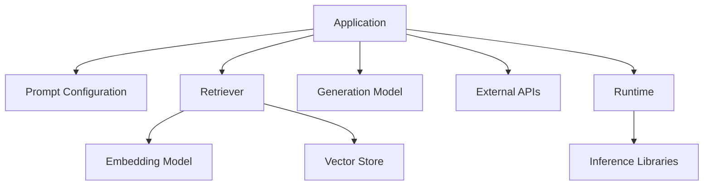

# AI Model, Application, and Configuration Lifecycle

## Learning Objectives

By the end of this chapter, you should be able to:

- Explain why production AI requires lifecycle management rather than treating deployment as the end of engineering work.
- Distinguish the lifecycle of an AI model, application, configuration, dependency, and infrastructure/runtime environment.
- Classify common AI changes and understand why different change types have different risk profiles.
- Explain versioning and why an AI production state must be identifiable, traceable, and sufficiently reproducible for its intended purpose.
- Describe lifecycle states from build through validation, qualification, production operation, improvement, and retirement.
- Analyze dependencies and coupling between models, applications, prompts, retrieval systems, external services, and runtime components.
- Perform basic change-impact analysis before modifying a production AI system.
- Explain compatibility concerns across AI system components.
- Understand controlled promotion without turning this chapter into a deployment-engineering chapter.
- Explain deprecation and retirement as lifecycle activities.
- Understand lifecycle-level rollback considerations and why not every AI change is perfectly reversible.
- Identify the information required to reconstruct the relevant AI system state at a point in time.

---

## Prerequisites

You should already understand:

- Basic software development and version control concepts.
- The distinction between source code, configuration, dependencies, and runtime environments.
- Basic ML concepts such as models, inference, training, and evaluation.
- Basic API and service architecture.
- The difference between development, validation/testing, and production environments.
- Basic concepts of AI applications such as LLM applications, RAG systems, prompts, tools, and model providers.

Related topics in this curriculum include:

- **PROD-04 — AI Deployment and Release Engineering**
- **PROD-05 — AI Observability and Telemetry**
- **PROD-06 — AI Reliability and Resilience Engineering**
- **PROD-08 — AI Performance and Cost Engineering**
- **PROD-11 — AI Lifecycle, Evaluation and Continuous Improvement**

Repository paths for neighboring chapters should be established from the actual repository structure rather than inferred from chapter names.

---

## Estimated Reading Time

**45–60 minutes**

---

## Before We Start

A common mental model is:

```text
Train Model
    ↓
Deploy Model
    ↓
Done
```

That model is insufficient for production AI.

A production AI system can change even when the model itself does not.

For example:

```text
Prompt changes
Retrieval changes
Configuration changes
Dependency upgrades
Application code changes
Model provider changes
Embedding model changes
Runtime changes
Infrastructure changes
```

Any of these may alter production behavior.

A more accurate model is:

```text
                    ┌───────────────┐
                    │     Build     │
                    └───────┬───────┘
                            ↓
                    ┌───────────────┐
                    │    Validate   │
                    └───────┬───────┘
                            ↓
                    ┌───────────────┐
                    │   Qualify     │
                    └───────┬───────┘
                            ↓
                    ┌────────────────────────┐
                    │ Release / Production-   │
                    │ Eligible                │
                    └────────────┬───────────┘
                                 ↓
                    ┌───────────────┐
                    │    Operate    │
                    └───────┬───────┘
                            ↓
                    ┌───────────────┐
                    │    Evaluate   │
                    └───────┬───────┘
                            ↓
                    ┌───────────────┐
                    │    Improve    │
                    └───────┬───────┘
                            ↓
                    ┌───────────────┐
                    │    Retire     │
                    └───────────────┘
```

In this chapter, **Release** refers to lifecycle progression into a production-eligible state. It does **not** describe deployment execution, CI/CD mechanics, progressive delivery, or deployment rollback. Those concerns belong to PROD-04.

The important idea is not the exact number of states.

The important idea is:

> **A production AI system is a continuously evolving system whose state must remain understandable, traceable, and controllable.**

---

# 1. Why AI Systems Need Lifecycle Management

Traditional software already requires lifecycle management.

AI systems add another layer of complexity because behavior is influenced by more than application code.

Consider an AI application:

```text
User
  ↓
API
  ↓
Application
  ↓
Prompt / Configuration
  ↓
Retriever
  ↓
Embedding Model
  ↓
Vector Database
  ↓
LLM
  ↓
Post-processing
  ↓
Response
```

Changing any significant component can change the final result.

For example:

```text
Application Version:      v3.4
Prompt Version:           v7
LLM:                      Model-A
Embedding Model:          Embed-X
Retriever Configuration:  top_k=8
Dependency Set:           D2026-10
Runtime Image:            R42
```

This combination represents a particular **AI system state**.

Now imagine changing only:

```text
top_k = 8
```

to:

```text
top_k = 20
```

The application code may remain unchanged.

The model may remain unchanged.

Yet the retrieved context may change, which can change:

- context length,
- evidence presented to the model,
- answer relevance,
- latency,
- token consumption,
- grounding behavior,
- final output.

Therefore:

> **Lifecycle management must track the system state, not only the model artifact.**

---

# 2. What Is an AI System Lifecycle?

An AI lifecycle is the sequence of controlled states through which an AI system or one of its components passes during its useful existence.

A simplified lifecycle is:

```text
Build
  ↓
Validate
  ↓
Qualify
  ↓
Release / Production-Eligible
  ↓
Operate
  ↓
Evaluate
  ↓
Improve
  ↓
Retire
```

These states should not be interpreted as rigid universal stages.

Different organizations may use different terminology.

The engineering principle is that a change should have:

- an identifiable state,
- an identifiable version,
- identifiable dependencies,
- known ownership,
- sufficient evidence for progression,
- traceability to the resulting production state.

### Release in the context of this chapter

Here, **Release** represents the lifecycle decision that a version has progressed far enough to be considered production-eligible.

It does not define how that version is physically introduced into production.

For example:

```text
Candidate
    ↓
Validated
    ↓
Qualified
    ↓
Release / Production-Eligible
```

The mechanics of deployment, artifact promotion, progressive delivery, and deployment rollback are outside this chapter and belong to PROD-04.

---

# 3. The Five Change Categories

One of the most important skills in AI lifecycle engineering is recognizing that **not every change is a model change**.

A useful classification is:

```text
┌─────────────────────────┐
│      Model Change       │
└────────────┬────────────┘
             │
┌────────────▼────────────┐
│    Application Change   │
└────────────┬────────────┘
             │
┌────────────▼────────────┐
│  Configuration Change   │
└────────────┬────────────┘
             │
┌────────────▼────────────┐
│   Dependency Change     │
└────────────┬────────────┘
             │
┌────────────▼────────────┐
│ Infrastructure/Runtime  │
│         Change          │
└─────────────────────────┘
```

These categories can overlap.

For example, upgrading an inference library may require application changes because an API changed.

The purpose of the classification is not bureaucratic labeling.

It is to answer:

> **What changed, what could that change affect, and what must remain compatible?**

---

# 4. Model Lifecycle

A model has its own lifecycle.

A simplified model lifecycle might look like:

```text
Candidate Model
      ↓
Model Validation
      ↓
Model Qualification
      ↓
Production Version
      ↓
Active Production Use
      ↓
Replacement Candidate
      ↓
Deprecated
      ↓
Retired
```

A model version might be represented conceptually as:

```text
Model:
    name = assistant-model

Version:
    2026.11.12

Artifact:
    immutable model artifact

Metadata:
    training/evaluation reference
    tokenizer
    expected input/output contract
    runtime requirements
    known limitations
```

The exact metadata depends on the organization and model type.

The important principle is that a production model should not be identified only by a human-readable name.

For example:

```text
"assistant-model"
```

is usually insufficient.

A stronger reference identifies the specific version or immutable artifact.

---

## 4.1 Why Model Names Are Not Enough

Suppose a service configuration contains:

```text
MODEL=assistant-model
```

A week later, the provider changes what that alias points to.

Your application configuration appears unchanged.

Your model behavior may have changed.

This creates a traceability problem.

A stronger lifecycle design attempts to answer:

```text
Which model?
Which version?
Which provider/runtime?
Which configuration?
When?
For which environment?
```

This does not mean every system must always pin every external dependency forever.

It means that production systems should make intentionality and traceability possible.

---

# 5. Application Lifecycle

The AI application itself has a lifecycle independent of the model.

For example:

```text
Application v1
      ↓
Application v2
      ↓
Application v3
```

An application version may change:

- API behavior,
- prompt construction,
- retrieval orchestration,
- tool invocation,
- post-processing,
- validation,
- error handling,
- response formatting,
- business logic.

Consider:

```python
def build_prompt(question, context):
    return f"""
    Answer the question using the following context:

    {context}

    Question:
    {question}
    """
```

A later version might change the instruction:

```python
def build_prompt(question, context):
    return f"""
    Answer only from the supplied context.
    If the answer is not supported, say that the information
    is unavailable.

    Context:
    {context}

    Question:
    {question}
    """
```

The model has not changed.

The application has changed.

The resulting behavior may still change significantly.

Therefore:

> **Application versioning is part of AI lifecycle management.**

---

# 6. Configuration Lifecycle

Configuration is often underestimated because it may not look like executable code.

In AI systems, configuration can directly influence behavior.

Examples include:

```text
temperature
max_output_tokens
top_p
system instructions
prompt templates
retrieval top_k
similarity thresholds
metadata filters
reranking settings
tool availability
feature flags
fallback model
safety configuration
routing configuration
```

A configuration change may therefore be behaviorally significant.

For example:

```text
Retriever:
    top_k = 5
```

becomes:

```text
Retriever:
    top_k = 15
```

This may cause:

```text
More candidates
      ↓
More context
      ↓
Different context composition
      ↓
Different model behavior
      ↓
Different answer quality
```

The configuration itself therefore deserves lifecycle discipline.

---

## 6.1 Independently Mutable Configuration

An important distinction is whether configuration changes independently from application code.

Consider:

```text
Application v10
Configuration v4
```

If configuration can be changed without changing the application artifact, then configuration needs its own identity and change history.

Otherwise an engineer may know:

```text
Application = v10
```

but still not know which behavior-affecting configuration was active.

A stronger lifecycle record therefore preserves the relationship:

```text
Application Version
        +
Configuration Version
        ↓
Effective System State
```

This is especially important for:

- prompts,
- model routing,
- retrieval parameters,
- feature flags,
- safety settings,
- fallback behavior,
- external-service configuration.

The exact implementation may use configuration files, database records, feature-management systems, or other mechanisms.

The lifecycle principle remains the same:

> **If behavior-affecting configuration can change independently, its lifecycle identity must be independently traceable.**

---

# 7. Prompt Changes Are Configuration Changes

A prompt is often stored as text rather than conventional application code.

That does not make it operationally insignificant.

Consider:

```text
Prompt v12
```

changing to:

```text
Prompt v13
```

The model may remain identical.

The application may remain identical.

The output behavior may change.

Therefore prompt changes should generally have:

- version identity,
- ownership,
- change history,
- associated configuration,
- traceability to the application/system version,
- appropriate validation.

This is especially important for production systems where prompt changes can alter behavior without requiring a conventional code deployment.

---

# 8. Retrieval Configuration Is Part of the Lifecycle

In a RAG system, retrieval configuration is part of the effective AI system state.

For example:

```text
Embedding Model
      ↓
Chunking Configuration
      ↓
Index
      ↓
Retriever
      ↓
Filters
      ↓
Ranking
      ↓
Context
      ↓
LLM
```

Changing any of these may alter the final answer.

For example:

```text
Embedding Model:
    Embed-A → Embed-B
```

or:

```text
top_k:
    5 → 15
```

or:

```text
similarity_threshold:
    0.75 → 0.65
```

or:

```text
chunk_size:
    500 → 900
```

These are not necessarily model changes.

They are AI-system lifecycle changes.

The deeper principle is:

> **The unit of lifecycle management should be the behavior-producing system, not merely the largest artifact in the architecture.**

---

# 9. Dependency Lifecycle

AI applications depend on many components.

Examples:

```text
Python packages
SDKs
Model providers
Embedding services
Vector databases
Databases
External APIs
Tokenizers
Inference libraries
Operating-system libraries
Runtime images
```

A dependency change may alter behavior even when application source code is unchanged.

For example:

```text
SDK v2.3
   ↓
SDK v2.4
```

could introduce:

- changed defaults,
- changed serialization,
- changed retry behavior,
- changed API semantics,
- changed token handling,
- changed error behavior.

Therefore dependency versions are part of reproducibility.

---

## 9.1 Dependency Relationships vs Dependency State

Two lifecycle concepts should be kept separate.

### Dependency relationship

This describes **what depends on what**:

```text
Application
    ↓
SDK
    ↓
Provider API
```

### Dependency state

This describes **which versions are actually present**:

```text
Application:
    app-4.7

SDK:
    sdk-3.2.1

Provider API:
    external-service-reference-X
```

The first describes the dependency graph.

The second describes the concrete system state.

Both are necessary for meaningful lifecycle analysis.

A dependency graph without versions cannot reconstruct a historical state.

A version list without relationships cannot easily determine the impact of changing one component.

---

# 10. Infrastructure and Runtime Lifecycle

The runtime environment can also change.

Examples:

```text
Python runtime
Container base image
CUDA/runtime stack
CPU architecture
GPU driver
Operating-system package
Network configuration
Inference server
```

Consider:

```text
Application:
    unchanged

Model:
    unchanged

Prompt:
    unchanged

Runtime:
    changed
```

The production behavior might still change.

For example, a runtime/library change could alter:

- numerical behavior,
- tokenization,
- inference execution,
- memory behavior,
- concurrency,
- compatibility.

This is why lifecycle analysis should include infrastructure/runtime changes without turning this chapter into infrastructure engineering.

---

# 11. A Unified AI System Version

A useful production mental model is to treat the AI system as a collection of versioned components.

```text
                    AI SYSTEM STATE
                          │
        ┌─────────────────┼─────────────────┐
        ↓                 ↓                 ↓
     Model            Application       Configuration
        │                 │                 │
        └────────────┬────┴───────┬─────────┘
                     ↓             ↓
                Dependencies   Runtime
                     │             │
                     └──────┬──────┘
                            ↓
                    Production State
```

For example:

```yaml
system:
  application: app-3.8.1
  model: model-2026.11.04
  prompt: prompt-17
  retrieval:
    embedding_model: embed-4
    top_k: 8
    reranker: rerank-2
  dependencies:
    package_lock: lock-2026-11-10
  runtime:
    image: runtime-42
```

The exact representation is organization-specific.

The engineering principle is:

> **A production AI state should be identifiable well enough that engineers can understand what combination of components produced the observed behavior.**

---

# 12. What Is a Production State?

For this chapter, **production state** means:

> **The identifiable combination of component versions, behavior-affecting configuration, dependency state, runtime context, and relevant external-system references that constitute the AI system at a particular point in time.**

For example:

```text
Production State
    │
    ├── Application Version
    ├── Model Version
    ├── Configuration Version
    ├── Retrieval State
    ├── Dependency State
    ├── Runtime State
    └── Relevant External-System References
```

This definition is intentionally broader than a deployment artifact.

A container image alone may not describe the complete production AI state.

Likewise, a model artifact alone does not describe the complete production AI state.

---

# 13. Lifecycle States

A practical lifecycle model is:

```text
┌──────────┐
│   Build  │
└────┬─────┘
     ↓
┌──────────┐
│ Validate │
└────┬─────┘
     ↓
┌──────────┐
│ Qualify  │
└────┬─────┘
     ↓
┌────────────────────────────┐
│ Release / Production-      │
│ Eligible                   │
└──────────┬─────────────────┘
           ↓
┌──────────┐
│ Operate  │
└────┬─────┘
     ↓
┌──────────┐
│ Evaluate │
└────┬─────┘
     ↓
┌──────────┐
│ Improve  │
└────┬─────┘
     │
     ├──────────────→ New Version
     │
     ↓
┌──────────┐
│  Retire  │
└──────────┘
```

These states represent lifecycle responsibility, not deployment mechanics.

In this chapter, **Release** means that the version has progressed into a production-eligible lifecycle state. It does not define the mechanics used to deploy or progressively introduce that version.

---

## 13.1 Build

A change is created.

Examples:

- new model candidate,
- new application version,
- prompt revision,
- retrieval configuration revision,
- dependency update.

The output should be identifiable.

---

## 13.2 Validate

The change is examined against appropriate technical expectations.

Validation may include:

- functional correctness,
- compatibility checks,
- unit/integration tests,
- model-specific checks,
- configuration validation,
- dependency validation.

Detailed AI evaluation methodology belongs elsewhere in the curriculum.

---

## 13.3 Qualify

Qualification asks:

> Is there sufficient evidence that this version is suitable for its intended production use?

This is distinct from simply proving that the software runs.

A system can:

```text
Start successfully
+
Pass basic tests
+
Still produce unacceptable AI behavior
```

PROD-11 therefore treats lifecycle progression as an evidence-based engineering activity.

Detailed evaluation gates and acceptance mechanisms are covered in:

`03-Evaluation-Gates-Continuous-Improvement-and-Safe-Change.md`

---

## 13.4 Release / Production-Eligible State

A component or system can exist in a state where it has been appropriately validated and qualified for production use without this chapter defining how it is physically deployed.

This distinction is useful:

```text
Candidate
    ↓
Validated
    ↓
Qualified
    ↓
Release / Production-Eligible
```

The lifecycle decision is:

> **This version is acceptable for production introduction.**

The deployment mechanics remain outside this chapter.

That includes:

- CI/CD implementation,
- artifact promotion mechanics,
- deployment strategy,
- progressive delivery,
- deployment rollback.

Those belong to PROD-04.

---

## 13.5 Operate

The version becomes part of a production system.

At this point, lifecycle management must preserve:

- version identity,
- configuration identity,
- dependency identity,
- ownership,
- traceability,
- relationships to other components.

Production operation does not end lifecycle management.

It continues it.

---

## 13.6 Evaluate

Production behavior generates evidence about whether the system continues to meet its intended requirements.

This connects lifecycle management to the production evaluation work in:

`02-Production-Evaluation-Drift-and-Quality-Signals.md`

File 01 establishes **what changed and what system state is being operated**.

File 02 focuses on **what production evidence says about quality and behavior**.

---

## 13.7 Improve

An observed problem or improvement opportunity can lead to a new lifecycle change.

For example:

```text
Observed issue
      ↓
Change hypothesis
      ↓
New configuration
      ↓
New application version
      ↓
New qualified system state
```

Continuous improvement is not simply repeated modification.

It must preserve lifecycle control.

---

## 13.8 Retire

A component eventually becomes obsolete.

Examples:

```text
Old Model
Old Prompt
Old Embedding Model
Old Dependency
Old Application Version
Old Runtime
```

Retirement should answer:

- What is being retired?
- What replaces it?
- Which systems still depend on it?
- Can it be removed safely?
- What historical traceability must be retained?
- What happens to stored artifacts and metadata?
- Is rollback still possible after retirement?

---

# 14. Versioning

Versioning provides identity across change.

Without versioning:

```text
"Current model"
"Latest prompt"
"Current configuration"
```

are ambiguous.

With versioning:

```text
Model       → v17
Application → v42
Prompt      → v8
Retriever   → v13
Runtime     → v31
```

the system becomes more traceable.

---

## 14.1 Versioning Is More Than Naming

A version number alone is not sufficient.

Consider:

```text
Model v5
```

What does that tell us?

Not enough.

A useful lifecycle record may need to connect:

```text
Component
   ↓
Version
   ↓
Artifact
   ↓
Dependencies
   ↓
Configuration
   ↓
Validation Evidence
   ↓
Production State
```

The exact metadata depends on the organization's architecture.

---

## 14.2 Immutable vs Mutable References

A dangerous pattern is relying on mutable references:

```text
latest
current
production
stable
```

These aliases can be useful for operational workflows, but they are weak as historical identifiers.

Suppose:

```text
model: latest
```

points to:

```text
Model v10
```

today and:

```text
Model v11
```

tomorrow.

A historical record containing only:

```text
model: latest
```

cannot reliably establish which model produced an earlier result.

A stronger system records the resolved version or immutable artifact identity.

---

# 15. Change Traceability

Traceability answers:

> **Can we connect a production behavior or system state back to the change that produced it?**

A useful chain is:

```text
Change Request
      ↓
Commit / Artifact
      ↓
Component Version
      ↓
Validation Evidence
      ↓
Qualified Version
      ↓
Production State
      ↓
Observed Behavior
```

For an AI system, this may become:

```text
Application Commit
        +
Model Version
        +
Prompt Version
        +
Retrieval Configuration
        +
Dependency Lock
        +
Runtime Image
        ↓
Production AI State
```

This matters during:

- debugging,
- regression investigation,
- incident analysis,
- audits,
- reproduction,
- rollback planning,
- performance analysis,
- lifecycle decisions.

---

# 16. Reproducibility of Lifecycle State

Reproducibility means being able to reconstruct a meaningful version of the system state.

It does **not** necessarily mean reproducing every external event exactly.

A useful distinction is:

```text
Identifiable
    ≠
Perfectly Reproducible
```

For example, recording:

```text
Application v8
Model v4
Prompt v12
Retriever v5
Dependency Lock v21
Runtime Image v9
External Service Reference X
```

may make the system state identifiable.

However, an external service may change server-side behavior even when the recorded reference remains the same.

Therefore lifecycle engineering should distinguish:

### State identity

> Can we determine what system state was intended or active?

### State reconstruction

> Can we recreate that state using preserved artifacts and configuration?

### Behavioral reproducibility

> Can we reproduce substantially the same behavior?

These are related but not identical goals.

---

## 16.1 Reproducibility Has Multiple Dimensions

For AI systems, reproducibility can involve:

```text
Code
Configuration
Model
Data / Index
Dependencies
Runtime
External service references
```

Not every component is always perfectly reproducible.

For example, a third-party API may change behavior server-side.

Therefore the realistic objective is:

> **Preserve enough identity and metadata to understand and reconstruct the relevant production state to the degree technically possible.**

---

# 17. Dependencies and Dependency Relationships

AI systems form dependency graphs.

For example:



A change in one node may affect downstream components.

For example:

```text
Embedding Model
      ↓
Embedding Representation
      ↓
Vector Index
      ↓
Retrieval Results
      ↓
Prompt Context
      ↓
Generated Answer
```

Changing the embedding model may therefore require more than changing one configuration value.

The index may need to be regenerated.

Compatibility may need to be checked.

Existing vectors may no longer be directly compatible.

The application may need to know which embedding representation is being used.

This is why lifecycle management requires dependency awareness.

---

# 18. Compatibility

Compatibility asks whether two versions or components can work together correctly.

Common compatibility dimensions include:

### API compatibility

```text
Application
    ↓
SDK
    ↓
External service
```

An SDK update may change request or response semantics.

### Model interface compatibility

```text
Application
    ↓
Model
```

Input/output contracts may change.

### Embedding compatibility

```text
Embedding Model A
       ↓
Existing Vector Index
```

Changing embedding models can make existing vector representations unsuitable for direct comparison.

### Configuration compatibility

A configuration may assume a capability that a new model or runtime does not support.

### Runtime compatibility

A model or library may require a specific runtime or hardware environment.

---

# 19. Lifecycle Coupling

Two components are coupled when a change in one creates consequences for the other.

Consider:

```text
Embedding Model
      ↕
Vector Index
```

These components have strong lifecycle coupling because the index depends on the representation produced by the embedding model.

Another example:

```text
Prompt
   ↕
Output Parser
```

If the prompt changes the expected output format:

```text
Old:
{
  "answer": "..."
}
```

to:

```text
New:
{
  "answer": "...",
  "confidence": 0.91
}
```

the parser may need to change.

The lesson is:

> **A component cannot always be versioned safely in isolation.**

---

# 20. Change Impact Analysis

Before changing a production AI component, ask:

```text
What is changing?
        ↓
What depends on it?
        ↓
What does it depend on?
        ↓
What behavior could change?
        ↓
What interfaces could break?
        ↓
What evidence is required?
```

A simple impact-analysis table can help:

| Change | Direct Impact | Possible Indirect Impact | Key Compatibility Concern |
|---|---|---|---|
| Model replacement | Generation behavior | latency, cost, formatting | input/output contract |
| Prompt change | instructions | refusal, tool use, quality | parser/output expectations |
| Top-k change | retrieval | context, latency, grounding | downstream context assumptions |
| Embedding model change | vector representation | retrieval quality | index compatibility |
| SDK upgrade | API integration | retries, serialization | API contract |
| Runtime change | execution environment | numerical/performance behavior | model/library support |

The purpose is not to predict every possible consequence.

The purpose is to prevent obviously incomplete reasoning.

---

# 21. Change Risk Is Not the Same as Change Size

A one-line change can have high AI risk.

For example:

```diff
- top_k = 5
+ top_k = 20
```

The code change is tiny.

The behavioral impact may be large.

Likewise:

```diff
- system_prompt = "Answer the user."
+ system_prompt = "Answer the user concisely and refuse unsupported claims."
```

The textual change is small.

The behavior may change across many user scenarios.

Therefore:

> **Code size is not a reliable proxy for AI change risk.**

Impact should be evaluated based on the component's role and coupling.

---

# 22. Production Change Ownership

A production AI change should have identifiable ownership.

At minimum, teams should be able to answer:

```text
Who proposed it?
Who implemented it?
Who owns the affected component?
Who validated it?
Who qualified it?
Who owns the resulting production state?
```

Ownership is especially important when multiple teams manage different parts of the AI stack.

For example:

```text
Model Team
     │
     ├── Model Version
     │
Application Team
     │
     ├── Prompt
     ├── Orchestration
     └── Business Logic
     │
Retrieval Team
     │
     ├── Embeddings
     ├── Index
     └── Retrieval Configuration
```

The system-level lifecycle still needs a coherent view across these boundaries.

---

# 23. Controlled Promotion

A lifecycle system should distinguish between:

```text
Created
```

and:

```text
Production-Eligible
```

A version can exist without being production-ready.

For example:

```text
Candidate
   ↓
Validated
   ↓
Qualified
   ↓
Release / Production-Eligible
```

This prevents accidental use of arbitrary versions.

Controlled promotion does not mean this chapter owns CI/CD or deployment mechanics.

Instead, it means:

> **Only appropriately identified and qualified lifecycle states should become candidates for production use.**

The mechanics of moving artifacts between environments belong to PROD-04.

---

# 24. Environment Progression

AI systems typically exist across multiple environments:

```text
Development
     ↓
Validation / Test
     ↓
Production
```

The same conceptual system may have different configurations in each environment.

For example:

```yaml
development:
  model: model-dev
  retriever_top_k: 3

validation:
  model: model-candidate
  retriever_top_k: 5

production:
  model: model-approved
  retriever_top_k: 5
```

The lifecycle challenge is ensuring that environment differences are intentional and traceable.

An environment should not silently become a different AI system simply because its configuration is unmanaged.

---

# 25. Lifecycle State vs Environment

These concepts should not be confused.

An environment answers:

> **Where is the system running?**

A lifecycle state answers:

> **What stage of controlled progression is this version in?**

For example:

```text
Environment:
    Validation

Lifecycle State:
    Qualified
```

or:

```text
Environment:
    Production

Lifecycle State:
    Active
```

Keeping these concepts separate improves reasoning.

---

# 26. Deprecation

Deprecation means that a component remains identifiable but is no longer intended for new use.

For example:

```text
Model v8
    ↓
Deprecated
    ↓
Existing consumers migrate
    ↓
Retired
```

Deprecation provides a transition period.

This can be useful when immediate removal would create unnecessary risk.

A deprecation process should identify:

- affected consumers,
- replacement component,
- migration expectations,
- compatibility period,
- ownership,
- retirement conditions.

---

# 27. Retirement

Retirement is the end of active lifecycle support or production use for a component.

Examples:

```text
Old model
Old embedding model
Old prompt version
Old runtime
Old application version
```

Retirement should not be treated as simply deleting a file.

Consider:

```text
Old Model
    ↓
Who still depends on it?
    ↓
Can historical results still be interpreted?
    ↓
Is replacement available?
    ↓
Does any data/index depend on it?
    ↓
What metadata must be retained?
    ↓
Retire
```

Historical traceability may require retaining version metadata even after active production use ends.

---

# 28. Rollback at the Lifecycle Level

Rollback is often described too simply:

```text
Bad Version
    ↓
Previous Version
```

For AI systems, that may not always be possible.

A previous application version may depend on:

- an old schema,
- an old dependency,
- an old model,
- an old embedding representation,
- an old index,
- a previous external API,
- old learned state.

Some changes may also have irreversible effects.

Examples:

```text
Data migration
External side effect
User-visible state change
Schema change
Index rebuild
Learned state modification
Third-party state mutation
```

Therefore lifecycle rollback should ask:

```text
What exactly changed?
        ↓
What previous state exists?
        ↓
Is it still compatible?
        ↓
Is the previous artifact available?
        ↓
Are its dependencies available?
        ↓
Did the change create irreversible effects?
        ↓
Can recovery restore the previous behavior?
```

The correct engineering principle is:

> **Preserve recoverability where technically possible, but never assume that every AI change is perfectly reversible.**

Deployment rollback mechanics belong to PROD-04.

---

# 29. Example: Model Replacement

Consider a production assistant using:

```text
Model A
```

The team proposes:

```text
Model B
```

The lifecycle perspective is:

```text
Model A
   │
   │ Existing production state
   ↓
Model B Candidate
   │
   ├── Version identity
   ├── Compatibility analysis
   ├── Dependency analysis
   ├── Validation
   ├── Qualification
   ↓
Model B Production-Eligible
```

Important questions include:

- Does Model B support the same interface?
- Does it require a different tokenizer?
- Does it change output structure?
- Does it interact differently with tools?
- Does it require different runtime resources?
- Does it change latency or cost?
- Does application configuration depend on Model A?
- Can the previous production state still be identified and recovered?

Detailed evaluation criteria belong primarily to the later evaluation and change-qualification files.

---

# 30. Example: Prompt Change

Suppose:

```text
Prompt v14
```

is changed to:

```text
Prompt v15
```

The model remains unchanged.

The lifecycle state changes:

```text
Application v10
Model v7
Prompt v14
      ↓
Application v10
Model v7
Prompt v15
```

The effective AI system is different.

The change should therefore be traceable.

Potential downstream effects include:

```text
Response format
Refusal behavior
Tool selection
Context usage
Token consumption
Answer style
Task success
```

The important lifecycle lesson is:

> **A production AI system can change without changing its model artifact.**

---

# 31. Example: Retrieval Change

Suppose a RAG system changes:

```text
top_k = 5
```

to:

```text
top_k = 12
```

The lifecycle impact could be:

```text
Retriever Configuration
        ↓
Retrieved Documents
        ↓
Prompt Context
        ↓
Model Input
        ↓
Generated Output
```

The model itself remains unchanged.

The production AI behavior may nevertheless change.

This is why retrieval configuration belongs in lifecycle traceability.

Detailed retrieval engineering belongs in the RET domain.

---

# 32. Example: Dependency Upgrade

Suppose:

```text
Inference SDK 3.1
```

is upgraded to:

```text
Inference SDK 3.2
```

The application source code does not change.

Yet the dependency may change:

```text
serialization
retry behavior
request defaults
error handling
token accounting
response parsing
```

The lifecycle record should therefore identify the dependency version associated with the production state.

---

# 33. Example: Runtime Change

Suppose:

```text
Application: unchanged
Model: unchanged
Prompt: unchanged
Dependencies: unchanged
Runtime image: changed
```

The runtime change may still alter:

- inference behavior,
- resource usage,
- numerical characteristics,
- concurrency,
- compatibility.

Therefore:

```text
No application code change
        ≠
No AI system change
```

This distinction is essential in production engineering.

---

# 34. The Effective AI System State

A useful mental model is:

```text
                Effective AI System State
                         │
       ┌─────────────────┼──────────────────┐
       ↓                 ↓                  ↓
    Model           Application       Configuration
       │                 │                  │
       └─────────────────┼──────────────────┘
                         ↓
                  Dependencies
                         ↓
                    Runtime
                         ↓
                 External Services
                         ↓
                Production Behavior
```

The exact architecture varies.

The principle does not:

> **Production behavior emerges from the interaction of multiple versioned components.**

Therefore lifecycle management must maintain enough information about those components and their relationships to reason about change.

---

# 35. Lifecycle Coupling and Change Propagation

A useful way to reason about change is:

```text
Component Changed
       ↓
Direct Dependents
       ↓
Indirect Dependents
       ↓
Behavioral Surface
       ↓
Validation / Qualification Scope
```

For example:

```text
Embedding Model
       ↓
Vector Index
       ↓
Retriever
       ↓
Prompt Context
       ↓
LLM Input
       ↓
Application Output
```

A change near the beginning of this chain can propagate through the entire system.

This is why lifecycle analysis should not ask only:

> "What file changed?"

It should ask:

> "What behavior-producing path changed?"

---

# 36. Change Impact Matrix

A practical engineering team can maintain a conceptual impact matrix.

| Component Changed | Typical Impact Surface | Coupling Risk |
|---|---|---:|
| Model | generation behavior, format, capabilities | High |
| Prompt | instructions, behavior, output format | Medium–High |
| Retrieval settings | context and grounding | Medium–High |
| Embedding model | index/retrieval compatibility | High |
| Application code | orchestration and business behavior | High |
| SDK | API behavior and integration | Medium–High |
| Runtime | execution behavior and compatibility | Medium–High |
| Documentation only | no runtime behavior | Low |

These are illustrative categories, not universal risk ratings.

Actual risk depends on architecture and system objectives.

---

## 37. Lifecycle Metadata

A production AI system benefits from maintaining lifecycle metadata.

Conceptually:

```yaml
system_id: customer-support-assistant

application:
  version: 4.7.2

model:
  name: support-model
  version: 18

prompt:
  version: 23

retrieval:
  embedding_model: embedding-7
  configuration_version: 11

dependencies:
  lockfile_version: 42

runtime:
  image_version: 19

lifecycle:
  state: active
```

Additional fields may include:

```text
owner
creation timestamp
qualification reference
change identifier
environment
deprecation status
replacement version
```

The exact schema is implementation-specific.

The key requirement is traceability.

---

# 38. Reconstructing a Production State

Imagine a production issue:

> "The assistant started returning different answers after Tuesday."

An engineer needs to ask:

```text
What changed?
```

Suppose the answer is:

```text
Nothing changed in application code.
```

That is not enough.

A lifecycle investigation should consider:

```text
Model?
Prompt?
Retrieval?
Embedding model?
Dependencies?
Runtime?
External provider?
Configuration?
Index?
```

A good lifecycle record turns this from:

```text
Guessing
```

into:

```text
State comparison
```

For example:

```text
Monday

App       v4.7
Model     v18
Prompt    v23
Retriever v11
Runtime   v19

Tuesday

App       v4.7
Model     v18
Prompt    v23
Retriever v12
Runtime   v19
```

Now the retrieval configuration becomes an immediate candidate for investigation.

Lifecycle traceability therefore improves debugging even before detailed evaluation begins.

---

# 39. Lifecycle Documentation

A production AI system should document more than architecture.

It should make lifecycle relationships understandable.

Useful documentation can include:

```text
Component
Version
Owner
Dependencies
Compatibility requirements
Lifecycle state
Production status
Replacement
Retirement status
```

A lifecycle record should answer:

> "What is this component, what version is it, what does it depend on, and where is it used?"

---

# 40. Common Lifecycle Anti-Patterns

## 40.1 "The Model Is the System"

Incorrect:

```text
AI System = Model
```

Better:

```text
AI System =
Model
+ Application
+ Configuration
+ Retrieval
+ Dependencies
+ Runtime
+ External Services
```

---

## 40.2 Versioning Only Application Code

A team may version:

```text
Git commit
```

while failing to version:

```text
Prompt
Model
Retriever configuration
Dependency state
Runtime
```

This creates incomplete traceability.

---

## 40.3 Using `latest` as Historical Identity

```text
model = latest
```

is convenient operationally but weak for historical reconstruction.

A production record should preserve the resolved identity where practical.

---

## 40.4 Treating Configuration as Non-Code

Configuration can alter AI behavior.

Therefore:

```text
Not code
```

does not mean:

```text
Not important
```

If behavior-affecting configuration is independently mutable, it should have independently traceable lifecycle identity.

---

## 40.5 Assuming Small Changes Are Low Risk

A one-line prompt or retrieval change can alter system behavior substantially.

Risk should be based on impact, not line count.

---

## 40.6 Assuming No Code Change Means No AI Change

External model updates, dependency changes, configuration changes, and runtime changes can alter behavior.

---

## 40.7 Treating Deployment as the End of the Lifecycle

Production introduction is one state in an ongoing lifecycle.

```text
Production Introduction
  ↓
Operate
  ↓
Evaluate
  ↓
Improve
  ↓
Change
```

---

## 40.8 Assuming Rollback Is Always Possible

Some AI changes have irreversible consequences.

Rollback must be assessed based on actual dependencies and side effects.

---

## 40.9 Retiring Without Dependency Analysis

Deleting an old component without checking consumers can break dependent systems.

---

# 41. Engineering Decision Framework

When a production AI change is proposed, use the following sequence:

```text
1. What changed?
       ↓
2. Which lifecycle component owns the change?
       ↓
3. What depends on that component?
       ↓
4. What does the component depend on?
       ↓
5. What interfaces or assumptions may change?
       ↓
6. What production behavior could change?
       ↓
7. What lifecycle state is the candidate in?
       ↓
8. What evidence is required before progression?
       ↓
9. Can the resulting state be identified or reconstructed?
       ↓
10. What is the retirement/recovery implication?
```

This is not a deployment checklist.

It is a lifecycle reasoning framework.

---

# 42. Production Lifecycle Example

Consider a RAG customer-support assistant.

Current production state:

```text
Application:       app-12
Model:             model-8
Prompt:            prompt-21
Embedding Model:   embed-4
Retriever Config:  retriever-7
Dependency Lock:   deps-31
Runtime:           runtime-15
```

A team proposes:

```text
Embedding Model:
    embed-4 → embed-5
```

A weak approach says:

> "Change the embedding model configuration."

A stronger lifecycle analysis asks:

```text
Embedding model changed
        ↓
Are existing vectors compatible?
        ↓
Does the index need regeneration?
        ↓
Does retrieval behavior change?
        ↓
Does the application expect the old embedding dimension?
        ↓
Do retrieval configurations remain compatible?
        ↓
What production state will represent the new combination?
        ↓
How will the previous state be identified?
```

This is lifecycle engineering.

---

# 43. Relationship to Production Evaluation

Lifecycle management answers:

```text
What changed?
What version is running?
What components form the system state?
What depends on what?
```

Production evaluation answers:

```text
What happened to system quality?
Did behavior regress?
Did distributions change?
Is the observed difference meaningful?
```

These concerns are connected but distinct.

```text
Lifecycle
    ↓
Change Identity
    ↓
Production State
    ↓
Production Evidence
    ↓
Evaluation
```

File 02 owns the detailed production evaluation and drift concepts.

---

# 44. Relationship to Change Qualification

Lifecycle management identifies the candidate state.

Change qualification determines whether evidence supports accepting that state.

Conceptually:

```text
New Version
     ↓
Lifecycle Identity
     ↓
Compatibility / Impact Analysis
     ↓
Evaluation Evidence
     ↓
Qualification Decision
```

The detailed qualification gates, acceptance criteria, and controlled improvement loop belong to File 03.

---

# 45. Relationship to Deployment Engineering

Lifecycle management and deployment engineering are complementary.

```text
PROD-11
Lifecycle:
"What is the change?
What state is qualified?
What evidence supports it?"

PROD-04
Deployment:
"How is the accepted change safely introduced?"
```

A lifecycle record may provide deployment systems with:

- version identity,
- qualification status,
- dependencies,
- compatibility information,
- change metadata.

But PROD-11 does not re-teach:

- CI/CD,
- deployment strategies,
- progressive delivery mechanics,
- artifact promotion implementation,
- deployment rollback mechanics.

---

# 46. Relationship to Observability and Reliability

Lifecycle management and observability answer complementary questions.

```text
Observability
    ↓
"What happened?"

Lifecycle
    ↓
"What changed?"
```

For example:

```text
Latency increased
      ↓
What changed?
      ↓
Runtime v18 → v19
```

or:

```text
Answer behavior changed
      ↓
What changed?
      ↓
Prompt v12 → v13
```

PROD-05 owns observability architecture and telemetry collection.

Similarly, a service can remain available while AI behavior degrades:

```text
HTTP 200
    ↓
Service Available
    ↓
AI Quality Degraded
```

PROD-06 owns service reliability and failure behavior, while PROD-11 owns lifecycle and AI-quality interpretation.

This distinction prevents:

```text
Availability = Quality
```

from becoming an incorrect assumption.

---

# 47. Lifecycle Completion Criteria

You should consider this topic understood when you can reason through a production change without automatically assuming the model is the only affected component.

You should be able to identify:

```text
Model
Application
Configuration
Dependency
Runtime
```

and explain:

```text
Version
↓
Dependency
↓
Compatibility
↓
Impact
↓
Lifecycle State
↓
Traceability
↓
Production State
```

You should also be able to explain why:

```text
Deployment ≠ Lifecycle Completion
```

and:

```text
Model Version ≠ Complete AI System Version
```

and:

```text
Identifiable State ≠ Perfectly Reproducible Behavior
```

---

# 48. Interview Questions

## Q1. Why is AI lifecycle management different from simply versioning model artifacts?

**Expected answer:**  
Because production AI behavior depends on models plus application code, prompts, retrieval configuration, dependencies, runtime, and external services. Versioning only the model does not provide complete system-state traceability.

---

## Q2. A prompt changes but the model does not. Is that an AI system change?

**Expected answer:**  
Yes. Prompt configuration can alter behavior, output format, tool use, retrieval behavior, token usage, and quality even when the model artifact is unchanged.

---

## Q3. Why can a one-line configuration change be high risk?

**Expected answer:**  
Risk depends on behavioral impact and component coupling, not code size. A small change to retrieval, routing, prompts, or model parameters can affect the entire behavior-producing path.

---

## Q4. Why is `latest` a weak historical identifier?

**Expected answer:**  
Because `latest` is mutable. Its meaning can change over time, making it difficult to reconstruct which artifact produced historical behavior.

---

## Q5. What is lifecycle coupling?

**Expected answer:**  
Lifecycle coupling exists when changing one component creates compatibility or behavioral consequences for another component. For example, an embedding model and its vector index may be tightly coupled.

---

## Q6. What is change-impact analysis?

**Expected answer:**  
It is the process of identifying what changed, which components depend on it, what it depends on, which interfaces or assumptions may be affected, and what behavior or lifecycle state could therefore change.

---

## Q7. What is the difference between lifecycle management and deployment engineering?

**Expected answer:**  
Lifecycle management identifies, tracks, validates, and qualifies system states and changes. Deployment engineering manages the mechanics of safely introducing accepted changes into environments.

---

## Q8. Why should runtime changes be included in AI lifecycle analysis?

**Expected answer:**  
Runtime libraries, drivers, inference engines, or base images can change execution behavior, compatibility, resource behavior, or numerical characteristics even when application and model artifacts remain unchanged.

---

## Q9. Can every AI change be rolled back?

**Expected answer:**  
No. Some changes are reversible, but data changes, external side effects, schema changes, learned state, dependency changes, or downstream effects may make complete rollback impossible.

---

## Q10. What should a production AI lifecycle record allow engineers to answer?

**Expected answer:**  
At minimum: what version was running, what configuration and dependencies were active, what runtime was used, who owned the change, what qualified it, and what other components were coupled to that state.

---

## Q11. Why should deprecation precede retirement in many systems?

**Expected answer:**  
Deprecation provides a controlled transition period during which consumers can migrate and dependencies can be identified before the old component is removed.

---

## Q12. A model has not changed, but answer quality changed after a dependency upgrade. How would you reason about it?

**Expected answer:**  
Treat the dependency upgrade as a lifecycle change, identify what behavior it could affect, compare the previous and current system states, inspect compatibility and downstream effects, and use production evaluation evidence to determine whether the change caused meaningful degradation.

---

## Q13. Design a versioning strategy for a RAG application where the model, prompt, embedding model, index, retriever configuration, application code, and runtime can all change independently.

**Expected answer:**  
Give each independently mutable behavior-affecting component an identifiable version or immutable reference, preserve dependency relationships, record the effective production state as a combination of those component identities, associate the state with validation/qualification evidence, and preserve enough historical metadata to reconstruct or understand the state later. The design should also account for coupled components such as embedding models and indexes.

---

## 49. Quick Revision

### Core idea

> **The production AI system is a lifecycle-managed combination of models, applications, configuration, dependencies, runtime, and external components.**

### Five major change categories

```text
1. Model
2. Application
3. Configuration
4. Dependency
5. Infrastructure / Runtime
```

### Lifecycle

```text
Build
  ↓
Validate
  ↓
Qualify
  ↓
Release / Production-Eligible
  ↓
Operate
  ↓
Evaluate
  ↓
Improve
  ↓
Retire
```

### Production state

```text
Production State =
component versions
+
behavior-affecting configuration
+
dependency state
+
runtime context
+
relevant external-system references
```

### Traceability

```text
Change
  ↓
Version
  ↓
Dependencies
  ↓
Qualified State
  ↓
Production State
  ↓
Observed Behavior
```

### Important distinctions

```text
Model version
    ≠
Complete AI system version
```

```text
Deployment
    ≠
Lifecycle completion
```

```text
Small code change
    ≠
Small behavioral change
```

```text
Identifiable state
    ≠
Perfectly reproducible behavior
```

```text
Rollback possible
    ≠
Rollback guaranteed
```

### Key engineering questions

```text
What changed?

What depends on it?

What does it depend on?

What could become incompatible?

What production behavior could change?

What lifecycle state is the new version in?

Can the resulting state be identified?

Can it be reconstructed?

What cannot be reproduced because of external or irreversible effects?

How will this component eventually be deprecated or retired?
```

---

# 50. Key Takeaways

1. Production AI is a continuously evolving system, not a model that is deployed once and forgotten.
2. Model, application, configuration, dependency, and runtime changes must be treated as distinct lifecycle categories.
3. Configuration and prompt changes can materially change AI behavior.
4. Retrieval and embedding changes can alter production behavior without changing the primary generation model.
5. Versioning should identify the relevant production system state, not merely application source code.
6. Dependencies and lifecycle coupling determine whether components can safely evolve independently.
7. Dependency relationships and dependency-version state are separate but complementary concepts.
8. Independently mutable behavior-affecting configuration should have independently traceable lifecycle identity.
9. Change-impact analysis should follow the behavior-producing dependency graph.
10. Controlled promotion means lifecycle states progress intentionally; it does not mean re-teaching deployment mechanics.
11. A production state can be identifiable without being perfectly reproducible, especially when external services or irreversible effects are involved.
12. Deprecation and retirement are engineering lifecycle activities, not administrative cleanup.
13. Rollback should be treated as a technical possibility that must be assessed, not an assumption.
14. Lifecycle traceability provides the context needed to understand production behavior and investigate changes.
15. Lifecycle management connects directly to evaluation, deployment, observability, reliability, performance, and security, but does not replace those disciplines.

---

## 51. Further Reading

For this repository, continue with:

- [02 — Production Evaluation, Drift and Quality Signals](./02-Production-Evaluation-Drift-and-Quality-Signals.md) — production quality evidence, regression, drift, and signal interpretation.
- [03 — Evaluation Gates, Continuous Improvement and Safe Change](./03-Evaluation-Gates-Continuous-Improvement-and-Safe-Change.md) — evaluation gates, change qualification, controlled improvement, and safe change.

Related domains:

- **AGT-10** — agent evaluation methodology and evaluation reliability.
- **AGT-11** — agent safety and agent-specific safety controls.
- **RET** — retrieval engineering and retrieval-system behavior.
- **LLM** — model and LLM engineering foundations.
- **PROD-04** — deployment and release engineering.
- **PROD-05** — observability and telemetry.
- **PROD-06** — reliability and resilience engineering.
- **PROD-08** — performance and cost engineering.
- **PROD-10** — operations, incidents, recovery, and operational learning.
- **PROD-12** — production readiness and architecture validation.
- **ENT** — enterprise governance, compliance, policy, and organizational controls.

---

## Final Mental Model

When an AI system changes, do not ask only:

> **"What code changed?"**

Ask:

```text
What changed?
     ↓
Which lifecycle component changed?
     ↓
What version identifies it?
     ↓
What depends on it?
     ↓
What does it depend on?
     ↓
What compatibility assumptions exist?
     ↓
What production behavior could change?
     ↓
What lifecycle state is the new version in?
     ↓
Can the resulting production state be identified?
     ↓
Can it be reconstructed to the degree technically possible?
     ↓
What external or irreversible factors limit reproducibility?
     ↓
What happens when this component is eventually replaced or retired?
```

The mature engineering mindset is:

> **Manage the lifecycle of the entire behavior-producing AI system, not merely the lifecycle of its model artifact.**
