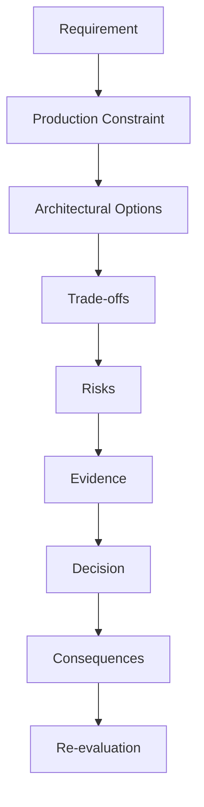
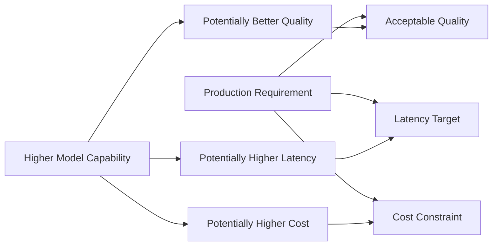
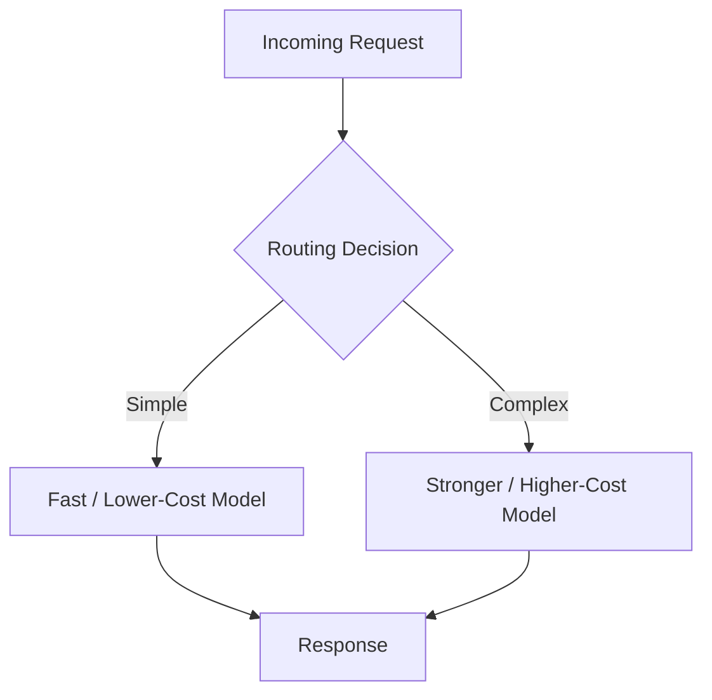
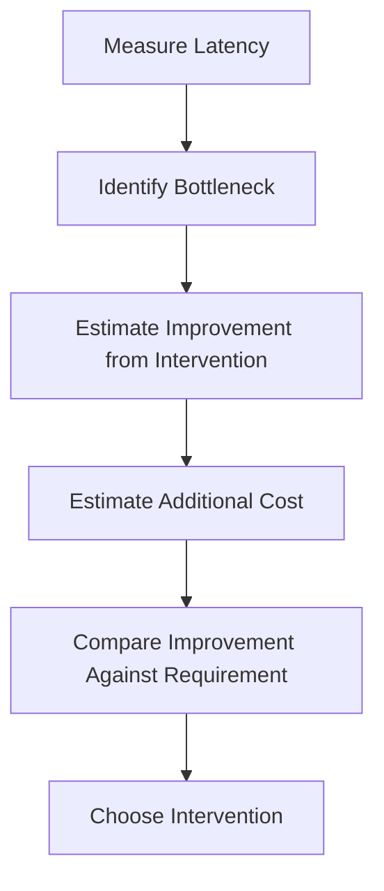
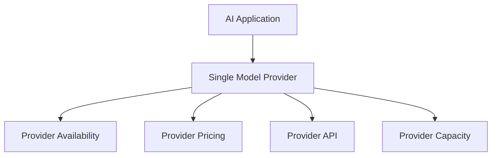
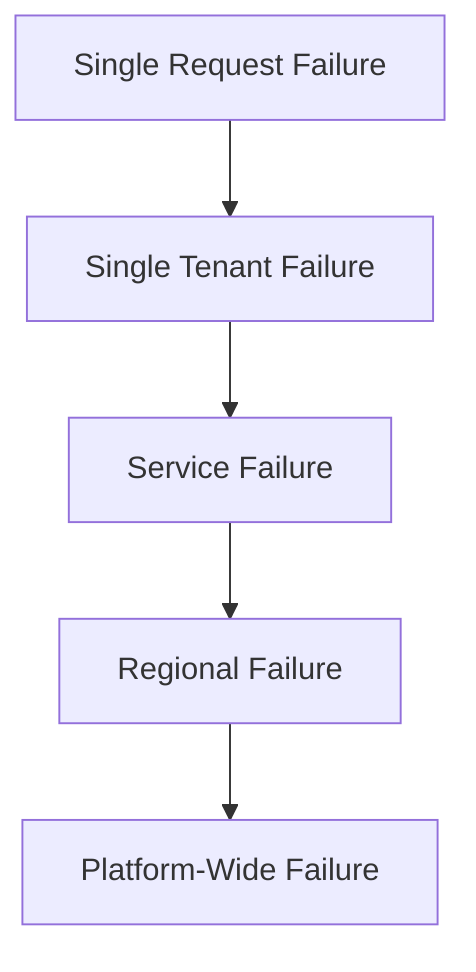
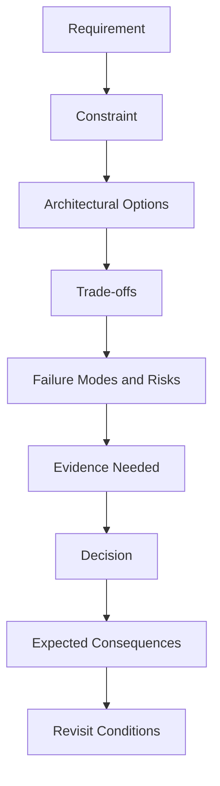
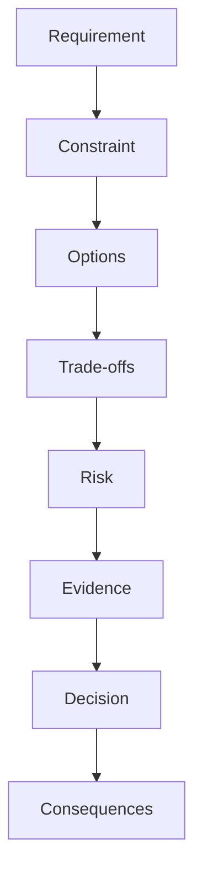
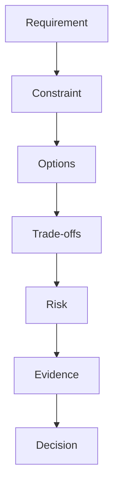

# PROD-12 — Production Trade-offs and Operational Design

## Learning Objectives

By the end of this chapter, you should be able to:

- Explain why production architecture is fundamentally a trade-off problem.
- Distinguish requirements from production constraints.
- Evaluate architecture fitness for a specific workload and operating environment.
- Analyze AI-specific trade-offs involving model quality, latency, cost, reliability, and control.
- Compare synchronous and asynchronous execution.
- Evaluate centralized and distributed architectures.
- Reason about build-vs-buy and managed-service decisions.
- Evaluate external versus local/self-hosted model providers.
- Analyze caching decisions and their operational consequences.
- Reason about consistency versus availability where AI system state requires it.
- Evaluate automation versus human/operator control.
- Identify operational burden and technical debt introduced by architectural choices.
- Analyze dependency concentration, vendor dependency, blast radius, and reversibility.
- Design operationally practical architectures rather than merely technically valid ones.
- Record architecture decisions with explicit trade-offs, risks, evidence, and consequences.

## Prerequisites

You should understand:

- Production system foundations
- Deployment and release concepts
- Observability
- Reliability
- Scaling and capacity
- Performance and cost
- Production security
- Operations and incident management
- AI lifecycle, evaluation, and continuous improvement
- Basic architecture reasoning

This chapter synthesizes those capabilities rather than re-teaching their implementation.

## Estimated Reading Time

**35–45 minutes**

---

## Before We Start

Production architecture is rarely about finding an architecture that is universally "best."

A design may be:

- faster but more expensive,
- cheaper but slower,
- simpler but less resilient,
- more reliable but operationally heavier,
- more automated but harder to control,
- more isolated but more expensive,
- more flexible but more complex.

The engineering problem is therefore not:

> "Which architecture is best?"

It is:

> **"Given these requirements and constraints, which architecture provides the best acceptable balance of outcomes, risks, and operational burden?"**

This distinction is central to production engineering.

---

## Why This Exists

AI systems make architecture trade-offs more difficult because the system is not only processing software requests.

It may also depend on:

- model behavior,
- model latency,
- model cost,
- model availability,
- provider quotas,
- inference capacity,
- retrieval quality,
- evaluation results,
- prompt and configuration changes,
- probabilistic outputs,
- human review,
- external services,
- continuously changing models.

A design that looks excellent in a development environment can become operationally expensive or fragile in production.

For example:

> A stronger model may improve answer quality but increase latency and cost.

Or:

> Model routing may reduce average cost but introduce routing logic, additional failure modes, and evaluation complexity.

Or:

> Caching may reduce latency and inference cost but create stale or incorrect responses.

Therefore, production architecture requires explicit reasoning about competing objectives.

---

## Mental Model

A useful production trade-off model is:

The important idea is that architecture decisions are **context-dependent**.

The same technology can be appropriate in one system and inappropriate in another.

For example:

- asynchronous processing may be excellent for batch document generation,
- but unacceptable for an interactive login flow.

Similarly:

- a managed model provider may be ideal for rapid product development,
- but unsuitable when strict data residency or provider independence is required.

---

# Core Concepts

## 1. Production Trade-offs

A production trade-off exists when improving one engineering objective affects another objective.

Examples include:

| Trade-off | Typical tension |
|---|---|
| Availability vs cost | More redundancy usually costs more |
| Latency vs cost | Lower latency often requires more resources |
| Quality vs latency | Stronger models may respond more slowly |
| Quality vs cost | Better models may cost more |
| Reliability vs complexity | More resilience mechanisms increase complexity |
| Scalability vs infrastructure cost | More capacity increases cost |
| Security vs usability | Stronger controls can add friction |
| Isolation vs cost | Stronger isolation often requires more infrastructure |
| Redundancy vs simplicity | More redundancy increases architecture complexity |
| Automation vs control | More automation can reduce direct operator control |
| Managed services vs ownership | Less infrastructure ownership can increase dependency on the provider |
| Build vs buy | Control and customization may increase engineering burden |

There is no universal winner.

The correct decision depends on:

- business requirements,
- workload,
- risk tolerance,
- team capability,
- operational maturity,
- budget,
- compliance constraints,
- expected growth,
- reversibility.

---

## 2. Requirements vs Constraints

Requirements describe what the system needs to achieve.

Constraints describe conditions within which the system must operate.

For example:

### Requirement

> Interactive responses should normally complete within an acceptable user-facing latency target.

### Constraints

- limited infrastructure budget,
- external model provider latency,
- database capacity,
- network latency,
- security requirements,
- limited operations team.

Architecture exists to satisfy the requirements **within the constraints**.

This distinction prevents engineers from treating constraints as implementation details.

---

## 3. Architecture Fitness

Architecture fitness means:

> **How well does the architecture satisfy the actual requirements and constraints of the system?**

A technically sophisticated architecture is not automatically fit.

For example:

A distributed architecture may provide excellent scalability but be inappropriate for a small internal AI tool with:

- low traffic,
- a small engineering team,
- low availability requirements,
- limited operational capacity.

The simpler architecture may be more fit.

Architecture fitness therefore includes:

- functional requirements,
- quality attributes,
- operational capabilities,
- team capabilities,
- economic sustainability,
- change requirements,
- risk profile.

---

## 4. Operational Burden

Every architectural decision creates an operational burden.

Operational burden can include:

- deployment complexity,
- monitoring requirements,
- on-call complexity,
- capacity planning,
- upgrades,
- dependency management,
- security maintenance,
- incident response,
- configuration management,
- cost management,
- troubleshooting,
- recovery procedures.

A system with more components may provide more capability but also increase the number of things that can fail.

Therefore:

> **Architecture complexity is not free.**

---

## AI-Specific Production Trade-offs

## 5. Model Quality vs Latency

A stronger model may provide:

- better reasoning,
- better instruction following,
- better generation quality,
- improved task performance.

But it may also introduce:

- higher latency,
- higher inference cost,
- greater resource consumption,
- lower throughput.

The decision should therefore be based on the actual quality requirement.

The correct question is not:

> "Which model is best?"

It is:

> "What level of model quality is required for this workload, and what latency and cost can the system afford?"

---

## 6. Model Quality vs Cost

A more capable model may produce better results, but the incremental quality improvement may not justify the additional cost.

For example:

- Model A costs 1 unit per request.
- Model B costs 5 units per request.
- Model B produces a measurable quality improvement.

The engineering question is:

> Does the additional quality create enough business value to justify the additional operating cost?

This requires evaluation rather than intuition.

The relevant evidence may include:

- task accuracy,
- user satisfaction,
- failure rate,
- escalation rate,
- token usage,
- latency,
- cost per successful task.

---

## 7. Model Routing

Model routing allows different requests to use different models.

Potential benefits:

- lower average cost,
- lower average latency,
- better resource utilization,
- stronger models reserved for difficult requests.

But routing introduces additional architecture.

### Routing complexity

The system must determine:

- what constitutes a simple request,
- what constitutes a complex request,
- what signals drive routing,
- what happens when classification is wrong.

### Quality consistency

Different models may produce different:

- tone,
- reasoning quality,
- formatting,
- safety behavior,
- tool-use behavior.

### Observability

Operators may need to know:

- which model handled the request,
- why it was selected,
- how much it cost,
- how it performed,
- whether routing decisions correlate with failures.

### Failure behavior

If one model becomes unavailable:

- should requests fail?
- should they fail over?
- should routing change?
- should the system degrade gracefully?

### Evaluation

Routing logic itself becomes part of the evaluation surface.

A routing change can alter:

- quality,
- cost,
- latency,
- failure behavior.

Therefore model routing is not simply an optimization.

It is an architectural decision.

---

## 8. External vs Local/Self-Hosted Model Providers

An external provider can provide:

- rapid model access,
- elastic capacity,
- reduced infrastructure ownership,
- access to managed capabilities.

But it can also introduce:

- provider availability dependency,
- network latency,
- pricing changes,
- quota constraints,
- API changes,
- model behavior changes,
- data handling considerations,
- vendor lock-in.

A local or self-hosted model can provide greater control over:

- deployment,
- model versioning,
- infrastructure,
- data boundaries,
- provider independence.

But it increases responsibility for:

- infrastructure,
- serving,
- capacity planning,
- model upgrades,
- security,
- monitoring,
- optimization,
- failure recovery.

The decision should therefore ask:

> **Which operating model provides the required combination of control, economics, performance, reliability, and operational ownership?**

---

## 9. Caching Trade-offs

Caching can reduce:

- latency,
- model inference cost,
- backend load.

But caching also creates new failure modes.

Potential problems include:

- stale results,
- incorrect cache keys,
- cache invalidation errors,
- tenant data leakage,
- responses based on outdated model or retrieval state,
- unexpected behavior after configuration changes.

For AI systems, cache design may need to consider:

- user identity,
- tenant,
- prompt,
- model,
- model version,
- system configuration,
- retrieval context,
- authorization context.

A cache is therefore not simply a performance optimization.

It is part of the system's correctness and security boundary.

---

# Architecture Pattern Trade-offs

## 10. Availability vs Cost

Increasing availability often requires:

- redundancy,
- failover,
- replication,
- multiple instances,
- multiple failure domains,
- additional operational mechanisms.

These capabilities increase cost.

The engineering question is:

> **What level of availability does the business actually require, and what is the economic value of increasing it?**

Avoid building high-availability infrastructure solely because it is technically possible.

---

## 11. Latency vs Cost

Lower latency may require:

- more compute,
- faster storage,
- additional caching,
- closer data placement,
- larger capacity buffers,
- more capable models,
- more expensive infrastructure.

The correct sequence is:

Do not optimize latency before understanding the actual bottleneck.

---

## 12. Scalability vs Infrastructure Cost

Scaling strategies may include:

- over-provisioning,
- elastic scaling,
- queue-based workload control,
- workload shedding,
- asynchronous processing.

Each has different cost and operational implications.

For example:

- over-provisioning may simplify operations but waste capacity,
- aggressive autoscaling may improve elasticity but increase infrastructure cost,
- queue-based processing may protect downstream systems but increase latency.

The correct decision depends on workload characteristics.

---

## 13. Reliability vs Complexity

Reliability mechanisms often increase complexity.

Examples:

- retries,
- timeouts,
- circuit breakers,
- fallback providers,
- replication,
- failover,
- queueing,
- redundancy.

Each mechanism can improve resilience while introducing new interactions.

For example, retries may help transient failures but can also amplify load during an incident.

Therefore:

> Reliability mechanisms should be evaluated for both the failure they prevent and the failure they might introduce.

---

## 14. Security vs Usability

Stronger security controls can increase user friction.

Examples:

- stronger authentication,
- additional authorization checks,
- shorter credential lifetimes,
- stricter access boundaries,
- approval workflows.

The goal is not maximum security in isolation.

The goal is:

> **Appropriate security for the risk and usage model.**

---

## 15. Isolation vs Cost

Isolation can reduce the impact of failures and security incidents.

Examples include:

- tenant isolation,
- workload isolation,
- service isolation,
- network segmentation,
- separate execution environments.

But stronger isolation can increase:

- infrastructure cost,
- deployment complexity,
- operational overhead,
- resource fragmentation.

The architecture should therefore match isolation strength to the actual risk.

---

## 16. Redundancy vs Simplicity

Redundancy improves resilience but adds:

- infrastructure,
- synchronization,
- monitoring,
- failure modes,
- operational complexity.

A single-instance design may be simpler but have a larger failure consequence.

A redundant design may reduce availability risk but create additional operational requirements.

The decision should be based on the required failure tolerance.

---

## 17. Automation vs Control

Automation can:

- reduce manual work,
- improve consistency,
- accelerate decisions,
- reduce operational effort.

But automation can also:

- make behavior harder to predict,
- make failures propagate faster,
- reduce direct operator intervention,
- increase automated blast radius.

Questions to ask:

- What decisions are automated?
- What decisions require approval?
- What limits exist?
- Can operators override the system?
- Can automation be disabled safely?
- Is automation observable?
- What happens when automation is wrong?
- What is the maximum blast radius?

The goal is not maximum automation.

It is:

> **Enough automation to operate efficiently without surrendering necessary control.**

---

## 18. Managed Services vs Operational Ownership

Managed services can reduce the burden of:

- infrastructure management,
- upgrades,
- capacity planning,
- maintenance.

But they do not eliminate responsibility.

The application team may still own:

- configuration,
- integration,
- security,
- cost,
- monitoring,
- failure behavior,
- data handling,
- business continuity.

Therefore:

> **Managed does not mean responsibility-free.**

---

## 19. Build vs Buy

Building internally can provide:

- customization,
- control,
- deeper integration,
- independence from a vendor.

But it increases:

- engineering effort,
- maintenance,
- operational burden,
- time to market.

Buying or adopting a managed capability can reduce implementation effort but introduce:

- vendor dependency,
- integration constraints,
- pricing dependency,
- migration cost,
- reduced control.

The correct question is:

> **Which capability is strategically important enough to own, and which is better consumed as a service?**

---

## 20. Synchronous vs Asynchronous Execution

### Synchronous execution

The caller waits for completion.

Useful when:

- immediate response is required,
- work is short,
- user interaction depends on the result.

Risks include:

- request timeout,
- long-running request pressure,
- resource contention.

### Asynchronous execution

The request is accepted and processed separately.

Useful when:

- work is long-running,
- immediate completion is unnecessary,
- workloads can be queued,
- throughput matters more than immediate response.

Costs include:

- queueing infrastructure,
- state management,
- more complex failure handling,
- delayed feedback.

The decision should follow the user and business requirement rather than architectural preference.

---

## 21. Centralized vs Distributed Architecture

Centralization can provide:

- simpler coordination,
- easier consistency,
- simpler deployment,
- centralized control.

Distribution can provide:

- fault isolation,
- independent scaling,
- geographic placement,
- team autonomy,
- reduced dependency concentration.

But distribution introduces:

- network failures,
- coordination complexity,
- consistency challenges,
- distributed tracing,
- operational overhead.

Do not distribute a system simply because distributed architecture appears more scalable.

---

## 22. Consistency vs Availability

Some AI systems contain state that does not need the same consistency guarantees everywhere.

Examples include:

- conversation state,
- tenant configuration,
- model-routing configuration,
- retrieval metadata,
- feature configuration.

Stronger consistency may require:

- coordination,
- synchronization,
- additional latency,
- reduced availability during some failures.

Weaker consistency may provide:

- higher availability,
- lower coordination overhead,
- simpler scaling.

But it may produce:

- stale state,
- temporary divergence,
- inconsistent behavior.

The key question is:

> **Which state must be immediately consistent, and where is temporary divergence acceptable?**

Do not apply the same consistency requirement to every piece of system state.

---

# Operational Complexity

## 23. Operational Complexity

Architecture complexity becomes operational complexity when engineers must:

- understand more components,
- monitor more dependencies,
- deploy more services,
- troubleshoot more failure modes,
- maintain more configurations,
- coordinate more changes.

A useful question is:

> **Can the team realistically operate this architecture under stress?**

A system that requires highly specialized knowledge to recover from ordinary failures may not be operationally fit for the organization.

---

## 24. Technical Debt

Technical debt represents a future cost created by a current engineering decision.

Debt is not automatically bad.

A deliberate trade-off can be reasonable when the debt is:

- understood,
- owned,
- bounded,
- reversible where possible,
- short-lived,
- associated with a clear benefit,
- accompanied by a reassessment trigger.

For example, using a temporary provider-specific integration may accelerate a product launch.

That can be rational if the team understands:

- migration cost,
- lock-in,
- contract implications,
- operational dependency,
- future replacement effort.

The problem is unmanaged debt.

Unmanaged debt becomes dangerous when:

- nobody owns it,
- its cost is unknown,
- it becomes invisible,
- replacement becomes difficult,
- operational burden grows,
- architecture fitness deteriorates.

Technical debt should therefore be evaluated together with:

- reversibility,
- operational burden,
- vendor dependency,
- change safety,
- migration cost.

---

## 25. Dependency Concentration

A system may depend heavily on:

- one model provider,
- one database,
- one cloud region,
- one service,
- one identity provider,
- one internal platform.

Concentration can simplify architecture but increase systemic risk.

For example:

The architecture should ask:

- Is this dependency intentional?
- Is the risk acceptable?
- Is there a fallback?
- What is the cost of diversification?
- Would diversification introduce more complexity than it removes?

Avoid assuming that every dependency must have a backup.

The correct question is whether the dependency's risk justifies the cost of reducing it.

---

## 26. Vendor Dependency

Vendor dependency becomes important when changing providers requires substantial:

- code changes,
- data migration,
- model adaptation,
- evaluation work,
- operational redesign,
- contractual changes.

Vendor dependency is not inherently unacceptable.

It becomes a problem when the organization loses meaningful strategic choice.

Ask:

- How difficult would migration be?
- Are interfaces standardized?
- Are data formats portable?
- Are evaluation suites portable?
- Are prompts or configurations provider-specific?
- Are application semantics tied to the provider?
- What would switching cost?

---

## 27. Reversibility

Reversibility is an important architecture property.

Ask:

- Can the change be reversed?
- Can traffic be redirected?
- Can a previous model version be restored?
- Can configuration be reverted?
- Can data changes be undone?
- What changes are irreversible?
- What happens if rollback is impossible?

Not every production change is reversible.

Examples of potentially difficult-to-reverse changes include:

- destructive data migrations,
- externally visible side effects,
- irreversible data transformations,
- vendor-specific integrations,
- model changes that alter persisted outputs.

Therefore, architecture should distinguish between:

- reversible changes,
- partially reversible changes,
- irreversible changes.

Irreversible changes require stronger evidence and stronger safeguards.

---

# Blast Radius

## 28. Blast Radius

Blast radius describes how broadly a failure or bad change can affect the system.

A useful model is:

Architecture should intentionally limit the impact of failures where practical.

Potential controls include:

- isolation,
- segmentation,
- tenant boundaries,
- failure domains,
- dependency boundaries,
- progressive changes,
- traffic controls,
- rate limits,
- circuit breakers.

The important question is not simply:

> "Can this component fail?"

It is:

> **"How much of the system fails if it does?"**

---

# Internal Working

## How to Evaluate a Production Trade-off

Use a repeatable reasoning process.

For every major decision, ask:

### 1. What requirement are we trying to satisfy?

Avoid starting with a technology.

Start with the outcome.

### 2. What constraints exist?

Examples:

- latency,
- cost,
- security,
- availability,
- team capability,
- compliance,
- workload,
- time to market.

### 3. What alternatives exist?

Avoid evaluating only the proposed architecture.

At least one meaningful alternative should usually be considered.

### 4. What does each option improve?

For example:

- lower latency,
- lower cost,
- higher availability,
- stronger control.

### 5. What does each option make worse?

For example:

- more complexity,
- higher cost,
- stronger vendor dependency,
- greater operational burden.

### 6. What new failure modes appear?

This is particularly important in AI systems.

Examples:

- routing failures,
- provider outages,
- stale cache results,
- model behavior changes,
- quota exhaustion.

### 7. What evidence do we need?

Architecture decisions should be supported by evidence appropriate to the claim.

Examples:

- load tests,
- latency measurements,
- evaluation results,
- failure testing,
- cost modeling,
- recovery testing.

### 8. What are the consequences?

Record:

- operational consequences,
- financial consequences,
- technical consequences,
- security consequences,
- future migration consequences.

### 9. When should the decision be revisited?

Some decisions should have explicit triggers.

Examples:

- traffic threshold,
- cost threshold,
- latency degradation,
- provider price change,
- quality regression,
- new compliance requirement.

---

# Production Trade-off Decision Framework

Use this framework for architecture decisions:

Avoid:

> "Best practice says X, therefore use X."

Instead:

> "Given these requirements and constraints, X may be preferable because..., but it introduces..."

That is architecture reasoning.

---

# Practical Example — AI Customer Support Platform

Consider an AI customer-support platform.

The system must:

- answer customer questions,
- retrieve account information,
- generate responses,
- support multiple tenants,
- maintain acceptable latency,
- control inference cost,
- remain available during provider failures.

Several architectural decisions are required.

---

## Decision 1 — Single Model vs Model Routing

### Option A — Single strong model

Advantages:

- simpler architecture,
- consistent behavior,
- simpler observability,
- easier evaluation.

Disadvantages:

- potentially higher cost,
- potentially higher latency,
- less flexibility.

### Option B — Model routing

Advantages:

- lower average cost,
- lower average latency,
- stronger models reserved for complex tasks.

Disadvantages:

- routing complexity,
- multiple model dependencies,
- more evaluation dimensions,
- inconsistent behavior,
- more complicated failure handling.

### Decision reasoning

If most requests are simple, routing may provide meaningful economic value.

But the team must prove:

- routing accuracy,
- quality preservation,
- latency improvement,
- cost reduction,
- failure behavior.

The decision should therefore be evidence-driven.

---

## Decision 2 — External Provider vs Local/Self-Hosted

### External provider

Advantages:

- rapid deployment,
- reduced infrastructure burden,
- elastic capacity.

Risks:

- provider outage,
- network latency,
- pricing changes,
- quota limits,
- vendor dependency,
- data/security considerations.

### Local/self-hosted

Advantages:

- greater control,
- stronger infrastructure and data-boundary control,
- reduced dependence on external provider availability.

Risks:

- infrastructure ownership,
- capacity planning,
- model serving,
- upgrades,
- optimization,
- operational burden.

The correct decision depends on:

- traffic,
- data sensitivity,
- latency requirements,
- operational maturity,
- cost model,
- strategic dependency tolerance.

---

## Decision 3 — Caching

Caching may reduce:

- repeated model calls,
- latency,
- cost.

But the team must determine:

- what can safely be cached,
- how cache keys are constructed,
- how tenant isolation is preserved,
- when cached responses expire,
- what happens after model changes,
- how retrieval changes affect cache validity.

A cache that returns an incorrect answer quickly is not necessarily an optimization.

---

## Decision 4 — Synchronous vs Asynchronous

Customer-facing question answering may require synchronous execution.

Long-running tasks such as:

- report generation,
- bulk document processing,
- offline evaluation,

may be better suited to asynchronous processing.

The architecture can therefore use both patterns where appropriate.

---

## Decision 5 — Tenant Isolation

If multiple organizations share the platform, the architecture must determine:

- which resources are shared,
- which resources are isolated,
- how tenant identity is propagated,
- how cached data is separated,
- how retrieval results are scoped,
- what happens if one tenant generates excessive load.

Stronger isolation may increase cost.

The correct isolation level should follow the risk.

---

## Decision 6 — Operational Design

The architecture should explicitly define:

| Area | Question |
|---|---|
| Ownership | Who owns each production component? |
| Observability | How are failures detected and diagnosed? |
| Reliability | What happens when dependencies fail? |
| Security | How are tenant and model boundaries protected? |
| Scaling | What happens during traffic bursts? |
| Recovery | How is service restored after major failure? |
| Change management | How are model and configuration changes controlled? |
| Evaluation | How are quality regressions detected? |

A technically elegant architecture that cannot be diagnosed, changed, secured, or recovered is not a strong production architecture.

---

## Example Architecture Decision Record

### Decision

Use model routing for the support platform.

### Context

Most support requests are simple, while a smaller subset requires stronger reasoning.

### Alternatives

1. Single strong model
2. Model routing
3. Self-hosted model fleet

### Constraints

- response latency,
- inference cost,
- operational team capacity,
- customer experience requirements.

### Rationale

Model routing provides an opportunity to reduce average cost while preserving stronger model capability for complex requests.

### Risks

- routing errors,
- inconsistent quality,
- increased observability complexity,
- multiple model dependencies.

### Evidence Required

- routing accuracy,
- quality evaluation,
- latency measurements,
- cost measurements,
- failure testing.

### Revisit Conditions

Re-evaluate when:

- traffic changes materially,
- provider pricing changes,
- quality requirements change,
- routing accuracy falls,
- operational burden becomes excessive.

This makes the decision explainable and reviewable.

---

## Production Perspective

A production architecture should be evaluated not only by whether it works.

It should also be evaluated by whether the organization can:

- operate it,
- observe it,
- secure it,
- scale it,
- recover it,
- change it,
- evaluate it,
- afford it.

A useful architecture review asks:

> **What does this architecture make easier?**

and:

> **What does this architecture make harder?**

The second question is often neglected.

---

## Engineering Decisions and Trade-offs

## Architecture Fitness

Ask:

- Does the architecture satisfy the actual requirements?
- Does it fit the workload?
- Does it fit the team's capabilities?
- Does it fit the operational maturity?
- Does it remain economically sustainable?
- Can it evolve safely?

## Operational Burden

Ask:

- How many components must be operated?
- How many dependencies exist?
- How difficult is diagnosis?
- How difficult is recovery?
- How much specialized knowledge is required?

## Blast Radius

Ask:

- What happens if one request fails?
- What happens if one tenant fails?
- What happens if one dependency fails?
- What happens if one region fails?
- What happens if a bad configuration reaches all traffic?

## Dependency Concentration

Ask:

- Which dependencies are critical?
- What happens when they become unavailable?
- What is the cost of diversification?
- Is the dependency intentional?

## Reversibility

Ask:

- Can we undo the decision?
- How quickly?
- What evidence is required before making an irreversible change?

## Technical Debt

Ask:

- What future cost are we accepting?
- Who owns it?
- What benefit are we receiving?
- When will it be reconsidered?

---

## Architecture Decision Matrix

A simple decision matrix can help make trade-offs explicit.

| Option | Quality | Latency | Cost | Reliability | Complexity | Operational Burden |
|---|---|---|---|---|---|---|
| Single strong model | High | Medium/High | High | Medium | Low | Low |
| Routed models | Variable | Low/Medium | Medium | Medium | High | High |
| External provider | Variable | Variable | Variable | Provider-dependent | Low/Medium | Low/Medium |
| Self-hosted model | Variable | Potentially low | Variable | Team-dependent | High | High |
| Aggressive caching | Variable | Low | Low | Medium | Medium/High | Medium |
| No caching | Current | Higher | Higher | Simpler | Low | Low |

The values are contextual rather than universal.

The purpose of the matrix is to expose trade-offs, not to declare a winner.

---

## Common Mistakes and Misconceptions

## Mistake 1 — Searching for the "best" architecture

There is usually no universally best architecture.

Architecture is contextual.

---

## Mistake 2 — Treating cost as an afterthought

Cost is an architectural constraint.

A system that works technically but becomes economically unsustainable is not production-fit.

---

## Mistake 3 — Assuming managed means responsibility-free

Managed services reduce some operational work.

They do not eliminate application ownership.

---

## Mistake 4 — Adding redundancy everywhere

Redundancy has a cost.

The correct question is whether the additional resilience justifies the added complexity and expense.

---

## Mistake 5 — Adding retries without considering amplification

Retries can recover transient failures.

They can also increase load during an outage.

---

## Mistake 6 — Assuming caching is always safe

Caching can introduce:

- stale data,
- incorrect results,
- privacy risks,
- invalidation complexity.

---

## Mistake 7 — Treating model routing as free optimization

Routing creates:

- routing logic,
- additional dependencies,
- evaluation complexity,
- observability requirements,
- new failure modes.

---

## Mistake 8 — Ignoring vendor dependency

A provider may be technically excellent while still creating unacceptable strategic dependency.

---

## Mistake 9 — Ignoring reversibility

Some architecture decisions are difficult or impossible to undo.

Irreversible decisions deserve stronger evidence.

---

## Mistake 10 — Confusing technical correctness with production fitness

A system can function correctly while still being:

- too expensive,
- too fragile,
- too difficult to operate,
- too difficult to recover,
- insufficiently observable,
- insufficiently secure.

---

## Interview Questions with Expected Answers

## 1. Why is production architecture fundamentally a trade-off problem?

**Expected answer:**

Because improving one engineering objective often affects another. For example, higher availability may require additional infrastructure, while stronger models may improve quality but increase latency and cost. The correct architecture depends on requirements, constraints, risks, and operational capacity.

---

## 2. When would you choose model routing over a single model?

**Expected answer:**

When workload characteristics justify different model capabilities and the expected savings or latency improvements justify the added routing, evaluation, observability, and failure-handling complexity.

---

## 3. What are the risks of depending on an external model provider?

**Expected answer:**

Availability dependency, latency, pricing changes, quotas, API changes, model behavior changes, data/security considerations, and vendor lock-in.

---

## 4. Why can caching create correctness problems in AI systems?

**Expected answer:**

Because the validity of a response may depend on user identity, tenant, model version, configuration, retrieval context, or authorization state. A cached result may become stale or may be incorrectly reused for another context.

---

## 5. When is asynchronous execution preferable?

**Expected answer:**

When work is long-running, does not require immediate completion, or can be queued. It can improve throughput and protect interactive request paths but introduces queueing, state-management, and failure-handling complexity.

---

## 6. What is architecture fitness?

**Expected answer:**

The degree to which an architecture satisfies the actual requirements and constraints of its workload, organization, operational environment, economics, and risk profile.

---

## 7. Why is technical debt not always bad?

**Expected answer:**

A deliberate trade-off can be rational when it creates meaningful short-term value and the resulting debt is understood, bounded, owned, and has a clear reassessment or repayment path.

---

## 8. What is blast radius?

**Expected answer:**

The scope of impact caused by a failure or change. Architecture should reduce blast radius where practical through isolation, segmentation, failure domains, progressive changes, and dependency boundaries.

---

## 9. Why is reversibility important?

**Expected answer:**

Because some production changes are difficult or impossible to undo. Reversible changes reduce risk, while irreversible changes require stronger evidence, safeguards, and decision confidence.

---

## 10. How should build-vs-buy decisions be made?

**Expected answer:**

By comparing strategic value, control, customization, engineering effort, operational burden, vendor dependency, migration cost, time to market, and long-term economics.

---

## 11. Why is "managed service" not equivalent to "no operational responsibility"?

**Expected answer:**

Because the organization may still own integration, configuration, security, monitoring, cost, failure handling, data management, and business continuity.

---

## 12. How should an architecture decision be documented?

**Expected answer:**

Record the context, requirements, constraints, alternatives, trade-offs, risks, evidence, decision, consequences, and conditions under which the decision should be revisited.

---

## Quick Revision

### Production trade-off reasoning

### AI-specific trade-offs

Remember:

- Quality ↔ Latency
- Quality ↔ Cost
- Availability ↔ Cost
- Latency ↔ Cost
- Scalability ↔ Infrastructure Cost
- Reliability ↔ Complexity
- Security ↔ Usability
- Isolation ↔ Cost
- Redundancy ↔ Simplicity
- Automation ↔ Control
- Managed Services ↔ Operational Ownership
- Build ↔ Buy
- Centralized ↔ Distributed
- Single Model ↔ Model Routing
- External Provider ↔ Local/Self-Hosted
- Caching ↔ Freshness/Correctness
- Consistency ↔ Availability

### Architecture risk concepts

Remember:

- Operational burden
- Technical debt
- Dependency concentration
- Vendor dependency
- Blast radius
- Reversibility
- Architecture fitness

---

# Key Takeaways

1. Production architecture is a trade-off problem.
2. Requirements should drive architecture decisions.
3. There is no universally best architecture.
4. AI systems introduce additional trade-offs around model quality, latency, cost, routing, providers, and evaluation.
5. Operational burden is an architectural concern.
6. Managed services reduce some responsibilities but do not eliminate ownership.
7. Caching can improve performance while creating correctness and security risks.
8. Model routing can reduce cost while increasing complexity.
9. Technical debt can be rational when it is deliberate, bounded, owned, and revisitable.
10. Dependency concentration can simplify architecture while increasing systemic risk.
11. Blast radius should be intentionally controlled.
12. Reversibility is an important architecture property.
13. Trade-offs should be evaluated with evidence rather than assumptions.
14. Architecture decisions should record consequences and revisit conditions.
15. A production architecture is strong only when the organization can operate, secure, scale, recover, change, and afford it.

---

## Further Reading

For deeper understanding, continue into the relevant production chapters:

- [PROD-01 — Production System Foundations](../PROD-01-Production-System-Foundations/README.md)
- [PROD-04 — Deployment and Release](../PROD-04-Deployment-and-Release/README.md)
- [PROD-05 — Observability](../PROD-05-Observability/README.md)
- [PROD-06 — Reliability](../PROD-06-Reliability/README.md)
- [PROD-07 — Scaling and Capacity](../PROD-07-Scaling-and-Capacity/README.md)
- [PROD-08 — Performance and Cost](../PROD-08-Performance-and-Cost/README.md)
- [PROD-09 — Security](../PROD-09-Security/README.md)
- [PROD-10 — Operations and Incident Management](../PROD-10-Operations-and-Incident-Management/README.md)
- [PROD-11 — AI Lifecycle, Evaluation and Continuous Improvement](../PROD-11-AI-Lifecycle-Evaluation-and-Continuous-Improvement/README.md)
- [AGT-12 — Agent Architecture](../../05-AGT/AGT-12-Agent-Architecture/README.md)

These chapters provide the implementation and operational foundations that PROD-12 synthesizes into production architecture decisions.
