# PROD-12 — End-to-End Production System Validation

## Learning Objectives

By the end of this chapter, you should be able to:

- Explain why production validation must evaluate the complete AI system rather than isolated components.
- Distinguish normal-path validation from failure-path validation.
- Design an end-to-end validation strategy from production requirements.
- Define and validate representative production workloads.
- Trace production requirements through acceptance criteria, validation scenarios, evidence, risks, and decisions.
- Evaluate functional, integration, workload, AI quality, reliability, performance, capacity, security, observability, operational, dependency, recovery, and lifecycle concerns as one system.
- Design representative production workloads for validation.
- Identify AI-specific validation scenarios such as model changes, retrieval changes, provider failures, long-context requests, multimodal inputs, and quality regressions.
- Determine what evidence is sufficient to support a production-readiness decision.
- Assess evidence quality and confidence rather than treating every test result as equally strong.
- Distinguish `Ready`, `Conditionally Ready`, and `Not Ready` decisions.
- Evaluate degraded-mode and recovery behavior.
- Understand why production readiness is change-sensitive rather than a permanent certification.
- Use continuous validation to detect when previously acceptable architecture or operational assumptions no longer hold.
- Record validation results and architecture decisions in a way that makes the reasoning reviewable.

---

## Prerequisites

You should already understand:

- Production system foundations
- AI application packaging and runtime concerns
- AI serving
- Deployment and release engineering
- Observability
- Reliability engineering
- Scaling and capacity
- Performance and cost analysis
- Production security
- Operations and incident management
- AI lifecycle, evaluation, and continuous improvement
- Production architecture review
- Production trade-offs and operational design

This chapter does **not** re-teach those systems.

Instead, it asks whether they work together sufficiently to satisfy the requirements of the complete production system.

---

## Estimated Reading Time

**45–60 minutes**

---

## Before We Start

A production AI system can pass every individual component test and still fail as a complete system.

For example:

- the model may produce acceptable answers,
- the API may return successful responses,
- the database may be healthy,
- the deployment may succeed,
- observability may be available,
- autoscaling may work,

yet the complete system may still fail because:

- end-to-end latency is too high,
- retrieval quality degrades under realistic workloads,
- a model provider becomes unavailable,
- a dependency fails without an acceptable fallback,
- concurrent requests exhaust capacity,
- safety controls activate incorrectly,
- costs become unacceptable at production volume,
- operators cannot diagnose failures,
- recovery takes longer than the business can tolerate.

This leads to an important distinction:

> **Component correctness is necessary, but it is not sufficient for production readiness.**

PROD-12 therefore evaluates the complete system against actual production requirements.

---

## Why This Exists

Production validation answers a different question from ordinary testing.

Traditional testing often asks:

> Does this component behave correctly?

Production validation asks:

> **Does the complete system behave acceptably under the conditions in which the business actually intends to operate it?**

That requires connecting:

- requirements,
- architecture,
- workloads,
- dependencies,
- AI behavior,
- infrastructure,
- operational controls,
- failure behavior,
- and recovery behavior.

The goal is not to create a universal checklist.

The goal is to establish enough credible evidence to make a defensible production decision.

---

## Mental Model

A useful end-to-end validation model is:

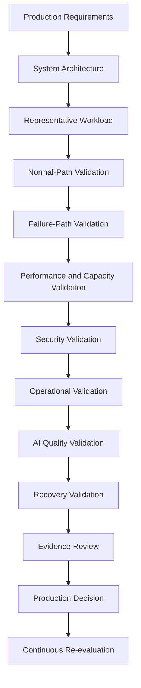

The exact execution order can vary.

The important principle is that validation must cover more than the happy path.

A complete validation strategy should establish evidence for:

> **Can the system perform its intended function, under realistic workload and failure conditions, while remaining secure, observable, operationally manageable, economically viable, and recoverable?**

---

# Core Concepts

## 1. End-to-End Validation

End-to-end validation evaluates the complete path through the production system.

For an AI application, a request may involve:

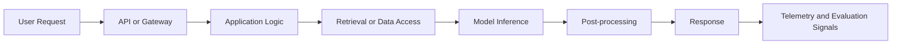

The exact architecture differs by system.

The validation principle does not.

The test should determine whether the complete path satisfies the relevant production requirements.

For example, testing model quality independently does not establish that:

- the API can sustain the required concurrency,
- retrieval remains acceptable under load,
- authentication and authorization work correctly,
- timeouts behave correctly,
- provider failures are handled,
- telemetry is sufficient,
- cost remains within acceptable bounds.

End-to-end validation connects those concerns.

---

## 2. System-Level Acceptance

System-level acceptance means evaluating the system against its actual acceptance criteria.

Acceptance criteria should originate from production requirements rather than arbitrary test targets.

Examples include:

- maximum acceptable end-to-end latency,
- minimum acceptable task success rate,
- acceptable error rate,
- required availability,
- acceptable AI quality,
- acceptable cost per request,
- maximum recovery time,
- required security controls,
- required auditability,
- acceptable degraded-mode behavior.

A requirement should ideally have:

1. a measurable or assessable condition,
2. a validation method,
3. evidence,
4. an owner,
5. and a decision rule.

For example:

> The customer-support system must maintain acceptable response latency under peak concurrency.

This is more useful than:

> The system should be fast.

---

## 3. Requirement-to-Validation Traceability

A production requirement should be traceable to the evidence used to evaluate it.

A useful chain is:

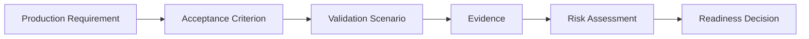

This prevents a common failure mode:

> performing tests first and deciding afterward that the tests somehow prove readiness.

Instead, the requirement determines what must be demonstrated.

### Example

| Production Requirement | Acceptance Criterion | Validation Scenario | Evidence | Result |
|---|---|---|---|---|
| Peak latency | p95 remains within target | Representative peak workload | Latency distribution | Pass |
| AI quality | Task success remains above threshold | Representative evaluation set | Evaluation results | Pass |
| Recovery | Recovery completes within target | Controlled dependency failure | Recovery exercise | Gap |
| Cost | Cost/request remains within target | Production-like workload | Cost analysis | Conditional |
| Tenant isolation | Cross-tenant access is prevented | Isolation/security test | Security evidence | Pass |

This traceability does not require every requirement to have a numerical threshold.

Some requirements are qualitative or control-oriented.

The important property is that the decision-maker can answer:

> **What production requirement does this evidence support?**

---

## 4. Representative Workload

Validation is only meaningful when the workload resembles production.

A representative workload may include:

- request volume,
- concurrency,
- request size,
- context length,
- user distribution,
- tenant distribution,
- retrieval patterns,
- model-selection patterns,
- output sizes,
- peak behavior,
- burst behavior,
- long-running requests,
- error-producing requests.

AI systems require particular care because average requests can hide expensive or difficult cases.

For example:

- short prompts may perform well,
- long-context requests may exhaust capacity,
- simple questions may produce good quality,
- complex questions may expose retrieval weaknesses,
- low concurrency may hide queueing,
- normal traffic may hide provider rate limits.

Therefore:

> **Representative workload means representative behavior, not merely representative request count.**

---

## 5. Workload Validation

Workload validation evaluates whether the system behaves acceptably when exposed to workloads that represent meaningful production conditions.

A practical workload-validation sequence is:

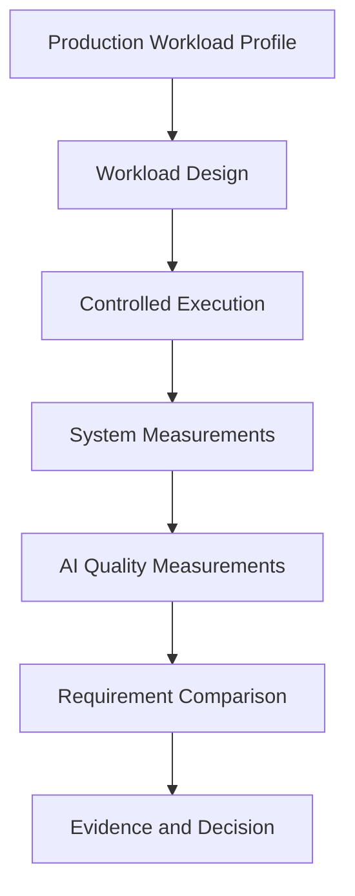

### Workload profile

Define the characteristics that matter:

- traffic volume,
- concurrency,
- request distribution,
- request complexity,
- context length,
- output size,
- tenant mix,
- model-routing distribution,
- retrieval patterns,
- tool usage,
- peak and burst behavior.

### Workload execution

Execute the workload under conditions that are relevant to the production decision.

Where appropriate, vary:

- concurrency,
- request complexity,
- dependency health,
- model selection,
- context size,
- traffic shape.

### Workload evidence

Capture evidence such as:

- latency,
- throughput,
- error rate,
- queueing,
- resource utilization,
- model/provider limits,
- cost,
- AI quality,
- degraded behavior.

### Workload acceptance

Compare the evidence against the production requirements.

A workload test is therefore not successful merely because it completed.

It is successful when the observed behavior supports the required production decision.

---

## 6. Normal-Path Validation

Normal-path validation verifies expected behavior under expected conditions.

It should include:

- successful requests,
- expected workload,
- expected dependencies,
- expected model behavior,
- normal resource conditions,
- normal authentication and authorization,
- expected observability signals.

The normal path establishes the baseline against which degraded and failure behavior can later be compared.

A system that cannot reliably complete its normal workload should not proceed to more advanced readiness claims.

---

## 7. Failure-Path Validation

Failure-path validation asks:

> What happens when something does not behave as expected?

Relevant scenarios include:

- dependency outage,
- model/provider failure,
- degraded dependency,
- overloaded system,
- malformed input,
- resource exhaustion,
- configuration error,
- failed deployment,
- unavailable retrieval service,
- unavailable database,
- unavailable external API,
- security control activation,
- unexpected model behavior,
- recovery scenario.

The objective is not to make every failure invisible.

The objective is to determine whether failures are:

- detected,
- contained,
- surfaced correctly,
- handled according to design,
- recoverable where required,
- and within acceptable business impact.

---

## 8. Degraded-Mode Validation

Many production systems do not have only two states:

> working / broken

They have intermediate states.

For example:

- retrieval unavailable,
- primary model unavailable,
- reduced model quality,
- reduced capacity,
- increased latency,
- partial feature availability,
- delayed asynchronous processing,
- stale cached information.

A degraded mode should be validated explicitly.

Ask:

- What capability is lost?
- What capability remains?
- Is the degradation visible?
- Is the user informed appropriately?
- Is the degraded behavior safe?
- Is the fallback acceptable?
- Can the system recover automatically?
- Can operators identify the degraded state?

A fallback that exists in architecture documentation but has never been validated is not strong production evidence.

---

## 9. Integration Validation

Integration validation determines whether system components behave correctly together.

Examples include:

- application → database,
- application → retrieval system,
- application → model provider,
- application → authentication system,
- application → external tools,
- service → observability platform,
- deployment system → runtime,
- evaluation system → production signals.

The important question is not merely whether each integration works independently.

It is:

> **Does the integration preserve the required behavior of the complete system?**

Integration validation should also cover failure behavior.

For example:

- Does the application time out when the model provider becomes slow?
- Does the system fail safely when retrieval becomes unavailable?
- Are partial failures visible to operators?
- Does a dependency retry create a traffic amplification problem?

---

## 10. Functional Validation

Functional validation checks whether the system performs the intended business function.

Examples:

- request classification,
- document question answering,
- recommendation,
- summarization,
- content generation,
- agent task completion,
- workflow execution.

Functional validation should use representative scenarios rather than only synthetic trivial examples.

For AI systems, functional correctness may require evaluating:

- correctness,
- completeness,
- groundedness,
- instruction adherence,
- structured-output validity,
- task completion,
- safety constraints.

The exact quality dimensions depend on the product.

---

## 11. AI Quality Validation

AI quality is part of production validation because a technically healthy system can still produce unacceptable outcomes.

AI quality validation may consider:

- answer correctness,
- relevance,
- groundedness,
- hallucination behavior,
- retrieval quality,
- instruction following,
- classification quality,
- structured-output correctness,
- refusal behavior,
- safety-sensitive behavior,
- regression against known scenarios.

The validation approach should match the AI capability.

For example:

A classification system may emphasize:

- precision,
- recall,
- false positives,
- false negatives.

A retrieval-augmented generation system may additionally evaluate:

- retrieval relevance,
- grounding,
- answer correctness,
- citation or evidence quality.

An agentic system may additionally evaluate:

- task completion,
- tool selection,
- tool-call correctness,
- unsafe action prevention,
- recovery from tool failures.

PROD-12 does not re-teach these AI subsystems.

It evaluates whether their resulting behavior is sufficient for the production requirement.

---

## 12. AI-Specific End-to-End Validation Scenarios

AI systems change the validation surface because behavior can change even when the surrounding infrastructure remains unchanged.

Important scenarios include:

### Prompt changes

Validate whether a prompt modification causes:

- quality regression,
- changed refusal behavior,
- altered output format,
- increased token usage,
- latency changes,
- unexpected downstream effects.

### Model replacement

Validate:

- quality,
- latency,
- cost,
- capacity,
- safety behavior,
- output compatibility,
- failure behavior,
- routing assumptions.

A model replacement should not be treated as purely an infrastructure change.

### Retrieval changes

Validate:

- retrieval relevance,
- answer quality,
- grounding,
- latency,
- indexing assumptions,
- metadata behavior,
- failure handling.

### Tool integrations

Validate:

- correct tool selection,
- parameter correctness,
- authorization,
- timeout behavior,
- tool failure handling,
- partial completion,
- unsafe action prevention.

### External model providers

Validate:

- availability,
- latency,
- rate limits,
- quota behavior,
- timeout handling,
- fallback behavior,
- provider error handling.

### Multimodal inputs

Validate:

- supported input types,
- input size,
- processing latency,
- model behavior,
- malformed media,
- unsupported formats,
- safety behavior.

### Long-context requests

Validate:

- latency,
- memory/resource consumption,
- context limits,
- truncation behavior,
- retrieval behavior,
- cost,
- quality degradation.

### Large output generation

Validate:

- latency,
- response-size limits,
- streaming behavior where applicable,
- resource usage,
- downstream compatibility,
- cost.

### High-concurrency workloads

Validate:

- queueing,
- throughput,
- saturation,
- model-provider limits,
- resource exhaustion,
- latency degradation,
- request isolation.

### Cost spikes

Validate whether unusual workloads can produce:

- unexpected token usage,
- expensive model routing,
- excessive retries,
- cache misses,
- expensive tool calls,
- uncontrolled external-provider usage.

### Quality degradation

Validate whether the system can detect meaningful quality changes after:

- model changes,
- prompt changes,
- retrieval changes,
- data changes,
- configuration changes,
- dependency changes.

---

## 13. Reliability Validation

Reliability validation determines whether the system behaves acceptably when expected failures occur.

Examples include:

- dependency failure,
- timeout,
- retry behavior,
- traffic surge,
- resource exhaustion,
- service restart,
- model-provider outage,
- partial system failure.

The validation question is:

> **Does the reliability architecture actually protect the system under the failures it claims to handle?**

Do not assume that because a timeout, retry, fallback, or circuit breaker exists, the reliability design has been validated.

Evidence should demonstrate behavior.

---

## 14. Performance Validation

Performance validation evaluates whether the system satisfies its latency and throughput requirements under representative conditions.

Relevant dimensions may include:

- request latency,
- time to first response,
- time to completion,
- throughput,
- queueing,
- CPU utilization,
- memory utilization,
- accelerator utilization where applicable,
- model inference time,
- retrieval latency,
- dependency latency.

For AI systems, performance validation should also consider workload characteristics such as:

- prompt length,
- context length,
- output length,
- model selection,
- tool usage,
- concurrency.

Average latency alone may be insufficient.

Tail latency can be more relevant when user experience or downstream systems are sensitive to slow requests.

---

## 15. Capacity Validation

Capacity validation asks:

> Can the system sustain the workload it is expected to receive?

It should consider:

- expected traffic,
- peak traffic,
- burst traffic,
- concurrency,
- resource limits,
- dependency limits,
- provider quotas,
- storage capacity,
- queue capacity,
- scaling behavior.

Capacity validation should also consider what happens when capacity is exceeded.

A useful question is:

> What is the expected failure mode when demand exceeds available capacity?

Possible outcomes include:

- controlled rejection,
- queueing,
- degraded functionality,
- increased latency,
- fallback,
- resource exhaustion,
- cascading failure.

The architecture should intentionally define which behavior is acceptable.

---

## 16. Security Validation

Security validation determines whether the security controls are effective under realistic system behavior.

It may include:

- authentication,
- authorization,
- tenant isolation,
- secret handling,
- input validation,
- access control,
- data protection,
- supply-chain controls,
- AI-specific abuse scenarios.

For AI systems, validation may additionally consider:

- prompt injection,
- unsafe tool use,
- data leakage,
- cross-tenant information exposure,
- sensitive data appearing in model context,
- malicious inputs,
- excessive tool permissions.

The objective is not to repeat PROD-09.

The objective is to determine whether the security architecture provides sufficient protection for this complete production system.

---

## 17. Observability Validation

A system can only be operationally ready if operators can determine what is happening.

Observability validation asks:

- Can failures be detected?
- Can operators identify affected components?
- Can request behavior be traced across important boundaries?
- Can latency problems be diagnosed?
- Can dependency failures be identified?
- Can model or provider failures be distinguished?
- Can important AI-quality signals be observed?
- Can operators determine whether a problem is systemic or isolated?

The key distinction is:

> **Telemetry existing is not the same as operational visibility being sufficient.**

A system may produce thousands of metrics and still fail to provide the signal required for diagnosis.

---

## 18. Operational Validation

Operational validation determines whether the system can actually be operated by the responsible team.

Consider:

- ownership,
- alerting,
- runbooks,
- incident procedures,
- escalation,
- deployment/change procedures,
- rollback or recovery procedures,
- capacity management,
- configuration management,
- evaluation workflows,
- support processes.

Ask:

> If the system fails at 2 AM, does the operating team have enough information and control to respond effectively?

Operational readiness is therefore part of technical readiness.

---

## 19. Dependency Validation

Dependencies can create hidden production risks.

Dependencies may include:

- model providers,
- databases,
- retrieval systems,
- identity systems,
- external APIs,
- payment systems,
- messaging systems,
- storage systems,
- observability platforms,
- internal services.

For each critical dependency, validate:

- expected availability,
- latency,
- failure behavior,
- timeout behavior,
- rate limits,
- capacity,
- fallback,
- ownership,
- recovery assumptions.

Dependency validation should also identify concentration risk.

If multiple critical paths depend on the same external service, that dependency may become a system-wide failure point.

---

## 20. Disaster-Recovery Validation

A recovery architecture should not be considered validated merely because a recovery plan exists.

Validation should establish whether the system can actually recover within the required constraints.

Depending on the system, this may involve:

- service restoration,
- data recovery,
- configuration recovery,
- dependency recovery,
- model/version restoration,
- traffic redirection,
- regional recovery,
- backup restoration.

Important questions include:

- What must be restored first?
- What data can be reconstructed?
- What data cannot be reconstructed?
- How long does recovery take?
- What functionality is available during recovery?
- Are recovery assumptions realistic?
- Has recovery actually been exercised?

The required recovery behavior must come from production requirements.

---

## 21. Lifecycle and Evaluation Validation

AI systems change over time.

Validation must therefore include the mechanisms that determine whether changes remain safe.

Examples:

- model updates,
- prompt changes,
- retrieval changes,
- dataset changes,
- configuration changes,
- dependency changes,
- routing changes,
- evaluation changes.

Validate whether meaningful changes trigger appropriate evaluation.

For example:

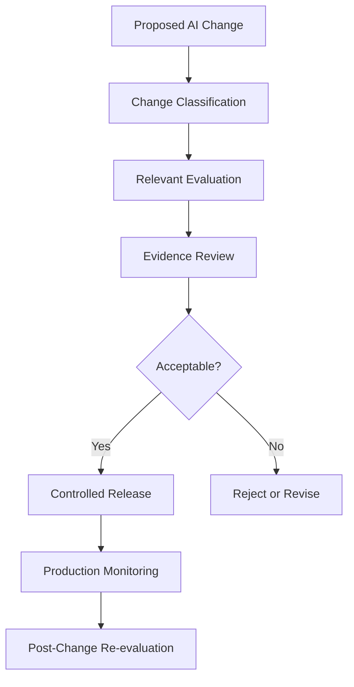

The purpose is not to require every change to undergo the same level of validation.

The purpose is to ensure that validation effort is proportional to change risk.

---

## 22. Recovery Validation

Recovery validation connects failure behavior with restoration behavior.

A complete recovery test should ask:

1. What failed?
2. How was failure detected?
3. What user or business impact occurred?
4. What containment occurred?
5. What recovery action occurred?
6. Was the system restored?
7. Was the restored system correct?
8. Was data integrity preserved?
9. Did performance return to acceptable levels?
10. Did AI quality return to acceptable levels?
11. Were operators able to confirm recovery?

Recovery is therefore more than:

> "The service came back."

The system must return to an acceptable operational state.

---

# Internal Working

## 23. Build a Validation Matrix

A practical way to organize end-to-end validation is to create a validation matrix.

| Validation Area | Production Question | Evidence | Decision |
|---|---|---|---|
| Functional | Does the system perform its intended function? | Scenario results | Pass / Gap |
| Integration | Do critical components work together? | Integration tests | Pass / Gap |
| Workload | Does representative traffic behave acceptably? | Workload results | Pass / Gap |
| AI Quality | Is AI behavior acceptable? | Evaluation results | Pass / Gap |
| Reliability | Does the system handle expected failures? | Failure tests | Pass / Gap |
| Performance | Is latency acceptable? | Benchmark/load results | Pass / Gap |
| Capacity | Can expected demand be sustained? | Capacity evidence | Pass / Gap |
| Security | Are required controls effective? | Security validation | Pass / Gap |
| Observability | Can operators detect and diagnose issues? | Operational evidence | Pass / Gap |
| Operations | Can the team operate the system? | Runbooks/exercises | Pass / Gap |
| Dependencies | Are critical dependencies acceptable? | Dependency tests | Pass / Gap |
| Recovery | Can the system recover within requirements? | Recovery exercise | Pass / Gap |
| Lifecycle | Can meaningful changes be validated safely? | Evaluation/change evidence | Pass / Gap |

The matrix is an organizing tool.

It is not itself proof of readiness.

---

## 24. Evidence Quality and Confidence

Not all evidence provides the same level of confidence.

A useful reasoning chain is:

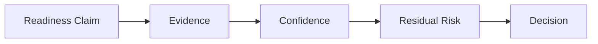

For every important readiness claim, ask:

### What is the claim?

Be precise.

Instead of:

> The system is production-ready.

use a narrower claim:

> The system can sustain the expected peak workload while maintaining the required latency and error-rate boundaries.

### What evidence supports it?

Examples:

- workload test,
- recovery exercise,
- security validation,
- AI evaluation,
- production measurements,
- controlled failure test.

### How strong is the evidence?

Consider whether the evidence is:

- direct or indirect,
- representative or artificial,
- current or stale,
- repeatable or one-off,
- measured or assumed,
- complete or partial.

### What confidence does the evidence provide?

Confidence should reflect the quality and relevance of the evidence rather than simply the number of tests performed.

### What residual risk remains?

Even strong evidence may leave uncertainty.

Document:

- assumptions,
- untested conditions,
- known limitations,
- remaining dependencies,
- unresolved risks.

### What decision follows?

The evidence should support a clear decision:

- Ready,
- Conditionally Ready,
- or Not Ready.

The important principle is:

> **Evidence reduces uncertainty; it does not eliminate uncertainty.**

---

## 25. Connect Validation to Requirements

Validation should begin with requirements rather than with available tests.

A useful reasoning chain is:

For example:

**Requirement**

The system must provide acceptable responses for customer-support requests during peak traffic.

**Acceptance criteria**

- task success remains above the defined threshold,
- latency remains within the required boundary,
- error rate remains acceptable,
- AI quality does not materially degrade.

**Validation**

Run representative customer-support workloads at expected peak concurrency.

**Evidence**

- latency distribution,
- throughput,
- error rate,
- task-success evaluation,
- resource utilization,
- dependency behavior.

**Decision**

Determine whether the evidence satisfies the requirement.

This is stronger than:

> "The load test passed."

A test can pass while the actual production requirement remains unsatisfied.

---

# Example / Practical Implementation

## 26. Example — AI Customer Support Platform

Consider an AI customer-support platform with:

- user-facing API,
- authentication,
- retrieval system,
- primary model provider,
- fallback model,
- ticketing-system integration,
- observability,
- evaluation pipeline,
- asynchronous analytics.

The system appears functionally complete.

The team now needs to determine whether it is ready for production.

---

## 27. Step 1 — Define Production Requirements

Suppose the requirements include:

- acceptable response latency,
- acceptable task success,
- protection of customer data,
- support for expected concurrency,
- acceptable cost,
- controlled provider failure behavior,
- operational ownership,
- recovery capability.

These requirements become the basis of validation.

---

## 28. Step 2 — Define Representative Workload

The workload should include:

- common support questions,
- complex questions,
- long-context questions,
- retrieval-heavy requests,
- requests requiring ticketing integration,
- different customer tenants,
- expected peak concurrency,
- burst traffic,
- large outputs,
- malformed requests.

This prevents validation from becoming artificially easy.

---

## 29. Step 3 — Validate the Normal Path

Validate:

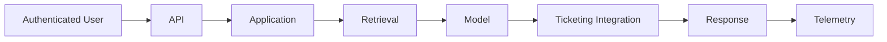

Evidence may include:

- successful request rate,
- response correctness,
- retrieval quality,
- model quality,
- latency,
- cost,
- telemetry completeness.

---

## 30. Step 4 — Validate Failure Paths

Now introduce controlled failures.

Examples:

### Retrieval unavailable

Questions:

- Does the request fail safely?
- Is the user experience acceptable?
- Does the system incorrectly answer without required grounding?
- Can operators identify retrieval failure?

### Primary model unavailable

Questions:

- Does routing switch to the fallback?
- Is quality still acceptable?
- Does latency remain acceptable?
- Is the fallback observable?

### Ticketing integration unavailable

Questions:

- Is ticket creation retried?
- Can duplicate tickets occur?
- Is the user told that ticket creation is delayed?
- Can the operation be recovered later?

### High concurrency

Questions:

- Does latency degrade predictably?
- Does the system queue or reject traffic?
- Are tenants isolated?
- Can one workload exhaust shared capacity?

---

## 31. Step 5 — Validate AI Quality

Run representative evaluation scenarios.

Check:

- answer correctness,
- grounding,
- retrieval quality,
- hallucination rate,
- task completion,
- refusal behavior,
- output format,
- regression against known cases.

The system should not be considered ready merely because the API returns HTTP success responses.

---

## 32. Step 6 — Validate Performance and Capacity

Run representative workloads at:

- normal traffic,
- expected peak,
- burst conditions,
- relevant concurrency levels.

Measure:

- latency,
- throughput,
- error rate,
- queueing,
- resource utilization,
- provider limits,
- cost.

The goal is to understand system behavior, not merely obtain a single benchmark number.

---

## 33. Step 7 — Validate Recovery

Simulate a critical dependency failure.

Observe:

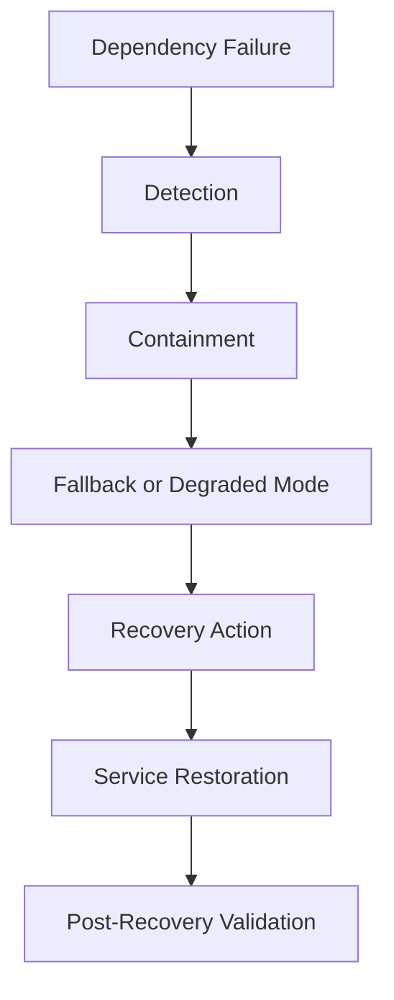

Post-recovery validation should confirm that:

- the service works,
- data is consistent,
- AI behavior is acceptable,
- telemetry has returned,
- capacity is healthy,
- no hidden degradation remains.

---

## 34. Step 8 — Review Evidence

The team should now review evidence across multiple dimensions.

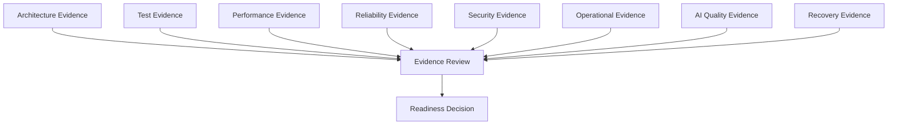

The evidence must be relevant to actual production requirements.

A large quantity of weak evidence is not necessarily better than a small amount of strong evidence.

---

# Production Perspective

## 35. Evidence-Based Readiness

Production readiness should be based on evidence.

Useful evidence may include:

- architecture review,
- functional validation,
- integration validation,
- workload validation,
- AI quality evaluation,
- performance testing,
- capacity testing,
- reliability exercises,
- security validation,
- observability validation,
- operational exercises,
- dependency validation,
- recovery exercises.

The important question is:

> **Does the evidence address the risks and requirements that actually matter for this system?**

A generic checklist cannot answer that by itself.

---

## 36. Readiness Decision Model

A useful engineering decision model is:

### Ready

Critical production requirements are satisfied and sufficient evidence exists to support the decision.

### Conditionally Ready

The system can proceed only with explicitly understood conditions.

Remaining gaps should be:

- understood,
- bounded,
- owned,
- monitored where appropriate,
- and explicitly accepted.

### Not Ready

The system should not proceed because:

- critical requirements are unmet,
- evidence is insufficient,
- risks are unacceptable,
- or important failure behavior remains unknown.

These labels are an engineering decision model, not a universal organizational policy.

---

## 37. Architecture Correctness vs Production Readiness

These concepts should not be conflated.

An architecture can be logically coherent but not production-ready.

For example:

- the architecture may be technically sound,
- the model may work,
- deployment may succeed,

but:

- capacity may not be validated,
- recovery may not be exercised,
- operational ownership may be unclear,
- AI quality may not be sufficient,
- costs may be unacceptable.

Therefore:

> **Architecture correctness is one input to production readiness, not the definition of production readiness.**

---

## 38. Functional Correctness vs Production Readiness

Similarly:

> "The feature works" does not mean "the system is production-ready."

A feature may work under:

- one user,
- low traffic,
- healthy dependencies,
- ideal inputs,
- no provider failures,
- no operational pressure.

Production validation must determine what happens under realistic conditions.

---

## Continuous Production Validation

## 39. Production Readiness Is Not Permanent

Readiness is not a one-time certificate.

Production conditions change:

- workload changes,
- dependencies change,
- models change,
- prompts change,
- retrieval changes,
- configuration changes,
- threats change,
- user behavior changes,
- infrastructure changes,
- quality changes,
- cost changes.

Therefore:

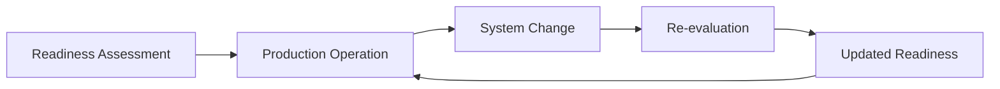

A system that was ready yesterday may no longer satisfy its requirements after a meaningful change.

---

## 40. Continuous Validation After Launch

Continuous validation does not mean continuously running every possible test.

It means maintaining appropriate evidence as the system changes.

Examples:

- monitor AI quality signals,
- evaluate meaningful model changes,
- validate significant prompt changes,
- test important dependency changes,
- monitor capacity assumptions,
- review cost behavior,
- validate recovery mechanisms periodically,
- reassess security risks,
- revalidate architecture after major changes.

The validation depth should be proportional to the change and its potential impact.

---

# Architecture Decision Records

## 41. Record the Validation Decision

Where useful, record:

- decision,
- context,
- requirements,
- alternatives,
- constraints,
- validation performed,
- evidence,
- risks,
- assumptions,
- accepted gaps,
- consequences,
- owner,
- revisit conditions.

The goal is not to create a separate ADR course.

The goal is to make the production decision explainable.

For example:

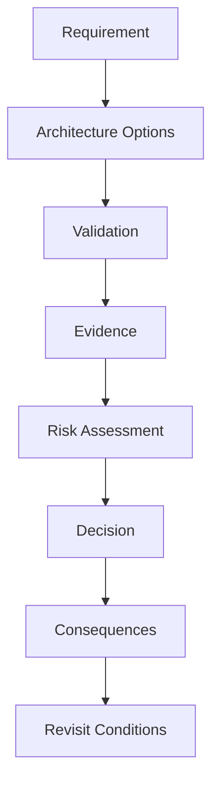

A future engineer should be able to understand not only **what** decision was made, but **why** it was considered acceptable at the time.

---

# Production Readiness Checklist

## 42. Readiness Review

Use the following as a compact review artifact:

- [ ] Production requirements understood
- [ ] Architecture boundaries clear
- [ ] Critical dependencies identified
- [ ] Representative workloads defined
- [ ] Normal paths validated
- [ ] Failure paths validated
- [ ] Degraded modes validated
- [ ] Functional behavior validated
- [ ] Integration behavior validated
- [ ] AI quality evaluated
- [ ] Performance validated
- [ ] Capacity validated
- [ ] Security controls validated
- [ ] Observability sufficient for operation and diagnosis
- [ ] Operational ownership established
- [ ] Incident and recovery readiness established
- [ ] Disaster recovery validated where required
- [ ] Lifecycle/change validation established
- [ ] Critical risks resolved or explicitly accepted
- [ ] Evidence reviewed against actual requirements
- [ ] Evidence quality and confidence assessed
- [ ] Production decision recorded
- [ ] Revisit conditions established

This checklist is a summary tool.

It is **not a substitute for engineering judgment**.

---

## Engineering Decisions and Trade-offs

## 43. How Much Validation Is Enough?

Validation has a cost.

Too little validation creates production risk.

Too much validation can delay delivery without materially reducing risk.

The appropriate level depends on:

- business impact,
- system criticality,
- change magnitude,
- uncertainty,
- failure consequences,
- reversibility,
- workload characteristics,
- regulatory or security requirements,
- dependency risk.

A low-risk, easily reversible change may require limited validation.

A high-impact, difficult-to-reverse model or architecture change may require extensive validation.

---

## 44. Test Coverage vs Evidence Quality

More tests do not automatically mean stronger readiness evidence.

For example:

- 1,000 trivial requests may provide weaker evidence than 100 representative scenarios.
- A passing unit-test suite may provide little evidence about recovery.
- A benchmark on ideal hardware may provide little evidence about production capacity.
- A model evaluation on synthetic data may not represent real user behavior.

Therefore:

> **Optimize validation for decision-relevant evidence, not test-count maximization.**

---

## 45. Validation Depth vs Change Risk

A useful principle is:

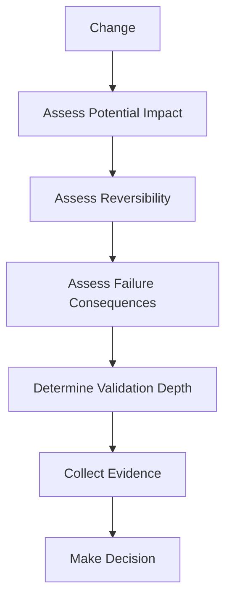

Higher-risk changes generally justify stronger validation.

Examples include:

- replacing a primary model,
- changing retrieval architecture,
- introducing a new external provider,
- changing tenant isolation,
- modifying security boundaries,
- changing critical dependencies,
- changing large-scale routing behavior.

---

# Common Mistakes and Misconceptions

## 46. "All Tests Passed, So We Are Ready"

Not necessarily.

Tests may cover only:

- isolated components,
- ideal workloads,
- normal paths,
- limited failure scenarios.

Readiness requires evidence against actual production requirements.

---

## 47. Testing Only the Happy Path

A system that works only when:

- dependencies are healthy,
- traffic is low,
- inputs are clean,
- providers are available,

has not been sufficiently validated.

Failure-path behavior is part of production behavior.

---

## 48. Treating HTTP Success as AI Success

An HTTP 200 response does not prove:

- answer correctness,
- grounding,
- task completion,
- safety,
- retrieval quality,
- appropriate tool use.

AI quality must be evaluated separately where relevant.

---

## 49. Using Synthetic Workloads That Are Too Easy

Artificially simple workloads can hide:

- long-context behavior,
- concurrency problems,
- expensive requests,
- retrieval weaknesses,
- model-quality degradation,
- provider limits.

Representative workload design matters.

---

## 50. Assuming Fallbacks Work Because They Exist

A documented fallback is only an architectural claim until validated.

Test:

- activation,
- latency,
- quality,
- failure behavior,
- observability,
- recovery,
- cost implications.

---

## 51. Treating Readiness as a One-Time Gate

Production systems change.

Therefore readiness must be revisited after meaningful changes.

---

## 52. Turning the Checklist Into a Substitute for Judgment

A checklist can help identify missing evidence.

It cannot decide:

> Is the residual risk acceptable for this system?

That remains an engineering and organizational decision.

---

## 53. Confusing Evidence With Assurance

Evidence reduces uncertainty.

It does not eliminate uncertainty.

A production decision should therefore state:

- what was validated,
- what was not validated,
- what assumptions remain,
- what risks remain,
- who accepted them,
- when the decision should be revisited.

This is stronger engineering practice than claiming absolute certainty.

---

## Interview Questions with Expected Answers

## 1. What is the difference between component testing and end-to-end production validation?

**Expected answer:**

Component testing verifies isolated behavior. End-to-end production validation evaluates whether the complete system satisfies production requirements across integrations, workloads, AI behavior, failures, operations, security, performance, and recovery.

---

## 2. Why is the happy path insufficient for production validation?

**Expected answer:**

Because production includes dependency failures, overload, malformed inputs, resource exhaustion, provider failures, configuration errors, security events, and recovery scenarios. A system that works only under ideal conditions has not demonstrated production readiness.

---

## 3. What makes a workload representative?

**Expected answer:**

It reflects important production characteristics such as request distribution, concurrency, request size, context length, output size, tenant behavior, dependency usage, peak traffic, and burst behavior—not merely average request count.

---

## 4. Why can a model evaluation pass while the production system still fail?

**Expected answer:**

Model quality is only one dimension. The complete system may still have unacceptable latency, capacity, cost, security, dependency, operational, reliability, or recovery behavior.

---

## 5. How would you validate a model replacement?

**Expected answer:**

Compare the new model against relevant quality, latency, cost, capacity, compatibility, safety, and failure criteria using representative workloads. Validate regressions and ensure the deployment and rollback strategy can safely handle the change.

---

## 6. How would you test an external model-provider failure?

**Expected answer:**

Simulate provider unavailability or degraded behavior and verify timeout, fallback or degraded-mode behavior, observability, user impact, recovery, and cost implications.

---

## 7. What is degraded-mode validation?

**Expected answer:**

It validates how the system behaves when some capability or dependency is impaired but the entire system does not necessarily fail. The goal is to determine whether the remaining functionality is safe, useful, observable, and within acceptable requirements.

---

## 8. What makes evidence sufficient for a readiness decision?

**Expected answer:**

Evidence is sufficient when it directly addresses the critical production requirements and major risks of the system, uses representative validation conditions, and provides enough confidence to make a defensible decision.

---

## 9. How do you distinguish strong evidence from weak evidence?

**Expected answer:**

Strong evidence is relevant, representative, current, repeatable, directly measured, and tied to a specific production requirement. Weak evidence may be indirect, stale, artificial, assumed, one-off, or disconnected from the actual acceptance criterion.

---

## 10. What is the difference between Ready and Conditionally Ready?

**Expected answer:**

Ready means critical requirements are satisfied with sufficient evidence. Conditionally Ready means remaining gaps or risks are understood, bounded, owned, and explicitly accepted under defined conditions.

---

## 11. Why should production readiness be revisited after deployment?

**Expected answer:**

Because workloads, dependencies, models, configurations, threats, user behavior, infrastructure, quality, and cost can change. Readiness is therefore change-sensitive.

---

## 12. Why is a readiness checklist not enough?

**Expected answer:**

A checklist can identify whether review areas were considered, but it cannot determine whether the evidence is relevant or whether residual risk is acceptable. Production readiness requires engineering judgment.

---

## 13. How would you validate recovery?

**Expected answer:**

Introduce or simulate an appropriate failure, verify detection and containment, execute recovery, then confirm that service functionality, data integrity, AI quality, observability, capacity, and operational state have returned to acceptable conditions.

---

## 14. What is the relationship between validation and architecture decisions?

**Expected answer:**

Architecture decisions create hypotheses about how the system will behave. Validation produces evidence about whether those hypotheses hold under relevant conditions. The evidence can support, modify, or reject the architecture decision.

---

## 15. How should validation depth change with risk?

**Expected answer:**

Higher-impact, less reversible, or more uncertain changes generally require stronger validation. Low-risk reversible changes may require less extensive evidence.

---

## Quick Revision

## End-to-End Validation

> Validate the complete system against production requirements, not isolated components alone.

## Requirement Traceability

> Every important production requirement should be traceable to an acceptance criterion, validation scenario, evidence, and decision.

## Normal Path

> Verify expected behavior under expected conditions.

## Failure Path

> Verify behavior when dependencies, resources, configuration, or system components fail.

## Degraded Mode

> Verify what remains possible when part of the system is impaired.

## Representative Workload

> Validate realistic request characteristics, not just realistic request counts.

## AI Quality

> Technical health does not guarantee acceptable AI behavior.

## Evidence Quality

> Evidence should be relevant, representative, current, repeatable, and directly connected to the claim being evaluated.

## Evidence

> Readiness decisions should be supported by relevant evidence.

## Readiness

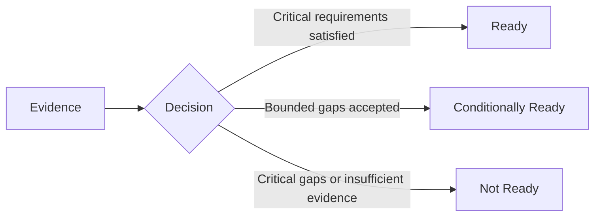

## Continuous Validation

> Production readiness must be revisited when meaningful system conditions change.

## Core Reasoning Chain

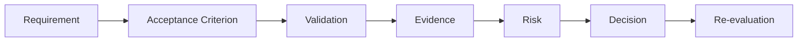

---

# Key Takeaways

1. Production validation evaluates the **complete AI system**, not isolated components.
2. Functional correctness alone does not establish production readiness.
3. Normal-path and failure-path validation are both required.
4. Representative workloads must reflect meaningful production behavior.
5. Workload validation should connect workload characteristics to measurable production requirements.
6. Important production requirements should be traceable to acceptance criteria, validation scenarios, evidence, and decisions.
7. AI quality is a first-class production validation concern.
8. Performance and capacity must be validated under realistic workload conditions.
9. Security and observability must be evaluated as system-level capabilities.
10. Dependencies must be validated for both normal and failure behavior.
11. Degraded-mode behavior should be explicitly tested where applicable.
12. Recovery must be exercised rather than assumed.
13. Evidence quality matters as much as evidence quantity.
14. Readiness decisions should be evidence-based and tied to actual requirements.
15. `Ready`, `Conditionally Ready`, and `Not Ready` are useful engineering decision models, not universal organizational certifications.
16. A checklist organizes evidence; it does not replace engineering judgment.
17. Production readiness is not permanent.
18. Meaningful changes should trigger appropriate re-evaluation.
19. Strong production engineering connects requirements, validation, evidence, confidence, risk, decisions, and consequences.

---

## Further Reading

Related PROD chapters:

- [PROD-01 — Production System Foundations](../PROD-01-Production-AI-System-Foundations/Readme.md)
- [PROD-04 — Deployment and Release](../PROD-04-Deployment-and-Release-Engineering/Readme.md)
- [PROD-05 — Observability](../PROD-05-AI-Observability-and-Telemetry/Readme.md)
- [PROD-06 — Reliability](../PROD-06-Production-AI-Reliability/Readme.md)
- [PROD-07 — Scaling and Capacity](../PROD-07-Scaling-and-Capacity-Engineering/Readme.md)
- [PROD-08 — Performance and Cost](../PROD-08-AI-Performance-Optimization-and-Cost/Readme.md)
- [PROD-09 — Security](../PROD-09-Production-AI-Security/Readme.md)
- [PROD-10 — Operations and Incident Management](../PROD-10-AI-Operations-and-Incident-Management/Readme.md)
- [PROD-11 — AI Lifecycle, Evaluation and Continuous Improvement](../PROD-11-AI-Lifecycle-Evaluation-and-Continuous-Improvement/README.md)

Related architecture domain:

- [AGT-12 — Agent Architecture](../../05-AGT/AGT-12-Agent-Architecture-and-Design-Review/Readme.md)

These references are intended to support deeper implementation study. PROD-12 remains the synthesis and decision layer: it evaluates whether those capabilities collectively satisfy production requirements rather than re-teaching their implementation.
