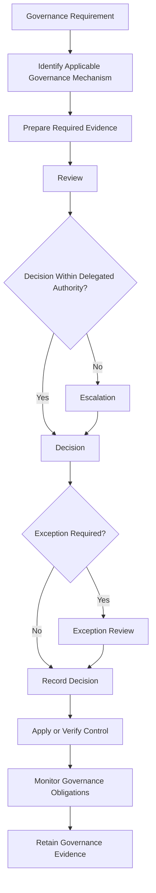

# Governance Operating Models and Control Mechanisms

## Learning Objectives

By the end of this chapter, you should be able to:

- Explain why enterprise AI governance requires an operating model rather than policy documents alone.
- Distinguish centralized, federated, and hybrid AI governance operating models.
- Explain how governance responsibilities and authority are distributed between central and domain teams.
- Understand the role of governance forums, review bodies, approval mechanisms, and escalation paths.
- Explain how governance requirements become operational through governance workflows and controls.
- Understand control ownership and how controls are operated, maintained, and escalated when they fail.
- Explain how governance obligations are monitored and evidenced.
- Design governance mechanisms that produce evidence and traceability.
- Distinguish governance requirements from the controls that implement them.
- Evaluate trade-offs between enterprise consistency and domain autonomy.
- Design proportional governance mechanisms without creating unnecessary delivery friction.
- Reason about governance failures such as unclear escalation, ineffective controls, missing evidence, and governance bottlenecks.

---

## Prerequisites

Before reading this chapter, you should understand:

- Enterprise AI accountability and decision rights from [ENT-02 File 01](./01-AI-Governance-Accountability-and-Decision-Rights.md).
- The distinction between accountability, responsibility, ownership, and decision authority.
- The basic enterprise AI architecture and operating-model concepts introduced in [ENT-01](../ENT-01-Enterprise-AI-Capabilities-and-Architectural-Boundaries/README.md).

You do not need detailed knowledge of enterprise risk management, security controls, data governance, or production operations. Those areas are covered by their respective domains.

---

## Estimated Reading Time

**35–45 minutes**

---

## Before We Start

A common mistake is to think that enterprise AI governance is primarily a collection of policies.

An organization may have policies stating that:

- AI systems must be approved.
- Sensitive data must be protected.
- High-impact AI requires additional review.
- AI systems must have an accountable owner.
- Exceptions must be documented.

Those statements establish expectations.

They do not, by themselves, explain how the organization actually operates when an AI team wants to launch a system on Monday morning.

Someone still needs to answer:

- Where does the team submit the request?
- Who reviews it?
- Which decisions can the domain make independently?
- Which decisions require central approval?
- What evidence must be produced?
- What happens when reviewers disagree?
- How are exceptions handled?
- Who can approve an exception?
- Where is the decision recorded?
- How are governance obligations monitored?
- What happens if a required control fails?

This is the difference between **governance as policy** and **governance as an operating mechanism**.

The purpose of this chapter is to understand the latter.

---

## Why This Exists

## Governance Must Operate, Not Merely Exist

Consider an enterprise with 40 teams building AI-enabled applications.

The enterprise publishes an AI policy:

> "All AI systems must undergo appropriate governance review before production deployment."

The policy sounds reasonable.

But suppose there is no defined review mechanism.

Team A asks the security team.

Team B asks the architecture team.

Team C asks a product manager.

Team D deploys because nobody knows who approves.

Team E waits three weeks because its request is repeatedly redirected between teams.

The enterprise has a policy.

It does not have an effective governance operating model.

The fundamental problem is:

> **Governance requirements must be translated into repeatable decision-making mechanisms.**

This requires more than assigning accountability.

An enterprise needs mechanisms that allow governance decisions to happen consistently.

A useful conceptual relationship is:

```text
Governance Requirement
        ↓
Responsibility
        ↓
Decision Right
        ↓
Governance Mechanism
        ↓
Control
        ↓
Evidence
        ↓
Review
        ↓
Escalation
```

This is not a mandatory universal execution sequence.

It is a reasoning model for understanding how governance becomes operational. In practice, some relationships are iterative: review can trigger escalation, controls can generate evidence continuously, and monitoring can identify conditions requiring renewed governance attention.

---

# Mental Model

## Governance as an Operating System for Enterprise AI Decisions

A useful mental model is to think of enterprise AI governance as an **operating system for organizational decision-making**.

The operating system does not build the application.

It establishes the mechanisms through which important decisions can be made consistently.

Similarly, AI governance does not replace:

- product engineering,
- model development,
- architecture,
- security engineering,
- data engineering,
- risk analysis,
- production operations.

Instead, governance coordinates the **authority, review, approval, evidence, and escalation** surrounding those activities.

Conceptually:

```text
                Enterprise AI Systems
                        │
                        ▼
              Governance Requirements
                        │
                        ▼
             Accountability + Decision Rights
                        │
                        ▼
              Governance Mechanisms
          ┌─────────────┼─────────────┐
          ▼             ▼             ▼
       Reviews      Approvals     Escalation
          │             │             │
          └─────────────┼─────────────┘
                        ▼
                Controls + Evidence
                        │
                        ▼
                    Decisions
                        │
                        ▼
             Monitoring / Review
```

The important insight is that governance is not one meeting or one approval.

It is a **system of mechanisms** through which enterprise AI decisions are made, documented, enforced, monitored, and escalated.

---

# Core Concepts

## 1. Governance Operating Model

A **governance operating model** defines how governance authority, responsibilities, and mechanisms are organized across an enterprise.

It answers questions such as:

- Where does governance authority reside?
- Which decisions are centralized?
- Which decisions are delegated to domains?
- Which standards are enterprise-wide?
- Which decisions can domains make independently?
- How are exceptions handled?
- How are disagreements escalated?
- How is governance evidence collected?
- How are governance obligations monitored?
- How is consistency maintained?

The operating model therefore connects organizational structure with governance execution.

It should not be confused with a generic organizational design exercise.

The concern here is specifically:

> **How does an enterprise make AI governance decisions consistently across multiple teams, systems, and domains?**

---

## 2. Centralized Governance

In a centralized model, significant governance authority and governance mechanisms are concentrated in central enterprise functions.

For example:

```text
                 Enterprise AI Governance
                          │
          ┌───────────────┼───────────────┐
          ▼               ▼               ▼
       Domain A         Domain B        Domain C
          │               │               │
          └───────────────┼───────────────┘
                          │
                 Central Review / Approval
```

A central function may provide:

- enterprise governance standards,
- common review mechanisms,
- approval forums,
- common evidence requirements,
- centralized exception handling,
- enterprise-level escalation.

Centralized authority does not necessarily mean that every governance activity must be performed centrally. Evidence collection, control operation, or preparation of submissions may remain distributed while decision authority remains centralized.

### Advantages

Centralization can provide:

- strong consistency,
- clear enterprise-wide standards,
- concentrated expertise,
- easier cross-domain comparison,
- centralized evidence coordination,
- reduced duplication of governance mechanisms.

### Limitations

It can also create:

- approval bottlenecks,
- slower delivery,
- excessive central dependency,
- limited domain context,
- overloaded review teams,
- incentives to bypass governance.

Centralization is therefore not automatically better.

It is useful when decisions have substantial enterprise-wide consequences or when consistency is particularly important.

---

# 3. Federated Governance

In a federated model, governance responsibility and decision-making are distributed across domains.

```text
             Enterprise Governance Principles
                        │
        ┌───────────────┼───────────────┐
        ▼               ▼               ▼
   Domain A         Domain B         Domain C
   Governance       Governance       Governance
        │               │               │
        ▼               ▼               ▼
   Local AI         Local AI         Local AI
   Systems          Systems          Systems
```

Domains may have their own governance mechanisms and decision processes while operating within enterprise-level expectations.

### Advantages

Federation can provide:

- faster local decisions,
- stronger domain context,
- greater autonomy,
- better alignment with domain-specific needs,
- reduced central bottlenecks.

### Limitations

It can produce:

- inconsistent governance,
- duplicated mechanisms,
- different evidence standards,
- uneven expertise,
- fragmented escalation,
- difficulty demonstrating enterprise-wide consistency.

Federation therefore requires strong enterprise-level boundaries and coordination mechanisms.

---

# 4. Hybrid Governance

A hybrid model combines central standards and mechanisms with delegated domain authority.

This is often useful when an enterprise needs both consistency and local autonomy.

```text
                 Central Governance
                 ┌───────────────┐
                 │ Standards     │
                 │ Common Rules  │
                 │ Shared Tools  │
                 │ Escalation    │
                 │ Enterprise    │
                 │ Decisions     │
                 └───────┬───────┘
                         │
             ┌───────────┼───────────┐
             ▼           ▼           ▼
          Domain A    Domain B    Domain C
          Decisions   Decisions   Decisions
             │           │           │
             ▼           ▼           ▼
           Local AI    Local AI    Local AI
```

The central layer may define:

- enterprise-wide governance requirements,
- common decision categories,
- minimum evidence expectations,
- escalation mechanisms,
- shared review forums,
- enterprise-level exceptions.

Domains may retain authority over:

- contextual decisions,
- local implementation choices,
- lower-impact approvals,
- domain-specific governance activities.

The exact boundary must be designed according to enterprise context.

---

# 5. Centralized vs Federated vs Hybrid

The choice should not be made based on organizational preference alone.

It should be based on the nature of the decisions being governed.

| Dimension | Centralized | Federated | Hybrid |
|---|---|---|---|
| Authority location | Central | Domain | Shared / delegated |
| Accountability location | Central / enterprise | Domain | Distributed by decision scope |
| Standards | Highly standardized | More domain-specific | Enterprise baseline + local variation |
| Exceptions | Central | Domain / local | Tiered by authority |
| Escalation | Central | Local / domain | Defined central escalation |
| Evidence collection | Central or coordinated | Domain-led | Shared standards, distributed collection |
| Consistency | High | Variable | Controlled |
| Autonomy | Low | High | Medium–High |
| Failure mode | Central bottleneck | Fragmentation / inconsistency | Boundary complexity |
| Appropriate when | Enterprise consistency dominates | Domain context dominates | Both matter |

No model is universally superior.

The engineering question is:

> **Which governance decisions require enterprise consistency, and which can safely be delegated?**

A useful design principle is to centralize the decisions that genuinely require enterprise-wide consistency while delegating context-specific decisions when their authority and consequences can be safely bounded.

---

## 6. Governance Responsibilities Are Not the Same as Governance Authority

A team may perform a governance activity without possessing final decision authority.

For example:

```text
Domain Team
   │
   │ prepares evidence
   ▼
Review Function
   │
   │ evaluates governance requirement
   ▼
Approval Authority
   │
   │ makes decision
   ▼
Recorded Decision
```

This distinction matters.

A team may:

- collect evidence,
- perform an assessment,
- prepare a submission,
- monitor a control,
- operate a workflow,

without being the final authority for the associated decision.

Governance mechanisms therefore need to distinguish:

**Who performs the activity?**

from:

**Who has authority to decide?**

File 01 establishes the accountability and decision-right concepts. This chapter focuses on how those decisions are operationalized.

---

# 7. Governance Forums and Review Bodies

A governance forum is a structured mechanism through which decisions are reviewed and made.

Examples include:

- AI governance review boards,
- architecture review forums,
- domain governance committees,
- risk review forums,
- exception review bodies.

The specific organizational name is less important than the mechanism.

An effective governance forum should have:

1. Defined purpose.
2. Defined decision scope.
3. Defined authority.
4. Defined participants.
5. Defined evidence requirements.
6. Defined escalation path.
7. Defined decision-recording mechanism.

A meeting without decision authority is not necessarily a governance mechanism.

Similarly, a committee that reviews everything but has no clear decision boundary can become a bottleneck rather than an effective control.

---

## 8. Approval Mechanisms

Approval is a governance mechanism that establishes authorization for a defined decision.

A useful approval mechanism specifies:

```text
What is being approved?
        ↓
Who can approve it?
        ↓
What evidence is required?
        ↓
What conditions apply?
        ↓
Where is the decision recorded?
        ↓
When must the decision be revisited?
```

Approval should therefore not be reduced to:

> "Someone clicked Approve."

The important engineering question is whether the approval represents a meaningful governance decision supported by appropriate evidence.

---

# 9. Escalation Mechanisms

Not every governance decision can be resolved at the initial level.

An escalation mechanism defines what happens when:

- authority is unclear,
- reviewers disagree,
- an exception is requested,
- a decision exceeds delegated authority,
- a governance requirement cannot be satisfied,
- a potential enterprise-wide consequence is identified.

A basic escalation path might look like:

```text
Local Decision
      │
      ▼
Domain Review
      │
      ├── Resolved ──► Decision Recorded
      │
      ▼
Central Review
      │
      ├── Resolved ──► Decision Recorded
      │
      ▼
Enterprise Authority
      │
      ▼
Final Decision + Evidence
```

Escalation should be designed before disagreement occurs.

Otherwise, escalation becomes an improvised organizational negotiation.

---

# 10. Exception Handling

Governance mechanisms must account for legitimate exceptions.

An exception mechanism should establish:

- what can be excepted,
- who can request an exception,
- who can approve it,
- what justification is required,
- what evidence supports the decision,
- what conditions apply,
- how long the exception remains valid,
- when it must be reviewed.

An important principle is:

> **An exception is a governed decision, not an informal bypass.**

For example, a domain may need to deviate from a standard enterprise mechanism because of a legitimate technical or business constraint.

A mature governance mechanism does not simply say:

> "Exceptions are prohibited."

Instead, it provides a controlled path for handling them.

---

## 11. Controls

A **control** is a mechanism designed to ensure that a governance requirement is implemented, enforced, or verified.

For example:

**Governance requirement**

> Certain AI systems require approval before deployment.

**Possible control**

> A deployment workflow prevents production promotion until the required approval is recorded.

The requirement describes what must happen.

The control helps make that requirement operational.

Controls can be:

- preventive,
- detective,
- approval-based,
- workflow-based,
- evidence-based,
- monitoring-based.

The specific control should be proportional to the governance requirement.

---

## 12. Control Ownership

A control needs an identifiable owner.

**Control ownership** means that a defined person, team, or organizational function is responsible for ensuring that the control remains appropriately designed, operated, maintained, and escalated when it does not perform as intended.

Control ownership is not necessarily the same as:

- ownership of the AI system,
- accountability for the business outcome,
- authority to approve the governed decision,
- responsibility for implementing the underlying AI capability.

For example:

```text
Governance Requirement
        ↓
Control Definition
        ↓
Control Owner
        ↓
Control Operation
        ↓
Evidence
        ↓
Effectiveness Review
        ↓
Failure / Exception
        ↓
Escalation
```

The control owner may be a central governance function, a platform team, or a domain team depending on the operating model.

For example, in a hybrid model:

- the enterprise may define a common governance control,
- a central platform team may operate the technical enforcement mechanism,
- domains may provide required evidence,
- the appropriate governance authority may decide exceptions.

The important principle is:

> **Every important governance control should have clear ownership for its operation and continued effectiveness.**

Without control ownership, a control can exist formally while nobody is responsible for maintaining it or responding when it fails.

---

# 13. Preventive and Detective Controls

## Preventive Controls

Preventive controls attempt to stop an invalid action before it occurs.

Example:

```text
Deployment Request
       ↓
Approval Check
       │
       ├── Approved ──► Deployment Allowed
       │
       └── Not Approved ──► Deployment Blocked
```

Benefits:

- reduces unauthorized actions,
- creates strong enforcement,
- makes governance requirements difficult to bypass.

Risks:

- can slow delivery,
- can become brittle,
- can create operational friction,
- can encourage bypass behavior if poorly designed.

---

## Detective Controls

Detective controls identify governance problems after or during an action.

Example:

```text
AI System Activity
       ↓
Governance Monitoring
       ↓
Potential Violation Detected
       ↓
Review / Escalation
```

Benefits:

- can support flexible workflows,
- can identify unexpected behavior,
- may be easier to implement in some environments.

Risks:

- the governed action may already have occurred,
- remediation may be expensive,
- detection gaps can remain unnoticed.

Mature governance may use both.

The choice should consider the consequence of failure, reversibility, enforcement cost, and the ability to detect and remediate violations.

---

# 14. Governance Obligation Monitoring

Governance does not end when a decision is approved.

An enterprise may have continuing governance obligations associated with that decision.

Examples include:

- required approval remains valid,
- an exception has not expired,
- required evidence remains available,
- a delegated authority remains applicable,
- required reviews have occurred,
- required governance conditions remain satisfied.

Monitoring these obligations is different from general system observability.

The governance question is:

> **Are the obligations imposed by the governance decision still being satisfied?**

A conceptual model is:

```text
Governance Obligation
        ↓
Required Evidence / Control
        ↓
Monitoring
        ↓
Obligation Satisfied?
       / \
     Yes  No
      │    │
      │    ▼
      │  Review / Escalation
      │
      ▼
 Continue Governance
```

For example, suppose an exception was approved for a defined period.

Governance monitoring should be able to identify when:

- the exception is approaching expiry,
- required conditions are no longer satisfied,
- the exception requires review,
- the authority under which it was granted has changed.

This does not require every governance obligation to be monitored continuously.

The monitoring mechanism should be proportionate to the obligation and its consequence.

---

# 15. Evidence and Traceability

Governance decisions should produce evidence sufficient to demonstrate what was decided, by whom, based on what information, and under what conditions.

Useful evidence may include:

- decision records,
- approval records,
- review outcomes,
- exception records,
- assessment results,
- required attestations,
- control execution evidence,
- escalation records,
- governance-obligation monitoring results.

The goal is not to produce documentation for its own sake.

The goal is **traceability**.

A useful evidence relationship is:

```text
Governance Requirement
        ↓
Decision
        ↓
Authority
        ↓
Evidence
        ↓
Approval / Exception
        ↓
Control
        ↓
Monitoring / Review
```

This allows an organization to reconstruct how an important governance decision was made and whether its associated obligations remained satisfied.

---

# 16. Decision Records

A governance decision record should make the decision understandable after the original participants are no longer available.

At minimum, it should answer:

- What decision was made?
- What system or capability was affected?
- Who had authority to make the decision?
- What evidence was considered?
- What conditions were attached?
- Were exceptions granted?
- What unresolved issues remained?
- When should the decision be revisited?

The exact format may vary by organization.

The principle is consistent:

> **Important governance decisions should not exist only in conversations or memory.**

---

## How Governance Works

A practical governance mechanism can be understood as a set of connected relationships.

```text
Governance Requirement
        ↓
Responsibility + Decision Right
        ↓
Review / Approval Mechanism
        ↓
Control
        ↓
Evidence
        ↓
Decision
        ↓
Monitoring / Review
        ↓
Escalation when required
```

This is a conceptual relationship model, not a mandatory universal workflow.

Each layer answers a different question.

| Layer | Core Question |
|---|---|
| Governance Requirement | What is expected or required? |
| Responsibility | Who performs the governance activity? |
| Decision Right | Who has authority? |
| Review Mechanism | How is the decision examined? |
| Control | How is the requirement implemented, enforced, or verified? |
| Evidence | What demonstrates that the requirement was addressed? |
| Decision | What was decided? |
| Monitoring / Review | Are the governance obligations still being satisfied? |
| Escalation | What happens when authority or resolution is insufficient? |

This separation prevents governance from collapsing into a vague concept of "review."

---

# Governance Workflow

A typical governance workflow might look like this:



This is a conceptual model.

Actual workflows will differ according to enterprise structure, system context, and governance requirements.

---

# Governance Mechanisms as a System

A mature enterprise rarely relies on one mechanism.

Instead, multiple mechanisms work together.

```text
                 Enterprise Governance
                         │
        ┌────────────────┼────────────────┐
        ▼                ▼                ▼
     Standards        Review Forums     Delegated
                                           Authority
        │                │                │
        └────────────────┼────────────────┘
                         ▼
                    Workflows
                         │
             ┌───────────┼───────────┐
             ▼           ▼           ▼
          Approval    Exception   Escalation
             │           │           │
             └───────────┼───────────┘
                         ▼
                  Evidence / Records
                         │
                         ▼
                Monitoring / Review
```

The engineering challenge is to ensure that these mechanisms form a coherent system rather than disconnected organizational processes.

---

# Practical Enterprise Example

## Scenario: Shared Enterprise AI Platform

An enterprise provides a shared AI platform.

The central platform team provides:

- model access,
- common AI infrastructure,
- evaluation capabilities,
- shared guardrails,
- common AI services.

Business domains build their own AI applications on top of the platform.

The organization needs to answer:

> Who governs what?

A reasonable hybrid model might look like:

```text
                 Central Governance
                        │
        ┌───────────────┼────────────────┐
        │               │                │
 Enterprise         Shared           Escalation
 Standards          Mechanisms        Authority
        │               │                │
        └───────────────┼────────────────┘
                        │
          ┌─────────────┼─────────────┐
          ▼             ▼             ▼
       Domain A      Domain B      Domain C
       Governance    Governance    Governance
          │             │             │
          ▼             ▼             ▼
       AI Apps        AI Apps        AI Apps
```

### Central mechanisms

The central layer may govern:

- enterprise-wide governance requirements,
- common approval mechanisms,
- shared evidence expectations,
- enterprise exceptions,
- cross-domain escalation,
- common governance controls.

### Domain mechanisms

Domains may govern:

- contextual application decisions,
- local business approvals,
- domain-specific review,
- local evidence collection,
- delegated decisions within defined boundaries.

### Control ownership

The operating model may distribute control ownership.

For example:

```text
Enterprise Governance Requirement
              ↓
      Central Control Standard
              ↓
       Platform Control Owner
              ↓
      Shared Enforcement
              ↓
       Domain Evidence
              ↓
      Governance Review
```

The central organization does not necessarily operate every control.

Instead, control ownership and execution can be distributed while enterprise expectations remain consistent.

The important point is that the boundary between central and domain authority, responsibility, control ownership, and escalation is explicit.

---

## Example Decision

Suppose a domain wants to deploy an AI application using the shared enterprise platform.

The governance mechanism might operate as:

```text
Domain proposes AI application
            ↓
Domain prepares required evidence
            ↓
Delegated review performed
            ↓
Decision within domain authority?
        /                 \
      Yes                  No
       ↓                    ↓
 Local decision       Central escalation
       ↓                    ↓
 Record decision      Central review
       \                    /
        └───────┬──────────┘
                ↓
         Governance record
                ↓
       Required control applied
                ↓
       Governance obligation monitored
```

The domain does not need to send every ordinary decision to a central committee.

At the same time, the enterprise retains mechanisms for decisions that exceed delegated authority.

This is one of the central benefits of a hybrid governance model.

---

# Example: Governance Failure

Consider the same enterprise without a defined escalation path.

A domain submits a governance request.

The reviewer believes the decision requires central approval.

The central team believes the domain should decide.

The domain believes the central team owns the decision.

No one can clearly resolve the disagreement.

The problem is not necessarily lack of policy.

The problem is an **operating-model failure**.

Specifically:

- decision boundaries are unclear,
- escalation is undefined,
- authority is ambiguous,
- evidence may be duplicated,
- delivery is delayed.

A different failure can occur when the governance decision is clear but the control has no owner.

For example:

```text
Governance Requirement
        ↓
Control Exists
        ↓
No Clear Control Owner
        ↓
Control Becomes Stale
        ↓
Failure Goes Unaddressed
```

This demonstrates why governance mechanisms need both **decision authority** and **operational ownership of controls**.

---

# Production / Enterprise Perspective

Enterprise governance mechanisms operate under real organizational constraints.

The design must account for:

- number of AI systems,
- number of teams,
- geographic distribution,
- domain autonomy,
- governance expertise,
- decision volume,
- decision consequence,
- evidence burden,
- delivery velocity,
- exception frequency,
- organizational change.

A mechanism that works for ten AI systems may fail at ten thousand.

---

## Governance Bottlenecks

Suppose every AI change requires review by one central committee.

At small scale:

```text
10 systems
   ↓
Central Review
```

This may work.

At larger scale:

```text
10,000 systems
       ↓
Central Review
       ↓
Review Queue
       ↓
Long Delays
```

The organization may respond by creating more reviewers.

But simply increasing reviewer capacity may not solve the structural problem.

A better solution may be to:

- delegate lower-consequence decisions,
- standardize evidence,
- automate routine controls,
- reserve central review for defined decision classes,
- establish clear escalation boundaries.

Governance scalability therefore requires **distribution of decision-making**, not just more meetings.

---

# Governance Evidence vs Documentation Burden

Evidence is necessary for traceability.

But excessive evidence requirements can become a governance failure of their own.

Consider:

```text
Governance Requirement
        ↓
Evidence Requirement
        ↓
Review Burden
        ↓
Delivery Delay
        ↓
Bypass Pressure
```

Therefore:

> **Evidence should be sufficient for the decision being governed, not maximized indiscriminately.**

High-consequence decisions may justify deeper evidence.

Lower-consequence decisions may require lightweight mechanisms.

This supports proportional governance.

---

# Governance Control Effectiveness

A control should not be judged merely by whether it exists.

Ask:

- Does it address the intended governance requirement?
- Is it applied consistently?
- Can it be bypassed?
- Does bypass generate evidence?
- Is the control understood by the teams using it?
- Does it create excessive operational friction?
- Can its effectiveness be evaluated?
- Does it fail safely?
- What happens when the control itself fails?
- Is there a clear control owner?

A formally defined control that nobody operates, maintains, or reviews is not an effective governance mechanism.

---

## Governance Decisions and Trade-offs

## Central Control vs Domain Autonomy

### Central control

Provides:

- consistency,
- enterprise visibility,
- centralized expertise.

But may create:

- bottlenecks,
- weaker local context,
- slower decisions.

### Domain autonomy

Provides:

- speed,
- contextual understanding,
- local ownership.

But may create:

- inconsistency,
- duplicated mechanisms,
- fragmented evidence.

### Decision guidance

Centralize decisions when enterprise-wide consistency or consequences justify it.

Delegate decisions when domain context matters and the consequences can be safely bounded.

---

## Governance Rigor vs Delivery Velocity

More review can increase confidence.

But more review also increases:

- time,
- coordination,
- evidence burden,
- organizational cost.

The goal is not maximum governance.

The goal is:

> **Appropriate governance proportional to the decision being made.**

---

## Standardization vs Local Optimization

Enterprise standards reduce variation.

However, forcing identical mechanisms across materially different domains can create unnecessary complexity.

A better approach is often:

```text
Enterprise Standard
        +
Context-specific Implementation
```

The enterprise standard defines the boundary.

The domain determines how to operate within that boundary where authority has been delegated.

---

## Preventive vs Detective Controls

Preventive controls provide stronger enforcement before an action.

Detective controls can provide greater flexibility.

A mature system may combine both:

```text
Preventive Control
       ↓
Allowed Action
       ↓
Detective Monitoring
       ↓
Exception / Violation
       ↓
Review + Escalation
```

The appropriate balance depends on the consequence of failure, reversibility, enforcement cost, and the ability to detect and remediate violations.

---

## Approval Depth vs Decision Speed

More approval layers may reduce the probability of an inappropriate decision.

But they also increase latency.

A useful design question is:

> What additional decision quality does this approval layer provide?

If the answer is unclear, the approval may be organizational ceremony rather than meaningful governance.

---

## Evidence vs Operational Burden

Evidence improves traceability.

Too much evidence can reduce governance effectiveness by creating:

- excessive administrative work,
- duplicated records,
- stale documentation,
- review fatigue.

The objective is **decision-relevant evidence**, not maximum documentation.

---

## Coverage vs Cost

A governance mechanism that covers every possible scenario may be extremely expensive.

A mechanism that covers only a small subset may leave significant gaps.

The organization must determine:

- which decisions require governance,
- which can be delegated,
- which controls can be automated,
- where human review adds meaningful value.

---

# Governance Decision Reasoning

A useful reasoning model is:

```text
Business / AI Need
        ↓
Impact and Context
        ↓
Accountability
        ↓
Decision Rights
        ↓
Governance Requirements
        ↓
Control / Review Mechanisms
        ↓
Evidence
        ↓
Approval / Escalation
        ↓
Governance Monitoring / Review
```

This is a reasoning model, not a mandatory universal process.

For any important governance decision, ask:

1. What decision is being made?
2. Why does governance apply?
3. Who is accountable?
4. Who has authority?
5. What mechanism performs the review?
6. What evidence is required?
7. What control implements or verifies the requirement?
8. Who owns that control?
9. What happens if the decision cannot be resolved?
10. How will continuing governance obligations be monitored?
11. Where is the decision recorded?
12. What conditions would require the governance decision to be revisited?

The final question connects to lifecycle governance, which is the focus of File 03.

---

# Common Mistakes and Misconceptions

## Mistake 1: Treating Policy as Governance

A policy can define expectations.

It does not automatically define:

- authority,
- workflow,
- evidence,
- approval,
- escalation,
- enforcement.

### Better approach

Translate important governance requirements into explicit governance mechanisms.

---

## Mistake 2: Creating a Committee Without Decision Authority

A committee may review an issue but still leave everyone uncertain about who can decide.

### Better approach

Define:

- scope,
- authority,
- evidence requirements,
- decision boundaries,
- escalation paths.

---

## Mistake 3: Centralizing Everything

Centralization can appear safer because decisions are concentrated.

But excessive centralization creates bottlenecks and weakens domain autonomy.

### Better approach

Separate decisions that require enterprise consistency from decisions that can be delegated.

---

## Mistake 4: Federating Everything

Complete federation can increase autonomy but create inconsistent governance.

### Better approach

Establish enterprise-level standards, boundaries, evidence expectations, and escalation mechanisms while delegating appropriate decisions.

---

## Mistake 5: Treating Approval as a Checkbox

An approval without meaningful evidence or authority may provide little governance value.

### Better approach

Ask whether the approval represents an actual decision made by an authorized party using appropriate evidence.

---

## Mistake 6: Maximizing Evidence

More documents do not automatically mean better governance.

### Better approach

Require evidence proportional to the decision's consequence and governance requirement.

---

## Mistake 7: Ignoring Exceptions

If the governance model has no legitimate exception mechanism, teams may create informal bypasses.

### Better approach

Provide controlled exception handling with authority, justification, evidence, and traceability.

---

## Mistake 8: Designing Controls Without Considering Failure Modes

A control can fail.

Examples:

- approval service unavailable,
- evidence repository unavailable,
- reviewer unavailable,
- workflow incorrectly configured,
- control bypass discovered,
- control owner unavailable or undefined.

### Better approach

Design governance mechanisms with explicit failure and escalation paths, including clear control ownership.

---

## Mistake 9: Confusing Governance with Compliance

Compliance requirements may create governance obligations.

But governance is broader.

Governance determines:

- who decides,
- who approves,
- how exceptions work,
- how evidence is recorded,
- how authority is distributed,
- how decisions are escalated.

Compliance is one input into that system.

---

## Mistake 10: Assuming Every Governance Obligation Requires Continuous Monitoring

Not every governance obligation needs continuous monitoring.

Some obligations may require:

- event-based checks,
- periodic review,
- expiry monitoring,
- approval verification,
- evidence checks.

### Better approach

Match monitoring frequency and mechanism to the nature and consequence of the governance obligation.

---

## Interview Questions with Expected Answers

## 1. Why is an AI governance policy insufficient by itself?

**Expected answer:**

A policy defines organizational expectations but does not necessarily define how decisions are made. An operating model translates requirements into responsibilities, decision mechanisms, controls, evidence, approvals, and escalation paths.

---

## 2. When would you choose centralized AI governance?

**Expected answer:**

When decisions require strong enterprise-wide consistency, centralized expertise, or have significant cross-domain consequences. The trade-off is increased approval latency and central bottleneck risk.

---

## 3. What is the main risk of federated governance?

**Expected answer:**

Inconsistency. Different domains may implement different standards, evidence requirements, or escalation mechanisms. Federation therefore needs enterprise-level boundaries and coordination.

---

## 4. Why is hybrid governance often useful?

**Expected answer:**

It allows enterprise-level consistency for decisions that require it while delegating context-specific decisions to domains. This balances standardization with autonomy.

---

## 5. What is the difference between a governance requirement and a control?

**Expected answer:**

A governance requirement states what the organization expects. A control is a mechanism that implements, enforces, or verifies that requirement.

---

## 6. What is control ownership?

**Expected answer:**

Control ownership identifies who is responsible for ensuring that a governance control is appropriately designed, operated, maintained, and escalated when it does not perform as intended. Control ownership does not necessarily equal ownership of the AI system or authority to approve the governed decision.

---

## 7. Why are escalation mechanisms important?

**Expected answer:**

Because not every decision can be resolved at the initial authority level. Escalation prevents ambiguity when authority is exceeded, reviewers disagree, exceptions arise, or consequences extend beyond a team's delegated scope.

---

## 8. Why should governance decisions produce evidence?

**Expected answer:**

Evidence provides traceability. It allows the organization to understand what was decided, who had authority, what information was considered, and what conditions or exceptions applied.

---

## 9. What is governance-obligation monitoring?

**Expected answer:**

It is the process of verifying that continuing obligations created by governance decisions remain satisfied. Examples include monitoring approval validity, exception expiry, required evidence, or required review completion.

---

## 10. What is the danger of excessive governance?

**Expected answer:**

It can create bottlenecks, increase delivery time and administrative burden, cause review fatigue, and encourage teams to bypass governance mechanisms.

---

## 11. What is the danger of insufficient governance?

**Expected answer:**

Important decisions may be made inconsistently, authority may be unclear, exceptions may become informal bypasses, and the organization may be unable to reconstruct or defend important decisions.

---

## 12. A domain team and central governance team disagree about who should approve an AI system. What should happen?

**Expected answer:**

The governance operating model should define the escalation path and authority boundary. The disagreement should be resolved through the defined governance mechanism rather than informal negotiation.

---

## 13. Why is "one central committee approves everything" usually a poor scaling strategy?

**Expected answer:**

Because decision volume grows faster than centralized review capacity. A scalable model delegates appropriate decisions, standardizes evidence, automates routine controls where practical, and reserves central authority for decisions that genuinely require it.

---

## 14. What is the relationship between governance and control?

**Expected answer:**

Governance determines what needs to be decided, who has authority, when review is required, and what evidence is expected. Controls operationalize or enforce those governance requirements.

---

## 15. Does centralized governance mean every governance activity must be performed centrally?

**Expected answer:**

No. Governance authority can be centralized while evidence collection, control operation, or preparation of submissions remains distributed. The operating model should explicitly define those boundaries.

---

## Quick Revision

### Governance Operating Model

Defines how AI governance authority, responsibilities, and mechanisms are organized across the enterprise.

### Centralized Governance

Central authority and mechanisms are concentrated in enterprise functions.

### Federated Governance

Governance responsibilities and decisions are distributed across domains.

### Hybrid Governance

Enterprise-level standards and authority are combined with delegated domain decision-making.

### Governance Forum

A structured mechanism for reviewing and deciding governance matters.

### Approval Mechanism

Defines how an authorized party formally approves a decision.

### Escalation Mechanism

Defines how unresolved or out-of-boundary decisions move to higher or different authority.

### Exception Mechanism

Provides a controlled process for authorized deviations from governance expectations.

### Control

A mechanism that implements, enforces, or verifies a governance requirement.

### Control Owner

The person, team, or function responsible for ensuring a governance control is appropriately operated, maintained, and escalated when it fails or becomes ineffective.

### Governance Obligation Monitoring

The process of verifying that continuing obligations created by governance decisions remain satisfied.

### Governance Evidence

Information that demonstrates how a governance requirement or decision was handled.

### Decision Record

A durable record of the decision, authority, evidence, conditions, and outcome.

### Core Relationship Model

```text
Governance Requirement
        ↓
Responsibility + Decision Right
        ↓
Governance Mechanism
        ↓
Control + Control Ownership
        ↓
Evidence
        ↓
Decision
        ↓
Monitoring / Review
        ↓
Escalation when required
```

---

# Key Takeaways

1. **Governance is an operating mechanism, not merely a policy document.**
2. **Operating models determine where governance authority, responsibilities, and mechanisms are located.**
3. **Centralized models optimize for consistency but can create bottlenecks.**
4. **Federated models optimize for domain autonomy but can create inconsistency.**
5. **Hybrid models combine enterprise standards with delegated authority where appropriate.**
6. **Governance responsibilities and decision authority must remain distinguishable.**
7. **Review forums are useful only when their scope and authority are explicit.**
8. **Approval mechanisms require defined authority and decision-relevant evidence.**
9. **Escalation must be designed before disagreement occurs.**
10. **Exceptions should be governed rather than becoming informal bypasses.**
11. **Controls operationalize governance requirements.**
12. **Important controls need clear ownership for operation, maintenance, and failure escalation.**
13. **Governance obligations may require ongoing monitoring even after an initial decision is approved.**
14. **Evidence provides traceability for important governance decisions.**
15. **Governance mechanisms should be proportional to decision consequence and context.**
16. **Scalable governance distributes appropriate decision-making rather than routing everything through one central authority.**
17. **Effective governance balances consistency, autonomy, rigor, delivery velocity, evidence, and operational burden.**
18. **Lifecycle governance and material-change reassessment determine how governance remains active as AI systems change; those topics are covered in File 03.**

---

## Further Reading

Within this repository:

- [ENT-02 — Enterprise AI Governance, Accountability and Lifecycle Control](./README.md)
- [AI Governance, Accountability and Decision Rights](./01-AI-Governance-Accountability-and-Decision-Rights.md)
- [AI Lifecycle Governance and Material Change Control](./03-AI-Lifecycle-Governance-and-Material-Change-Control.md)
- [ENT-01 — Enterprise AI Capabilities and Architectural Boundaries](../ENT-01-Enterprise-AI-Capabilities-and-Architectural-Boundaries/README.md)

Related enterprise domains:

- [ENT-03 — AI Risk, Impact and Assurance](../ENT-03-AI-Risk-Impact-and-Assurance/README.md)
- [ENT-04 — AI Security, Privacy and Access Governance](../ENT-04-AI-Security-Privacy-and-Access-Governance/README.md)
- [ENT-05 — AI Data Governance and Information Control](../ENT-05-AI-Data-Governance-and-Information-Control/README.md)
- [ENT-06 — Enterprise AI Integration and Platform Architecture](../ENT-06-Enterprise-AI-Integration-and-Platform-Architecture/README.md)

---

## Final Mental Model

The most important idea in this chapter is simple:

> **Governance becomes real when enterprise requirements are connected to authority, mechanisms, controls, evidence, monitoring, review, and escalation.**

A mature enterprise does not merely ask:

> "Do we have an AI policy?"

It asks:

> "When an AI decision needs governance, who decides, through which mechanism, using what evidence, under what authority, with what control, who owns that control, and what happens when the decision or its continuing obligations cannot be satisfied?"

That is the difference between **having governance** and **operating governance**.
