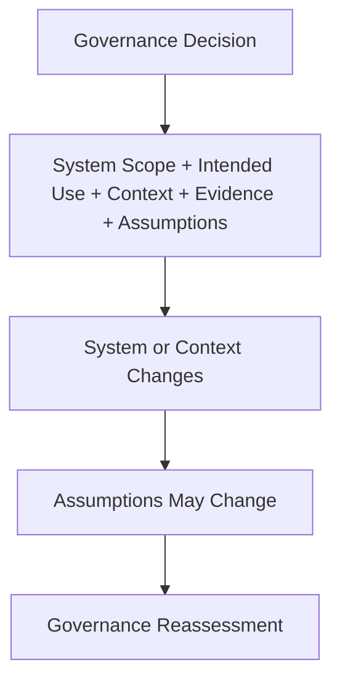
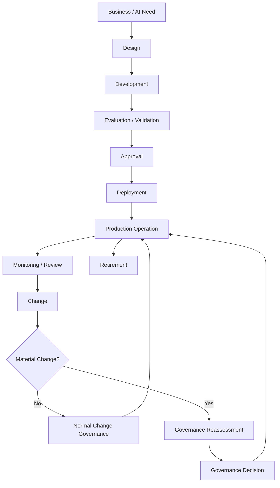
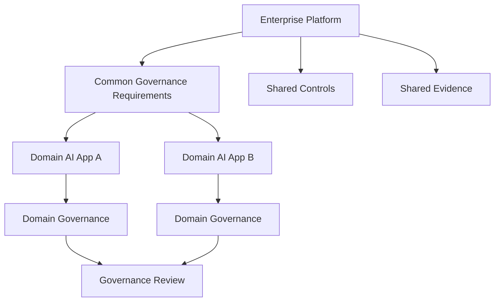

# AI Lifecycle Governance and Material Change Control

## Learning Objectives

By the end of this chapter, you should be able to:

- Explain why AI governance must continue throughout the lifecycle rather than stop at initial approval.
- Identify governance checkpoints across the major stages of an AI system lifecycle.
- Distinguish lifecycle governance from ordinary software delivery and operational processes.
- Explain what evidence should support governance decisions at different lifecycle stages.
- Explain why governance requirements can change as an AI system changes.
- Define **material change** in an enterprise AI context.
- Identify common material-change triggers, including model, provider, data, architecture, capability, autonomy, deployment scope, and business-purpose changes.
- Distinguish material changes from routine changes that do not require the same level of reassessment.
- Explain how change classification determines the appropriate governance response.
- Design a governance reassessment flow for significant AI system changes.
- Explain how lifecycle traceability preserves accountability and decision continuity over time.
- Explain how retirement closes the governance lifecycle and preserves appropriate decision continuity.
- Reason about proportional governance without turning every change into a full approval cycle.

---

## Prerequisites

You should already understand:

- Enterprise AI accountability and decision rights from [01-AI-Governance-Accountability-and-Decision-Rights.md](./01-AI-Governance-Accountability-and-Decision-Rights.md).
- Governance operating models and control mechanisms from [02-Governance-Operating-Models-and-Control-Mechanisms.md](./02-Governance-Operating-Models-and-Control-Mechanisms.md).
- The distinction between governance, architecture, risk, security, privacy, data governance, and production operations.
- The idea that governance mechanisms create decision rights, controls, evidence, review, and escalation rather than merely documenting policies.

This chapter builds on those concepts and focuses specifically on **when governance applies and how it changes as an AI system moves through its lifecycle and evolves over time**.

---

## Estimated Reading Time

**35–45 minutes**

---

## Before We Start

Consider an AI system that was approved six months ago.

At approval time:

- the system used one model provider,
- accessed a defined set of enterprise data,
- served internal users,
- generated recommendations,
- had limited tool access,
- and operated under a particular business purpose.

Six months later, the team:

- changes the model provider,
- adds a new enterprise data source,
- gives the system the ability to call external tools,
- expands the user population,
- and changes the system from recommendation generation to partially automated decision execution.

The application may still have the same name.

The deployment pipeline may still work.

The API contract may even remain unchanged.

But the **governance situation has changed materially**.

This creates the central problem of lifecycle governance:

> **How does an enterprise ensure that governance remains appropriate as an AI system moves through its lifecycle and changes over time?**

The answer is not to require the same approval process for every change.

The answer is to establish:

1. lifecycle governance checkpoints,
2. evidence expectations,
3. change classification,
4. material-change triggers,
5. reassessment mechanisms,
6. decision authority,
7. traceability,
8. and proportional escalation.

Governance therefore becomes a **continuous lifecycle capability**, not a one-time gate.

---

## Why Lifecycle Governance Exists

AI systems do not remain static after initial approval.

They evolve because of:

- model updates,
- provider changes,
- prompt and policy changes,
- new data,
- new tools,
- architecture changes,
- user expansion,
- business changes,
- performance changes,
- organizational changes,
- and changes in applicable obligations.

A governance decision is therefore made against a particular **system scope, intended use, context, evidence, and set of assumptions**.

If those conditions change materially, the assumptions supporting the original decision may no longer hold.

This does not mean every change invalidates the original approval.

It means material changes must be recognized and evaluated appropriately.

### The fundamental relationship



The important idea is:

> **An approval should be understood in relation to the defined system scope, intended use, conditions, assumptions, and evidence under which the decision was made.**

---

# Mental Model

A useful mental model is to treat lifecycle governance as a **continuing decision system** around the AI lifecycle.



The exact lifecycle stages differ across enterprises.

The important principle is not the exact sequence.

The principle is that **governance accompanies the system throughout its lifecycle and re-enters the decision process when material changes occur**.

There are two related but distinct forms of lifecycle governance:

- **Transition governance** — determining whether the system can move from one lifecycle stage or governance state to another.
- **Continuing governance** — ensuring that obligations, decisions, controls, and reviews remain appropriate while the system continues operating within a lifecycle stage.

For example, deployment may require an explicit transition decision, while production operation may involve continuing governance obligations and periodic review.

---

# Core Concepts

## 1. Lifecycle Governance

**Lifecycle governance** is the set of governance decisions, checkpoints, evidence requirements, approvals, reviews, and reassessment mechanisms applied throughout the life of an AI system.

It answers questions such as:

- What must be decided before development?
- What must be demonstrated before deployment?
- Who approves the transition?
- What evidence supports that approval?
- What obligations continue during production?
- What changes require reassessment?
- Who can authorize those changes?
- When should the system be retired?

Lifecycle governance therefore connects the governance model from Lesson 01 and the operating mechanisms from Lesson 02 to the changing state of an AI system.

---

## 2. Governance Is Not a One-Time Approval

A common but dangerous mental model is:

```text
Build → Approve → Deploy → Done
```

A better model is:

```text
Design
  ↓
Develop
  ↓
Evaluate
  ↓
Approve
  ↓
Deploy
  ↓
Operate
  ↓
Monitor / Review
  ↓
Change
  ↓
Reassess when required
  ↓
Continue / Restrict / Reapprove / Retire
```

The difference is important.

An approval establishes that a system is acceptable under a defined set of conditions.

It does not guarantee that the system will remain acceptable under every future configuration.

---

## 3. Lifecycle Stages and Governance Questions

The lifecycle should be understood through the governance questions associated with each stage.

| Lifecycle Stage | Primary Governance Question | Typical Governance Evidence |
|---|---|---|
| Idea / Intake | Should this AI capability proceed into formal development? | Business purpose, accountable owner, initial context |
| Design | What is being built and who is accountable for it? | System scope, ownership, decision rights, intended use |
| Development | Are governance requirements being incorporated into implementation? | Development records, required controls, design decisions |
| Evaluation / Validation | Is there sufficient evidence to support the intended use? | Evaluation results, validation evidence, unresolved issues |
| Approval | Who has authority to authorize the next stage? | Decision record, approval, conditions, exceptions |
| Deployment | Are approved conditions preserved in the deployed system? | Release/change evidence, deployment authorization |
| Production Operation | Are continuing governance obligations being fulfilled? | Review records, obligation monitoring, escalations |
| Change | Has the system changed in a way that affects governance assumptions? | Change description, impact assessment, classification |
| Reassessment | Does the change require new or modified governance decisions? | Reassessment evidence, updated decisions, approvals |
| Retirement | Has the system been appropriately withdrawn and its governance state closed? | Retirement decision, closure evidence, retained records |

These are governance questions, not a universal implementation checklist.

An enterprise may combine, rename, or add stages according to its own operating environment.

---

# 4. Governance Checkpoints

A **governance checkpoint** is a defined point at which an enterprise determines whether required governance conditions have been satisfied before allowing a lifecycle transition or continuing operation.

For example:

```text
Design
   │
   ├── Governance checkpoint
   ↓
Development
   │
   ├── Evaluation checkpoint
   ↓
Validation
   │
   ├── Approval checkpoint
   ↓
Deployment
```

A checkpoint should have at least:

- a decision being made,
- an accountable decision owner,
- required evidence,
- applicable criteria,
- a decision outcome,
- and a mechanism for handling exceptions or unresolved issues.

A checkpoint without a clear decision owner often becomes a documentation exercise rather than governance.

---

# 5. Evidence Requirements

Governance decisions should be supported by evidence appropriate to the decision.

Evidence may include:

- system purpose and scope,
- identified accountable owners,
- architecture or design records,
- evaluation results,
- validation findings,
- approved exceptions,
- decision records,
- control evidence,
- change descriptions,
- impact assessments,
- review outcomes,
- escalation records,
- and reassessment decisions.

The exact evidence depends on the decision.

For example, evidence required for initial approval may be substantially different from evidence required for a provider change.

The engineering principle is:

> **Evidence should be sufficient to justify the governance decision being made, not collected merely because a checklist exists.**

---

## 6. Lifecycle Traceability

As systems evolve, an enterprise needs to understand:

- what was approved,
- when it was approved,
- under which conditions,
- who made the decision,
- what evidence supported it,
- what changed afterward,
- whether the change was reassessed,
- and what decision resulted.

This creates **lifecycle traceability**.

A simplified model is:


Without this traceability, teams may eventually know that a system was “approved” but not know:

- what was actually approved,
- which assumptions mattered,
- whether the current system still matches the governed scope,
- or why a later decision was made.

Traceability therefore preserves governance continuity as the system evolves.

---

# 7. Governance Continuity

Lifecycle governance must preserve continuity across organizational and technical changes.

For example, an AI system may change:

- product owner,
- technical owner,
- model,
- provider,
- data source,
- deployment scope,
- or business purpose.

The enterprise should not rely on informal memory to preserve governance.

Governance continuity requires that important decisions and obligations remain discoverable and attributable.

This is particularly important when:

- teams reorganize,
- systems are transferred between business units,
- vendors change,
- ownership changes,
- or systems remain in operation for several years.

---

## 8. Retirement Governance

Retirement is the final lifecycle governance transition.

It should answer:

- Who has authority to retire the system?
- Why is the system being retired?
- What dependent systems, users, or business processes are affected?
- What capabilities or access should be withdrawn?
- What outstanding governance obligations must be closed or transferred?
- Which governance records must be retained?
- What is the final governance state of the system?
- Is a successor system replacing the capability, and if so, which governance decisions need to be established independently?

Retirement governance is not the same as the technical mechanics of decommissioning infrastructure.

The governance concern is the **decision to end the system's governed operation and the orderly closure or transfer of its governance obligations**.

A useful mental model is:

```text
Retirement Decision
       ↓
Identify Dependencies
       ↓
Withdraw / Transfer Authority and Obligations
       ↓
Close Outstanding Governance Actions
       ↓
Retain Required Records
       ↓
Record Final Governance State
```

Retirement therefore closes the lifecycle governance record rather than simply deleting the application's infrastructure.

---

# Material Change Control

## 9. What Is a Material Change?

A **material change** is a change that can meaningfully alter an AI system's:

- risk,
- impact,
- behavior,
- authority,
- data exposure,
- operational characteristics,
- or governance obligations.

The key phrase is **meaningfully alter**.

Materiality is therefore contextual.

A small technical change can be material in one system and immaterial in another.

Conversely, a large implementation change may not require the same governance response if it does not meaningfully alter the relevant governance assumptions.

---

## 10. Why Materiality Matters

Without change classification, enterprises often fall into one of two failure modes.

### Failure Mode 1 — Govern Everything Equally

Every change triggers the full governance process.

Result:

- excessive approval workload,
- delivery delays,
- governance fatigue,
- teams bypassing governance,
- and reduced attention on genuinely important changes.

### Failure Mode 2 — Govern Nothing After Approval

Teams assume that the original approval covers all future changes.

Result:

- governance drift,
- outdated assumptions,
- uncontrolled capability expansion,
- new data exposure,
- changed decision impact,
- and approval records that no longer describe the real system.

Material-change control exists between these extremes.

```text
Too Little Reassessment
        │
        │ Governance Drift
        ↓
────── Balanced Proportionality ──────
        ↑
        │ Governance Fatigue
        │
Too Much Reassessment
```

The goal is **proportional reassessment**.

---

# 11. Common Material-Change Triggers

Material-change triggers vary by enterprise and system context.

Common examples include:

### Model Changes

- replacement of the underlying model,
- major model version change,
- meaningful changes in model behavior,
- changes in model capabilities that affect intended use.

Not every model version update is automatically material.

The relevant question is:

> Does the model change meaningfully alter the assumptions underlying the governance decision?

---

### Provider Changes

Changing the external model or service provider can affect:

- model behavior,
- data handling,
- contractual obligations,
- dependency structure,
- service characteristics,
- geographic exposure,
- or governance responsibilities.

Therefore, provider changes may require reassessment when they materially affect the governed system.

Provider strategy itself belongs to ENT-07; this chapter focuses on the **governance consequence of the change**.

---

### Prompt, Policy, or Behavioral Changes

A significant change to:

- system instructions,
- prompts,
- policy logic,
- routing,
- safety behavior,
- or decision logic

may alter system behavior without changing the underlying model.

The important governance question is whether the change materially alters:

- intended behavior,
- authority,
- decision impact,
- user population,
- or governance obligations.

---

### Tool and Action Capability Changes

A system that only generates information may have a different governance profile from a system that can:

- execute transactions,
- modify records,
- send communications,
- invoke external systems,
- or take actions without direct user confirmation.

Increasing action capability or autonomy can therefore be a material change.

---

### Data Changes

Potential material triggers include:

- new data sources,
- new sensitive data,
- substantially different data populations,
- expanded data access,
- changes in data purpose,
- or materially different data exposure.

Detailed data governance belongs to ENT-05.

The lifecycle governance question is:

> Does the data change alter the assumptions, authority, impact, or obligations under which the system was approved?

---

### Architecture and Integration Changes

Examples include:

- major architecture changes,
- new external integrations,
- significant trust-boundary changes,
- new execution paths,
- new system dependencies,
- or changes that materially alter system behavior.

Detailed enterprise integration architecture belongs to ENT-06.

Here the concern is the governance consequence of the architectural change.

---

### User and Deployment Scope Changes

Materiality can change when an AI system expands from:

```text
Internal pilot
```

to:

```text
Enterprise-wide deployment
```

or from:

```text
One business unit
```

to:

```text
Multiple business units / geographies
```

The underlying software may remain similar while its governance context changes significantly.

---

### Business Purpose Changes

A system originally approved for:

> employee productivity assistance

may later be used for:

> customer eligibility recommendations.

The implementation may not change dramatically.

The **purpose and impact** have changed.

That can make the change material.

---

### Decision Impact Changes

A system may move from:

```text
Informational output
```

to:

```text
Decision recommendation
```

or from:

```text
Recommendation
```

to:

```text
Automated decision execution
```

Such changes can materially alter authority, impact, accountability, and governance obligations.

---

### Significant Performance or Reliability Changes

A substantial change in system performance or reliability can affect the assumptions supporting its approved use.

The governance response should depend on:

- intended use,
- impact,
- criticality,
- and the significance of the change.

This does not mean every performance fluctuation triggers governance reassessment.

---

### Organizational or Regulatory Context Changes

Materiality can also arise from changes outside the technical system, such as:

- organizational ownership changes,
- significant changes in business responsibility,
- new deployment geography,
- or changes in applicable obligations.

Governance must therefore account for both **system change** and **context change**.

---

# 12. Material Change Is Contextual

Consider two changes.

### Example A — Internal summarization system

A low-impact internal summarization system changes from one equivalent model version to another.

The change may require routine validation and documentation but not necessarily a full governance approval cycle.

### Example B — High-impact decision system

A model update changes the behavior of a system used in a high-impact business decision.

The same type of technical change may require deeper reassessment and approval.

Therefore:

> **Materiality cannot be determined from the change type alone. It must be evaluated against system purpose, impact, authority, exposure, context, and governance obligations.**

---

## 13. Change Classification

A practical enterprise approach is to classify changes according to their governance significance.

For example:

```text
                    Change
                       │
                       ↓
             ┌──────────────────┐
             │ Assess Materiality│
             └────────┬─────────┘
                      │
          ┌───────────┼───────────┐
          ↓           ↓           ↓
       Routine     Significant   Material
       Change       Change        Change
          │           │           │
          ↓           ↓           ↓
    Normal Change  Targeted      Formal
    Controls       Review        Reassessment
                      │           │
                      └─────┬─────┘
                            ↓
                     Governance Decision
```

The names and thresholds may vary by enterprise.

The important design principle is:

> **Different levels of change should receive proportionate governance responses.**

A classification mechanism should therefore answer:

- What changed?
- What assumptions could it affect?
- What system characteristics changed?
- What impact could change?
- What governance obligations could change?
- What evidence is needed?
- Who has authority to decide the response?

---

# 14. Material Change Reassessment

When a change is classified as material, the enterprise should reassess the relevant governance decisions.

The reassessment does not necessarily mean restarting the entire lifecycle.

Instead, it should identify:

1. what changed,
2. why it changed,
3. what prior assumptions are affected,
4. what new evidence is required,
5. which governance decisions are affected,
6. whether existing controls remain appropriate,
7. whether accountability or decision rights changed,
8. whether additional approval is required,
9. what conditions should apply to the changed system,
10. and how the decision should be recorded.

A useful mental model is:

```text
Change
  ↓
Describe Change
  ↓
Identify Affected Assumptions
  ↓
Assess Materiality
  ↓
Identify Affected Governance Decisions
  ↓
Gather Required Evidence
  ↓
Reassess
  ↓
Approve / Restrict / Reject / Require Changes
  ↓
Update Governance Record
```

This is a governance reasoning model, not a mandatory universal workflow.

---

# 15. Governance Reassessment Does Not Always Mean Reapproval

One of the most important distinctions is:

> **Reassessment and reapproval are not synonymous.**

A change may require:

- no additional approval,
- documented review,
- targeted reassessment,
- additional evidence,
- updated conditions,
- approval by an existing authority,
- escalation to a higher authority,
- or suspension until unresolved issues are addressed.

The correct response depends on materiality and governance requirements.

This prevents governance from becoming unnecessarily binary:

```text
Approved / Not Approved
```

Instead, governance can support proportional decisions.

---

# Lifecycle Governance in Practice

## 16. Example: Shared Enterprise AI Platform

Consider an enterprise AI platform that provides:

- model access,
- common guardrails,
- evaluation infrastructure,
- shared AI services,
- and integration capabilities.

Business domains build their own AI applications on top of it.

The lifecycle governance model may look like:



The central platform team may own governance mechanisms for shared capabilities.

The domain teams may remain accountable for their individual AI systems.

A material platform change can therefore have consequences for multiple downstream systems.

For example:

> The platform replaces the underlying model provider.

The governance question is not merely whether the platform team can deploy the change.

It is also:

- Which downstream systems are affected?
- Which assumptions change?
- Which applications require reassessment?
- Who has authority to approve the platform change?
- Who must be notified?
- What evidence must be produced?
- Which domain systems require additional governance action?

This demonstrates why lifecycle governance must account for **dependency and downstream impact**.

---

# 17. Example: High-Impact AI System

Consider an AI system that supports a high-impact business decision.

At initial approval:

```text
Purpose:
Decision Support

Authority:
Human decision maker

Model:
Approved model configuration

Data:
Defined enterprise data sources

Users:
Specific business unit

Governance State:
Approved with defined conditions
```

Later, the product team proposes:

> “Let the system automatically execute the decision when confidence exceeds a threshold.”

This is not merely a feature enhancement.

The system's authority has changed.

The governance analysis should ask:

- Has decision authority changed?
- Has human involvement changed?
- Has impact changed?
- Has the accountable owner changed?
- Are existing governance conditions still valid?
- What evidence is required?
- Does the change require escalation?
- Does the approval authority change?

The system should not simply inherit the original approval because the underlying model is unchanged.

---

# 18. Example: Model Provider Change

Suppose an enterprise AI application moves from Provider A to Provider B.

The engineering team may describe the change as:

> “Replace API endpoint and update SDK configuration.”

From a governance perspective, that description is incomplete.

The change may affect:

- model behavior,
- provider dependency,
- data handling,
- contractual conditions,
- geographic processing,
- service characteristics,
- or existing governance assumptions.

The governance analysis therefore begins with:

```text
Provider Change
      ↓
What changed?
      ↓
What governance assumptions are affected?
      ↓
Is the change material?
      ↓
What reassessment is required?
      ↓
Who has decision authority?
      ↓
What evidence supports the decision?
```

The provider selection decision itself belongs to ENT-07.

The lifecycle governance mechanism determining whether and how the change must be reassessed belongs here.

---

# 19. Change Evidence

A material-change record should make the governance reasoning reconstructable.

Useful information can include:

- change description,
- reason for change,
- affected system components,
- affected users,
- affected data,
- affected capabilities,
- affected governance assumptions,
- materiality determination,
- evidence reviewed,
- governance decisions affected,
- approvals,
- exceptions,
- conditions,
- follow-up actions,
- and effective date.

The objective is not paperwork.

The objective is **decision traceability**.

---

## 20. Governance State

It can be useful to think of an AI system as having a governance state.

For example:

```text
Draft
  ↓
Under Evaluation
  ↓
Approved for Deployment
  ↓
Approved for Production
  ↓
Under Review
  ↓
Conditionally Approved
  ↓
Restricted
  ↓
Retired
```

These states are illustrative rather than universal.

The important concept is that governance status should correspond to the current system scope, intended use, applicable conditions, and relevant decisions.

A system should not remain labeled “approved” indefinitely if its material characteristics have changed without reassessment.

---

# 21. Governance Drift

**Governance drift** occurs when the current AI system gradually diverges from the assumptions, conditions, or governance decisions under which it was approved.

Drift can happen through many small changes:

```text
Approved System
      ↓
Prompt Change
      ↓
Model Update
      ↓
New Data Source
      ↓
New User Group
      ↓
New Tool
      ↓
New Business Use
      ↓
Current System ≠ Originally Governed System
```

No individual change may appear significant in isolation.

The accumulated effect can nevertheless be material.

This is why lifecycle governance needs continuing review and change traceability rather than relying only on initial approval.

---

# Production / Enterprise Perspective

Lifecycle governance becomes difficult in production because change is continuous.

AI systems may change through:

- automated deployment pipelines,
- model version updates,
- configuration changes,
- prompt changes,
- provider changes,
- feature releases,
- data changes,
- dependency changes,
- and organizational changes.

A governance system that requires manual review for every technical change will eventually become a bottleneck.

A governance system that ignores change will eventually lose control of the system.

A production-capable governance model therefore needs:

### Clear Change Ownership

Someone must be accountable for identifying changes that may require governance reassessment.

### Proportionate Classification

Routine changes should not receive the same process as material changes.

### Defined Escalation

Teams need to know what happens when materiality is uncertain.

### Traceable Decisions

Governance decisions should remain reconstructable over time.

### Continuing Review

Governance obligations should not disappear after deployment.

### Downstream Awareness

Shared platform changes may affect multiple dependent AI systems.

### Lifecycle Closure

Retirement should also be governed so that systems do not remain indefinitely in an ambiguous state.

---

## Governance Decisions and Trade-offs

## 22. Governance Rigor vs Delivery Velocity

More governance can improve consistency and control.

Too much governance can slow delivery and encourage teams to work around the process.

The engineering objective is not maximum governance.

It is **appropriate governance proportional to the decision and its consequences**.

---

## 23. Comprehensive Evidence vs Operational Burden

More evidence can improve traceability.

But excessive evidence requirements create:

- documentation overhead,
- stale records,
- low-value administrative work,
- and governance fatigue.

Evidence should therefore be tied to actual governance decisions.

---

## 24. Fixed Thresholds vs Contextual Judgment

Rigid rules can make classification predictable.

But fixed thresholds may fail when system contexts differ significantly.

For example:

```text
Same Change
    │
    ├── Low-impact internal system
    │       → Limited reassessment
    │
    └── High-impact decision system
            → Deeper reassessment
```

Enterprises may therefore combine defined criteria with contextual judgment and escalation.

---

## 25. Centralized Reassessment vs Distributed Reassessment

A centralized function can provide:

- consistency,
- expertise,
- common interpretation,
- and enterprise-wide visibility.

Distributed reassessment can provide:

- domain context,
- faster decisions,
- and closer ownership.

A hybrid model may use:

```text
Domain Team
   ↓
Initial Change Assessment
   ↓
Central Governance Escalation
   ↓
Specialized Review Where Needed
   ↓
Decision Authority
```

The correct model depends on enterprise size, AI maturity, risk profile, and organizational structure.

---

## 26. Preventive Governance vs Post-Change Detection

Preventive governance attempts to review changes before they take effect.

This can reduce exposure but may slow delivery.

Detective governance identifies changes or deviations after implementation.

This can support higher delivery velocity but may allow temporary exposure to uncontrolled conditions.

A mature lifecycle model often combines both:

```text
Before Change
    ↓
Change Classification
    ↓
Preventive Review When Required
    ↓
Change
    ↓
Monitoring / Review
    ↓
Detect Governance Drift
    ↓
Escalate / Reassess
```

The balance depends on system impact and reversibility.

---

# Governance Decision Reasoning

A useful reasoning model for lifecycle governance is:

```text
Business / AI Need
        ↓
Current System + Context
        ↓
Governance Requirements
        ↓
Accountability + Decision Rights
        ↓
Lifecycle Checkpoint
        ↓
Evidence
        ↓
Decision
        ↓
Operate + Monitor
        ↓
Change
        ↓
Materiality Assessment
        ↓
Reassessment if Required
        ↓
Updated Governance State
```

For a proposed change, ask:

1. What exactly changed?
2. Why is the change being made?
3. Which system characteristics changed?
4. Which prior assumptions are affected?
5. Could authority or decision impact change?
6. Could data exposure change?
7. Could system behavior materially change?
8. Could governance obligations change?
9. Is the change material in this context?
10. What evidence is needed?
11. Who has decision authority?
12. Does existing accountability remain valid?
13. What controls or conditions must change?
14. What happens if the change is not acceptable?
15. How will the decision be recorded?
16. What continuing review is required?
17. If the system is being retired, what obligations and records must be closed or transferred?

This is a reasoning framework, not a universal enterprise workflow.

---

# Common Mistakes and Misconceptions

## Mistake 1 — Treating Approval as Permanent

**Incorrect:**

> “The system was approved, so future changes are covered.”

**Why it fails:**

Approval is based on a defined system scope, intended use, evidence, assumptions, and conditions.

**Better:**

Treat approval as a governance decision whose applicability depends on the conditions and assumptions under which it was made.

---

## Mistake 2 — Treating Every Change as Material

**Incorrect:**

> “Any version change requires full governance approval.”

**Why it fails:**

It creates unnecessary governance burden and reduces attention on genuinely consequential changes.

**Better:**

Assess materiality in context and apply proportional governance.

---

## Mistake 3 — Treating Model Changes as the Only Important Changes

**Incorrect:**

> “If the model does not change, governance does not need to change.”

**Why it fails:**

Prompts, data, tools, authority, user population, architecture, business purpose, and provider dependencies can materially change system behavior or obligations.

**Better:**

Evaluate the complete governed system and its context.

---

## Mistake 4 — Confusing Technical Change Size with Governance Materiality

A small code change can create a large governance consequence.

A large infrastructure refactor may have little governance significance.

The relevant question is not:

> “How large was the code change?”

It is:

> “What materially changed about the governed system or its obligations?”

---

## Mistake 5 — Requiring Reapproval Without Reassessment

**Incorrect:**

> “Material change means start the entire approval process again.”

**Why it fails:**

Some changes affect only specific governance decisions.

**Better:**

Identify affected assumptions and decisions, then perform proportionate reassessment.

---

## Mistake 6 — Ignoring Context Changes

Governance may become outdated even when the implementation barely changes.

Examples:

- new business purpose,
- new user population,
- new geography,
- changed organizational ownership,
- changed applicable obligations.

**Better:**

Treat context as part of the governed system state.

---

## Mistake 7 — Losing the Governance Record

A system may have been governed correctly but still become difficult to govern if historical decisions cannot be reconstructed.

**Better:**

Maintain lifecycle traceability for material decisions, evidence, approvals, exceptions, and reassessments.

---

## Mistake 8 — Making Governance a Release Bottleneck

If every engineering change requires manual governance intervention, teams will eventually try to bypass the process.

**Better:**

Define clear classification rules, delegated authority, automation where appropriate, and escalation paths for uncertain or material changes.

---

## Mistake 9 — Treating Retirement as Purely Technical Decommissioning

**Incorrect:**

> “Once the infrastructure is deleted, governance is complete.”

**Why it fails:**

Retirement may involve dependent systems, users, unresolved obligations, retained records, authority withdrawal, and successor systems.

**Better:**

Govern the decision to retire, closure or transfer of governance obligations, retention of required records, and final governance state. Leave the detailed infrastructure decommissioning mechanics to the appropriate technical owners.

---

## Interview Questions with Expected Answers

## 1. Why is AI governance a lifecycle concern rather than a one-time approval?

**Expected answer:**

Because AI systems and their context change over time. Initial approval is based on a particular system scope, intended use, evidence, assumptions, and conditions. Material changes can alter those assumptions, so governance must include continuing review and reassessment.

---

## 2. What is a material change?

**Expected answer:**

A material change is a change that can meaningfully alter an AI system's risk, impact, behavior, authority, data exposure, operational characteristics, or governance obligations.

---

## 3. Does every model version change require full governance approval?

**Expected answer:**

No. Materiality is contextual. A model change should be evaluated against the system's purpose, impact, behavior, authority, exposure, and governance assumptions. The resulting governance response should be proportional.

---

## 4. Give examples of changes that may be material even when the model does not change.

**Expected answer:**

Examples include new data sources, sensitive-data exposure, new tools or action capabilities, increased autonomy, major prompt or policy changes, expanded user populations, new geographies, changed business purpose, new integrations, or changes in decision authority.

---

## 5. What is the difference between reassessment and reapproval?

**Expected answer:**

Reassessment evaluates whether a change affects existing governance decisions and what response is required. Reapproval is one possible outcome when the affected governance authority must formally approve the changed state. Not every reassessment requires full reapproval.

---

## 6. Why is lifecycle traceability important?

**Expected answer:**

It allows the enterprise to reconstruct what was approved, under which conditions, what changed later, what was reassessed, who made the decisions, and why the current governance state exists.

---

## 7. A team changes a model provider but claims the API contract is unchanged. Is governance still relevant?

**Expected answer:**

Yes. The API interface is only one technical characteristic. The provider change may affect model behavior, data handling, dependencies, contractual conditions, geographic exposure, or governance obligations. The change should be assessed for materiality.

---

## 8. A system changes from recommendation to automated execution. Why could that be material?

**Expected answer:**

The system's authority and decision impact have changed. The governance assumptions around human involvement, accountability, approval, and acceptable use may no longer apply, requiring reassessment.

---

## 9. What is governance drift?

**Expected answer:**

Governance drift occurs when the current AI system gradually diverges from the assumptions, conditions, or decisions under which it was originally governed.

---

## 10. How would you prevent governance from becoming a delivery bottleneck?

**Expected answer:**

Use proportional change classification, delegated authority for routine changes, automated evidence collection where appropriate, clear escalation paths, and deeper review only for changes that materially affect the governed system.

---

## 11. What should happen when an AI system is retired?

**Expected answer:**

The enterprise should authorize the retirement, identify affected dependencies and users, withdraw or transfer relevant authority and obligations, close outstanding governance actions, retain required records, and record the final governance state. Technical decommissioning is a related implementation activity but is not the whole governance decision.

---

## Quick Revision

### Lifecycle Governance

Governance continues through:

```text
Design
→ Development
→ Evaluation
→ Approval
→ Deployment
→ Operation
→ Monitoring / Review
→ Change
→ Reassessment
→ Retirement
```

The exact stages are enterprise-specific.

### Core Principle

> Governance is not a one-time approval. It is a continuing decision capability across the AI lifecycle.

### Transition vs Continuing Governance

**Transition governance** determines whether a system can move between lifecycle stages or governance states.

**Continuing governance** ensures that obligations, decisions, controls, and reviews remain appropriate while the system operates.

### Material Change

A change is material when it can meaningfully alter:

- risk,
- impact,
- behavior,
- authority,
- data exposure,
- operational characteristics,
- or governance obligations.

### Common Material Triggers

- model changes,
- provider changes,
- prompt/policy changes,
- tool/action capability changes,
- data changes,
- architecture/integration changes,
- user/deployment expansion,
- business-purpose changes,
- decision-impact changes,
- significant performance/reliability changes,
- organizational/context changes.

### Reassessment

```text
Change
→ Identify affected assumptions
→ Assess materiality
→ Identify affected decisions
→ Gather evidence
→ Reassess
→ Decide
→ Record
→ Continue / Restrict / Reapprove / Retire
```

### Important Distinction

**Reassessment ≠ automatic reapproval.**

The governance response should be proportional to the change.

### Retirement

Retirement governance should:

- authorize the retirement,
- identify dependencies,
- close or transfer obligations,
- withdraw relevant authority,
- retain required records,
- and record the final governance state.

---

# Key Takeaways

1. **AI governance must operate across the lifecycle, not only at initial approval.**
2. **An approval should be understood in relation to the defined system scope, intended use, conditions, assumptions, and evidence under which the decision was made.**
3. **Lifecycle checkpoints make governance decisions explicit at meaningful transitions.**
4. **Transition governance and continuing governance address different lifecycle needs and should not be conflated.**
5. **Evidence should support the governance decision being made rather than exist solely for documentation.**
6. **Lifecycle traceability preserves accountability and decision continuity as systems evolve.**
7. **Material change means a change that can meaningfully alter the system's risk, impact, behavior, authority, exposure, operational characteristics, or governance obligations.**
8. **Materiality is contextual; the same technical change can require different governance responses for different systems.**
9. **Not every change requires full governance reapproval.**
10. **Material changes require proportionate reassessment of affected assumptions and governance decisions.**
11. **Model changes are only one category of material change; data, tools, autonomy, purpose, authority, users, architecture, and context can also matter.**
12. **Governance drift occurs when the current system diverges from the conditions under which it was governed.**
13. **Retirement is a governance transition that closes or transfers outstanding obligations and establishes the final governance state; it is not merely infrastructure deletion.**
14. **A production-capable governance model balances control with delivery velocity through proportionality, clear ownership, evidence, escalation, and traceability.**

---

## Further Reading

For related concepts within the Enterprise GenAI Engineering curriculum:

- [01-AI-Governance-Accountability-and-Decision-Rights.md](./01-AI-Governance-Accountability-and-Decision-Rights.md) — accountability, decision rights, authority boundaries, and governance responsibility.
- [02-Governance-Operating-Models-and-Control-Mechanisms.md](./02-Governance-Operating-Models-and-Control-Mechanisms.md) — governance operating models, control mechanisms, evidence, monitoring, and escalation.
- [ENT-03 — Enterprise AI Risk, Impact and Oversight] — substantive AI risk, impact assessment, assurance, and human oversight.
- [ENT-04 — Enterprise AI Security, Privacy and Access Governance] — security, privacy, and access governance.
- [ENT-05 — Enterprise AI Data Governance] — data ownership, provenance, authority, and information controls.
- [ENT-06 — Enterprise AI Integration and Platform Architecture] — integration and platform architecture boundaries.
- [ENT-07 — Enterprise AI Model, Provider and Vendor Strategy] — enterprise model/provider strategy and selection.
- [ENT-09 — Enterprise AI Criticality, Resilience and Dependency Governance] — enterprise criticality, resilience expectations, and dependency governance.

The cross-domain references above provide the primary locations for those concepts. This chapter focuses on the **governance implications of lifecycle decisions and material changes**, rather than re-teaching those domains.
