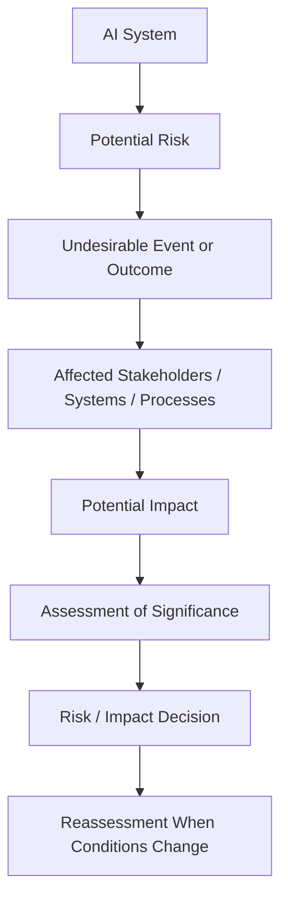
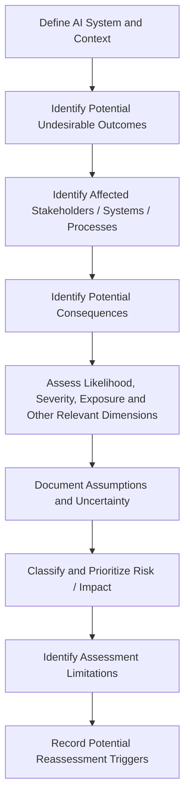

# 01 — AI Risk and Impact Assessment

## Learning Objectives

By the end of this chapter, you should be able to:

- Explain what AI risk means in an enterprise context.
- Distinguish **risk**, **uncertainty**, **harm**, and **impact**.
- Identify potential sources of AI risk.
- Distinguish direct and indirect impacts.
- Identify intended and unintended consequences.
- Identify affected individuals, groups, organizations, systems, and processes.
- Analyze risk across multiple relevant dimensions rather than relying on a single score.
- Explain the relationship between likelihood, severity, exposure, and context.
- Perform a structured qualitative AI risk and impact assessment.
- Understand when quantitative assessment may be useful and where it can create false precision.
- Classify and prioritize AI risks and impacts proportionately.
- Make assumptions and uncertainty visible during assessment.
- Recognize the limitations of an AI risk assessment.
- Identify circumstances that may require risk and impact reassessment.
- Reason about risk and impact in consequential enterprise AI scenarios.

---

## Prerequisites

This chapter assumes familiarity with:

- AI and machine-learning systems
- Generative AI and LLM-based systems
- Basic enterprise software concepts
- AI system lifecycle thinking
- Enterprise governance concepts

The chapter does not require a specialized mathematical risk-management background.

---

## Estimated Reading Time

**35–45 minutes**

---

## Before We Start

Consider an AI-assisted hiring system.

The system analyzes candidate information and produces a recommendation to a recruiter.

Suppose the system is wrong for one candidate.

At first glance, that may look like a model-quality problem.

But an enterprise risk assessment asks broader questions:

- What kind of error occurred?
- Who is affected?
- What decision does the error influence?
- What happens if the recruiter relies on the recommendation?
- Can the decision be reversed?
- Could the same failure affect thousands of candidates?
- Could some groups be affected differently?
- How significant could the consequences be?
- What assumptions are we making?
- What changes if the system becomes more autonomous?

The important shift is this:

> **Enterprise AI risk assessment is not simply asking whether an AI system can be wrong. It is asking what could go wrong, what consequences could follow, who or what could be affected, and how significant those consequences could be in context.**

That is the purpose of this chapter.

---

## 1. Why AI Risk and Impact Assessment Exists

AI systems introduce a particular engineering challenge.

Traditional software can fail because of implementation defects, incorrect requirements, infrastructure failures, or unexpected inputs.

AI systems can also fail in these ways, but they introduce additional sources of uncertainty:

- probabilistic behavior
- imperfect training data
- incomplete evaluation coverage
- distribution changes
- ambiguous inputs
- model limitations
- generated outputs that appear plausible but are incorrect
- context-dependent behavior
- human over-reliance
- changing downstream use
- model or provider changes

A technically functional AI system can therefore still create unacceptable enterprise consequences.

Consider two systems.

### System A

An internal AI tool summarizes meeting notes.

An incorrect summary causes a minor inconvenience and is easily corrected.

### System B

An AI system recommends whether a customer should receive a financially significant service.

An incorrect recommendation may affect the customer's access to that service.

Both systems can produce incorrect outputs.

But the **risk and impact context are different**.

Therefore:

> **AI risk cannot be understood only by looking at model accuracy or technical failure rate.**

The enterprise must understand the relationship between:

```text
AI System
    ↓
Potential Failure / Undesirable Outcome
    ↓
Affected Stakeholders / Systems / Processes
    ↓
Consequences
    ↓
Significance in Context
```

This is the foundation of enterprise AI risk and impact assessment.

---

# 2. Mental Model: From AI Behavior to Enterprise Consequence

A useful starting mental model is:



The important point is that the AI model itself is only one part of the assessment.

The same model behavior can produce different consequences depending on:

- where the system is deployed
- who relies on it
- what decision it influences
- how much authority it has
- whether the result can be reversed
- how widely it is used
- what happens when it fails

This is why enterprise AI risk is **context-dependent**.

---

# 3. Risk, Uncertainty, Harm and Impact

These concepts are closely related but should not be collapsed into one term.

## 3.1 Risk

A useful conceptual definition is:

> **Risk is the potential for an undesirable event, outcome, or condition.**

For example:

> An AI hiring system may incorrectly rank a qualified candidate lower than appropriate.

That describes a potential undesirable outcome.

---

## 3.2 Uncertainty

Uncertainty refers to what the enterprise does not know or cannot predict with sufficient confidence.

Examples include:

- uncertainty about model behavior on unseen inputs
- uncertainty about future user behavior
- uncertainty about how a model will behave after a provider update
- uncertainty about how an AI system will perform under changing conditions
- uncertainty about the consequences of a new use case

Uncertainty can increase difficulty in assessing risk.

However:

> **Uncertainty is not itself synonymous with risk.**

Uncertainty may exist without an undesirable consequence.

Conversely, an enterprise may have substantial evidence about a known risk while uncertainty about the exact frequency or magnitude remains.

---

## 3.3 Harm

Harm refers to an adverse effect or negative consequence experienced by an affected party.

Examples may include:

- financial loss
- denial of an opportunity
- operational disruption
- reputational damage
- incorrect decision-making
- loss of trust
- unsafe action
- unfair treatment

Harm is therefore closely related to consequences, but it should be considered in context rather than treated as a generic label for every AI failure.

---

## 3.4 Impact

Impact describes the **consequence or significance** associated with an undesirable outcome.

For example:

```text
Risk:
AI system may produce an incorrect customer eligibility recommendation.

Impact:
An incorrect recommendation may cause a customer
to be denied or delayed access to a significant service.
```

Risk and impact are therefore different questions:

```text
Risk
↓
What undesirable outcome could occur?

Impact
↓
What could happen as a consequence?
How significant could that consequence be?
```

A system may have:

- relatively frequent but low-impact errors
- rare but severe failures
- uncertain likelihood but potentially high impact
- different impacts for different stakeholders

This distinction is fundamental to proportional enterprise assessment.

---

# 4. Sources of AI Risk

AI risk can originate from many parts of the system and its surrounding environment.

A useful conceptual model is:

```text
AI Risk Sources
│
├── Data
├── Model
├── System / Application
├── Human Interaction
├── Organizational Context
├── Operational Context
├── External Dependencies
└── Use-Case / Decision Context
```

These categories are not a universal risk taxonomy.

They are a reasoning aid for identifying potential sources of risk.

---

## 4.1 Data-Related Sources

Examples include:

- incomplete information
- inaccurate information
- outdated information
- inappropriate data
- insufficient representation
- unexpected data distributions
- changes in data over time

The important point for ENT-03 is not to re-teach data governance.

The risk question is:

> **What risk or impact could arise because the AI system depends on particular data characteristics?**

Detailed data ownership, provenance, authority, and governance belong to ENT-05.

---

## 4.2 Model-Related Sources

Examples include:

- incorrect predictions
- hallucinated or unsupported outputs
- poor generalization
- sensitivity to inputs
- unstable behavior
- model limitations
- unexpected behavior under edge cases
- changes in model behavior after updates

The assessment should consider not only whether a model can fail, but what happens when it fails in the actual enterprise context.

---

## 4.3 System and Application Sources

The model may be only one component of a larger AI system.

Risk may arise from:

- incorrect application logic
- incorrect routing
- inappropriate use of model output
- missing validation
- incorrect downstream actions
- unintended automation
- incorrect interpretation of model outputs

This distinction matters because:

> **A model can perform as designed while the overall AI system still creates unacceptable risk.**

---

## 4.4 Human Interaction Sources

Humans may:

- misunderstand model outputs
- over-trust recommendations
- ignore uncertainty
- fail to recognize limitations
- use the system outside its intended purpose
- apply outputs without appropriate review

Human interaction therefore forms part of the risk context.

Detailed human oversight and control design are covered in File 02.

---

## 4.5 Organizational and Contextual Sources

Risk can change when organizational conditions change.

Examples include:

- new business processes
- new users
- new decision authority
- changed business objectives
- expanded deployment
- increased reliance on AI output

A system that was acceptable for internal experimentation may not be acceptable when used for consequential enterprise decisions.

---

## 4.6 External Dependency Sources

AI systems may depend on:

- model providers
- external services
- third-party data
- external infrastructure
- changing upstream systems

A provider or dependency change may alter system behavior or risk.

ENT-03 assesses the resulting risk and impact.

Detailed provider strategy belongs to ENT-07.

---

# 5. Direct and Indirect Impact

Impact is not always limited to the immediate user.

## Direct Impact

A direct impact occurs to a party or system immediately affected by an AI outcome.

Example:

> An AI recommendation causes a customer application to be rejected.

The customer experiences the immediate consequence.

---

## Indirect Impact

An indirect impact occurs through a downstream effect.

Example:

```text
AI Recommendation
      ↓
Human Decision
      ↓
Operational Action
      ↓
Downstream Customer Consequence
```

The AI output may not directly change the customer's state.

Instead, it influences a human or another system that produces the final consequence.

This distinction is important because enterprise AI systems are often embedded in larger decision chains.

---

# 6. Intended and Unintended Consequences

AI systems are designed for a purpose.

That purpose does not define every consequence that can occur.

## Intended Consequence

The expected outcome of using the system.

For example:

> An enterprise copilot is intended to reduce the time employees spend searching for internal information.

---

## Unintended Consequence

An outcome that was not part of the intended purpose.

For example:

> Employees begin relying on generated answers without independently checking important information.

The system may still be delivering its intended productivity benefit while creating an unintended risk.

Therefore:

> **Risk assessment must examine system use beyond the happy path described by the original business objective.**

---

## 7. Identifying Affected Stakeholders

A risk assessment should explicitly ask:

> **Who or what could be affected if this system behaves undesirably?**

Potential affected parties include:

- direct users
- customers
- employees
- candidates
- partners
- suppliers
- operational teams
- downstream decision-makers
- other enterprise systems
- business units
- organizations
- broader groups or communities

The affected stakeholder is not always the person interacting directly with the AI system.

For example:

```text
Recruiter
   ↓
AI Hiring Recommendation
   ↓
Hiring Decision
   ↓
Candidate
```

The recruiter is the direct user.

The candidate may be the party experiencing the more significant consequence.

A good assessment therefore traces the **decision chain**, not just the user interface.

---

# 8. Risk and Impact Dimensions

There is rarely one universally sufficient dimension for enterprise AI risk.

Depending on context, relevant dimensions may include:

- likelihood
- severity
- exposure
- reversibility
- detectability
- scale
- uncertainty
- affected population
- decision consequence
- autonomy
- business criticality
- potential harm

These dimensions should not automatically be collapsed into one number.

For example:

> A failure may have low estimated likelihood but extremely high consequence.

Reducing that situation to a single average score can hide an important engineering reality.

---

## 9. Likelihood, Severity and Exposure

These concepts are useful for reasoning about significance.

## Likelihood

Likelihood asks:

> **How plausible or probable is the undesirable event or outcome?**

The exact estimation method depends on the enterprise context.

Likelihood may be uncertain, particularly when evidence is limited.

---

## Severity

Severity is one dimension that may be used to characterize the significance of an impact.

It asks:

> **How significant could the consequence be if the undesirable outcome occurs?**

Severity may differ across affected stakeholders.

Severity does not replace analysis of the actual consequence or affected stakeholders.

---

## Exposure

Depending on the enterprise's assessment approach, exposure may describe the extent to which a system, population, process, or decision context is subject to the risk.

Factors may include:

- number of users
- number of decisions
- frequency of use
- duration
- scale of deployment
- dependency on the system

---

## Why These Must Be Considered Together

Consider two hypothetical failures:

| Failure | Likelihood | Severity |
|---|---|---|
| Incorrect internal meeting summary | High | Low |
| Incorrect high-consequence decision recommendation | Low | High |

A simple focus on likelihood could prioritize the first problem.

A simple focus on severity could ignore how rarely the second occurs.

Enterprise assessment therefore requires contextual reasoning across multiple dimensions.

---

## 10. Context-Dependent Risk

The same AI capability can have very different risk depending on how it is used.

Consider a language model generating text.

### Use Case A

Drafting an internal brainstorming document.

### Use Case B

Generating a recommendation used in a consequential customer decision.

The underlying model capability may be similar.

The enterprise risk context is not.

A useful mental model is:

```text
Same AI Capability
        +
Different Use Context
        ↓
Different Decision Consequence
        ↓
Different Risk / Impact
```

Therefore:

> **Risk belongs to the AI system in its context of use, not only to the underlying model.**

This is one of the most important enterprise AI risk concepts.

---

# 11. High-Impact and Consequential AI Systems

Some AI systems influence decisions with significant consequences.

Examples may include:

- employment-related decisions
- financial decisions
- customer eligibility
- healthcare-related decision support
- access to important services
- significant operational decisions

The exact definition of a high-impact or consequential system depends on the applicable enterprise and external context.

The engineering principle is:

> **The greater the consequence of an AI-supported decision, the more carefully the enterprise should understand and assess the associated risks and impacts.**

This does not mean that every consequential system requires an identical control set.

It means consequence should influence proportional assessment.

---

## 12. Risk Identification

Risk identification asks:

> **What could go wrong?**

A useful approach is to examine the system across several perspectives.

### System Perspective

- What can the AI system do incorrectly?
- What assumptions does it make?
- What failure modes are plausible?

### Decision Perspective

- What decisions depend on its output?
- What happens if the output is wrong?
- Can humans or downstream systems act incorrectly because of it?

### Stakeholder Perspective

- Who could be affected?
- Who bears the consequence?
- Are different stakeholders affected differently?

### Context Perspective

- Where is the system being used?
- What changes if its scope expands?
- What happens when conditions change?

### Dependency Perspective

- What external components or providers influence behavior?
- What happens if they change?

This produces a more complete risk picture than simply asking whether the model is accurate.

---

## 13. Impact Identification

After identifying potential undesirable outcomes, examine their consequences.

A useful reasoning sequence is:

```text
Potential Failure
      ↓
Immediate Consequence
      ↓
Downstream Consequence
      ↓
Affected Stakeholders
      ↓
Operational / Business / Other Impact
      ↓
Significance in Context
```

The goal is not to predict every possible consequence.

The goal is to identify the consequences that are material to the enterprise decision.

---

# 14. Qualitative vs Quantitative Assessment

Risk assessment can be qualitative, quantitative, or a combination of both.

## Qualitative Assessment

Qualitative assessment uses structured judgments such as:

- low
- moderate
- high
- very high

or descriptive reasoning around likelihood and consequence.

### Advantages

- easier to apply when evidence is limited
- useful early in the lifecycle
- supports expert reasoning
- avoids pretending that uncertain estimates are precise

### Limitations

- subjective
- can vary between assessors
- categories may be interpreted inconsistently
- may hide uncertainty if not documented

---

## Quantitative Assessment

Quantitative assessment uses numerical estimates or measurements where meaningful evidence exists.

Examples may include:

- observed failure rates
- incident frequencies
- affected population estimates
- financial exposure estimates
- measured performance under defined conditions

### Advantages

- can support comparison
- can make assumptions explicit
- can provide stronger evidence when reliable data exists

### Limitations

- numerical precision may exceed evidence quality
- rare events may be difficult to estimate
- future conditions may differ from historical observations
- different impact dimensions may be difficult to combine meaningfully

Therefore:

> **A numerical risk score is not automatically more rigorous than a qualitative assessment.**

The quality of the reasoning and evidence matters more than whether the output contains numbers.

---

## 15. Avoiding False Precision

Suppose an assessment states:

```text
Risk Score = 7.43 / 10
```

That number appears precise.

But ask:

- Where did 7.43 come from?
- How reliable is the likelihood estimate?
- How was severity measured?
- What assumptions were made?
- Can the components actually be combined?
- What does the difference between 7.43 and 7.52 mean?

If the underlying evidence is weak, numerical precision can create an illusion of certainty.

A better assessment may say:

> The likelihood is uncertain because the system has limited evidence under the target operating conditions, but the potential consequence is high. The risk therefore requires attention despite uncertainty in the frequency estimate.

That statement preserves the important engineering information.

---

# 16. Risk Classification

Risk classification helps the enterprise organize and prioritize risk.

Classification may consider:

- potential severity
- likelihood
- exposure
- decision consequence
- affected population
- autonomy
- reversibility
- uncertainty
- business context
- criticality
- applicable obligations

Classification should support a decision.

It should not become an administrative exercise where a label is assigned without understanding the underlying risk.

---

## Proportionality

A useful principle is:

```text
Lower Risk / Lower Impact
        ↓
Lighter Assessment

Higher Risk / Higher Impact
        ↓
Stronger Assessment
```

The actual thresholds depend on context.

There is no universal requirement that every enterprise AI system use the same risk categories or numerical thresholds.

---

# 17. Risk Prioritization

Identifying many risks does not automatically tell the enterprise which risks require the greatest attention.

Prioritization should consider factors such as:

- potential severity
- likelihood
- exposure
- uncertainty
- affected stakeholders
- reversibility
- ability to detect failure
- decision consequence
- business context

For example:

### Risk A

High frequency, easily detected, quickly reversible, low consequence.

### Risk B

Low frequency, difficult to detect, difficult to reverse, high consequence.

Risk B may deserve greater attention despite its lower estimated frequency.

This illustrates why:

> **Risk prioritization requires reasoning across dimensions rather than mechanically sorting by one score.**

---

## 18. Assumptions and Uncertainty

Every risk assessment contains assumptions.

Examples:

- expected user behavior
- expected workload
- assumed review behavior
- expected data quality
- assumed model behavior
- assumed operating environment
- assumed level of human intervention

These assumptions should be visible.

A useful assessment records:

```text
Assessment
    ↓
Evidence
    ↓
Assumptions
    ↓
Uncertainty
    ↓
Confidence in Assessment
```

Hidden assumptions can become hidden risk.

For example:

> “A human will review every AI recommendation.”

If that statement is merely an assumption rather than an observed operating condition, the risk assessment may be overly optimistic.

The detailed design of meaningful human oversight belongs to File 02, but the assumption itself must be recognized during risk assessment.

---

# 19. Risk Decision Context

Risk assessment informs enterprise decisions, but the assessment itself should not be confused with the governance mechanism used to make those decisions.

The assessment should make clear:

- what risk has been identified
- what impact has been identified
- how significant the risk appears
- what evidence supports the assessment
- what assumptions remain
- what uncertainty remains

The organizational decision rights, accountability structures, approval mechanisms, and escalation models that act on this information are owned by ENT-02.

The important relationship is:

```text
Risk / Impact Assessment
          ↓
Risk Significance
          ↓
Enterprise Decision
```

ENT-03 provides the risk and impact understanding that informs the decision without re-teaching the governance structure behind it.

---

# 20. Risk Assessment Limitations

A risk assessment is not a prediction of the future.

Important limitations may include:

- incomplete evidence
- unknown failure modes
- changing system behavior
- changing users
- changing data
- changing business context
- uncertain future impact
- limited historical experience
- assumptions about human behavior
- dependency changes

Therefore:

> **A risk assessment should communicate the quality and limitations of the evidence supporting the assessment.**

An assessment that says “low risk” without explaining uncertainty may be less useful than an assessment that identifies meaningful uncertainty explicitly.

---

## 21. Practical Enterprise Example — AI-Assisted Hiring

Consider an AI system that analyzes candidate information and provides a hiring recommendation.

## Step 1 — Define the System Context

The system:

- processes candidate information
- produces a recommendation
- influences recruiter decisions

The system does not necessarily make the final decision itself.

---

## Step 2 — Identify Potential Risks

Potential risks might include:

- incorrect recommendations
- inappropriate ranking
- reliance on incomplete information
- unexpected behavior for certain candidate profiles
- misuse outside the intended hiring workflow

---

## Step 3 — Identify Potential Impacts

Potential impacts may include:

- candidates being incorrectly deprioritized
- recruiter time being wasted
- incorrect hiring decisions
- organizational consequences
- reputational consequences

Different stakeholders may experience different impacts.

---

## Step 4 — Consider Risk Dimensions

The assessment may consider:

- potential severity
- likelihood
- scale
- affected population
- reversibility
- uncertainty
- decision consequence

The objective is not to produce a universally correct numerical score.

The objective is to establish a defensible understanding of significance.

---

## Step 5 — Identify Assumptions

Possible assumptions include:

- recruiters understand system limitations
- recruiters review recommendations
- candidate information is sufficiently representative
- the system remains within its intended scope

These assumptions should be made visible rather than treated as facts.

---

## Step 6 — Establish Assessment Conclusion

A reasonable conclusion might be:

> The system influences a consequential employment-related decision. Although the system does not make the final decision autonomously, incorrect recommendations could create significant downstream consequences. The assessment therefore requires careful consideration of uncertainty, affected stakeholders, decision consequence, and the assumptions surrounding downstream human review.

Notice what this conclusion does **not** do.

It does not prescribe the detailed human oversight mechanism.

That is File 02.

It does not specify risk treatment or residual-risk acceptance.

That is File 03.

The purpose here is to establish the **risk and impact understanding** that those later decisions depend on.

---

## 22. Practical Enterprise Example — Enterprise Copilot

Consider an enterprise copilot used by employees.

At first glance, the system may appear relatively low risk because employees remain responsible for their work.

But risk depends on the use context.

### Lower-Consequence Use

The copilot helps draft an internal brainstorming document.

Potential impact from an incorrect output may be limited.

### Higher-Consequence Use

The same copilot generates recommendations that employees use to make important customer or financial decisions.

The decision consequence changes.

Therefore:

```text
Same General AI Capability
          ↓
Different Use Context
          ↓
Different Decision Consequence
          ↓
Different Risk / Impact Assessment
```

The lesson is:

> **Do not classify an AI system only by its technology. Assess how the enterprise actually uses it.**

---

# 23. Practical Enterprise Example — Autonomous or Semi-Autonomous AI

Consider an AI system that can perform actions rather than merely generate recommendations.

Increasing autonomy can change risk because the system may move from:

```text
Generate Output
      ↓
Human Decides
```

toward:

```text
Generate Output
      ↓
System Performs Action
```

The potential consequence may therefore become more direct.

Relevant assessment questions include:

- What actions can the system take?
- What decisions does it influence?
- What is the consequence of an incorrect action?
- How reversible are those actions?
- How large is the affected population?
- What external systems are affected?
- What assumptions does the assessment make about system behavior?

Detailed agent safety mechanisms and action-level controls belong to AGT-11.

The ENT-03 concern is the **enterprise risk and impact significance** of the autonomy.

---

# 24. Practical Enterprise Example — Model or Provider Change

Suppose an enterprise changes the model provider supporting an existing AI application.

The application architecture may remain largely unchanged.

However, the behavior of the AI component may change.

Potential risk questions include:

- Has expected behavior changed?
- Have known failure modes changed?
- Has uncertainty changed?
- Has the affected population changed?
- Are previous assumptions still valid?
- Does previous evidence remain representative?
- Has the decision consequence changed?

The important principle is:

> **A system's previous risk assessment may no longer be sufficient when material assumptions or system behavior change.**

Provider strategy itself belongs to ENT-07.

ENT-03 focuses on the resulting risk and impact reassessment.

---

## 25. Common Risk Assessment Mistakes

## Mistake 1 — Treating Model Accuracy as Overall Risk

A model metric does not capture every enterprise consequence.

**Correction:**

Assess the complete AI system and its context of use.

---

## Mistake 2 — Treating Risk and Impact as Synonyms

Risk describes the potential undesirable outcome.

Impact describes the consequence or significance.

**Correction:**

Keep the concepts distinct.

---

## Mistake 3 — Looking Only at the Direct User

The person operating the system may not be the person affected by its output.

**Correction:**

Trace downstream stakeholders and decision consequences.

---

## Mistake 4 — Using One Risk Score for Everything

A single number can hide uncertainty and important dimensions.

**Correction:**

Use multiple relevant dimensions and document assumptions.

---

## Mistake 5 — Assuming Low Likelihood Means Low Risk

A rare event may have severe consequences.

**Correction:**

Consider likelihood together with severity, exposure, reversibility, uncertainty, and context.

---

## Mistake 6 — Treating a Risk Assessment as Permanent

The system and its environment can change.

**Correction:**

Identify material conditions that may require reassessment.

---

## Mistake 7 — Confusing Uncertainty with Risk

Uncertainty describes limited knowledge or predictability.

Risk concerns potential undesirable outcomes.

**Correction:**

Record uncertainty as a factor affecting the quality of the assessment.

---

## Mistake 8 — Treating Human Review as Automatically Eliminating Risk

The existence of a human reviewer does not by itself establish effective control.

**Correction:**

Record the assumption and assess the actual decision context. Detailed oversight analysis belongs to File 02.

---

## Mistake 9 — Turning Risk Assessment into Compliance Checklisting

A list of required fields does not necessarily produce good risk reasoning.

**Correction:**

Focus on potential outcomes, affected stakeholders, consequences, evidence, assumptions, uncertainty, and proportionality.

---

## Mistake 10 — Re-Teaching Neighboring Domains

AI risk may involve security, privacy, data, resilience, agents, or production systems.

That does not mean ENT-03 owns those engineering disciplines.

**Correction:**

Assess their relevance as risk dimensions while respecting the corresponding domain's ownership.

---

## 26. AI Risk and Impact Assessment Reasoning Framework

When assessing an enterprise AI system, use the following reasoning sequence:



This is a reasoning framework, not a universal mandatory enterprise risk process.

The appropriate implementation depends on enterprise context.

---

# 27. From Assessment to the Next Chapter

Risk and impact assessment provides the foundation for subsequent ENT-03 decisions.

```text
Risk + Impact Assessment
          ↓
Downstream Enterprise Decisions
```

The next chapter examines how risk and impact inform:

- oversight
- human control
- assurance
- assurance evidence

The following chapter examines:

- risk treatment
- residual risk
- assurance maintenance
- continuous reassessment

The separation is deliberate:

> **This file establishes what the risk and impact are before deciding how the enterprise should oversee, assure, treat, or revisit them.**

---

# 28. When Should Risk and Impact Be Reassessed?

A previous assessment may no longer represent the current system when material conditions change.

Potential triggers include:

- material model changes
- provider changes
- significant data changes
- new users
- new use cases
- expanded scope
- increased autonomy
- changed decision authority
- significant incidents
- emerging failure patterns
- changed business context
- changed impact
- changed assumptions

These triggers indicate that the previous risk and impact understanding may need to be revisited.

The detailed lifecycle process for continuous reassessment, assurance maintenance, and treatment of changing residual risk is covered in File 03.

The governance mechanism for lifecycle change control belongs to ENT-02.

---

## 29. Interview Questions

## 1. What is the difference between AI risk and AI impact?

**Expected answer:**

Risk describes the potential for an undesirable event, outcome, or condition. Impact describes the consequence or significance if that undesirable outcome occurs. They are related but should not be treated as synonyms.

---

## 2. Why is model accuracy insufficient for enterprise AI risk assessment?

**Expected answer:**

Accuracy measures a particular aspect of model behavior under defined conditions. Enterprise risk also depends on decision consequence, affected stakeholders, scale, reversibility, uncertainty, downstream use, autonomy, and the broader system context.

---

## 3. Can a low-probability event still represent high risk?

**Expected answer:**

Yes. Low likelihood does not imply low significance. A rare event can have severe consequences, particularly when the affected population, decision consequence, or irreversibility is high.

---

## 4. Why should risk assessment consider the AI system rather than only the model?

**Expected answer:**

The model is only one component. Application logic, downstream systems, human use, decision processes, external dependencies, and operating context can all change the consequences of model behavior.

---

## 5. What is the difference between uncertainty and risk?

**Expected answer:**

Uncertainty concerns limited knowledge or predictability. Risk concerns potential undesirable outcomes and their consequences. Uncertainty can affect confidence in the risk assessment without being synonymous with risk.

---

## 6. Why can a single risk score be misleading?

**Expected answer:**

A single score can hide important dimensions such as uncertainty, severity, reversibility, exposure, or stakeholder differences. Numerical precision can also exceed the quality of the underlying evidence.

---

## 7. How can the same AI capability have different risk in different contexts?

**Expected answer:**

Risk depends on how the capability is used, what decisions it influences, who is affected, the consequences of failure, the scale of use, and the degree of autonomy. The same model can therefore have very different enterprise risk profiles.

---

## 8. Why should indirect impacts be considered?

**Expected answer:**

AI output may influence a human or downstream system that creates the actual consequence. Focusing only on the immediate AI output can therefore miss material downstream effects.

---

## 9. What should be documented when uncertainty is significant?

**Expected answer:**

The assessment should document the relevant uncertainty, assumptions, evidence limitations, and how those limitations affect confidence in the assessment.

---

## 10. When should an AI risk assessment be revisited?

**Expected answer:**

When material conditions change, such as model/provider changes, new users or use cases, expanded scope, increased autonomy, incidents, emerging failure patterns, changed assumptions, changed impact, or changed business context.

---

## 30. Quick Revision

Remember these distinctions:

### Risk

> What undesirable outcome could occur?

### Impact

> What consequence could result, and how significant could it be?

### Uncertainty

> What do we not know or cannot predict confidently?

### Assessment

> What evidence and reasoning tell us about the significance of the risk and impact?

### Proportionality

> How should assessment depth reflect the context and consequence?

### Reassessment

> What has changed that could invalidate the previous assessment?

---

## Core Reasoning Chain

```text
AI System
    ↓
Potential Risk
    ↓
Undesirable Outcome
    ↓
Affected Stakeholders / Systems
    ↓
Potential Impact
    ↓
Likelihood / Severity / Exposure / Context
    ↓
Assumptions + Uncertainty
    ↓
Risk / Impact Classification
    ↓
Prioritization
    ↓
Decision Inputs
    ↓
Potential Reassessment Triggers
```

---

# 31. Key Takeaways

1. **AI risk is contextual.** The same AI capability can have different risk depending on how it is used.

2. **Risk and impact are different.** Risk concerns potential undesirable outcomes; impact concerns their consequences and significance.

3. **AI risk extends beyond model accuracy.** The complete system, decision process, human interaction, dependencies, and operating context matter.

4. **Stakeholders may be indirect.** The person using the AI system may not be the person experiencing the consequence.

5. **Likelihood is not enough.** Severity, exposure, reversibility, uncertainty, scale, and decision consequence may also matter.

6. **Quantification does not automatically create rigor.** A precise number built on weak assumptions can create false confidence.

7. **Assumptions must be visible.** Hidden assumptions can become hidden risk.

8. **Risk classification should support decisions.** Classification is useful when it helps determine proportional attention.

9. **Higher consequence generally demands more careful assessment.** Proportionality is more useful than applying identical treatment to every AI system.

10. **Risk assessment is not permanent.** Material changes can invalidate previous assumptions and require reassessment.

11. **ENT-03 assesses enterprise risk and impact.** It does not re-teach security, privacy, data governance, agent safety, production engineering, or other domain-owned disciplines.

12. **Risk assessment is the foundation for later decisions.** Oversight, assurance, treatment, and reassessment build on the risk and impact understanding established here.

---

## 32. Further Reading

Use authoritative sources appropriate to the enterprise context when deeper framework-specific understanding is required.

Relevant areas include:

- AI risk management
- AI impact assessment
- enterprise risk assessment
- AI assurance
- AI governance
- lifecycle risk management
- high-impact and consequential AI systems

Framework-specific material should be treated as an implementation or reference perspective rather than as the conceptual foundation of ENT-03.

---
