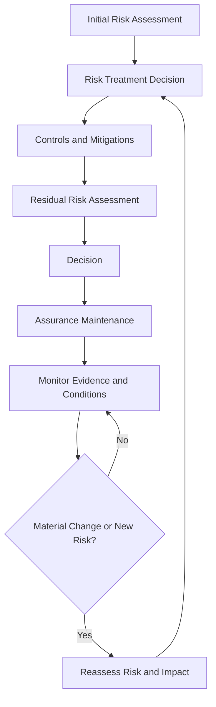

# AI Risk Treatment, Assurance and Continuous Reassessment

## Learning Objectives

By the end of this chapter, you should be able to:

- Explain why AI risk assessment is not the end of the risk-management process.
- Distinguish initial risk from residual risk after treatment.
- Explain the purpose of AI risk treatment.
- Distinguish treatment decisions from the controls and mitigations used to implement them.
- Compare risk treatment responses such as avoidance, reduction, transfer, acceptance, restriction, pause, and retirement.
- Select risk treatment approaches based on context rather than applying a universal hierarchy.
- Evaluate whether a treatment actually reduces the relevant risk.
- Explain how assurance must be maintained after initial assessment.
- Identify when assurance evidence should be refreshed.
- Recognize conditions that require risk or impact reassessment.
- Explain how material changes, incidents, emerging risks, and changing operating conditions can invalidate previous conclusions.
- Determine when risk should be accepted, escalated, further treated, restricted, paused, or retired.
- Apply continuous reassessment reasoning to realistic enterprise AI scenarios.
- Explain how risk treatment and reassessment support defensible enterprise decisions over the AI lifecycle.

---

## Prerequisites

Before reading this chapter, you should understand the concepts covered in:

- [01-AI-Risk-and-Impact-Assessment.md](./01-AI-Risk-and-Impact-Assessment.md)
- [02-AI-Oversight-Human-Control-and-Assurance.md](./02-AI-Oversight-Human-Control-and-Assurance.md)

Those chapters established:

- how AI risks and impacts are identified and assessed;
- how risk significance depends on context;
- how oversight and human control should be proportionate to risk and impact;
- how assurance provides evidence for justified confidence.

This chapter builds on those concepts rather than re-teaching them.

---

## Estimated Reading Time

**35–45 minutes**

---

## Before We Start

Risk assessment produces an understanding of what could go wrong and how significant the resulting impact could be.

Oversight and assurance establish how the enterprise supervises the AI system and gathers evidence that relevant expectations are being satisfied.

But neither activity answers the final operational question:

> **What should the enterprise do about the identified risk, and when should it reconsider that decision?**

A risk that has been identified but not treated may remain unacceptable.

A risk that has been treated may still remain above the enterprise's acceptable threshold.

A control that worked during initial validation may become ineffective after a material system change.

Evidence that was sufficient six months ago may no longer justify confidence after a new model, new data source, new user population, or new business purpose is introduced.

Therefore, AI risk management must continue beyond initial assessment.

The central progression of this chapter is:

```text
Initial Risk
     ↓
Risk Treatment
     ↓
Controls / Mitigations
     ↓
Residual Risk
     ↓
Decision
     ↓
Assurance Maintenance
     ↓
Continuous Reassessment
     ↓
Changed Conditions?
     ↓
Reassess / Retreat / Restrict / Pause / Retire
```

The important engineering idea is simple:

> **Risk treatment is a decision, not a declaration that risk has disappeared.**

---

# 1. Why Risk Treatment and Reassessment Exist

An enterprise rarely operates an AI system in a completely static environment.

The system may change.

The model may change.

The data may change.

Users may change.

The business purpose may change.

External obligations may change.

New failure modes may appear.

Previously unknown risks may become visible.

Operational experience may reveal weaknesses that were not identified during initial assessment.

Therefore, an AI risk decision should be treated as a **decision under changing conditions**, rather than a permanent certification.

Consider an AI system used to prioritize customer-support cases.

During initial assessment, the enterprise identifies:

- potential prioritization errors;
- unequal treatment across customer groups;
- incorrect escalation;
- operational disruption;
- reputational impact.

The enterprise introduces controls:

- confidence thresholds;
- human review for high-impact cases;
- monitoring;
- escalation procedures;
- periodic validation.

The remaining risk may become acceptable.

However, suppose the organization later:

- expands the system to a new customer population;
- changes the model;
- adds a new data source;
- increases automation;
- changes the business process;
- removes human review for some cases.

The original risk decision may no longer be valid.

The important question is therefore not:

> "Was this AI system assessed?"

It is:

> **"Is the current risk decision still justified by current evidence and current conditions?"**

---

## 2. Mental Model: Risk Is Managed, Not Deleted

A useful mental model is:

```text
                ┌───────────────────────┐
                │     Initial Risk      │
                └───────────┬───────────┘
                            │
                            ▼
                ┌───────────────────────┐
                │   Risk Treatment      │
                └───────────┬───────────┘
                            │
                ┌───────────┴───────────┐
                │                       │
                ▼                       ▼
        Controls / Mitigations     Avoid / Restrict
                │                 / Pause / Retire
                │
                ▼
        ┌───────────────────────┐
        │    Residual Risk      │
        └───────────┬───────────┘
                    │
                    ▼
             Decision Point
                    │
        ┌───────────┼────────────┐
        ▼           ▼            ▼
     Accept      Escalate   Further Treat
        │           │            │
        └───────────┴────────────┘
                    │
                    ▼
          Assurance Maintenance
                    │
                    ▼
          Continuous Monitoring
                    │
                    ▼
             Changed Conditions?
                    │
              ┌─────┴─────┐
              │           │
             No          Yes
              │           │
              ▼           ▼
          Continue     Reassess
```

This model prevents a common mistake:

> Treating risk assessment as a one-time project milestone.

Risk management instead becomes a loop:

```text
Assess → Treat → Decide → Assure → Reassess → Decide Again
```

---

# 3. Risk Treatment

## 3.1 What Is Risk Treatment?

**Risk treatment** is the deliberate selection and application of actions intended to change the risk associated with an AI system.

Treatment may:

- reduce likelihood;
- reduce severity;
- reduce exposure;
- constrain the system's use;
- remove a risky capability;
- introduce additional controls;
- transfer certain consequences where appropriate;
- accept the remaining risk;
- or stop the activity entirely.

Risk treatment should therefore be understood as a decision process rather than a list of controls.

A treatment decision explains **why and how the enterprise is changing its risk position**.

Controls and mitigations are mechanisms used to implement or support that treatment.

For example:

```text
Risk:
AI may incorrectly prioritize high-impact customer cases.

Treatment decision:
Reduce the risk by requiring human review for high-impact cases.

Control:
High-impact cases are routed to trained reviewers.

Residual risk:
Some incorrect prioritization remains possible.

Decision:
Residual risk is accepted within the defined decision context.
```

The treatment decision connects the risk assessment to the actual enterprise response.

---

# 4. Risk Treatment Responses

There is no universal treatment hierarchy that applies to every AI system.

The appropriate response depends on:

- risk significance;
- impact;
- likelihood;
- affected stakeholders;
- business purpose;
- available controls;
- control effectiveness;
- uncertainty;
- operational constraints;
- legal or organizational obligations;
- acceptable risk thresholds;
- and the enterprise's decision context.

Common treatment responses include the following.

---

## 4.1 Avoid

**Avoidance** means changing or stopping the proposed use so that the relevant risk is no longer incurred through that activity.

Examples:

- deciding not to deploy an AI capability for a high-risk use case;
- removing a particularly risky feature;
- declining to automate a consequential decision.

Avoidance is especially relevant when the enterprise cannot reasonably reduce the risk to an acceptable level.

---

## 4.2 Reduce

**Reduction** means taking actions intended to decrease the likelihood, severity, exposure, or other relevant dimensions of risk.

Examples:

- narrowing the system's operating scope;
- improving validation;
- adding additional review;
- improving input quality;
- introducing decision thresholds;
- restricting outputs to lower-risk actions.

Reduction does not necessarily eliminate the risk.

Its purpose is to move the risk toward an acceptable level.

---

## 4.3 Transfer

**Transfer** means allocating some aspect of risk responsibility or consequence to another party or mechanism where appropriate.

Examples may include contractual arrangements, insurance, or third-party service arrangements.

Transfer should not be interpreted as making the underlying risk disappear.

For example:

```text
Enterprise Risk
      ↓
Contractual Arrangement
      ↓
Some Responsibility / Consequence Allocated Elsewhere
      ↓
Residual Enterprise Risk
```

The enterprise should still understand the remaining exposure and dependencies created by the transfer.

---

## 4.4 Accept

**Acceptance** means making a deliberate decision to retain the residual risk within the applicable decision context.

Acceptance should not mean:

- nobody noticed the risk;
- nobody decided what to do;
- the risk was ignored;
- or the existence of a control automatically makes the risk acceptable.

A defensible acceptance decision should be based on the available assessment and evidence.

Conceptually:

```text
Residual Risk
      ↓
Is the remaining risk acceptable
within the decision context?
      │
   ┌──┴──┐
  Yes    No
   │      │
   ▼      ▼
Accept   Further Treat / Escalate /
         Restrict / Pause / Retire
```

Acceptance is therefore a **risk decision**, not a claim that the system is risk-free.

---

## 4.5 Restrict

**Restriction** means limiting the system's use so that exposure to unacceptable or poorly understood conditions is reduced.

Examples:

- limiting the system to specific users;
- limiting supported use cases;
- limiting decision authority;
- restricting access to certain data;
- restricting automation to low-impact cases.

Restriction is particularly useful when the system may be useful in some contexts but inappropriate in others.

---

## 4.6 Pause

**Pause** means temporarily stopping the relevant AI activity while the enterprise investigates, treats, or reassesses the risk.

A pause may be appropriate when:

- evidence indicates an unexpected failure;
- a control appears ineffective;
- a significant incident occurs;
- risk conditions change materially;
- uncertainty becomes too high for continued operation.

A pause should not automatically be treated as permanent retirement.

It creates decision space while the enterprise determines what should happen next.

---

## 4.7 Retire

**Retirement** means ending the AI system or use case when continued operation is no longer justified.

Retirement may become appropriate when:

- risk cannot be reduced sufficiently;
- the system's purpose is no longer justified;
- required assurance cannot be maintained;
- material changes make the original design unsuitable;
- or continued operation creates unacceptable exposure.

Retirement is therefore a legitimate risk-treatment outcome, not necessarily a failure of engineering.

---

# 5. Selecting a Risk Treatment

Risk treatment should be proportional to the risk and context.

A useful reasoning sequence is:

```text
What is the relevant risk?
        ↓
How significant is it?
        ↓
Who or what could be affected?
        ↓
What treatment responses are available?
        ↓
What assumptions do those responses depend on?
        ↓
How effective are the proposed controls or mitigations?
        ↓
What residual risk remains?
        ↓
Is the residual risk acceptable?
        ↓
What decision follows?
```

This avoids a common implementation mistake:

> Selecting controls first and attempting to justify the risk decision afterward.

The correct direction is:

```text
Risk Understanding
      ↓
Treatment Decision
      ↓
Control / Mitigation Design
      ↓
Residual Risk Assessment
      ↓
Decision
```

The control or mitigation is therefore evaluated as part of the treatment rather than treated as the treatment decision itself.

---

# 6. Treatment Effectiveness

Implementing a treatment does not prove that the treatment worked.

Suppose an enterprise introduces human review for an AI-supported decision.

The existence of human review is not sufficient evidence that risk has been adequately reduced.

The enterprise may need to determine:

- Are reviewers qualified?
- Do they receive the information required to make the decision?
- Do they have sufficient time?
- Can they actually override the AI?
- Are they reviewing every relevant case?
- Are they following the intended process?
- Are reviewers overly dependent on AI recommendations?
- Does the control work under realistic operating conditions?

Therefore:

```text
Treatment Implemented
        ≠
Treatment Effective
```

A stronger model is:

```text
Treatment Decision
       ↓
Control / Mitigation Implemented
       ↓
Control / Mitigation Operates as Intended
       ↓
Evidence of Effectiveness
       ↓
Relevant Risk Actually Reduced?
       ↓
Residual Risk
```

This connects risk treatment to the assurance concepts established in the previous chapter without repeating the assurance model itself.

---

# 7. Residual Risk

## 7.1 What Is Residual Risk?

**Residual risk** is the risk that remains after selected treatments and controls or mitigations have been applied.

A useful conceptual model is:

```text
Initial Risk
      ↓
Risk Treatment
      ↓
Controls / Mitigations
      ↓
Residual Risk
```

Residual risk is important because controls rarely produce perfect protection.

For example:

```text
Initial Risk:
AI incorrectly prioritizes customer cases.

Treatment:
Introduce validation, thresholds, monitoring, and human review.

Residual Risk:
Some incorrect prioritization remains possible.

Decision:
Accept if sufficiently justified,
otherwise further treat, escalate,
restrict, pause, or retire.
```

The goal is therefore not necessarily:

> "Reduce risk to zero."

The goal is:

> **"Determine whether the remaining risk is acceptable and whether that decision remains justified."**

---

# 8. Residual Risk Decision

Residual risk creates a decision point.

```text
                 Residual Risk
                       │
                       ▼
          ┌────────────────────────┐
          │ Is the residual risk   │
          │ acceptable in context? │
          └────────────┬───────────┘
                       │
          ┌────────────┼────────────┐
          ▼            ▼            ▼
       Accept       Escalate    Further Treat
                                      │
                                      ▼
                              Restrict / Pause
                                      │
                                      ▼
                                    Retire
```

The actual decision depends on context.

An enterprise should avoid treating a single threshold or numerical score as universally sufficient.

Risk decisions may depend on:

- severity;
- likelihood;
- uncertainty;
- affected populations;
- reversibility;
- available safeguards;
- business purpose;
- evidence quality;
- and applicable obligations.

---

# 9. Why Assurance Must Be Maintained

Initial assurance does not automatically remain valid forever.

An AI system may continue operating for months or years after its initial assessment.

During that time:

- models may change;
- prompts or configurations may change;
- data may change;
- users may change;
- integrations may change;
- business objectives may change;
- operating environments may change;
- new incidents may occur;
- new risks may emerge.

Therefore, the evidence supporting continued confidence must remain relevant to the current system and operating context.

The key question becomes:

> **Does the evidence that supported the previous decision still support the current decision?**

A useful model is:

```text
Initial Assurance Evidence
          ↓
Current System and Context
          ↓
Evidence Still Relevant?
          ↓
Evidence Still Current?
          ↓
Controls Still Effective?
          ↓
System Still Within Assessed Context?
          ↓
Confidence Still Justified?
```

If the answer to one or more questions becomes "no", reassessment may be required.

---

# 10. Assurance Maintenance

Assurance maintenance means keeping the evidence and reasoning needed to support continued confidence in the AI system.

It may include:

- refreshing validation evidence;
- reviewing monitoring results;
- checking whether controls remain effective;
- updating relevant documentation;
- reviewing incidents and failures;
- reassessing changed assumptions;
- confirming that the system remains within its approved use context;
- repeating appropriate evaluations;
- reviewing evidence after material changes.

The exact frequency should depend on context.

A low-impact system operating in a stable environment may require less intensive reassessment than a system supporting consequential decisions.

Therefore:

> **Assurance maintenance should be proportionate to risk, impact, change, and uncertainty.**

The objective is not to generate evidence for its own sake.

The objective is to maintain evidence that remains capable of supporting the current risk decision.

---

## 11. Evidence Refresh and Evidence Validity

Evidence can become stale.

For example, an evaluation performed against an older model version may not establish confidence in a substantially changed model.

Similarly, evidence from one user population may not automatically establish confidence for a new population.

Evidence should therefore be reconsidered when its assumptions no longer match the current system.

A useful model is:

```text
Evidence
   ↓
What did this evidence establish?
   ↓
Under what conditions?
   ↓
Are those conditions still true?
   ↓
Does the evidence still support the current decision?
```

This prevents a common mistake:

> Reusing old evidence simply because it exists.

The relevant question is not:

> "Do we have evidence?"

It is:

> **"Does the available evidence still support the current decision?"**

Evidence refresh may therefore be triggered by:

- model changes;
- changed data;
- changed users or populations;
- changed business purpose;
- changed autonomy;
- changed controls;
- incidents;
- emerging risks;
- or other material changes.

---

# 12. Continuous Reassessment

## 12.1 Why Reassessment Is Necessary

Risk assessment describes a point in time.

Enterprise AI systems operate across time.

Therefore:

```text
Point-in-Time Assessment
          ↓
        Operation
          ↓
     New Evidence
          ↓
   Changed Conditions
          ↓
      Reassessment
          ↓
    Updated Decision
```

Continuous reassessment does not mean performing a complete risk assessment every day.

It means maintaining the ability to recognize when the previous assessment may no longer be valid.

---

## 12.2 Reassessment Triggers

Common reassessment triggers include:

### Model Changes

Examples:

- model replacement;
- major model version change;
- significant model configuration change;
- changed model behavior.

### Data Changes

Examples:

- new data sources;
- materially changed data distributions;
- new user populations;
- changes in data quality;
- new categories of information.

### User or Population Changes

Examples:

- expanding to new users;
- introducing a new customer segment;
- changing reviewer populations;
- increasing the scale of use.

### Business Purpose Changes

Examples:

- using a recommendation system for a more consequential decision;
- expanding an assistant into an action-taking workflow;
- changing the intended purpose of the AI system.

### Autonomy Changes

Examples:

- increasing the number of actions the system can take;
- reducing required human review;
- allowing the system to operate with less intervention.

### Provider or Dependency Changes

Examples:

- changing an external model provider;
- changing a critical model service;
- introducing a materially different external dependency.

These changes may alter the risk context even when the surrounding application appears unchanged.

### Obligation or Requirement Changes

Changes in:

- organizational policies;
- contractual obligations;
- applicable requirements;
- internal risk thresholds;
- governance expectations.

### Incidents and Failures

Examples:

- harmful outputs;
- unexpected behavior;
- control failures;
- significant user complaints;
- security or privacy events;
- operational failures with meaningful AI contribution.

### Emerging Risks

New information may reveal risks that were not understood during the original assessment.

Examples:

- newly discovered failure modes;
- new attack patterns;
- unexpected social or organizational impacts;
- new evidence about system limitations.

---

# 13. Material Change

Not every change requires the same response.

The key question is:

> **Could this change materially alter the AI system's risk, impact, control effectiveness, or assurance basis?**

A useful reasoning model is:

```text
Change
  ↓
Does it affect the assessed context?
  ↓
Does it affect risk or impact?
  ↓
Does it affect controls?
  ↓
Does it affect assurance evidence?
  ↓
Could previous conclusions become invalid?
  ↓
If yes → Reassess
```

Examples of potentially material changes include:

- replacing the underlying model;
- expanding into a new consequential use case;
- substantially increasing autonomy;
- changing the affected population;
- introducing materially different data;
- removing a human review step;
- changing the decision authority of the system.

The purpose of material-change assessment is not to create unnecessary bureaucracy.

It is to prevent the enterprise from treating a materially different system as though it were unchanged.

---

# 14. Risk Reassessment After an Incident

An incident can reveal that the original risk model was incomplete or that controls did not operate as expected.

The response should therefore go beyond asking:

> "How do we fix this incident?"

The enterprise should also ask:

- What happened?
- What risk materialized?
- Was the risk previously identified?
- Were assumptions incorrect?
- Did a control fail?
- Did the control exist but operate ineffectively?
- Was the operating context different from the assessed context?
- Does the incident reveal a broader risk?
- Does the residual-risk decision remain justified?
- Does the system need additional treatment?
- Should use be restricted or paused?

A useful model is:

```text
Incident
   ↓
Understand What Happened
   ↓
Identify Contributing Risk
   ↓
Review Existing Treatment
   ↓
Evaluate Control Effectiveness
   ↓
Reassess Risk / Impact
   ↓
Update Decision
```

An incident is therefore not only an operational event.

It can also be new evidence about the quality of the enterprise's risk assumptions.

---

# 15. Emerging Risk

Some risks become visible only after deployment.

This may happen because:

- the system interacts with users differently than expected;
- users adapt their behavior;
- new use cases emerge;
- system behavior changes at scale;
- external conditions change;
- new dependencies appear;
- previously unknown failure modes are discovered.

Emerging risk should not automatically be treated as evidence that the original assessment was negligent.

Enterprise AI systems operate in environments with uncertainty.

The engineering responsibility is to establish mechanisms capable of detecting and responding to meaningful changes.

Therefore:

> **A mature risk process is designed not only to predict known risks, but also to respond when new risks become visible.**

---

## 16. Continuous Reassessment Loop

The complete process can be represented as:



This is not a requirement to continuously restart the entire process.

Instead, it represents a feedback loop in which new evidence can trigger a new risk decision.

---

# 17. Relationship Between Risk Treatment, Assurance and Reassessment

These concepts should not be treated as separate activities.

They form a connected decision loop.

```text
Risk Assessment
      ↓
What can go wrong?
      ↓
Risk Treatment
      ↓
What should we do about it?
      ↓
Controls / Mitigations
      ↓
How will the response be implemented?
      ↓
Residual Risk Decision
      ↓
Is continued operation justified?
      ↓
Assurance Maintenance
      ↓
Does current evidence still support confidence?
      ↓
Reassessment
      ↓
Has anything changed?
      ↓
Updated Risk Decision
```

The relationships are:

- **Risk assessment** establishes what matters.
- **Risk treatment** determines how the enterprise responds.
- **Controls and mitigations** implement or support the treatment.
- **Assurance maintenance** keeps relevant evidence current enough to support continued confidence.
- **Residual risk assessment** determines what remains after treatment.
- **Reassessment** determines whether the previous decision remains valid when new evidence or changed conditions arise.

Together, they form an ongoing enterprise decision process.

---

# 18. Enterprise Example: AI Customer Eligibility Recommendation

Consider an AI system that recommends whether customer applications should receive additional review.

The system does not make the final decision, but its recommendation influences the workflow.

---

## 18.1 Initial Assessment

The enterprise identifies risks including:

- incorrect recommendations;
- unequal treatment;
- inappropriate escalation;
- operational delays;
- customer impact;
- reputational consequences.

The enterprise assesses the significance of these risks in context.

This work belongs to the risk and impact assessment established in Chapter 1.

---

## 18.2 Risk Treatment

The enterprise decides to:

- restrict the AI to recommendation rather than final decision authority;
- require human review for certain cases;
- introduce validation checks;
- monitor recommendation outcomes;
- establish escalation procedures.

These actions constitute the risk-treatment approach.

The human review, validation checks, monitoring, and escalation mechanisms are controls or mitigations supporting that treatment.

---

## 18.3 Residual Risk

After treatment, some risk remains.

For example:

- recommendations may still be incorrect;
- reviewers may occasionally disagree with the AI;
- monitoring may not detect every failure;
- new failure modes may emerge.

The enterprise therefore evaluates residual risk.

Suppose the residual risk is acceptable within the current decision context.

The system continues operating.

---

## 18.4 Assurance Maintenance

Over time, the enterprise reviews:

- validation evidence;
- monitoring results;
- reviewer feedback;
- incidents;
- control performance;
- changes to the system.

The purpose is to maintain justified confidence that the current treatment and controls remain appropriate.

---

## 18.5 Material Change

The organization later proposes to:

- remove some human review;
- introduce a new model;
- expand the system to a new customer population.

These changes could materially alter the risk.

The enterprise therefore triggers reassessment.

```text
Existing System
      ↓
New Model + New Population + Less Human Review
      ↓
Material Change
      ↓
Reassess Risk / Impact
      ↓
Review Treatment
      ↓
Review Assurance Evidence
      ↓
Updated Residual Risk
      ↓
New Decision
```

The key lesson is:

> The original approval does not automatically authorize a materially different system.

---

# 19. Enterprise and Production Perspective

Risk treatment and reassessment become particularly important when AI systems move from controlled development environments into real enterprise use.

Production introduces:

- real users;
- real data;
- real business consequences;
- changing operating conditions;
- operational dependencies;
- unexpected behavior;
- scale-related effects.

This means that production evidence can become relevant to enterprise risk decisions.

Examples include:

- incident trends;
- user complaints;
- control failures;
- unexpected outputs;
- monitoring signals;
- review outcomes;
- changes in usage patterns.

However, production monitoring itself is not the entire risk-management process.

The enterprise must interpret evidence in the context of:

- risk;
- impact;
- treatment;
- residual risk;
- assurance;
- and reassessment.

Detailed production reliability and operational engineering belong to the production engineering domain.

---

## 20. Risk Treatment and Decision Escalation

A residual-risk decision should not become permanent simply because it was once accepted.

Escalation may be appropriate when:

- residual risk exceeds the accepted decision context;
- treatment effectiveness is insufficient;
- assurance evidence becomes inadequate;
- material changes invalidate previous conclusions;
- incidents reveal previously underestimated risk;
- new information materially changes the assessment.

A simplified decision model is:

```text
Residual Risk
      ↓
Within Accepted Context?
      │
 ┌────┴────┐
Yes        No
 │          │
 ▼          ▼
Continue   Escalate
             │
       ┌─────┼─────┐
       ▼     ▼     ▼
   Further  Restrict Pause
    Treat
                 │
                 ▼
               Retire
```

The appropriate action depends on the nature and significance of the risk.

---

# 21. Risk Treatment Trade-offs

Risk treatment often involves competing objectives.

## 21.1 Risk Reduction vs Operational Efficiency

Additional controls may reduce risk but increase:

- processing time;
- human workload;
- operational complexity;
- cost;
- user friction.

Removing controls may improve efficiency but increase risk.

The engineering question is therefore:

> What level of treatment is justified by the risk and impact?

---

## 21.2 Automation vs Human Review

Increasing automation may improve scale and consistency.

However, reducing human involvement may also remove an important intervention mechanism.

The enterprise should consider:

- consequence of error;
- reviewer capability;
- intervention time;
- decision reversibility;
- system uncertainty;
- expected workload.

The appropriate balance depends on context.

---

## 21.3 Treatment Strength vs Residual Risk

A stronger treatment may reduce residual risk but introduce additional complexity.

For example:

```text
Light Treatment
    ↓
Lower operational overhead
    ↓
Higher residual risk

Stronger Treatment
    ↓
Higher operational overhead
    ↓
Lower residual risk
```

Neither extreme is automatically correct.

The decision should be proportionate to the risk.

---

## 21.4 Immediate Continuation vs Pause

Pausing a system may protect affected stakeholders while investigation occurs.

However, a pause may also disrupt important business processes.

The enterprise therefore needs to consider:

- potential harm from continued operation;
- potential harm from stopping;
- uncertainty;
- availability of alternative processes;
- reversibility;
- speed of investigation.

This is another reason risk decisions require context rather than rigid rules.

---

# 22. Common Mistakes and Misconceptions

## Mistake 1: Treating Risk Assessment as the End

**Incorrect:**

> "The assessment is complete, so the risk is handled."

**Better:**

Assessment establishes understanding.

Treatment establishes the response.

Residual-risk evaluation establishes what remains.

Reassessment determines whether the decision remains valid.

---

## Mistake 2: Assuming a Control Eliminates Risk

**Incorrect:**

> "We added human review, so the risk is solved."

**Better:**

Determine whether the control operates effectively and whether the relevant risk has actually been reduced.

---

## Mistake 3: Treating Acceptance as Ignoring Risk

**Incorrect:**

> "We accept the risk, so we do not need to think about it."

**Better:**

Acceptance is a deliberate decision to retain residual risk within the applicable decision context.

---

## Mistake 4: Reusing Old Evidence Without Checking Its Relevance

**Incorrect:**

> "We already tested this system last year."

**Better:**

Ask whether the evidence still applies to the current system, context, population, model, controls, and purpose.

---

## Mistake 5: Reassessing Everything After Every Small Change

**Incorrect:**

> "Every configuration change requires a complete enterprise risk assessment."

**Better:**

Evaluate whether the change could materially affect risk, impact, controls, or assurance evidence.

---

## Mistake 6: Ignoring Incidents as Risk Evidence

**Incorrect:**

> "The incident was operational, so it does not affect the risk assessment."

**Better:**

An incident may reveal previously unknown risk, ineffective controls, incorrect assumptions, or changed operating conditions.

---

## Mistake 7: Assuming Risk Can Be Reduced to Zero

**Incorrect:**

> "The objective is zero AI risk."

**Better:**

The objective is to understand, treat, and govern risk appropriately within the relevant decision context.

---

## Mistake 8: Treating the Original Approval as Permanent

**Incorrect:**

> "The system was approved, so future versions are covered."

**Better:**

Material changes may require reassessment because the current system may no longer match the assessed system.

---

## Mistake 9: Confusing Monitoring With Reassessment

Monitoring can provide evidence.

Reassessment interprets whether changed evidence or conditions require a new risk decision.

They are related but not identical.

---

## 23. AI Risk and Impact Treatment Reasoning Framework

When deciding how to treat an AI risk, use the following reasoning sequence:

### Step 1 — Reconfirm the Risk

What risk or impact is being treated?

### Step 2 — Understand the Context

Who or what can be affected?

What is the relevant decision context?

### Step 3 — Identify Treatment Responses

Could the enterprise:

- avoid;
- reduce;
- transfer;
- accept;
- restrict;
- pause;
- or retire the activity?

What controls or mitigations would support the selected response?

### Step 4 — Evaluate Treatment Effectiveness

Would the proposed treatment actually change the relevant risk?

What assumptions does the treatment depend on?

Do the supporting controls or mitigations operate effectively?

### Step 5 — Determine Residual Risk

What remains after treatment?

### Step 6 — Make the Decision

Should the residual risk be:

- accepted;
- escalated;
- further treated;
- restricted;
- paused;
- or retired?

### Step 7 — Establish Assurance Maintenance

What evidence must remain current to support continued confidence?

### Step 8 — Define Reassessment Triggers

What changes would cause the enterprise to reconsider the decision?

### Step 9 — Reassess When Conditions Change

Do not wait for a scheduled review if a material change or significant new evidence occurs.

---

## 24. Interview Questions

## Question 1

**What is residual risk?**

### Expected Answer

Residual risk is the risk that remains after selected risk treatments and controls or mitigations have been applied. It is used to determine whether the remaining risk can be accepted or whether further action is required.

---

## Question 2

**Does implementing a control mean the risk has been treated successfully?**

### Expected Answer

No. A control may exist but operate ineffectively. The enterprise must consider whether the treatment actually changes the relevant risk and whether evidence supports its effectiveness.

---

## Question 3

**What is the difference between a risk treatment and a control?**

### Expected Answer

A risk treatment is the enterprise's chosen response to a risk. A control or mitigation is a mechanism used to implement or support that response. Implementing a control does not by itself prove that the treatment is effective.

---

## Question 4

**Why is risk acceptance different from ignoring risk?**

### Expected Answer

Risk acceptance is a deliberate decision to retain residual risk within the applicable decision context. Ignoring risk means failing to make or justify a risk decision.

---

## Question 5

**Why might an AI system need reassessment after a model update?**

### Expected Answer

A model update may change system behavior, failure modes, performance characteristics, affected outcomes, or the effectiveness of existing controls. Therefore, previous risk and assurance conclusions may no longer be sufficient.

---

## Question 6

**Does every system change require a complete reassessment?**

### Expected Answer

No. The enterprise should determine whether the change could materially affect risk, impact, controls, assurance evidence, or the assessed context. Material changes may require reassessment.

---

## Question 7

**Why can an incident trigger risk reassessment?**

### Expected Answer

An incident can provide new evidence about previously unknown risks, incorrect assumptions, ineffective controls, or changed operating conditions. Therefore, it may invalidate part of the previous risk decision.

---

## Question 8

**What is the relationship between assurance and reassessment?**

### Expected Answer

Assurance provides evidence supporting confidence in the system and its controls. Reassessment determines whether that confidence and the underlying risk decision remain justified when new evidence or changed conditions arise.

---

## Question 9

**Why is there no universal risk-treatment hierarchy?**

### Expected Answer

Treatment depends on context, including risk significance, impact, uncertainty, affected stakeholders, available controls, obligations, and the enterprise's decision context. One treatment approach cannot be assumed to be optimal for every AI system.

---

## 25. Quick Revision

### Risk Treatment

Risk treatment is the deliberate response to identified AI risk.

Common treatment responses include:

- Avoid
- Reduce
- Transfer
- Accept
- Restrict
- Pause
- Retire

Controls and mitigations are mechanisms that may be used to implement or support those treatment responses.

### Residual Risk

```text
Initial Risk
    ↓
Treatment Response
    ↓
Controls / Mitigations
    ↓
Residual Risk
```

### Assurance Maintenance

Initial assurance does not automatically remain valid.

Evidence should remain:

- relevant;
- current;
- appropriate to the assessed context;
- sufficient to support continued confidence.

### Reassessment

Reassessment may be triggered by:

- model changes;
- data changes;
- user or population changes;
- business-purpose changes;
- autonomy changes;
- provider or dependency changes;
- obligation changes;
- incidents;
- failures;
- emerging risks;
- material changes.

### Core Loop

```text
Assess
  ↓
Treat
  ↓
Assure
  ↓
Decide
  ↓
Reassess
  ↓
Decide Again
```

---

# 26. Key Takeaways

1. **Risk assessment is not the end of AI risk management.**
2. **Risk treatment determines how the enterprise responds to identified risk.**
3. **A treatment response and a control are not the same thing.**
4. **Controls and mitigations implement or support treatment; their existence does not prove effectiveness.**
5. **Residual risk is the risk remaining after treatment and controls or mitigations.**
6. **Risk acceptance is a deliberate decision, not an absence of action.**
7. **Avoidance, reduction, transfer, acceptance, restriction, pause, and retirement are possible treatment responses depending on context.**
8. **There is no universal treatment hierarchy that applies to every AI system.**
9. **Assurance must be maintained as the system and its environment evolve.**
10. **Evidence should be refreshed when its assumptions or applicability change.**
11. **Material changes can invalidate previous risk and assurance conclusions.**
12. **Incidents can provide new evidence about risk and control effectiveness.**
13. **Continuous reassessment does not mean repeating the entire assessment continuously; it means recognizing when new evidence or changed conditions require a new decision.**
14. **A mature enterprise risk process can restrict, pause, or retire an AI system when continued operation is no longer justified.**
15. **The objective is not zero risk; it is defensible, proportionate, and continuously justified risk decision-making.**

---

## 27. Scope Boundary

This chapter owns:

- AI risk treatment;
- treatment selection;
- risk reduction;
- risk avoidance;
- risk control as a treatment mechanism;
- risk transfer;
- risk acceptance;
- restriction;
- pause;
- retirement;
- treatment effectiveness;
- residual risk;
- assurance maintenance;
- evidence refresh;
- continuous reassessment;
- reassessment triggers;
- material change;
- emerging risk;
- incident-driven reassessment;
- changing conditions;
- continued risk decisions.

This chapter does not primarily teach:

- governance operating models or decision-right structures;
- security engineering;
- privacy engineering;
- data governance;
- integration or platform architecture;
- model/provider/vendor strategy;
- AI economics or FinOps;
- criticality and resilience governance;
- agent behavioral evaluation;
- agent-specific safety engineering;
- production reliability engineering or operational management.

Those topics belong to their respective domains.

This chapter completes the ENT-03 progression:

```text
WHAT?
Risk + Impact Assessment
        ↓
HOW?
Oversight + Human Control + Assurance
        ↓
WHAT NEXT?
Risk Treatment + Assurance Maintenance + Reassessment
```

The central enterprise principle is:

> **An AI risk decision is only as durable as the evidence, assumptions, controls, and conditions on which that decision depends.**
