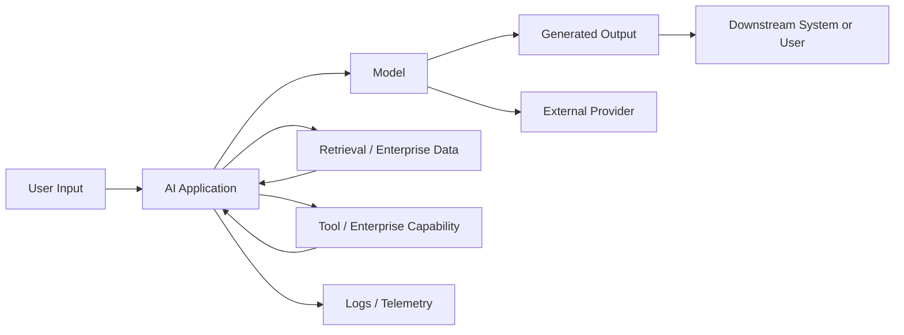

# AI Security, Privacy and Access Governance

## Learning Objectives

By the end of this chapter, you should be able to:

- Explain why AI systems create distinctive enterprise security and privacy governance considerations.
- Distinguish security, privacy, identity, authentication, authorization, access, and accountability.
- Explain why security controls do not automatically establish privacy compliance.
- Identify AI-specific security and privacy exposure surfaces at the enterprise governance level.
- Explain confidentiality, integrity, and availability in the context of enterprise AI.
- Identify risks arising from AI inputs, outputs, retrieval, tools, providers, logs, telemetry, and downstream information movement.
- Apply data minimization, purpose limitation, appropriate use, retention, and sharing principles to AI systems.
- Explain least privilege and separation of duties as enterprise governance principles.
- Explain how security and privacy responsibilities are distributed across shared AI platforms and domain-owned applications.
- Reason about security and privacy trade-offs without assuming that maximum restriction is always the correct solution.
- Recognize the boundary between enterprise security/privacy governance and detailed access-control or production-security implementation.

---

## Prerequisites

Before reading this chapter, you should understand:

- Enterprise AI capabilities and architectural boundaries
- Enterprise AI operating models
- Basic enterprise governance and accountability concepts
- Enterprise AI risk and oversight concepts
- Basic software and system architecture concepts

The primary prerequisite chapters are:

- ENT-01 — Enterprise AI Architecture and Operating Models
- ENT-02 — Enterprise AI Governance and Accountability
- ENT-03 — Enterprise AI Risk, Oversight and Assurance

This chapter does not require expertise in a particular IAM product, cloud provider, security platform, or privacy technology.

---

## Estimated Reading Time

**45–60 minutes**

The actual time will vary depending on how deeply you work through the enterprise examples and decision-reasoning exercises.

---

## Before We Start

Enterprise AI security is easy to misunderstand if it is reduced to:

> “Protect the model.”

That is too narrow.

An enterprise AI system is usually a chain of interacting principals, applications, models, data sources, tools, providers, and downstream systems.

For example:

```text
User
  ↓
AI Application
  ↓
Model
  ↓
Retrieval / Data
  ↓
Tool / Enterprise Capability
  ↓
External Provider or Internal Service
  ↓
Generated Output
  ↓
Downstream System
```

Every transition can introduce security, privacy, access, trust, or information-handling considerations.

The central question of this chapter is therefore not:

> How do we secure an AI model?

It is:

> **What security, privacy, and access responsibilities must an enterprise govern when AI systems interact with people, data, models, tools, and enterprise capabilities?**

This distinction matters because an AI model can be technically secure while the overall system still creates unacceptable data exposure, inappropriate use, excessive access, unclear responsibility, or privacy problems.

---

# Why This Exists

Traditional enterprise applications already require security and privacy governance.

AI systems introduce additional complexity because they can:

- process large amounts of information,
- combine information from multiple sources,
- generate new content from sensitive inputs,
- interact with enterprise capabilities,
- pass information between internal and external components,
- operate through shared model platforms,
- expose information through prompts and outputs,
- retain or log interaction data,
- consume information from retrieval systems,
- invoke tools or services,
- produce outputs that are later reused by other systems or people.

The security and privacy problem therefore extends beyond protecting a database or authenticating a user.

Consider an employee using an enterprise AI assistant to summarize confidential documents.

Several different governance questions appear immediately:

1. Is the employee authorized to access the documents?
2. Is the AI application permitted to process them?
3. Is the selected model or provider appropriate for the information?
4. What information crosses organizational or provider boundaries?
5. What happens to interaction data?
6. How long is it retained?
7. Can the generated output contain sensitive information?
8. Can the output be copied into another system?
9. Who is responsible for the relevant security and privacy decisions?

A conventional access-control answer alone cannot resolve all of these questions.

Enterprise AI therefore requires security, privacy, and access governance to be considered together while keeping their concepts distinct.

---

## Mental Model

A useful high-level model is:

```text
AI System / Enterprise Resource
        ↓
Security + Privacy Requirements
        ↓
Identity, Access and Trust Boundaries
        ↓
Security / Privacy Responsibilities
```

This is a reasoning model, not a mandatory enterprise workflow.

It helps establish an important principle:

> **Security, privacy, and access are connected governance concerns, but they are not interchangeable concepts.**

A system may correctly identify a user and enforce an authorization decision while still creating a privacy problem through excessive collection, inappropriate use, unnecessary retention, or unsuitable information sharing.

Similarly, satisfying a privacy requirement does not by itself guarantee that the information is protected against unauthorized access or misuse.

---

# Core Concepts

## 1. Security, Privacy, Access and Accountability

These concepts overlap, but they answer different questions.

### Security

Security is concerned with protecting systems, information, identities, capabilities, and interactions from unauthorized or harmful access or use.

Typical security questions include:

- Who can access this system?
- What actions are permitted?
- Can information be disclosed without authorization?
- Can unauthorized parties modify information or system behavior?
- Can an attacker disrupt the capability?
- Can a principal obtain more privilege than intended?

### Privacy

Privacy is concerned with how information about people is collected, used, shared, retained, and otherwise processed appropriately.

Typical privacy questions include:

- Why is this information being collected?
- Is the use appropriate for the stated purpose?
- Is more information being processed than necessary?
- Who will receive it?
- How long will it be retained?
- Could it be reused for another purpose?
- Are individuals' expectations and applicable requirements being respected?

### Access

Access concerns whether a principal is permitted to interact with a resource or capability under specified conditions.

Examples include:

- access to an AI application,
- access to a model,
- access to enterprise data,
- access to a tool,
- access to a tenant,
- access to an enterprise capability.

### Accountability

Accountability concerns who is responsible for security and privacy decisions, controls, oversight, and outcomes.

For AI systems, accountability becomes particularly important because responsibility can cross organizational boundaries.

For example:

```text
Platform Team
      ↓
Shared AI Capability
      ↓
Domain Application
      ↓
Business Process
```

A shared capability may be operated centrally while application-specific security or privacy responsibilities remain with the consuming domain.

When an AI capability crosses organizational, application, provider, or data boundaries, accountability for the associated security and privacy decisions should remain explicitly assigned rather than becoming an implicit responsibility of whichever team operates the platform.

ENT-02 owns the broader enterprise governance and decision-rights model. ENT-04 focuses on the security, privacy, and access responsibilities within that governance structure.

---

## 2. Security Is Not the Same as Privacy

A secure system is not automatically a privacy-preserving system.

Consider an enterprise AI application that encrypts stored data, strongly authenticates users, and has effective network controls.

Suppose the application collects employee information and uses it for a purpose unrelated to the intended business function.

The system may have strong security controls while still having a privacy problem.

The reverse should be stated more precisely:

> A system may satisfy an intended privacy requirement while still having security weaknesses.

For example, an enterprise may have a legitimate and appropriate purpose for processing customer information but expose that information because an AI application has weak access or information-handling controls.

A useful distinction is:

```text
Security
↓
Can unauthorized or harmful access/use be prevented or controlled?

Privacy
↓
Is information about people being collected, used, shared,
retained, and otherwise processed appropriately?
```

Access controls can support both goals, but they do not answer both questions completely.

> **Do not reduce privacy to confidentiality.**

---

## 3. Confidentiality, Integrity and Availability

The traditional CIA model remains useful when reasoning about enterprise AI.

### Confidentiality

Confidentiality concerns preventing information from being disclosed to unauthorized parties.

For AI systems, this can include:

- confidential prompts,
- sensitive retrieved information,
- proprietary documents,
- customer information,
- employee information,
- model interaction data,
- generated outputs,
- credentials or secrets accidentally included in inputs.

### Integrity

Integrity concerns preventing unauthorized or inappropriate modification of information or system behavior.

For AI systems, integrity considerations may include:

- manipulated enterprise data,
- altered retrieval content,
- unauthorized changes to AI configuration,
- manipulated model inputs,
- tampered policies,
- corrupted system instructions,
- incorrect or misleading information entering downstream business processes.

Not every incorrect model output is automatically an integrity failure. The relevant question is whether the integrity of information, systems, or governed processes has been compromised.

### Availability

Availability concerns whether authorized users can access required capabilities when needed.

For enterprise AI, availability can involve:

- model service availability,
- AI platform availability,
- retrieval availability,
- dependent enterprise service availability,
- provider availability,
- capacity constraints.

Availability is relevant to security governance, but detailed resilience and dependency engineering belongs to ENT-09.

---

# Identity, Authentication and Authorization

Identity, authentication, and authorization are foundational security concepts, but they should be distinguished carefully.

```text
Identity
↓
Who or what is the principal?

Authentication
↓
How is the claimed identity verified?

Authorization
↓
What is that principal permitted to access or do?
```

### Identity

An identity represents a principal participating in an interaction.

A principal may be:

- a human user,
- an application,
- a service,
- a workload,
- an AI system,
- an agent,
- another system component.

### Authentication

Authentication establishes confidence in the claimed identity.

It answers:

> “Who are you?”

It does not by itself answer:

> “What are you allowed to do?”

### Authorization

Authorization determines whether a principal may access a resource or capability under specified conditions.

For ENT-04, the important governance principle is:

> **Identity and authorization are security boundaries that must remain explicit when AI systems act between users and enterprise resources.**

Detailed authorization semantics, policy models, delegated access, lifecycle management, and access-boundary engineering are developed in File 02.

This chapter therefore establishes why those concerns matter without re-teaching their detailed mechanics.

---

# AI-Specific Security and Privacy Exposure Surfaces

AI systems create several exposure surfaces that require enterprise-level governance.

These are not limited to attacks against the underlying model.

## 1. Input Exposure

AI inputs may contain:

- user questions,
- uploaded documents,
- retrieved enterprise content,
- customer information,
- employee information,
- operational information,
- confidential business information.

An input can therefore become a security or privacy exposure before model generation even begins.

---

## 2. Output Disclosure

Generated outputs can reproduce, combine, transform, or reveal sensitive information.

For example:

```text
Sensitive Enterprise Information
        ↓
AI Processing
        ↓
Generated Output
        ↓
User / Application / Downstream System
```

The output may:

- reveal sensitive information,
- combine information from multiple sources,
- reach a broader audience,
- be copied into another system,
- become part of a business record,
- be redistributed.

Protecting the input alone is therefore insufficient.

---

## 3. Unauthorized AI Capability Use

Enterprise AI capabilities may themselves become targets for unauthorized or inappropriate use.

Examples include:

- unauthorized use of an internal AI capability,
- use of a capability outside its intended business purpose,
- excessive use of privileged AI functionality,
- use of AI-mediated enterprise capabilities by an inappropriate principal.

The governance question is:

> Who or what is permitted to use the capability, for what purpose, and within which boundaries?

Detailed authorization models belong to File 02.

---

## 4. Information Disclosure Through AI Interaction

Sensitive information can be exposed through:

- prompts,
- retrieved context,
- generated responses,
- conversation history,
- logs,
- telemetry,
- tool parameters,
- downstream outputs.

This means an AI security review should consider the complete information flow rather than only the model endpoint.

---

## 5. Malicious or Untrusted Inputs

AI systems may process information supplied by users, documents, external sources, or other systems.

Untrusted inputs can create security or privacy concerns when they influence:

- what information is processed,
- what information is disclosed,
- what capability is invoked,
- what downstream system receives the result.

ENT-04 establishes this as an enterprise exposure concern.

Detailed agent behavior, tool execution, and agent-specific safety mechanisms are owned by AGT.

---

## 6. Excessive Privilege Exposure

AI systems may sit between users and enterprise resources.

If an AI capability receives broader privileges than required, the impact of misuse, compromise, or incorrect behavior can increase.

This is why least privilege remains relevant to AI governance:

> Give an AI capability the access required for its intended function, rather than treating broad access as the default.

Detailed privilege and authorization engineering belongs in File 02.

---

## 7. Cross-Boundary Information Movement

Information may move across:

- organizational boundaries,
- application boundaries,
- model boundaries,
- provider boundaries,
- tenant boundaries,
- environment boundaries,
- downstream-system boundaries.

Each transition should be treated as a potential security and privacy governance boundary.

A critical principle follows:

> **Authorization or trust at one boundary does not automatically establish authorization or trust at every downstream boundary.**

---

# AI Information-Flow Boundaries

AI systems can create multiple information-flow paths.



This is a conceptual model, not a universal enterprise architecture.

Each transition can create different governance questions.

| Boundary | Governance question |
|---|---|
| User → AI application | Is the capability being used by an appropriate principal? |
| AI application → enterprise data | Is the information appropriate for the intended AI function? |
| AI application → model | Is the model or provider appropriate for the information involved? |
| AI application → tool | Is the capability access appropriately governed? |
| Model → output | Could sensitive information be disclosed or transformed into an inappropriate output? |
| AI system → logs | Is interaction information appropriate to collect and retain? |
| AI system → external provider | What information crosses the enterprise boundary and why? |
| Output → downstream system | Is the receiving system appropriate for the information and intended use? |

A critical principle follows:

> **Authorization or trust at one boundary does not automatically establish authorization or trust at every downstream boundary.**

---

# Trust Boundaries

A trust boundary is a point where assumptions about authority, control, ownership, or information handling change.

Examples may include:

- user to application,
- application to model,
- application to enterprise data,
- enterprise to external provider,
- AI application to enterprise capability,
- one organizational tenant to another,
- one environment to another.

Trust boundaries matter because security and privacy assumptions may not remain valid after crossing them.

For example:

```text
Internal Enterprise
       ↓
External Provider
```

The fact that information originated inside the enterprise does not automatically mean an external provider may process it without additional governance.

Likewise:

```text
Authorized User
       ↓
AI Application
       ↓
Enterprise Resource
```

The user's authorization should not be treated as unrestricted delegated authority for every AI component.

Detailed access-boundary semantics are developed in File 02.

---

# Privacy Governance

Privacy must be treated as more than “keeping data secret.”

A useful enterprise privacy model considers the information lifecycle:

```text
Collect
   ↓
Use
   ↓
Share
   ↓
Retain
   ↓
Delete / Dispose where applicable
```

The exact requirements depend on applicable law, organizational policy, context, and the nature of the information.

---

## Purpose Limitation

Information should be processed for an appropriate and defined purpose.

For an AI system, ask:

> Why does this AI capability need this information?

For example, an HR assistant designed to answer employee policy questions may need certain employee context.

That does not automatically justify using the same information for unrelated model experimentation, profiling, or another business purpose.

Purpose matters because AI systems can make secondary use technically easy.

---

## Data Minimization

Data minimization means avoiding unnecessary collection or processing.

The principle can be expressed as:

> **Process the information required for the intended function rather than assuming that more information is always better.**

For AI systems, this is particularly important because models can process large context windows and applications may be tempted to provide broad datasets simply because they are available.

More data can increase:

- exposure,
- privacy risk,
- retention complexity,
- access complexity,
- downstream disclosure risk.

Data minimization does not mean “never use sensitive information.”

It means the use should be justified by the intended purpose and requirements.

---

## Appropriate Use

Authorization asks whether a principal may perform an action.

Privacy governance also asks whether the action is appropriate for the intended purpose.

These are related but different questions.

```text
User is authorized
        ↓
User can access information
        ↓
Is the intended AI use appropriate?
```

A technically authorized action can still create a privacy concern if the processing purpose is inappropriate.

---

## Sharing Boundaries

AI systems can increase the number of components that receive information.

A single user interaction might involve:

```text
User
 ↓
Application
 ↓
Retrieval System
 ↓
Model Provider
 ↓
Logging System
 ↓
Downstream Application
```

The enterprise should understand which boundaries exist and whether each recipient is permitted to receive and process the information.

---

## Retention

AI interactions may generate multiple forms of stored information:

- prompts,
- outputs,
- conversation history,
- logs,
- telemetry,
- retrieved context,
- application records.

Retention should therefore be considered deliberately rather than assumed to be harmless.

Relevant questions include:

- What needs to be retained?
- Why?
- For how long?
- Who can access it?
- What happens when the retention period ends?

---

## Secondary Use

AI systems can make reuse easy.

Data initially collected for one purpose may later become attractive for:

- analytics,
- model evaluation,
- experimentation,
- personalization,
- monitoring,
- product improvement.

A governance decision should distinguish the original purpose from later uses rather than treating all technically possible reuse as automatically acceptable.

---

# Provider and External-Boundary Considerations

An enterprise may use an external model provider.

This introduces another information-processing boundary:

```text
Enterprise
    ↓
AI Application
    ↓
External Model Provider
```

The enterprise should consider:

- what information crosses the boundary,
- why it crosses the boundary,
- whether the processing is appropriate,
- what security requirements apply,
- what privacy requirements apply,
- what retention expectations apply,
- who is responsible for the relevant decisions,
- what happens if provider behavior or conditions change.

This chapter does not determine which provider the enterprise should select.

Model/provider strategy and vendor selection belong primarily to ENT-07.

ENT-04 addresses the security, privacy, and access-governance implications of the boundary.

---

# Retrieval, Data and Capability Boundaries

AI systems may retrieve enterprise information or interact with enterprise capabilities.

This creates security and privacy governance questions even when the underlying data or capability already has established controls.

## Retrieval and Enterprise Data

A user being authorized to use an AI assistant does not automatically mean the assistant should have unrestricted access to all enterprise information.

The enterprise must consider:

- what information the AI can process,
- why it needs that information,
- what boundaries apply,
- what information may appear in outputs,
- where the information may subsequently flow.

Detailed retrieval engineering belongs to RET.

Enterprise data governance belongs to ENT-05.

ENT-04 addresses the security, privacy, and access implications of those boundaries.

---

## Enterprise Capabilities

AI systems may interact with:

- CRM systems,
- ticketing systems,
- document systems,
- internal services,
- business applications.

The governance concerns include:

- identity,
- authorization,
- delegated authority,
- least privilege,
- sensitive capabilities,
- downstream information exposure,
- responsibility for resulting actions.

Detailed tool contracts, selection, routing, and execution belong to AGT-03.

Agent-specific safety belongs to AGT-11.

---

## Least Privilege and Separation of Duties

## Least Privilege

Least privilege is a durable security principle:

> **Give a principal only the permissions required to perform its intended function, for the required scope and duration.**

The principle can apply to:

- users,
- applications,
- services,
- AI systems,
- agents,
- tools,
- model providers.

For AI systems, least privilege is particularly important because AI capabilities can act as intermediaries between users and enterprise resources.

The governance principle is simple:

> Do not grant broad access merely because broad access is technically convenient.

Detailed authorization semantics and privilege lifecycle are developed in File 02.

---

## Separation of Duties

Separation of duties reduces the risk that one principal can perform an entire sensitive process without appropriate independent control.

For example:

```text
Request
   ↓
Approval
   ↓
Execution
```

The same principal should not automatically control every step of a sensitive workflow.

In AI systems, separation of duties may become relevant when AI capabilities interact with high-impact enterprise processes.

The exact implementation belongs to the relevant application and production architecture.

ENT-04 establishes the governance principle rather than prescribing a universal implementation.

---

# Shared Responsibility Across Enterprise AI

Enterprise AI often uses centralized capabilities.

For example:

```text
                    Enterprise AI Platform
                           │
        ┌──────────────────┼──────────────────┐
        ↓                  ↓                  ↓
   Identity            Model Access       Common Controls
        │                  │                  │
        └──────────────────┼──────────────────┘
                           ↓
                Domain-Owned Applications
```

A central platform may provide:

- identity,
- model access,
- common policy enforcement,
- logging,
- shared controls.

However, the existence of a shared platform does not automatically solve every application-specific security or privacy requirement.

Responsibilities may be divided between:

- enterprise platform teams,
- domain application teams,
- security teams,
- privacy functions,
- data owners,
- business owners,
- service owners.

The important governance question is:

> **Who is responsible for which protection at which boundary?**

This is different from simply asking who operates the platform.

A centralized control may provide an inherited protection, while a domain application may still have additional requirements.

When an AI capability crosses organizational, application, provider, or data boundaries, accountability for the associated security and privacy decisions should remain explicitly assigned rather than becoming an implicit responsibility of whichever team operates the platform.

---

# Security and Privacy Decisions and Trade-offs

Enterprise security architecture is rarely about maximizing every control.

The goal is:

> **Proportionate protection aligned with enterprise requirements, risk, privacy needs, and business purpose.**

## Security vs Usability

Stronger controls can increase friction.

```text
More restrictive access
        ↓
Smaller exposure surface
        ↓
Potentially more user friction
```

The correct decision depends on the sensitivity and consequences of the capability.

---

## Privacy vs Convenience

Collecting more information may make an AI experience easier to personalize.

But unnecessary collection increases exposure and governance complexity.

The engineering question is:

> Is the additional information necessary for the intended purpose?

---

## Least Privilege vs Workflow Flexibility

Narrow permissions reduce exposure.

Broad permissions can simplify workflows.

The correct decision should consider:

- required functionality,
- sensitivity,
- risk,
- duration,
- scope,
- alternatives.

---

## Centralized Controls vs Domain Autonomy

Central platforms can provide consistency.

However, excessive centralization can make domain-specific requirements difficult to satisfy.

Conversely, excessive decentralization can create inconsistent security and privacy practices.

The enterprise therefore needs clear responsibility boundaries.

---

## Data Minimization vs Functionality

More information may improve model context.

But more context may also increase:

- privacy exposure,
- security exposure,
- retention complexity,
- downstream disclosure risk.

The question is not:

> “Can we provide this data?”

It is:

> “Do we need to provide this data for the intended function?”

---

## Retention vs Auditability

Retaining more interaction data can improve investigation and auditing.

But retention can increase:

- privacy exposure,
- storage obligations,
- access complexity,
- secondary-use risk.

Retention therefore needs a purpose and appropriate governance.

---

# Practical Enterprise Examples

## Example 1 — Enterprise AI Assistant

An employee uses an internal AI assistant to summarize confidential company documents.

### Governance questions

- Is the employee authorized to access the documents?
- Is the AI application permitted to process them?
- Is the selected model or provider appropriate for the information?
- Does information cross an external boundary?
- What happens to prompts and retrieved content?
- Can the generated summary contain sensitive information?
- Where can the output be stored or shared?

### Engineering lesson

Do not treat:

> “The employee is authorized”

as equivalent to:

> “Every AI component involved is authorized to process everything the employee can access.”

Security and privacy responsibilities must be considered across the relevant boundaries.

---

## Example 2 — AI System Processing Employee Information

An AI application is designed to help HR staff answer employee-related questions.

The application processes sensitive employee information.

### Security considerations

- access to the application,
- access to employee information,
- unauthorized disclosure,
- privileged access,
- information exposure through outputs.

### Privacy considerations

- purpose of processing,
- appropriate collection,
- minimization,
- retention,
- secondary use,
- downstream sharing.

### Engineering lesson

Security and privacy must be considered together, but they should not be collapsed into a single requirement.

---

## Example 3 — External Model Provider

An enterprise sends user-provided information to an external model provider.

The key questions include:

- What information crosses the boundary?
- Is the transfer necessary?
- Is the provider permitted to process the information?
- What retention expectations apply?
- What access restrictions apply?
- Who owns the relevant decision?
- What happens if provider conditions change?

### Engineering lesson

An external provider is not merely a model endpoint. It is an additional information-processing and trust boundary.

---

## Example 4 — AI System Connected to Enterprise Capabilities

An AI capability can interact with:

- CRM,
- email,
- document systems,
- ticketing systems.

The enterprise must consider:

- identity,
- delegated authority,
- least privilege,
- capability-specific access,
- sensitive actions,
- separation of duties,
- downstream information exposure.

### Engineering lesson

The security boundary extends beyond the AI application to the enterprise capabilities it can influence.

Detailed tool execution and agent safety are owned elsewhere.

---

## Example 5 — Shared Enterprise AI Platform

A central platform provides:

- model access,
- identity,
- logging,
- common controls,
- policy enforcement.

Multiple domain applications consume the platform.

A domain application may still introduce a requirement that the shared platform does not completely satisfy.

The enterprise therefore needs to distinguish:

```text
Shared Platform Capability
          ↓
Inherited Protection
          ↓
Application-Specific Requirement
          ↓
Additional Requirement?
```

### Engineering lesson

A shared control can reduce duplicated engineering effort without eliminating application-specific responsibility.

---

# Enterprise / Production Perspective

ENT-04 addresses governance meaning, boundaries, and responsibilities rather than detailed production implementation.

Weak security and privacy governance can result in:

### Unauthorized access

A user, application, service, or AI capability accesses information or functionality beyond its intended authority.

### Excessive permissions

An AI application receives broad access because restricting access was considered inconvenient.

### Data exposure

Sensitive information reaches an unintended component, provider, user, or downstream system.

### Privacy leakage

Information is processed, retained, or reused in ways inconsistent with the intended purpose.

### Provider exposure

Sensitive enterprise information crosses an external boundary without appropriate security or privacy governance.

### Control bypass

A security or privacy requirement exists on paper, but another path allows the intended protection to be bypassed.

### Stale access

Permissions remain available after the original business need has changed.

### Weak boundary isolation

Information or capabilities cross organizational, tenant, or environment boundaries incorrectly.

### Unclear ownership

Multiple teams assume another team is responsible for a security or privacy requirement.

### Evidence gaps

The enterprise cannot demonstrate why an important security or privacy decision was made or who was responsible for it.

Detailed control evidence, control effectiveness, monitoring, and reassessment are covered in File 03.

Detailed production implementation belongs primarily to PROD.

---

## Security and Privacy Governance Reasoning

A useful way to reason about an AI security or privacy concern is to start with the information or capability being protected.

```text
What information / capability is involved?
        ↓
Who or what interacts with it?
        ↓
Why is it being accessed or processed?
        ↓
Where can the information or capability move?
        ↓
What security and privacy requirements apply?
        ↓
Who owns the relevant responsibility?
        ↓
What governance decision is required?
```

For example:

### Situation

An AI assistant wants to send customer information to an external model provider.

Reason through:

1. What customer information is involved?
2. Why does the AI function need it?
3. Is the processing necessary?
4. What security requirements apply?
5. What privacy requirements apply?
6. What boundary does the provider introduce?
7. Who is responsible for the decision?
8. What information may be retained or reused?
9. What happens if the provider or system changes?

This chapter establishes the questions and governance concerns.

Detailed access-policy design and control implementation are addressed in later files and other curriculum domains.

---

# Common Mistakes and Misconceptions

## Mistake 1 — “Security and privacy are the same thing.”

They overlap, but they answer different questions.

Security focuses heavily on protection against unauthorized or harmful access and use.

Privacy focuses on appropriate information processing.

---

## Mistake 2 — “If the user is authorized, the AI is authorized.”

Incorrect.

The AI application, service, agent, or downstream component may have separate security and access boundaries.

---

## Mistake 3 — “Authentication gives access.”

Authentication establishes identity.

Authorization determines permitted actions.

---

## Mistake 4 — “Encryption solves privacy.”

Encryption can protect confidentiality.

It does not automatically establish:

- appropriate purpose,
- minimization,
- appropriate use,
- retention,
- secondary-use controls,
- appropriate sharing.

---

## Mistake 5 — “More data gives the model better results, so we should provide everything.”

More data may improve functionality in some situations, but it can also increase security and privacy exposure.

The correct question is whether the information is necessary and appropriate for the intended purpose.

---

## Mistake 6 — “The central AI platform handles security.”

A shared platform can provide important controls.

It does not automatically eliminate application-specific requirements or responsibilities.

---

## Mistake 7 — “Logging everything improves security, so there is no privacy concern.”

AI logs may contain prompts, outputs, retrieved information, and other sensitive interaction data.

Logging can improve security while simultaneously creating additional privacy exposure.

---

## Mistake 8 — “Least privilege means the AI should have no access.”

Least privilege means required access with constrained scope.

The goal is not zero access.

The goal is appropriate access.

---

## Mistake 9 — “A security control exists, so the governance problem is solved.”

A control is only one part of the broader governance problem.

The enterprise must also establish:

- responsibility,
- appropriate scope,
- applicable requirements,
- review expectations,
- handling of changes and exceptions.

Detailed control effectiveness and evidence are covered in File 03.

---

## Mistake 10 — “ENT-04 should teach all AI security.”

No.

ENT-04 establishes enterprise security, privacy, identity, authorization, and access-governance foundations.

It does not replace:

- PROD-09 production security engineering,
- ENT-05 data governance,
- AGT-03 tool execution,
- AGT-11 agent safety,
- ENT-06 integration architecture,
- ENT-07 provider strategy.

---

## Interview Questions with Expected Answers

## 1. What is the difference between security and privacy?

**Expected answer:**

Security focuses on protecting systems, information, identities, capabilities, and interactions from unauthorized or harmful access or use. Privacy focuses on whether information about people is collected, used, shared, retained, and otherwise processed appropriately. They overlap, but security does not automatically establish privacy.

---

## 2. Why is access governance especially important for enterprise AI?

**Expected answer:**

AI systems can act as intermediaries between users and enterprise data or capabilities. A user's authorization to use an AI application does not automatically give every AI component unrestricted access to enterprise resources. Security and privacy boundaries must therefore remain explicit.

---

## 3. Why is authentication not the same as authorization?

**Expected answer:**

Authentication establishes confidence in the identity of a principal. Authorization determines what that principal is permitted to access or do under specified conditions.

---

## 4. Why is privacy more than confidentiality?

**Expected answer:**

Confidentiality focuses on preventing unauthorized disclosure. Privacy also considers purpose, collection, minimization, appropriate use, sharing, retention, secondary use, and how information about people is otherwise processed.

---

## 5. Give an example where a system is secure but still has a privacy problem.

**Expected answer:**

An AI application may have strong authentication, encryption, and access controls but collect employee information for a purpose unrelated to the intended business function. The system can therefore be strongly secured while still raising a privacy concern.

---

## 6. Why are AI-specific exposure surfaces broader than the model itself?

**Expected answer:**

Enterprise AI systems involve prompts, retrieved information, outputs, tools, logs, telemetry, providers, and downstream systems. Sensitive information or capabilities can therefore be exposed at multiple boundaries even if the underlying model is protected.

---

## 7. What does least privilege mean in an AI system?

**Expected answer:**

An AI system or principal should receive only the permissions required for its intended function, with appropriate scope and duration. Broad access should not be granted merely for convenience.

---

## 8. Why can logging create a privacy concern?

**Expected answer:**

AI logs may contain prompts, retrieved information, generated outputs, or other sensitive interaction data. Logging can improve security and investigation while simultaneously creating additional information that requires appropriate governance.

---

## 9. What is the risk of sending enterprise data to an external model provider?

**Expected answer:**

The provider creates an additional information-processing and trust boundary. The enterprise must consider what data crosses the boundary, why it crosses it, whether the provider is appropriate to process it, what retention and privacy implications exist, and who is responsible for the decision.

---

## 10. Does a shared AI platform automatically solve application security and privacy?

**Expected answer:**

No. Shared platforms can provide inherited controls such as identity, model access, logging, and common policy enforcement, but applications may have additional security and privacy requirements.

---

## 11. What is the central governance question of ENT-04?

**Expected answer:**

Who or what should be allowed to access enterprise AI capabilities and information, under which conditions, and how should security, privacy, and access responsibilities be governed across the enterprise?

---

## Quick Revision

### Core distinctions

```text
Identity
= Who or what is the principal?

Authentication
= How is the claimed identity verified?

Authorization
= What is the principal permitted to access or do?

Security
= How are systems, information, identities, capabilities,
  and interactions protected?

Privacy
= How is information about people appropriately processed?

Accountability
= Who is responsible for security/privacy decisions,
  controls, oversight, and outcomes?
```

### AI security principle

```text
AI Security
      ↓
Not Only the Model
      ↓
Inputs + Outputs + Data + Capabilities
+ Providers + Logs + Downstream Systems
      ↓
Multiple Security / Privacy Boundaries
```

### Privacy principles

```text
Purpose
   ↓
Minimize
   ↓
Use Appropriately
   ↓
Share Appropriately
   ↓
Retain Deliberately
   ↓
Review Secondary Use
```

### AI information-flow principle

```text
Input
 ↓
Application
 ↓
Model / Retrieval / Tool / Provider
 ↓
Output
 ↓
Downstream System
```

Every transition may introduce a new security, privacy, access, or trust-boundary consideration.

---

# Key Takeaways

1. Enterprise AI security is broader than protecting a model.
2. AI systems introduce multiple information, capability, and trust boundaries.
3. Security and privacy overlap but are not interchangeable.
4. Authentication establishes identity; authorization determines permitted access or action.
5. A user's authorization does not automatically authorize every AI component or downstream system.
6. AI-specific exposure surfaces include inputs, outputs, retrieval, capabilities, providers, logs, telemetry, and downstream information movement.
7. Privacy includes purpose, minimization, appropriate use, sharing, retention, and secondary-use considerations.
8. Least privilege applies to AI systems, applications, services, agents, tools, and other principals.
9. Shared AI platforms can provide inherited controls but do not eliminate application-specific responsibility.
10. Logging and telemetry can create additional privacy and security exposure.
11. External model providers create additional information-processing and trust boundaries.
12. Security controls do not automatically establish privacy compliance.
13. Accountability must remain clear when security and privacy responsibilities cross platform, application, and business boundaries.
14. Enterprise AI security and privacy decisions should consider the complete information and capability flow.
15. ENT-04 establishes governance meaning and boundaries; it does not replace production security engineering, data governance, agent safety, integration architecture, or provider strategy.
16. Mature security and privacy governance seeks proportionate protection rather than maximum restriction.

---

## Further Reading

For continued study, use the following areas as the next conceptual steps:

- **ENT-04 File 02** — Identity, Authorization and AI Access Boundaries
- **ENT-04 File 03** — AI Security, Privacy Controls and Governance Integration
- **ENT-02** — Enterprise AI Governance and Accountability
- **ENT-03** — Enterprise AI Risk, Oversight and Assurance
- **ENT-05** — Enterprise AI Data Governance
- **AGT-03** — Agent Tool Execution and Invocation Boundaries
- **AGT-11** — Agent Safety and Control
- **PROD-09** — Production Security Engineering

These references continue the progression without duplicating the concepts owned by each area.
