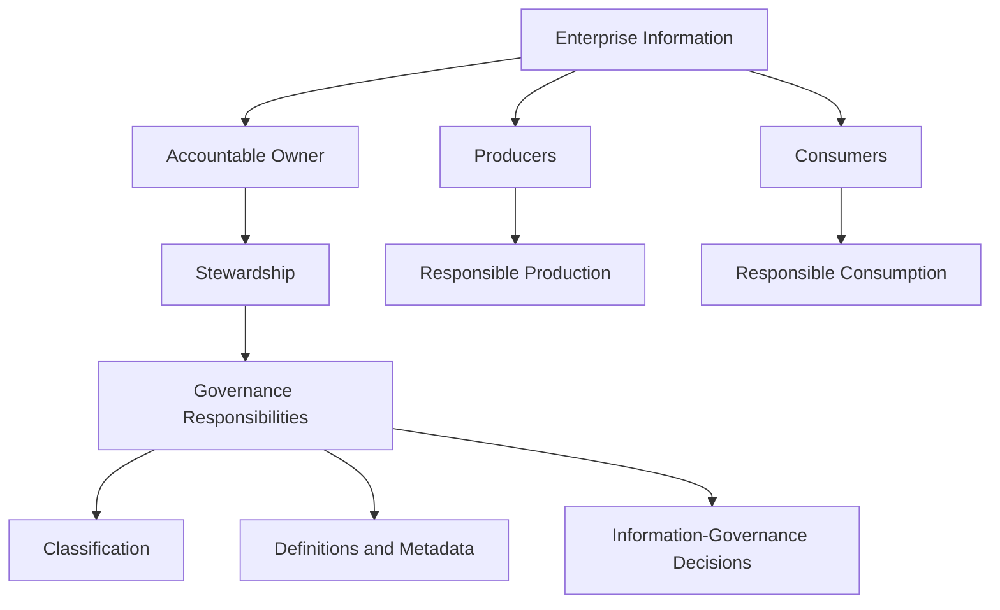

# AI Data Ownership, Stewardship and Classification

## Learning Objectives

After completing this chapter, you should be able to:

- explain why enterprise AI systems require explicit information ownership and stewardship
- distinguish **ownership**, **stewardship**, **responsibility**, and **accountability**
- identify different ownership models for enterprise information
- distinguish business, domain, technical, and shared-data responsibilities
- identify the roles of information producers and consumers
- explain why the technical system storing information is not necessarily its business owner
- classify information according to relevant enterprise requirements without assuming a universal classification taxonomy
- reason about classification across source, processed, derived, and AI-generated information
- establish governance responsibilities for information used by AI systems
- reason about ownership and stewardship when information crosses organizational or system boundaries
- identify common ownership and classification failures in enterprise AI systems
- make practical governance decisions without turning information governance into database administration, security engineering, or data-pipeline implementation

---

## Prerequisites

Before studying this chapter, you should understand:

- basic enterprise systems and organizational responsibilities
- the distinction between business requirements and technical implementation
- the basic idea of information being created, processed, transformed, and consumed by systems
- the role of AI systems as consumers and producers of information

This chapter does not require detailed knowledge of databases, IAM, cybersecurity, retrieval engineering, or data-engineering platforms.

Those concerns may implement or enforce governance requirements, but they are not the primary subject of this chapter.

---

## Estimated Reading Time

**35–45 minutes**

---

## Before We Start

Enterprise AI systems rarely depend on a single piece of information.

A typical AI system may consume:

- customer information
- product information
- organizational documents
- operational records
- policies
- financial information
- knowledge-base content
- application data
- externally sourced information
- previously generated AI information

That information may then be:

```text
Collected
   ↓
Stored
   ↓
Processed
   ↓
Transformed
   ↓
Retrieved
   ↓
Used by an AI system
   ↓
Combined with other information
   ↓
Used to produce derived information or AI output
```

The technical system may know **where the data is stored**.

That does not automatically answer:

> Who is accountable for the information?

It also does not answer:

> Who decides how that information should be governed?

And it does not answer:

> What governance requirements apply to the information?

These are governance questions.

The central concern of this chapter is therefore:

> **Who is responsible for enterprise information, who operationalizes that responsibility, and how should the information be classified so that appropriate governance expectations can be established?**

---

# Why This Exists

## The Problem

In a small system, responsibility may appear obvious.

For example:

```text
Sales Team
    ↓
Customer Data
    ↓
Sales Application
    ↓
Sales Manager
```

People may informally know who owns the information.

Enterprise environments are different.

Information may cross:

- business units
- departments
- applications
- countries
- organizational boundaries
- cloud platforms
- vendors
- AI systems
- analytical environments

The same information may also have multiple technical representations.

For example:

```text
Customer
   ↓
CRM Record
   ↓
Data Warehouse Record
   ↓
Feature Dataset
   ↓
Embedding
   ↓
Retrieved Context
   ↓
AI-Generated Summary
```

If ownership is not explicit, several problems appear.

### Problem 1 — Nobody Clearly Owns the Information

A team may assume another team is responsible.

```text
Business Team
     ↘
       "IT owns it."
     ↗
IT Team
     ↘
       "Business owns it."
```

The information becomes effectively ownerless.

---

### Problem 2 — Technical Custody Is Mistaken for Ownership

A database team may operate the database containing customer information.

That does not necessarily mean the database team owns the business meaning, governance requirements, or organizational accountability associated with the information.

The database team may be responsible for operating the platform.

The business may remain accountable for the information.

---

### Problem 3 — AI Creates New Governance Ambiguity

Traditional systems mostly consume and transform information.

AI systems can additionally generate:

- summaries
- classifications
- recommendations
- extracted facts
- generated documents
- synthetic representations
- embeddings
- intermediate artifacts
- conversational outputs

This creates a new question:

> Who is responsible for information after an AI system transforms or generates it?

The answer cannot simply be:

> "The AI owns it."

AI systems are not organizational accountability structures.

Human and organizational responsibilities must still be established.

---

### Problem 4 — Classification Is Missing or Inconsistent

Different teams may describe the same information differently.

For example:

```text
Team A → "Internal"
Team B → "Confidential"
Team C → "Customer-sensitive"
Team D → "Restricted"
```

If the enterprise has no coherent classification approach, downstream systems cannot reliably determine which governance expectations apply.

Classification therefore provides a common governance vocabulary.

---

## The Engineering Problem

Information governance can be represented as:

```text
Information
     ↓
Who is accountable?
     ↓
Who operationalizes governance?
     ↓
Who produces and consumes it?
     ↓
What responsibilities apply?
     ↓
How should it be classified?
     ↓
What governance expectations follow?
```

The objective is not to maximize governance complexity.

The objective is to establish **clear, usable, and proportionate governance responsibility**.

---

# Mental Model

A useful mental model is:

> **Ownership establishes accountability. Stewardship operationalizes governance. Classification establishes the category of governance requirements that apply to information.**

These concepts are related, but they are not interchangeable.

```text
                    INFORMATION
                         │
             ┌───────────┼───────────┐
             ↓           ↓           ↓
         Ownership   Stewardship  Classification
             │           │           │
             ↓           ↓           ↓
       Accountability  Execution   Governance
          & decisions   of duties   expectations
```

A second useful model separates **who is accountable** from **who performs the work**.

```text
                    Information
                         │
                         ↓
                Accountable Owner
                         │
             ┌───────────┴───────────┐
             ↓                       ↓
       Governance Decisions      Stewardship
                                     │
                                     ↓
                            Operational Governance
```

The owner and steward may sometimes be the same organizational role.

They do not have to be.

---

# Core Concepts

## 1. Information Ownership

### Definition

**Ownership** is organizational accountability for governing a defined information domain or information asset.

An owner is accountable for decisions about the information's governance.

This may include decisions concerning:

- business meaning
- responsibility
- classification
- governance expectations
- stewardship arrangements
- escalation of unresolved issues

Ownership is therefore primarily an **accountability relationship**, not a storage relationship.

---

## What Ownership Does Not Mean

Ownership does not necessarily mean:

- physically storing the information
- operating the database
- writing ETL pipelines
- administering cloud infrastructure
- managing access permissions
- maintaining APIs
- developing the AI model

Those activities may belong to other roles.

For example:

```text
Business Owner
      │
      │ accountable for information
      ↓
Customer Information

Technical Team
      │
      │ operates platform
      ↓
Customer Database
```

The technical team may be responsible for operating the database without being the information owner.

---

## Why Ownership Matters

Without ownership, governance decisions become ambiguous.

Consider:

```text
AI System
    ↓
Customer Profile Data
    ↓
Question:
"Who decides whether this information can be used?"
```

Possible answers might include:

- application team
- database administrator
- data engineering team
- security team
- business department
- legal team
- AI team

Without an established ownership model, the organization may make inconsistent decisions.

Explicit ownership provides a governance anchor.

---

# 2. Stewardship

### Definition

**Stewardship** is the operational responsibility for maintaining and implementing established information-governance expectations.

A steward helps ensure that governance decisions are translated into ongoing practice.

Stewardship may involve:

- maintaining metadata
- supporting classification
- maintaining information definitions
- coordinating information-quality concerns
- documenting responsibilities
- supporting governance processes
- identifying changes
- escalating issues to the owner

Stewardship is therefore more operational than ownership.

---

## Ownership vs Stewardship

The distinction can be summarized as:

| Dimension | Ownership | Stewardship |
|---|---|---|
| Primary role | Accountability | Operational governance |
| Main question | Who is accountable? | Who carries out governance responsibilities? |
| Decision authority | Usually higher | Usually delegated or operational |
| Scope | Governance accountability | Governance execution |
| Technical dependency | Not required | Often interacts with technical teams |
| Can be delegated? | Accountability may remain with owner | Stewardship can commonly be delegated |

A useful mental model is:

```text
Owner
  │
  │ establishes / approves information-governance expectations
  ↓
Steward
  │
  │ operationalizes expectations
  ↓
Information
```

The owner should operate within the enterprise's broader governance model and established decision rights. The steward carries out defined information-governance responsibilities within that framework.

---

# 3. Responsibility

Responsibility describes the specific duties an individual, team, or organizational role is expected to perform.

Examples include:

- maintaining a classification
- maintaining information definitions
- documenting a source
- reviewing governance status
- escalating information issues
- validating that governance expectations are being followed

Responsibility is therefore more specific than ownership.

For example:

```text
Owner
  └── accountable for customer information governance

Steward
  ├── maintains metadata
  ├── coordinates classification
  ├── tracks governance issues
  └── escalates unresolved concerns
```

---

# 4. Accountability

Accountability answers:

> Who ultimately answers for whether the governance responsibility is being fulfilled?

This distinction matters because work can be delegated while accountability remains with another organizational role.

For example:

```text
Owner
  │
  ├── delegates stewardship
  │
  ↓
Steward
  │
  ├── performs operational duties
  │
  ↓
Governance Activities
```

Delegating a task does not necessarily transfer accountability.

---

# 5. Business, Domain, Technical, and Shared Ownership

Enterprise information may involve several types of responsibility.

These should not automatically be collapsed into one role.

## Business Ownership

Business ownership focuses on the organizational meaning and business accountability of information.

Example:

```text
Customer Service
      ↓
Customer Service Information
      ↓
Business Owner
```

The business owner may determine the business meaning and governance expectations within the enterprise's broader governance framework even when another team operates the underlying technology.

---

## Domain Ownership

Domain ownership assigns accountability to a business or organizational domain.

Examples might include:

```text
Finance Domain
HR Domain
Sales Domain
Customer Domain
Product Domain
```

Domain ownership can reduce ambiguity when information is shared across multiple applications.

---

## Technical Responsibility

Technical responsibility concerns operation and maintenance of technical systems.

Examples include:

- database administration
- platform operation
- application maintenance
- storage management
- pipeline operation

Technical responsibility is important, but it should not automatically be equated with information ownership.

---

## Shared Data Ownership

Some information spans multiple organizational domains.

For example:

```text
Customer
   │
   ├── Sales
   ├── Support
   ├── Marketing
   └── Finance
```

A single enterprise may need shared governance arrangements rather than forcing one domain to represent every responsibility.

Shared ownership models require explicit decision rights and escalation paths within the enterprise governance framework.

Otherwise:

```text
Shared Information
       ↓
Everyone depends on it
       ↓
Nobody clearly owns it
```

This is a common enterprise governance failure.

---

# 6. Producers and Consumers

Information governance must recognize both producers and consumers.

## Information Producer

A producer creates or contributes information.

Examples include:

- business applications
- employees
- operational processes
- external sources
- automated systems
- AI systems

---

## Information Consumer

A consumer uses information for some purpose.

Examples include:

- applications
- analysts
- business teams
- reporting systems
- AI systems
- downstream services

The relationship may look like:

```text
Producer
    ↓
Information
    ↓
Consumer
```

But enterprise environments usually contain many producers and consumers:

```text
Producer A ──┐
Producer B ──┼──→ Information ──→ Consumer A
Producer C ──┘                    Consumer B
                                  Consumer C
```

Ownership should not automatically follow the consumer.

Likewise, producing information does not automatically make a team the long-term owner of every downstream representation.

---

# 7. Source and Derived Information Responsibility

AI systems complicate ownership because information may exist in several forms.

A useful conceptual model is:

```text
Source Information
       ↓
Processed Information
       ↓
Derived Information
       ↓
AI Output
```

Each stage can introduce different governance questions.

For example:

```text
Customer Record
       ↓
Normalized Customer Record
       ↓
Customer Profile
       ↓
Customer Summary
       ↓
AI Recommendation
```

The original source owner may remain accountable for the source information.

However, downstream teams may have additional responsibilities for derived information they create and manage.

The organization therefore needs to distinguish:

- responsibility for source information
- responsibility for transformed information
- responsibility for derived information
- responsibility for AI-generated information
- responsibility for downstream use

There is no universal rule that every derived artifact automatically inherits exactly the same organizational ownership.

The governance model must define the relevant responsibilities.

---

# 8. Information Classification

### Definition

**Classification** is the process of categorizing information according to enterprise-defined governance requirements.

Classification helps an organization communicate:

> What kind of information is this, and what governance expectations should apply?

Classification may consider dimensions such as:

- sensitivity
- business importance
- confidentiality expectations
- regulatory relevance
- operational criticality
- intended use

The exact taxonomy should be defined by the enterprise.

There is no universal classification scheme that every organization must use.

---

## Why Classification Exists

Without classification, governance expectations may become inconsistent.

Consider:

```text
Information
     ↓
No classification
     ↓
Different teams interpret requirements differently
     ↓
Inconsistent governance
```

With classification:

```text
Information
     ↓
Classification
     ↓
Defined governance expectations
     ↓
Consistent handling decisions
```

Classification therefore acts as a governance abstraction.

---

# Classification Is Not the Same as Security

Classification can support security and access decisions, but classification itself is not an IAM or cybersecurity implementation.

For example:

```text
Classification
      ↓
Governance requirements
      ↓
Security / privacy / access controls
```

The classification describes information characteristics and governance expectations.

Technical controls may then implement relevant requirements.

This chapter does not teach how to configure:

- IAM policies
- encryption
- network controls
- authentication
- authorization systems

Those concerns belong to their respective engineering domains.

---

# Classification Dimensions

An enterprise may classify information using multiple dimensions.

## Sensitivity

How sensitive is the information?

Examples may include:

```text
Public
Internal
Confidential
Restricted
```

These labels are examples only.

An enterprise may use a different taxonomy.

---

## Business Importance

How important is the information to business operations?

For example:

```text
Low business importance
        ↓
Operationally important
        ↓
Business-critical
```

Business importance is different from confidentiality.

Information may be non-sensitive but highly important to operations.

---

## Regulatory Relevance

Some information may be subject to specific organizational or regulatory requirements.

Classification can identify that additional governance expectations may apply.

The classification framework should identify relevant categories without assuming that every enterprise has the same legal or regulatory environment.

---

## Operational Criticality

Information may be important because downstream operations depend on it.

For example:

```text
Information
    ↓
Operational Process
    ↓
Business Service
```

Loss or corruption may have significant operational consequences even if the information is not highly confidential.

---

## Intended Use

Classification may sometimes include information about intended use where the enterprise's classification framework explicitly defines it as a classification dimension.

However, **classification and usage governance remain distinct concepts**.

Classification describes characteristics or governance categories assigned to information.

Usage governance determines **which purposes and conditions of use are permitted**.

For example:

```text
Classification
      ↓
Information characteristics / governance category
      ↓
Applicable governance expectations

Usage Governance
      ↓
Permitted purpose and conditions
      ↓
Allowed use
```

Classification should therefore not be treated as a substitute for explicit usage governance.

Detailed permitted-use and handling constraints are addressed later in this chapter.

---

# A Practical Classification Model

A useful conceptual model is:

```text
                    INFORMATION
                         │
                         ↓
              Classification Factors
                         │
        ┌────────────────┼────────────────┐
        ↓                ↓                ↓
   Sensitivity      Business Value    Regulatory
        │                │             Relevance
        └────────────────┼────────────────┘
                         ↓
              Enterprise Classification
                         │
                         ↓
              Governance Expectations
```

The exact categories and decision rules should be defined by the organization.

The important engineering principle is:

> **Classification should produce meaningful governance consequences.**

A classification system that exists only as a label but does not influence governance is unlikely to provide much practical value.

---

# Classification of AI-Relevant Information

AI systems can consume and generate several forms of information.

A useful conceptual model is:

```text
Source Information
       ↓
Processed Information
       ↓
Derived Information
       ↓
AI-Generated Information
       ↓
Downstream Information
```

Classification should consider these forms rather than assuming that only original source records require governance.

---

## Source Information

Examples:

- customer records
- financial records
- organizational documents
- operational data
- policies

The source information has an established governance context.

---

## Processed Information

Information may be cleaned, normalized, filtered, enriched, or otherwise transformed.

For example:

```text
Raw Customer Record
        ↓
Normalized Customer Record
```

The transformation does not automatically eliminate governance responsibilities associated with the source information.

---

## Derived Information

Derived information is produced from other information.

Examples include:

- aggregated metrics
- calculated attributes
- classifications
- summaries
- inferred properties

The organization should determine what responsibilities apply to the derived representation.

---

## AI-Generated Information

AI systems can generate:

- summaries
- recommendations
- classifications
- extracted information
- responses
- generated documents

AI-generated information should not automatically be assumed to be equivalent to authoritative source information.

Its governance depends on how the enterprise defines and uses it.

Likewise, not every AI-generated artifact should automatically be treated as a formal enterprise record.

The governance model should establish when generated information requires ownership, retention, review, or other treatment.

---

# How Information Governance Works

Information governance can be represented as a sequence of responsibility decisions.

```text
Information Identified
        ↓
Owner Established
        ↓
Stewardship Established
        ↓
Producers and Consumers Identified
        ↓
Responsibilities Defined
        ↓
Classification Established
        ↓
Governance Expectations Established
        ↓
Responsibilities Reviewed
```

The process is not necessarily strictly linear.

New information uses, organizational changes, or system changes may require governance responsibilities to be revisited.

---

## Step 1 — Identify the Information

First determine what information is being governed.

Avoid vague descriptions such as:

> "Customer data."

Prefer a defined information scope such as:

> "Customer account information used by account-management processes."

The more precisely the information is defined, the easier responsibility becomes.

---

## Step 2 — Establish Ownership

Determine which organizational role is accountable for governing the information.

Questions include:

- Which business or domain is accountable?
- Who makes information-governance decisions within the established enterprise decision-rights framework?
- Who resolves ownership disputes through the appropriate governance mechanism?
- Is the information shared across domains?
- Does ownership change across information domains?

The answer should be explicit.

---

## Step 3 — Establish Stewardship

Determine who operationalizes the governance expectations.

Questions include:

- Who maintains definitions?
- Who coordinates classification?
- Who tracks governance issues?
- Who maintains relevant metadata?
- Who escalates unresolved issues?

The steward should have enough organizational authority and access to perform the role effectively.

---

## Step 4 — Identify Producers and Consumers

Map how information enters and leaves the governance boundary.

```text
Producer A
    ↓
Information
    ↓
Consumer A
    ↓
Consumer B
    ↓
AI System
```

This helps identify responsibility across organizational boundaries.

---

## Step 5 — Define Responsibilities

Different participants may have different responsibilities.

For example:

| Role | Example Responsibility |
|---|---|
| Owner | Accountable for information-governance decisions |
| Steward | Operationalizes governance expectations |
| Producer | Creates or contributes information appropriately |
| Consumer | Uses information according to applicable expectations |
| Technical Custodian | Operates the system that stores or processes information |
| AI Team | Applies information within the defined governance context |

These roles may be combined or separated depending on the organization.

---

## Step 6 — Classify the Information

Classification should be performed according to the enterprise's established taxonomy.

The classification should be meaningful enough to support downstream governance decisions.

For example:

```text
Information
    ↓
Sensitivity
    +
Business Importance
    +
Regulatory Relevance
    +
Operational Criticality
    ↓
Classification
```

---

## Step 7 — Establish Governance Expectations

Once responsibility and classification are known, the organization can determine which information-governance expectations apply.

For example:

```text
Classification
      ↓
Governance Expectations
      ↓
Implementation by Relevant Teams
```

The governance requirement belongs here.

The technical implementation belongs to the appropriate engineering function.

Classification does not by itself determine every permitted use or handling condition.

Those decisions require additional information-governance analysis.

---

# Information Governance Responsibility Model

A practical responsibility model can be visualized as:



The model emphasizes that ownership does not mean doing every task personally.

Ownership establishes accountability within the enterprise governance framework.

Stewardship and other roles carry out defined responsibilities.

---

# Practical Enterprise Example

## Scenario

Consider an enterprise AI assistant used by employees to answer questions about customer accounts.

The system uses:

```text
CRM
   ↓
Customer Information
   ↓
Data Processing
   ↓
Knowledge Repository
   ↓
AI Assistant
   ↓
Employee
```

The enterprise needs to establish information governance before assuming that the AI assistant can freely use all available customer information.

---

## Step 1 — Identify the Information

The relevant information includes:

- customer account information
- account status
- service history
- support information
- customer preferences

These should not simply be treated as one undifferentiated "customer data" category.

Different information elements may have different governance characteristics.

---

## Step 2 — Establish Ownership

Suppose the enterprise identifies the customer-service business domain as accountable for customer account information.

The structure may be:

```text
Customer-Service Domain
          │
          ↓
   Accountable Owner
          │
          ↓
Customer Account Information
```

The database team is not automatically made the owner merely because the database stores the information.

---

## Step 3 — Establish Stewardship

A designated information steward may coordinate:

- information definitions
- classification
- governance metadata
- issue escalation
- governance reviews

```text
Owner
  │
  ↓
Steward
  │
  ├── Definitions
  ├── Classification
  ├── Governance coordination
  └── Issue escalation
```

---

## Step 4 — Identify Producers and Consumers

Possible producers:

```text
CRM
Support Application
Customer Service Processes
```

Possible consumers:

```text
Customer Service Employees
Analytics
AI Assistant
```

This creates a governance network rather than a single producer-consumer relationship.

---

## Step 5 — Classify Information

The enterprise applies its own classification framework.

For example, different customer information categories may receive different classifications based on:

- sensitivity
- business importance
- regulatory relevance
- operational importance

The exact labels are determined by enterprise policy.

---

## Step 6 — Establish Responsibilities

The AI engineering team may be responsible for ensuring the AI system consumes information within the established governance requirements.

The technical platform team may be responsible for operating the underlying infrastructure.

The information owner remains accountable for the information-governance decisions within the established enterprise governance framework.

This separation prevents:

```text
Technical Custodian = Information Owner
```

from becoming an automatic assumption.

---

# AI-Specific Ownership Challenges

AI systems introduce additional ownership questions because information may change form repeatedly.

Consider:

```text
Source
  ↓
Processed
  ↓
Retrieved
  ↓
Transformed
  ↓
AI Context
  ↓
AI Output
  ↓
Downstream Use
```

Each representation may involve different responsibilities.

---

## Source Ownership

The organization should know who is accountable for the original information.

---

## Processed Information

If information is transformed, the organization should determine who is responsible for maintaining the resulting representation.

---

## Derived Information

If an AI or analytics system derives new information, the organization should determine:

- who created it
- who maintains it
- what governance expectations apply
- whether it remains dependent on the source
- whether it can be reused elsewhere

---

## AI-Generated Information

AI-generated information requires additional care.

For example:

```text
Source Information
      ↓
AI Processing
      ↓
Generated Summary
```

The generated summary is not automatically equivalent to the source.

The enterprise may need to establish:

- who is responsible for the generated artifact
- whether it requires review
- whether it may be reused
- whether it should be retained
- whether it should be treated as an official representation

These decisions depend on enterprise context and intended use.

---

# Enterprise/Production Perspective

In production environments, ownership and classification should be visible enough that engineering teams can reason about governance without relying on informal knowledge.

A mature organization should be able to answer:

```text
What information is this?
        ↓
Who owns it?
        ↓
Who stewards it?
        ↓
Who produces it?
        ↓
Who consumes it?
        ↓
How is it classified?
        ↓
What governance expectations follow?
```

This information may be represented through organizational processes, governance records, metadata, catalogs, documentation, or other enterprise mechanisms.

The implementation mechanism is less important than the governance outcome.

---

## Ownership Should Survive Technology Changes

A common production mistake is tying ownership too closely to a technical implementation.

For example:

```text
CRM Database
     ↓
Data Warehouse
     ↓
Cloud Storage
     ↓
New AI Platform
```

The technology may change several times.

The underlying information responsibility should not become undefined each time the platform changes.

Ownership should therefore be anchored to the information or business/domain responsibility rather than only to the current storage technology.

---

## Classification Should Be Usable by Engineering Teams

A classification system should be understandable and actionable.

If engineers cannot determine:

```text
What classification applies?
        ↓
Who decides?
        ↓
What governance expectations follow?
```

then classification becomes administrative labeling rather than useful engineering governance.

---

## Governance Metadata Should Be Maintained

Ownership and classification are not necessarily one-time decisions.

Information may:

- change meaning
- move between domains
- gain new consumers
- acquire new uses
- become more important
- become obsolete
- be transformed into new representations

Governance information therefore needs mechanisms for review and maintenance.

If ownership or classification metadata becomes stale, engineering teams may be unable to determine who should resolve governance questions or which governance expectations apply.

---

# Engineering Decisions / Trade-offs

Information governance involves trade-offs.

The goal is not maximum governance.

The goal is **fit-for-purpose governance**.

---

## 1. Centralized Ownership vs Domain Ownership

### Centralized

```text
Enterprise
    ↓
Central Data Owner
    ↓
Many Information Domains
```

Advantages:

- consistency
- centralized decision-making
- simpler enterprise-wide standards

Disadvantages:

- may lack domain context
- can become a bottleneck
- may reduce local accountability

### Domain Ownership

```text
Enterprise
   ├── Finance Owner
   ├── HR Owner
   ├── Sales Owner
   └── Customer Owner
```

Advantages:

- stronger domain knowledge
- clearer business accountability
- better contextual decisions

Disadvantages:

- possible inconsistency
- coordination overhead
- shared-data conflicts

---

## 2. Strict Classification vs Practical Classification

More classification detail can provide more precise governance.

But excessive classification can create:

- operational burden
- inconsistent labeling
- confusion
- slow decision-making

A smaller taxonomy that people understand and use may be more effective than an extremely detailed taxonomy that nobody maintains.

---

## 3. Central Standards vs Local Context

Enterprise-wide classification standards improve consistency.

However, domains may have specialized information characteristics.

A practical approach may therefore be:

```text
Enterprise Standards
        +
Domain Context
        ↓
Applicable Classification
```

The enterprise establishes common principles while allowing justified domain-specific interpretation.

---

## 4. Governance Rigor vs Delivery Speed

More governance can reduce risk and ambiguity.

But excessive governance can slow development.

The engineering objective is not:

> "Add as many governance steps as possible."

It is:

> "Apply sufficient governance to support responsible use."

---

## 5. Shared Ownership vs Clear Accountability

Shared information may legitimately involve multiple domains.

However:

```text
Shared Responsibility
        ≠
No Accountability
```

If multiple teams participate, the governance model should still make decision rights and escalation responsibilities clear within the enterprise governance framework.

---

## 6. Ownership Stability vs Organizational Change

Organizations change.

Teams are reorganized.

Applications are replaced.

Business domains are merged.

Ownership models should therefore be maintainable without requiring the entire technical architecture to be redesigned.

---

## 7. Classification Precision vs Governance Burden

More classification dimensions can improve precision.

But each additional dimension creates maintenance cost.

The enterprise should ask:

> Does this classification dimension materially improve governance decisions?

If not, it may not justify the additional complexity.

---

# Common Mistakes / Misconceptions

## Mistake 1 — "The Database Owner Owns the Data"

A database administrator may operate the platform without being accountable for the business information stored within it.

**Better model:**

```text
Information Owner
       ↓
Information Governance

Technical Custodian
       ↓
Technical Operation
```

---

## Mistake 2 — "The Steward Is the Owner"

A steward may operationalize governance responsibilities without holding ultimate accountability.

**Better model:**

> Ownership establishes accountability; stewardship operationalizes governance.

---

## Mistake 3 — "The Team That Created the Data Owns It Forever"

Production and ownership are different concepts.

A producer may create information while another organizational domain becomes accountable for governing it.

Ownership should be explicitly established.

---

## Mistake 4 — "Classification Means Security Classification"

Security may use classification, but classification can consider broader governance dimensions such as:

- business importance
- regulatory relevance
- operational criticality
- intended use

Classification is therefore broader than access control alone.

---

## Mistake 5 — "Everything Generated by AI Has the Same Owner"

AI-generated information can have different governance contexts.

The enterprise should establish responsibility based on:

- how it was generated
- how it is used
- whether it is retained
- whether it becomes part of a business process
- whether it is treated as an official artifact

---

## Mistake 6 — "Every AI Output Is an Enterprise Record"

Not every generated response automatically becomes a formal enterprise record.

Whether an output requires record-like governance depends on enterprise requirements and context.

---

## Mistake 7 — "Classification Automatically Determines Every Allowed Use"

Classification can inform governance decisions.

It does not eliminate the need to define purpose, usage constraints, or other requirements.

---

## Mistake 8 — "Technical Ownership Is Enough"

Knowing which team operates a system does not necessarily establish who is accountable for the information.

Enterprise governance must distinguish technical custody from information accountability.

---

## Mistake 9 — "One Owner Can Perform Every Responsibility"

Enterprise information often crosses organizational boundaries.

Ownership, stewardship, production, consumption, and technical operation may legitimately belong to different roles.

The important requirement is that the responsibilities are explicit.

---

# Interview Questions / Expected Answers

## 1. What is information ownership?

**Expected answer:**

Information ownership is organizational accountability for governing a defined information domain or information asset. It is not necessarily responsibility for physically storing or technically operating the information.

---

## 2. What is the difference between ownership and stewardship?

**Expected answer:**

Ownership establishes accountability for governance decisions, while stewardship operationalizes governance expectations. A steward may perform governance activities on behalf of an owner without becoming the ultimate accountable owner.

---

## 3. Why should the database administrator not automatically be considered the data owner?

**Expected answer:**

The database administrator is responsible for operating the technical platform. Information ownership concerns business meaning, governance accountability, and organizational decision-making. Those responsibilities may belong to a business or domain owner.

---

## 4. What is classification?

**Expected answer:**

Classification categorizes information according to enterprise-defined governance requirements. It may consider factors such as sensitivity, business importance, regulatory relevance, operational criticality, and intended use.

---

## 5. Is classification the same as security classification?

**Expected answer:**

No. Security may use classification, but enterprise information classification can consider broader governance dimensions. Classification is a governance mechanism rather than an IAM or cybersecurity implementation.

---

## 6. Can the owner and steward be the same person or team?

**Expected answer:**

Yes. The roles can be combined in some organizations. The important distinction is conceptual: ownership represents accountability, while stewardship represents operational governance responsibility.

---

## 7. Why are producers and consumers important in information governance?

**Expected answer:**

Information may have many producers and consumers. Understanding these relationships helps establish responsibility across organizational and system boundaries and prevents assumptions that the producer or consumer automatically owns the information.

---

## 8. Who owns AI-generated information?

**Expected answer:**

There is no universal answer. The enterprise must establish responsibility based on how the information is generated, transformed, used, retained, and incorporated into business processes. AI itself is not an organizational owner.

---

## 9. Is derived information automatically owned by the same team as the source?

**Expected answer:**

Not necessarily. The source owner may remain accountable for source information, while a downstream team may have responsibilities for derived representations. The governance model should explicitly define these responsibilities.

---

## 10. Why is shared data ownership difficult?

**Expected answer:**

Multiple domains may depend on and contribute to the same information. Without explicit decision rights, escalation paths, and accountability, shared responsibility can become unclear responsibility.

---

## 11. Why should classification be connected to governance consequences?

**Expected answer:**

Classification is valuable when it helps determine applicable governance expectations. If classification is merely a label with no practical effect, it provides limited engineering value.

---

## 12. How would you establish ownership for information used by an enterprise AI assistant?

**Expected answer:**

First define the information scope, then identify the accountable business or domain owner within the enterprise governance framework, establish stewardship, identify producers and consumers, define responsibilities, classify the information according to enterprise standards, and establish the resulting information-governance expectations.

---

## Quick Revision

## Ownership

> **Who is accountable for governing the information?**

---

## Stewardship

> **Who operationalizes the governance expectations?**

---

## Responsibility

> **Who is expected to perform a specific governance duty?**

---

## Accountability

> **Who ultimately answers for whether the responsibility is fulfilled?**

---

## Classification

> **How is the information categorized according to enterprise governance requirements?**

---

## Producer

> **Who or what creates or contributes information?**

---

## Consumer

> **Who or what uses the information?**

---

## Technical Custodian

> **Who operates the technical system that stores or processes the information?**

A technical custodian is not automatically the information owner.

---

## AI Information Responsibility

```text
Source
  ↓
Processed
  ↓
Derived
  ↓
AI-Generated
  ↓
Downstream Use
```

Each stage may introduce different responsibilities.

---

## Core Distinctions

| Concept | Core Question |
|---|---|
| Ownership | Who is accountable? |
| Stewardship | Who operationalizes governance? |
| Responsibility | Who performs the duty? |
| Accountability | Who ultimately answers for it? |
| Classification | What governance category applies? |
| Producer | Who creates it? |
| Consumer | Who uses it? |
| Technical Custodian | Who operates the technology? |

---

# Key Takeaways

1. **Information ownership is an accountability relationship, not a storage relationship.**

2. **Stewardship operationalizes governance expectations but does not automatically imply ownership.**

3. **Ownership, responsibility, and accountability should be explicitly distinguished.**

4. **Technical custody does not automatically establish information ownership.**

5. **Business, domain, technical, and shared-data responsibilities may coexist.**

6. **Producers and consumers should be identified because information commonly crosses organizational and system boundaries.**

7. **Classification provides a governance vocabulary for determining what requirements may apply to information.**

8. **Classification should reflect enterprise requirements rather than assuming one universal taxonomy.**

9. **Classification describes information characteristics or governance categories; it does not by itself determine every permitted use.**

10. **AI systems create additional governance complexity because information can exist as source, processed, derived, and AI-generated representations.**

11. **AI-generated information does not automatically become authoritative, formally recorded, or owned by the AI system.**

12. **Derived information may require explicit responsibility even when its source already has an established owner.**

13. **Shared responsibility must not become ambiguous responsibility.**

14. **Governance should be proportionate to the information and its context rather than maximizing administrative complexity.**

15. **Ownership and classification should remain maintainable as systems, teams, and organizational structures change.**

16. **Information governance establishes the responsibility and classification foundation for later reasoning about authority, provenance, lineage, quality, trust, usage, retention, and handling.**

---

## Further Reading

For the next stage of the ENT-05 progression, continue with:

- [02 — AI Data Provenance, Lineage, Quality and Trust](./02-AI-Data-Provenance-Lineage-Quality-and-Trust.md)
- [03 — AI Data Usage, Retention and Information Handling Constraints](./03-AI-Data-Usage-Retention-and-Information-Handling-Constraints.md)

The next file develops the concepts that follow ownership and classification:

```text
Ownership & Stewardship
        ↓
Classification & Responsibility
        ↓
Authority
        ↓
Provenance
        ↓
Lineage
        ↓
Quality
        ↓
Trust
```

In particular, the next chapter distinguishes:

- **Authority** — which source should be recognized for a particular purpose
- **Provenance** — where information originated
- **Lineage** — how information moved or changed
- **Quality** — whether information satisfies intended-use requirements
- **Trust** — how much confidence should be placed in the information for that use

These concepts should not be collapsed into ownership, classification, or a generic notion of "data reliability."
