# 01 — Enterprise AI Integration Patterns and System Boundaries

## Learning Objectives

After completing this chapter, you should be able to:

- Explain why enterprise AI integration is an architectural concern rather than simply a connectivity problem.
- Identify appropriate system and capability boundaries around AI capabilities.
- Compare synchronous and asynchronous integration patterns.
- Distinguish asynchronous integration from event-driven integration.
- Compare request/response and event-driven interaction models.
- Evaluate shared versus embedded AI capabilities.
- Reason about integration ownership and architectural coupling.
- Understand how integration topology affects dependencies and change propagation.
- Evaluate failure-domain implications of integration choices.
- Compare direct, shared-capability, and platform-mediated integration.
- Select integration patterns using explicit enterprise decision criteria.

## Prerequisites

Before reading this chapter, you should understand:

- Basic software system architecture.
- The idea of an enterprise application or business system.
- The concept of an AI capability such as classification, summarization, extraction, generation, or recommendation.
- Basic concepts of dependencies and system boundaries.

You do not need detailed knowledge of REST, message brokers, Kubernetes, cloud infrastructure, or API gateway implementation.

Those technologies may appear as examples, but they are not the subject of this chapter.

## Estimated Reading Time

**45–60 minutes**

---

## Before We Start

An AI capability rarely exists as an isolated component.

A real enterprise system may contain:

- customer relationship management,
- case management,
- document management,
- enterprise search,
- workflow systems,
- identity systems,
- data platforms,
- business applications,
- AI applications,
- shared AI services,
- model or provider capabilities.

The architectural problem is therefore not simply:

> How do we connect an application to an AI model?

The more important question is:

> **Where should the AI capability exist, what should it depend on, who should own the integration, and how should changes or failures propagate across the boundary?**

That is the focus of this chapter.

---

## Why This Exists

Enterprise AI creates new dependencies between systems.

Consider a customer-support application that uses AI to summarize customer conversations.

A simple mental model might be:

```text
Customer Application
        |
        v
    AI Model
```

A production enterprise architecture is usually more complicated.

The AI capability may depend on:

- customer data,
- conversation history,
- enterprise identity,
- business rules,
- knowledge systems,
- shared AI services,
- model/provider capabilities,
- governance mechanisms.

The resulting architecture may look more like:

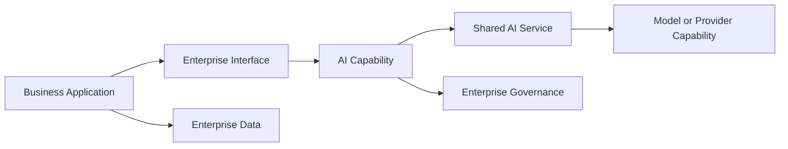

The important architectural question is not whether these components can communicate.

It is:

> **Where should the boundaries exist, and what consequences follow from those boundaries?**

---

# Mental Model

A useful starting mental model is:

```text
Business / Domain System
        |
        v
Enterprise Interface
        |
        v
AI Capability
        |
        v
Shared AI Service
        |
        v
Enterprise AI Platform
        |
        +--> Model / Provider Capability
        +--> Shared AI Capabilities
        +--> Governance Integration
        +--> Routing
```

Each layer can introduce a different dependency.

For example:

- A business system may depend on an AI capability.
- The AI capability may depend on a shared AI service.
- The shared service may depend on a platform.
- The platform may route requests to different model/provider capabilities.

This means architectural boundaries determine more than code organization.

They influence:

- ownership,
- coupling,
- change propagation,
- failure behavior,
- reuse,
- autonomy,
- integration complexity.

---

# Integration Is More Than Connectivity

Two systems being able to communicate does not mean the integration is well designed.

Connectivity answers:

> Can these systems exchange information?

Integration architecture asks broader questions:

- Who owns the interface?
- Who owns the capability?
- What dependency exists?
- Is the interaction synchronous or asynchronous?
- What happens when the dependency fails?
- How quickly must changes propagate?
- How tightly are the systems coupled?
- Is the capability embedded or shared?
- Can multiple systems reuse it?
- Who coordinates interface evolution?
- Where does governance integration occur?

Therefore:

```text
Connectivity
    ↓
Communication
    ↓
Integration
    ↓
Architectural Dependency
    ↓
Enterprise Responsibility
```

Integration is therefore an architectural relationship, not merely a technical connection.

---

# System Boundaries

A **system boundary** defines what belongs inside a system and what remains outside it.

For enterprise AI, the boundary determines questions such as:

- Is the AI capability part of the business application?
- Is it a separate shared capability?
- Is it provided by an enterprise AI platform?
- Does the application own the AI-specific workflow?
- Does another system own the AI capability?
- Which system controls changes to the interface?

A useful boundary model is:

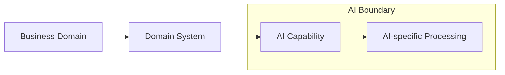

The boundary should reflect responsibility and dependency, not simply deployment units.

Two components may run in the same deployment environment while having different architectural responsibilities.

Conversely, a capability may be architecturally separate even when implementation details are hidden behind a platform.

---

# Capability Boundaries

A **capability boundary** defines which AI capability is owned by which architectural component.

For example, a customer-support domain may require:

- summarization,
- classification,
- sentiment analysis,
- response generation,
- knowledge retrieval.

These do not necessarily need to belong to the same component.

A useful decomposition might be:

```text
Customer Support Domain
        |
        +--> Case Management
        |
        +--> AI Summarization
        |
        +--> AI Classification
        |
        +--> Knowledge Capability
        |
        +--> Workflow
```

The important question is not:

> How many services should we create?

The architectural question is:

> **Which capabilities should have independent responsibility and boundaries?**

Creating unnecessary boundaries can increase integration complexity.

Creating boundaries that are too broad can increase coupling and reduce reuse.

---

# Integration Patterns

Enterprise AI capabilities can participate in several architectural integration patterns.

The most important distinction is not the technology used to implement the connection.

It is the relationship between the systems.

Common patterns include:

1. Synchronous integration
2. Asynchronous integration
3. Request/response interaction
4. Event-driven interaction
5. Embedded AI capability
6. Shared AI capability
7. Direct integration
8. Shared-capability integration
9. Platform-mediated integration

These patterns can also be combined.

For example:

```text
Application
    |
    | synchronous request
    v
AI Capability
    |
    | asynchronous event
    v
Workflow System
```

Therefore, enterprise architecture should not treat these patterns as mutually exclusive categories.

---

# Synchronous Integration

In synchronous integration, the initiating system waits for the integrated capability to provide a response.

A simplified model is:

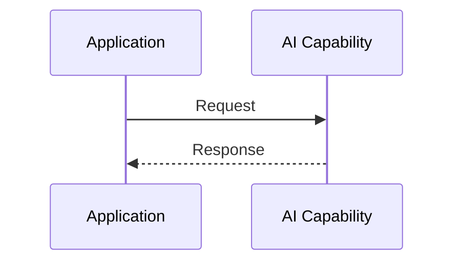

The application depends on the AI capability during the interaction.

For example:

```text
Customer Support Application
        |
        | "Generate response suggestion"
        v
AI Capability
        |
        v
Generated Response
        |
        v
Customer Support Application
```

## Architectural Characteristics

Synchronous integration is useful when:

- the caller needs an immediate result;
- the result directly affects the current interaction;
- the user is waiting for the response;
- the operation can complete within an acceptable latency boundary.

However, the dependency is visible in the caller's execution path.

This can create:

- latency coupling,
- availability coupling,
- failure propagation,
- request-duration constraints.

---

# Synchronous Dependency

Consider:

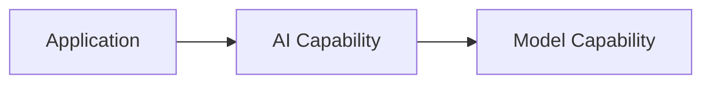

If the AI capability is unavailable, the application may be unable to complete the request.

The failure path can therefore become:

```text
Model Capability Failure
        ↓
AI Capability Failure
        ↓
Application Request Failure
        ↓
User-visible Failure
```

This does not mean synchronous integration is bad.

It means the dependency must be intentional.

If the user is waiting for the result, synchronous integration may be the correct architecture.

---

# Asynchronous Integration

In asynchronous integration, the initiating system does not need to wait for the downstream processing to complete before continuing.

A simplified model is:


For example:

```text
Document Upload
        |
        v
Document Processing Request
        |
        v
AI Classification
        |
        v
Classification Result
        |
        v
Business Workflow
```

The producer and AI-processing stages can often have different execution and workload characteristics. An asynchronous boundary can therefore allow those stages to be processed and scaled independently when the surrounding architecture supports it.

This does not mean asynchronous architecture automatically guarantees:

- independent scaling,
- reliable delivery,
- correct ordering,
- successful retry,
- eventual consistency handling,
- operational simplicity.

Those are separate architectural concerns.

---

# Asynchronous Does Not Mean Event-Driven

These concepts are related but not identical.

**Asynchronous** describes the temporal relationship between interacting systems.

**Event-driven** describes the interaction semantics in which events represent occurrences, state changes, or notifications.

For example:

```text
Command:
"Classify this document."
```

may be processed asynchronously.

An event might instead represent:

```text
"Document classification completed."
```

The distinction can be expressed as:

```text
Asynchronous
    ↓
The caller does not need to wait for completion.

Event-driven
    ↓
The interaction is organized around events representing
occurrences, state changes, or notifications.
```

Therefore:

> **Event-driven integration is commonly asynchronous, but asynchronous integration is broader than event-driven integration.**

An asynchronous workflow can exist without an event-driven architecture.

---

# Request/Response vs Event-Driven Interaction

Request/response and event-driven interaction represent different interaction semantics.

| Dimension | Request/Response | Event-Driven |
|---|---|---|
| Interaction | Caller requests an operation | Producer publishes an occurrence/state change |
| Response expectation | Response is associated with the request | Consumers react to the event |
| Coupling | Often stronger temporal dependency | Often more temporal decoupling |
| Typical use | Immediate result | Notification or downstream processing |
| Processing | Frequently synchronous, but can be asynchronous | Commonly asynchronous |
| Consumer model | Caller expects a result | One or more consumers may react |

The important distinction is semantic.

An event is not simply a response delivered later.

---

## Message vs Event

The terms **message** and **event** are related but should not be treated as interchangeable.

A **message** is a communication unit exchanged between systems. It may represent:

- a command,
- a request,
- a response,
- an event,
- or another application-defined communication payload.

An **event** represents something that has happened, such as:

- a document being uploaded,
- a customer case being created,
- a classification being completed,
- a business state changing.

This distinction matters because the consumer's responsibility differs.

A command generally asks another capability to perform something.

An event informs interested consumers that something has occurred.

Therefore:

```text
Message
    ↓
Communication unit

Event
    ↓
Representation of an occurrence or state change
```

An event may be carried inside a message, but not every message is an event.

This distinction is useful when deciding whether an integration should represent a request for work or communicate a business occurrence.

---

# Integration Pattern Decision

The correct pattern depends on the business interaction.

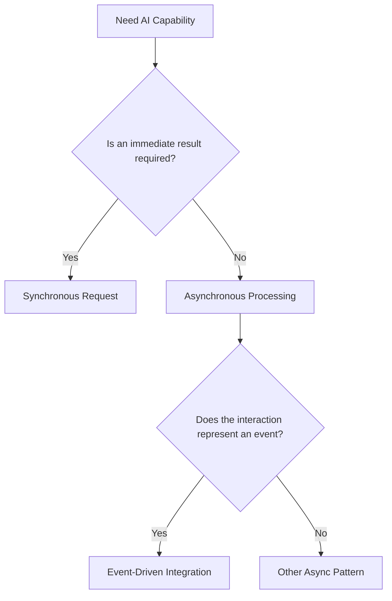

The decision should be driven by:

- user experience,
- business timing requirements,
- dependency tolerance,
- processing characteristics,
- failure behavior,
- consistency expectations,
- integration ownership.

Technology selection comes after the architectural requirement.

---

# Shared vs Embedded AI Capabilities

Another major architectural decision is whether an AI capability should be embedded within an application or provided as a shared capability.

The choice affects:

- reuse,
- autonomy,
- duplication,
- governance integration,
- dependency,
- change coordination,
- platform coupling.

---

## Embedded AI Capability

An embedded AI capability is closely owned and integrated by the consuming application or domain.

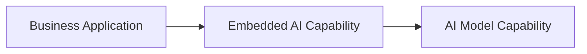

The application may control:

- capability behavior,
- integration logic,
- domain-specific processing,
- lifecycle decisions.

### Advantages

- High local autonomy
- Strong domain alignment
- Fewer shared dependencies
- Easier application-specific optimization
- Potentially simpler ownership boundaries

### Risks

- Capability duplication
- Repeated integrations
- Inconsistent controls
- Divergent implementations
- Fragmented evolution

Embedded architecture is therefore not inherently inferior.

It can be appropriate when the capability is highly domain-specific or when shared ownership would introduce unnecessary coupling.

---

# Shared AI Capability

A shared AI capability is provided for use by multiple applications or domains.

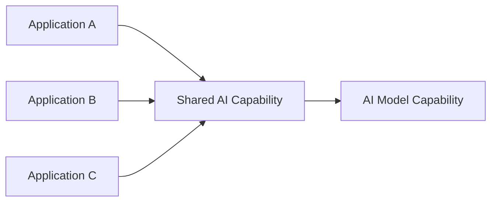

Examples might include:

- enterprise document classification,
- common summarization capability,
- shared AI extraction capability,
- common AI-assisted search capability.

### Advantages

- Reuse
- Reduced duplication
- Standardized integration
- Centralized capability evolution
- Consistent enterprise behavior where appropriate

### Risks

- Shared dependency
- Platform or service bottlenecks
- Central-team dependency
- Change coordination
- Concentration risk
- Reduced domain autonomy

The correct architectural question is therefore not:

> Should AI always be centralized?

It is:

> **Which AI capabilities benefit from sharing, and what dependency does sharing create?**

---

# Shared vs Embedded Decision

A useful decision framework is:

| Question | Embedded may fit | Shared may fit |
|---|---|---|
| Domain specificity | Highly specific | Common across domains |
| Reuse | Low | High |
| Autonomy | High priority | Less important |
| Standardization | Limited need | Strong need |
| Duplication | Acceptable | Should be reduced |
| Change coordination | Local | Central coordination acceptable |
| Shared dependency | Undesirable | Acceptable |
| Governance consistency | Local controls sufficient | Common controls valuable |

Neither model is universally superior.

The architecture should reflect the capability's characteristics and enterprise requirements.

---

## Integration Ownership

Integration architecture also creates ownership responsibilities.

Ownership should answer questions such as:

- Who owns the interface?
- Who owns the AI capability?
- Who owns the dependency relationship?
- Who coordinates interface changes?
- Who is responsible for compatibility?
- Who handles failure behavior?
- Who coordinates changes across dependent systems?

A useful mental model is:

```text
Capability Owner
      |
      +--> Capability behavior
      |
      +--> Capability lifecycle

Interface Owner
      |
      +--> Interface contract
      |
      +--> Compatibility
      |
      +--> Change coordination

Consumer
      |
      +--> Correct usage
      |
      +--> Consumer-side failure handling
```

Ownership does not necessarily mean one organizational team owns every aspect.

Architectural responsibility can be distributed.

What matters is that responsibility is explicit.

---

# Architectural Coupling

**Coupling** describes how strongly one component depends on another.

Enterprise AI integration can create several forms of coupling.

---

## Temporal Coupling

Temporal coupling exists when two systems must coordinate within the same time window.

Synchronous integration commonly creates stronger temporal coupling.

```text
Application
    |
    | wait
    v
AI Capability
```

If the AI capability cannot respond, the caller may not be able to proceed.

Asynchronous integration can reduce this dependency:

```text
Application
    |
    | submit
    v
Processing
    |
    | later
    v
Result
```

The systems are less dependent on completing the work at the same moment.

---

## Availability Coupling

Availability coupling exists when one system's availability affects another system's ability to perform a function.

For example:

```text
Application
    |
    v
Shared AI Capability
    |
    v
Model Capability
```

If the shared capability becomes unavailable, multiple consuming applications may be affected.

Shared reuse therefore creates both efficiency and dependency.

---

## Change Coupling

Change coupling exists when changes in one system require coordinated changes elsewhere.

For example:

```text
AI Capability Interface Change
        ↓
Consumer Contract Impact
        ↓
Consumer Changes
        ↓
Deployment / Migration Coordination
```

A stable interface can reduce this coupling.

An unstable shared interface can amplify it.

---

## Knowledge Coupling

Knowledge coupling occurs when one system must understand implementation-specific assumptions of another system.

For example, an application tightly coupled to a particular AI provider's internal behavior may become dependent on provider-specific assumptions.

A more stable enterprise interface can hide some implementation details.

However, abstraction can also hide capabilities that consumers genuinely need.

Therefore abstraction is a trade-off, not an automatic improvement.

---

## Dependency Coupling

Dependency coupling describes reliance on another capability for successful operation.

For example:

```text
Customer Support
       |
       v
Shared Summarization
       |
       v
AI Platform
```

The more critical the dependency, the more carefully the architecture should consider:

- ownership,
- failure behavior,
- change management,
- compatibility,
- substitution options.

Detailed enterprise resilience and dependency governance belong to ENT-09 rather than this chapter.

---

# Integration Topology

Integration topology describes how systems are connected.

Three useful architectural patterns are:

1. Direct integration
2. Shared capability integration
3. Platform-mediated integration

---

## Direct Integration

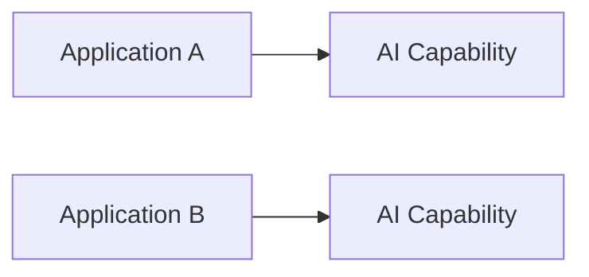

Each application integrates directly with its required AI capability.

### Advantages

- Simple local architecture
- High application autonomy
- Fewer intermediary dependencies

### Risks

- Repeated integrations
- Duplicated logic
- Inconsistent controls
- More interfaces to maintain

Direct integration may be appropriate when the capability is highly specific or the number of consumers is small.

---

# Shared Capability Integration

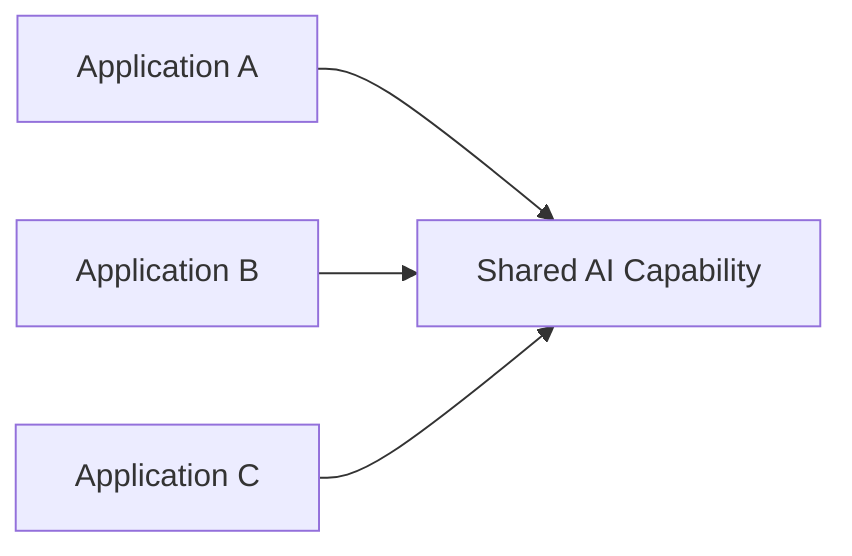

Multiple applications consume a common AI capability.

### Advantages

- Reuse
- Consistent capability behavior
- Reduced duplication
- Centralized capability evolution

### Risks

- Shared dependency
- Change coordination
- Concentration risk
- Reduced local autonomy

---

# Platform-Mediated Integration

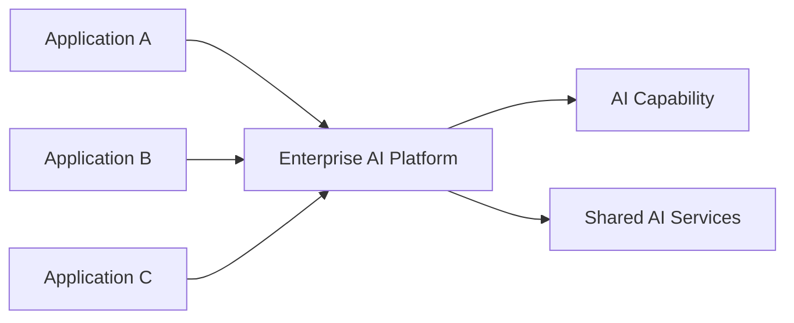

The platform becomes an architectural integration boundary.

It may coordinate:

- access to AI capabilities,
- shared services,
- routing,
- governance integration,
- usage controls,
- capability registration.

Detailed platform architecture is the subject of File 02.

Here, the important point is that introducing a platform changes the dependency topology.

---

# Direct vs Shared vs Platform-Mediated

| Dimension | Direct | Shared Capability | Platform-Mediated |
|---|---|---|---|
| Local autonomy | High | Medium | Lower |
| Reuse | Low–Medium | High | High |
| Duplication | Higher | Lower | Lower |
| Central dependency | Low | Medium | Higher |
| Standardization | Lower | Medium–High | High |
| Change coordination | Local | Shared | Platform-mediated |
| Integration complexity | Lower initially | Medium | Higher initially |
| Governance consistency | Distributed | More centralized | Stronger central coordination |
| Platform dependency | Low | Medium | High |

The table does not identify a universal winner.

The architecture should match the enterprise's needs.

---

## Change Propagation

Architecture determines how changes travel through an enterprise system.

Consider:

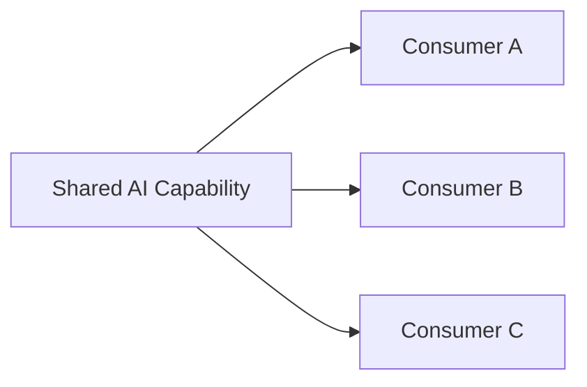

A change to the shared capability can affect multiple consumers.

This creates a change-propagation problem.

For example:

```text
Shared Interface Change
        |
        +--> Consumer A
        +--> Consumer B
        +--> Consumer C
```

The larger the consumer population, the more important interface stability and compatibility become.

This is one reason shared capabilities should not be created simply because reuse appears attractive.

---

# Failure-Domain Implications

Integration architecture also affects how failures propagate.

Suppose several applications depend on a shared AI capability:


If the shared capability fails, the impact may extend across multiple applications.

This creates a larger dependency surface than a domain-local capability.

By contrast:

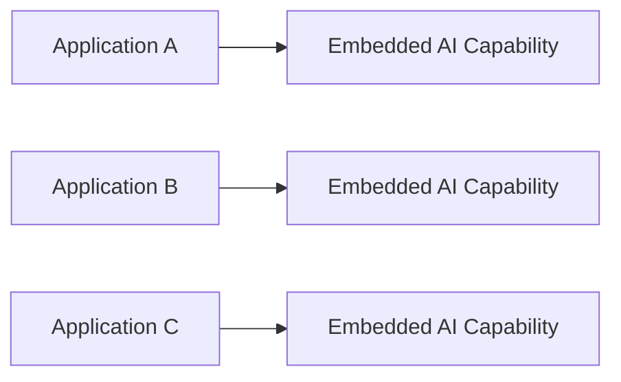

A failure may remain more localized.

However, embedded capabilities can create duplicated failure-management responsibilities.

Therefore:

> **Failure isolation and reuse can pull architecture in opposite directions.**

Detailed resilience engineering belongs to ENT-09 and PROD. Here the goal is to recognize the architectural consequence of dependency topology.

---

# Failure Behavior Is Part of Integration Architecture

Integration design should not only ask:

> How do systems communicate when everything works?

It should also ask:

> What happens when the dependency does not work?

For synchronous integration:

```text
Request
   |
   v
AI Capability
   |
   X
Failure
   |
   v
Caller must handle failure
```

For asynchronous integration:

```text
Request
   |
   v
Queue / Event Boundary
   |
   X
Processing Failure
   |
   v
Processing can be handled independently
```

Asynchronous architectures can make retry-oriented processing easier to separate from the original request.

However:

> **Retry is not an inherent property of asynchronous architecture.**

Retry behavior must be explicitly designed.

Similarly, asynchronous processing does not automatically guarantee correct ordering, exactly-once behavior, or successful recovery.

Those are separate architectural properties.

---

# Practical Enterprise Example

Consider an enterprise customer-support environment.

The enterprise has:

```text
CRM
Case Management
Knowledge System
Workflow System
AI Capabilities
```

The business wants AI-assisted support.

Possible AI capabilities include:

- conversation summarization,
- case classification,
- knowledge-assisted response generation,
- next-action recommendation.

A possible architecture is:

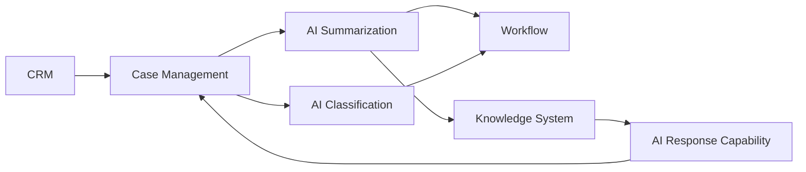

This architecture demonstrates several integration relationships.

### Synchronous interaction

When a support agent opens a case:

```text
Case Management
       |
       | request summary
       v
AI Summarization
       |
       | response
       v
Case Management
```

The agent may need the result immediately.

### Asynchronous interaction

When a new case is created:

```text
Case Created
     |
     v
Processing Request
     |
     v
AI Classification
     |
     v
Classification Result
     |
     v
Workflow
```

The workflow may not need to block case creation while classification completes.

### Shared capability

The enterprise may decide that summarization is shared because multiple applications require it.

### Embedded capability

A highly domain-specific recommendation capability may remain inside the support domain because other domains have little need for it.

The architecture therefore combines multiple patterns.

---

# Practical Example: Synchronous and Asynchronous Together

Real enterprise architectures often combine interaction styles.

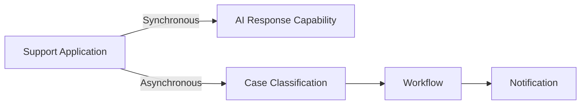

The same application can therefore use:

- synchronous integration for user-facing response generation;
- asynchronous integration for background classification;
- event-driven interaction for downstream notifications.

The architecture should be chosen per business interaction rather than applying one pattern universally.

---

# Production Perspective

In production architecture, integration decisions become operational dependencies.

An architect should ask:

### Dependency

What happens if the AI capability is unavailable?

### Latency

Does the business interaction tolerate waiting?

### Change

What happens when the interface changes?

### Ownership

Who coordinates changes between producer and consumer?

### Reuse

Is this capability common enough to justify sharing?

### Autonomy

Does the domain require independent evolution?

### Failure

Can failure remain localized?

### Compatibility

Can consumers continue operating while the capability evolves?

### Governance

Does the integration need centralized governance mechanisms?

These questions are more durable than any particular technology choice.

---

## Engineering Decisions and Trade-offs

Enterprise AI integration involves recurring trade-offs.

## Synchronous vs Asynchronous

```text
Synchronous
    +
Immediate result
    +
Simple request flow
    -
Temporal coupling
    -
Latency dependency
    -
Failure propagation

Asynchronous
    +
Temporal decoupling
    +
Independent processing
    +
Better fit for background work
    -
Eventual processing
    -
More complex state handling
    -
More complex failure visibility
```

---

## Embedded vs Shared

```text
Embedded
    +
Autonomy
    +
Domain optimization
    -
Duplication
    -
Inconsistent implementations

Shared
    +
Reuse
    +
Standardization
    -
Shared dependency
    -
Change coordination
    -
Concentration risk
```

---

## Direct vs Platform-Mediated

```text
Direct
    +
Local simplicity
    +
Autonomy
    -
Repeated integration
    -
Distributed controls

Platform-Mediated
    +
Reuse
    +
Central coordination
    +
Consistent integration mechanisms
    -
Platform dependency
    -
Potential bottleneck
    -
Reduced local flexibility
```

---

# Integration Decision Criteria

A practical architecture review can use the following questions.

| Decision | Questions |
|---|---|
| Interaction timing | Does the caller need an immediate result? |
| Processing model | Is the work interactive or background-oriented? |
| Event semantics | Does the interaction represent an occurrence or state change? |
| Capability reuse | Will multiple domains consume the capability? |
| Domain specificity | Is the capability highly specific to one domain? |
| Ownership | Who should own the capability and interface? |
| Coupling | How much temporal and change coupling is acceptable? |
| Failure impact | Should failure remain local or affect multiple consumers? |
| Change propagation | How many systems will be affected by interface changes? |
| Standardization | Is common enterprise behavior valuable? |
| Autonomy | How important is independent domain evolution? |
| Governance integration | Does the capability need centralized enterprise mechanisms? |
| Platform dependency | Is introducing a shared platform justified? |

The goal is not to maximize reuse or minimize dependencies independently.

The goal is to find an architecture whose trade-offs match the business and enterprise context.

---

## Common Architectural Mistakes

## Mistake 1 — Treating Connectivity as Integration Architecture

Two systems communicating successfully does not mean their boundary is well designed.

The architecture must also consider:

- ownership,
- coupling,
- change,
- failure,
- compatibility.

---

## Mistake 2 — Assuming Asynchronous Means Event-Driven

Asynchronous describes timing.

Event-driven describes interaction semantics.

They overlap, but they are not synonyms.

---

## Mistake 3 — Assuming Shared Is Always Better

A shared capability can reduce duplication while creating a larger shared dependency.

Reuse must justify the dependency.

---

## Mistake 4 — Creating a Platform Too Early

A platform introduces another architectural dependency.

Centralization should solve a real enterprise problem.

It should not exist simply because centralized architecture appears more sophisticated.

---

## Mistake 5 — Ignoring Ownership

An interface without clear responsibility becomes difficult to evolve.

Architecture should make responsibility explicit.

---

## Mistake 6 — Ignoring Change Propagation

A change to a shared AI capability can affect many consumers.

The number of consumers is therefore an architectural consideration.

---

## Mistake 7 — Designing Only for the Success Path

An integration that works when every dependency is healthy may still be poorly designed.

Failure behavior is part of the architecture.

---

## Architecture Review Questions

When reviewing an enterprise AI integration architecture, ask:

### Boundary

- What capability belongs inside this system?
- What belongs outside it?
- Why?

### Interaction

- Should the interaction be synchronous or asynchronous?
- If asynchronous, is it actually event-driven?
- Why?

### Ownership

- Who owns the capability?
- Who owns the interface?
- Who coordinates changes?

### Coupling

- What temporal coupling exists?
- What availability coupling exists?
- What change coupling exists?

### Reuse

- Does the capability justify being shared?
- What dependency does sharing introduce?

### Topology

- Why is the integration direct?
- Why is it shared?
- Why is a platform involved?

### Failure

- What happens when the dependency fails?
- Which systems are affected?

### Change

- What happens when the interface changes?
- How many consumers must change?

### Enterprise Fit

- Does the architecture support required governance integration?
- Does it preserve appropriate domain autonomy?

---

## Complete Mental Model

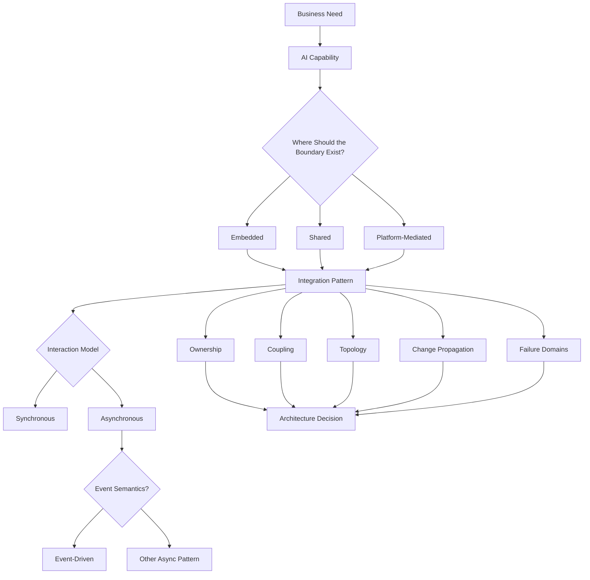

The key idea is:

> **Integration architecture is the design of relationships between capabilities and systems, including their boundaries, interaction patterns, ownership, dependencies, change behavior, and failure implications.**

---

# Boundary with the Next Files

File 01 establishes the integration foundation.

It answers:

> **How should AI capabilities integrate with enterprise systems, where should system boundaries exist, and what integration trade-offs follow from those choices?**

File 02 builds on this foundation by asking:

> **What should an enterprise AI platform provide centrally, and what should remain within individual AI applications or business domains?**

File 02 therefore moves from integration relationships toward:

- enterprise AI platforms,
- shared AI services,
- AI gateways,
- routing,
- governance integration,
- usage controls,
- capability registration,
- Enterprise AI Control Architecture.

File 03 then builds on the platform and integration boundaries by asking:

> **How should independent enterprise systems exchange AI capabilities and preserve identity, security context, trust context, and interface compatibility across system boundaries?**

It moves into:

- interoperability,
- enterprise interfaces,
- interface contracts,
- context propagation,
- cross-system trust,
- compatibility,
- interface evolution.

These concepts are intentionally not taught deeply here.

---

## Interview Questions with Expected Answers

## 1. What is the difference between connectivity and integration architecture?

**Expected answer:**

Connectivity means systems can communicate.

Integration architecture additionally considers:

- system boundaries,
- ownership,
- dependencies,
- coupling,
- interaction patterns,
- change propagation,
- failure behavior,
- compatibility.

Therefore, communication is necessary for integration but does not fully define integration architecture.

---

## 2. What is the difference between synchronous and asynchronous integration?

**Expected answer:**

Synchronous integration requires the initiating system to wait for the interaction to complete or receive a response within the interaction flow.

Asynchronous integration allows the initiating system to continue without waiting for downstream processing to complete.

Synchronous integration commonly creates stronger temporal and availability coupling.

Asynchronous integration can reduce temporal coupling but introduces other concerns such as eventual processing and more complex failure visibility.

---

## 3. Is asynchronous integration the same as event-driven integration?

**Expected answer:**

No.

Asynchronous describes the temporal relationship between systems.

Event-driven describes an interaction model in which events represent occurrences, state changes, or notifications.

Event-driven systems are commonly asynchronous, but asynchronous integration is broader than event-driven integration.

---

## 4. What is the difference between a message and an event?

**Expected answer:**

A message is a communication unit exchanged between systems and may represent a command, request, response, event, or other application-defined payload.

An event specifically represents an occurrence, state change, or notification.

An event may be carried in a message, but not every message is an event.

---

## 5. Should AI capabilities always be centralized?

**Expected answer:**

No.

Centralization can provide reuse and standardization but also introduces shared dependencies, change coordination, concentration risk, and reduced domain autonomy.

The decision should depend on capability reuse, domain specificity, governance requirements, ownership, and acceptable coupling.

---

## 6. What is the architectural risk of a shared AI capability?

**Expected answer:**

A shared capability creates a dependency shared by multiple consumers.

Its failure or incompatible change can therefore affect multiple systems.

The benefit is reuse and standardization.

The trade-off is shared dependency and coordination cost.

---

## 7. Why does ownership matter in integration architecture?

**Expected answer:**

Because interfaces and capabilities evolve.

Without explicit responsibility for capability behavior, interface contracts, compatibility, and change coordination, integration boundaries become difficult to maintain.

---

## 8. Why should failure behavior be considered during integration design?

**Expected answer:**

Because integration creates dependencies.

If one dependency fails, the architecture determines whether failure remains localized or propagates to dependent systems.

Failure behavior is therefore part of the architectural relationship.

---

## 9. When might embedded AI be preferable to shared AI?

**Expected answer:**

When the capability is highly domain-specific, requires strong local autonomy, has limited reuse, or when introducing a shared dependency would create more coupling than value.

---

## 10. When might a platform-mediated integration be justified?

**Expected answer:**

When multiple enterprise systems need common AI capabilities or centralized architectural mechanisms such as routing, governance integration, usage controls, or capability registration.

The platform must provide enough enterprise value to justify the additional dependency and coordination cost.

---

## 11. Why is change propagation an architectural concern?

**Expected answer:**

Because a shared capability or interface may have many consumers.

A change in the shared component can therefore require coordinated changes across multiple systems.

The larger the consumer population, the more important compatibility and interface stability become.

---

## Quick Revision

Remember these distinctions:

### Integration

```text
Integration
=
Connectivity
+
Boundary
+
Ownership
+
Dependency
+
Interaction
+
Change
+
Failure
```

### Synchronous

```text
Request
   ↓
Wait
   ↓
Response
```

### Asynchronous

```text
Submit
   ↓
Continue
   ↓
Process Later
```

### Event-Driven

```text
Event Occurs
   ↓
Event Published
   ↓
Consumers React
```

### Message vs Event

```text
Message
   ↓
Communication unit

Event
   ↓
Occurrence / state change / notification
```

### Embedded

```text
Application
   ↓
Local AI Capability
```

### Shared

```text
Application A ─┐
Application B ─┼─> Shared AI Capability
Application C ─┘
```

### Platform-Mediated

```text
Applications
     ↓
Enterprise AI Platform
     ↓
AI Capabilities
```

### Coupling

Ask:

```text
How much does one system depend on another?
```

### Change Propagation

Ask:

```text
If this component changes,
how many systems are affected?
```

### Failure Domain

Ask:

```text
If this dependency fails,
how far does the impact spread?
```

---

# Key Takeaways

- Enterprise AI integration is an architectural relationship, not merely connectivity.
- System boundaries determine responsibility, dependency, and change behavior.
- Synchronous integration provides immediate interaction but commonly increases temporal and availability coupling.
- Asynchronous integration reduces temporal dependency but introduces different consistency and failure-management considerations.
- Asynchronous integration is broader than event-driven integration.
- Event-driven architecture is defined by event-oriented interaction semantics, not simply by non-blocking execution.
- A message is a communication unit; an event represents an occurrence, state change, or notification.
- AI capabilities may be embedded or shared.
- Shared capabilities provide reuse and standardization but create shared dependencies and coordination costs.
- Integration ownership should be explicit.
- Coupling can be temporal, availability-related, change-related, knowledge-related, or dependency-related.
- Direct, shared, and platform-mediated integration have different architectural consequences.
- Change propagation should be considered before creating shared capabilities.
- Failure behavior is part of integration architecture.
- No integration pattern is universally superior.
- Enterprise integration decisions should be driven by business requirements, capability boundaries, ownership, coupling, reuse, change, and failure implications.

The central engineering question remains:

> **Where should an AI capability belong, how should it interact with surrounding systems, who should own the relationship, and what happens when that relationship changes or fails?**

---

## Further Reading

For deeper study, continue with:

- **ENT-06-02 — AI Platforms, Shared Services, Gateways and Control Planes**
- **ENT-06-03 — AI Interoperability, Identity Propagation and Enterprise Interfaces**

Related enterprise domains:

- **ENT-01 — Enterprise AI Architecture and Operating Models**
- **ENT-04 — AI Security, Privacy and Access Governance**
- **ENT-05 — AI Data and Information Governance**
- **ENT-07 — AI Model, Provider and Vendor Strategy**
- **ENT-08 — AI Economics and FinOps**
- **ENT-09 — AI Criticality, Resilience and Dependency Governance**

---

## End of Document
