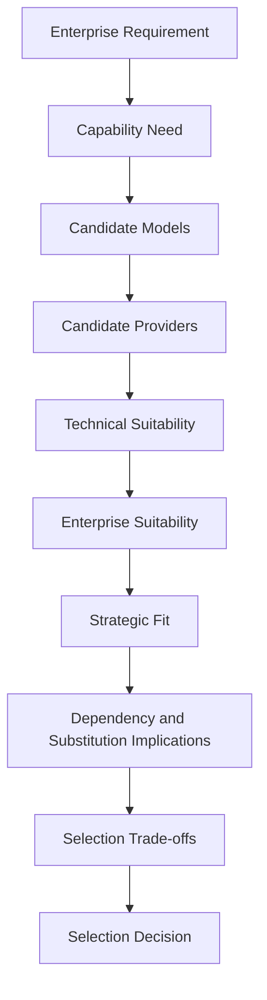

# ENT-07 — Enterprise Model and Provider Selection Strategy

## Learning Objectives

By the end of this chapter, you should be able to:

- explain why enterprise model selection is broader than benchmark performance
- distinguish **model selection** from **provider selection**
- translate enterprise needs into meaningful model/provider selection criteria
- evaluate capability, technical, enterprise, and strategic suitability
- explain what **strategic fit** means in an AI provider decision
- identify important trade-offs between capability, convenience, dependency, portability, and ecosystem fit
- reason about the architectural consequences of selecting a model or provider
- explain why the strongest model on a narrow benchmark may not be the best enterprise choice
- make a defensible model/provider selection decision without relying on a single score
- recognize where File 01 ends and dependency, lock-in, procurement, and exit strategy begin

---

## Prerequisites

You should be familiar with:

- basic enterprise application architecture
- APIs and service integrations
- AI/LLM capabilities at a high level
- basic model evaluation concepts
- the distinction between an AI model and an application using that model
- the enterprise architecture context introduced in ENT-06

You do **not** need to know the internals of model training or model-serving infrastructure to understand this chapter.

---

## Estimated Reading Time

**35–45 minutes**

---

## Before We Start

Imagine an enterprise team is choosing an AI capability for customer support.

Three candidate models appear to perform well.

One has the strongest benchmark results.

Another has better latency.

A third is available through a provider that already supplies several other enterprise services.

The team initially asks:

> **Which model is best?**

That is usually the wrong first question.

The better question is:

> **Which model/provider combination is most suitable for this enterprise capability, under the enterprise's actual technical, operational, governance, and strategic constraints?**

This distinction is the foundation of ENT-07.

A model does not operate in isolation.

It becomes part of an enterprise system.

That system has applications, interfaces, data flows, operational dependencies, governance requirements, supplier relationships, and long-term architectural consequences.

Therefore, selecting an AI model or provider is an **engineering and enterprise strategy decision**, not simply a model-ranking exercise.

---

## Why This Exists

AI technology changes quickly.

Models improve.

Providers introduce new capabilities.

Interfaces change.

Context limits change.

Modalities expand.

Pricing changes.

Products are discontinued or replaced.

Enterprise requirements, however, often change more slowly.

An enterprise may need an AI capability to remain usable for years even though the specific model providing that capability may change several times.

This creates a fundamental selection problem.

If an enterprise chooses only according to today's model performance, it may optimize for the present while creating an unsuitable long-term dependency.

Conversely, if an enterprise focuses so heavily on future flexibility that it rejects useful provider-specific capabilities, it may sacrifice meaningful business value.

The engineering problem is therefore not:

> **How do we find the universally best model?**

There usually is no such model.

The engineering problem is:

> **How do we choose a model and provider that fit the enterprise's requirements while making the resulting strategic consequences explicit?**

---

## Mental Model

A useful mental model is to think of model/provider selection as a sequence of increasingly broader questions.

```text
What does the enterprise need?
            ↓
What AI capability is required?
            ↓
Which models can provide that capability?
            ↓
Which providers can supply those models/capabilities?
            ↓
Are they technically suitable?
            ↓
Are they enterprise suitable?
            ↓
Are they strategically suitable?
            ↓
What dependencies does the choice create?
            ↓
What selection decision is justified?
```

The important idea is that **selection becomes broader as the decision progresses**.

A model can be technically capable but enterprise-unsuitable.

A provider can be enterprise-capable but strategically unsuitable.

A provider can be strategically attractive while still being inappropriate for a particular workload.

Selection therefore requires reasoning across multiple dimensions.

---

# Core Concepts

## 1. Model Selection Is Not Just Benchmarking

The first important distinction is:

```text
Technical / Benchmark Performance
              ≠
Enterprise Suitability
```

A benchmark can answer questions about specific capabilities under specific evaluation conditions.

It does not automatically answer:

- Can the model meet the required latency?
- Does it support the required context?
- Does it provide the required modality?
- Can it produce the required structured output?
- Does it fit deployment constraints?
- Does its data handling meet enterprise requirements?
- Can it integrate with the surrounding architecture?
- Does the provider create unacceptable dependency?
- Can the enterprise maintain meaningful strategic flexibility?
- Does the overall model/provider combination fit governance requirements?
- Does it create acceptable economic implications?

Benchmark performance is therefore **evidence**, not the entire decision.

### Example

Suppose Model A produces slightly better answers than Model B on a public benchmark.

The enterprise workload requires:

- structured output
- low latency
- a specific context size
- regional availability
- controlled data handling
- integration with existing enterprise services

If Model A fails one of these requirements while Model B satisfies all of them, Model B may be the better enterprise choice.

The benchmark winner is not necessarily the enterprise winner.

---

## 2. Start With Enterprise Requirements

A sound selection process begins with the requirement rather than the model.

The enterprise should first understand:

> **What capability are we actually trying to provide?**

Requirements can be grouped into several useful categories.

### Capability Requirements

These describe what the AI capability must do.

Examples include:

- reasoning
- generation
- classification
- extraction
- summarization
- multimodality
- structured output
- tool-use compatibility

These requirements describe the required **AI capability**, not a specific model.

---

### Technical Requirements

These describe how the capability must behave within the technical environment.

Examples include:

- latency
- context requirements
- throughput expectations
- interface compatibility
- deployment options
- integration requirements

For example, a model that produces excellent responses but cannot meet the application's latency requirement may not be suitable.

---

### Enterprise Requirements

These describe constraints created by the broader enterprise environment.

Examples include:

- security and privacy requirements
- data-handling constraints
- governance requirements
- regulatory constraints
- regional requirements
- operational constraints

These requirements often eliminate otherwise attractive technical candidates.

---

### Strategic Requirements

These describe longer-term consequences.

Examples include:

- provider dependency
- portability
- substitution possibilities
- ecosystem fit
- long-term viability
- supplier concentration

Strategic requirements matter because model/provider choices can persist beyond the lifetime of the original technical decision.

---

## 3. Selection Dimensions Are Not a Universal Checklist

The categories above should not be interpreted as a rigid checklist that every workload must apply identically.

Different workloads have different priorities.

For example:

A low-risk internal summarization tool may tolerate a different dependency profile than a highly strategic customer-facing AI capability.

A research workload may prioritize capability experimentation.

A regulated enterprise workload may prioritize governance and regional constraints.

A latency-sensitive application may prioritize response characteristics more heavily than other workloads.

The important engineering principle is:

> **Selection criteria should be derived from the capability's requirements rather than copied mechanically from another project.**

---

# Model Selection

Model selection asks:

> **What AI model is suitable for the capability we need?**

The model should be evaluated against the actual workload.

A useful reasoning structure is:

```text
Enterprise Requirement
        ↓
Capability Need
        ↓
Candidate Models
        ↓
Technical Suitability
        ↓
Enterprise Suitability
```

The purpose is not to create a universal model ranking.

It is to establish whether a candidate model satisfies the requirements of the particular capability.

---

## Capability Fit

Capability fit asks whether the model can perform the required work.

For example, an enterprise may require:

- reliable structured output
- multilingual generation
- document extraction
- image understanding
- tool use
- long-context processing
- reasoning over enterprise-specific information

The question is not:

> “Is this model powerful?”

The better question is:

> **“Does this model provide the capabilities required by this workload at the required quality?”**

---

## Technical Fit

A capable model may still be technically unsuitable.

Consider:

```text
Required latency:     Low
Required context:     Large
Required interface:   Structured
Required throughput:  High

Candidate Model:
Capability:           Strong
Latency:              Too high
Context:              Sufficient
Throughput:           Insufficient
```

The model may be impressive in isolation but unsuitable for the system.

This is why model selection must consider the environment in which the model will operate.

---

# Provider Selection

Model selection and provider selection are related, but they are not the same decision.

A useful distinction is:

```text
Model Choice
    ↓
What AI capability do we need
and which model is suitable?

Provider Choice
    ↓
Who should supply that capability
and under what enterprise conditions?
```

A provider may offer multiple models.

A model may also be available through multiple providers or service arrangements.

Therefore, the enterprise may need to reason separately about:

- model dependency
- provider dependency
- service dependency
- ecosystem dependency

---

## What a Provider Decision Includes

Provider selection may consider:

- model portfolio
- service capabilities
- enterprise support
- contractual terms
- geographic availability
- data-handling commitments
- integration ecosystem
- platform capabilities
- roadmap confidence
- substitution options
- portability
- concentration exposure
- strategic alignment

These factors should be evaluated in relation to the enterprise requirement.

There is no universal provider ranking.

---

## Why Provider Choice Can Differ From Model Choice

Consider two providers:

```text
Provider A
    └── Strongest candidate model

Provider B
    ├── Slightly weaker candidate model
    ├── Better enterprise integration
    ├── Better geographic fit
    ├── Stronger support model
    └── Better alignment with existing enterprise architecture
```

If the enterprise chooses Provider B, that does not necessarily mean it ignored model quality.

It may mean the enterprise evaluated **the complete provider relationship**, rather than only the model's isolated capability.

This is a core ENT-07 distinction.

---

# Model vs Provider Dependency

A useful mental model is:

```text
Model Dependency
    ↓
Dependence on a particular model's
behavior, capabilities, or characteristics

Provider Dependency
    ↓
Dependence on the organization/service
supplying the AI capability

Service Dependency
    ↓
Dependence on provider-specific services,
interfaces, or surrounding capabilities

Ecosystem Dependency
    ↓
Dependence on the broader provider ecosystem
and its integrations
```

These dependencies can overlap, but they are not identical.

For example, an enterprise might be able to replace a model while remaining with the same provider.

Conversely, it might be able to keep the same model family while changing how or where it is supplied.

This distinction matters because the selection decision should make the relevant dependency visible rather than treating model and provider choice as one undifferentiated decision.

---

# Strategic Fit

## What Is Strategic Fit?

Strategic fit describes how well the model/provider choice aligns with the enterprise's broader requirements and future direction.

A useful mental model is:

```text
Enterprise Requirements
          +
AI Capability Requirements
          +
Provider Characteristics
          +
Future Evolution
          ↓
Strategic Fit
```

Strategic fit is broader than technical capability.

It asks whether the choice makes sense **for this enterprise, for this capability, under these constraints, with the expected future direction**.

---

## Strategic Fit Is Not a Single Score

It can be tempting to create a score such as:

```text
Capability       40%
Latency          20%
Cost             15%
Integration      15%
Portability      10%
```

A score can help organize discussion, but it should not create false precision.

Some requirements are constraints rather than preferences.

For example:

```text
Capability score = excellent

BUT

Regional requirement = not satisfied
```

If the regional requirement is mandatory, a high overall score should not hide the failure.

Similarly:

```text
Benchmark score = excellent

BUT

Required structured output = unreliable
```

The model may still be unsuitable.

The enterprise should therefore distinguish:

- **hard constraints**
- **important requirements**
- **tradeable preferences**
- **strategic considerations**

This produces better decision reasoning than pretending every dimension can always be reduced to one number.

---

# Enterprise Suitability

A useful distinction is:

```text
Model Capability
        ↓
Technical Suitability
        ↓
Enterprise Suitability
        ↓
Strategic Suitability
```

### Model Capability

Can the model perform the required AI task?

### Technical Suitability

Can it satisfy the technical requirements?

### Enterprise Suitability

Can it operate within enterprise constraints?

### Strategic Suitability

Does the model/provider relationship make sense given dependency, portability, ecosystem, concentration, and future direction?

Each layer eliminates different classes of unsuitable choices.

---

# Practical Enterprise Example

## Scenario

An enterprise wants to introduce an AI assistant for internal knowledge work.

The assistant needs to:

- answer questions
- summarize documents
- generate structured responses
- support multiple languages
- integrate with enterprise applications
- meet defined latency expectations
- operate under enterprise data-handling requirements

The architecture team identifies several candidate model/provider combinations.

A simplistic evaluation might be:

```text
Candidate A → Best benchmark
Candidate B → Second best
Candidate C → Third best
```

The team could simply select Candidate A.

That would be premature.

---

## Step 1 — Define Requirements

The team identifies:

```text
Capability
- generation
- summarization
- structured output
- multilingual support

Technical
- required latency
- required context
- interface compatibility
- integration requirements

Enterprise
- data handling
- governance
- regional requirements
- security/privacy constraints

Strategic
- provider dependency
- portability
- ecosystem fit
- substitution options
```

---

## Step 2 — Evaluate Model Capability

Candidate models are evaluated against the actual workload.

The team asks:

> Can the candidate perform the required tasks at the required quality?

A benchmark can contribute evidence, but workload-specific evidence matters more for this decision.

---

## Step 3 — Evaluate Provider Conditions

For each viable model, the team asks:

> Under what conditions can the enterprise obtain and operate this capability?

This introduces provider considerations such as:

- available services
- geographic availability
- enterprise support
- data-handling commitments
- integration ecosystem
- contractual conditions
- provider-specific capabilities

---

## Step 4 — Evaluate Strategic Fit

The team then asks:

> What does choosing this model/provider combination mean for the enterprise over time?

Questions include:

- How dependent would the application become?
- Are important capabilities provider-specific?
- How difficult could future substitution become?
- Does the choice increase concentration?
- Does it align with the enterprise's broader architecture?
- Does it provide useful ecosystem benefits?
- Are there meaningful alternatives if requirements change?

These questions do not require the team to reject dependency.

They require the team to **understand its implications before selecting the option**.

Detailed analysis of portability, concentration, lock-in, and diversification belongs in File 02.

---

## Step 5 — Make the Decision

The final decision might look like:

```text
Candidate A
Excellent capability
Poor regional fit
→ Reject

Candidate B
Strong capability
Strong enterprise fit
Moderate dependency
→ Consider

Candidate C
Adequate capability
Strong portability
Higher integration effort
→ Consider
```

The final choice should be based on the enterprise's requirements and trade-offs, not simply the highest benchmark score.

---

# How the Selection Strategy Works

A useful reasoning model is:



This is a **reasoning model**, not a mandatory enterprise process.

Different organizations may combine or reorder parts of the evaluation depending on their operating model and governance requirements.

The important principle is that the decision should move from **requirement → capability → suitability → strategic consequence**.

---

# Provider Selection Dimensions

Provider selection should consider the provider as an enterprise relationship rather than simply an endpoint for model inference.

## Model Portfolio

A provider's broader model portfolio may matter when an enterprise needs different AI capabilities.

For example, the enterprise may require different capabilities for:

- generation
- reasoning
- extraction
- multimodality
- classification

A broader portfolio can create convenience and standardization.

It can also increase dependency on a single provider.

That trade-off belongs in the decision.

---

## Service Capabilities

Providers may offer surrounding capabilities that influence enterprise suitability.

These can include:

- model access services
- evaluation capabilities
- integration capabilities
- observability-related services
- governance-related capabilities
- supporting AI platform services

The enterprise should distinguish **useful ecosystem value** from **unnecessary dependency**.

---

## Enterprise Support

Support requirements may differ depending on the importance of the AI capability.

An enterprise should consider whether the provider's support model is appropriate for the capability's business importance.

The question is not simply:

> “Does the provider offer support?”

It is:

> **“Is the provider relationship appropriate for the enterprise's required level of support and strategic dependency?”**

---

## Geographic Availability

Geographic availability can affect enterprise suitability.

A capability may be technically attractive but unavailable in the required geography or unsuitable for the enterprise's regional requirements.

Therefore, geographic constraints should be evaluated as part of enterprise requirements rather than discovered after selection.

---

## Data-Handling Characteristics

How a provider handles enterprise data can materially affect suitability.

The selection decision may need to consider:

- applicable data-handling commitments
- retention characteristics
- processing conditions
- geographic considerations
- enterprise governance requirements

ENT-07 considers these characteristics as **provider-selection criteria**.

Detailed information governance remains within ENT-05.

---

## Integration Ecosystem

A provider may fit an enterprise's existing architecture particularly well.

This can create meaningful benefits:

- reduced integration effort
- common interfaces
- existing organizational familiarity
- easier adoption of related capabilities

However, ecosystem fit can also increase dependency.

Therefore:

```text
Ecosystem Value
      ≠
Dependency-Free Value
```

The enterprise should evaluate both sides.

---

# Architectural Consequences of Provider Choice

Provider choice is not isolated from architecture.

A provider decision can influence:

- application architecture
- interface design
- data flows
- model routing
- observability requirements
- operational dependencies
- fallback options
- portability
- integration architecture
- governance requirements

For example:

```text
Provider-Specific Capability
          ↓
Application Uses Provider-Specific Interface
          ↓
Application Behavior Depends on Interface
          ↓
Future Substitution May Require Additional Work
```

This does not mean provider-specific capabilities should never be used.

They may provide substantial value.

The engineering question is:

> **Is the architectural coupling intentional and justified by the capability gained?**

The detailed analysis of portability dimensions and lock-in belongs in File 02.

---

# Provider Trade-offs

Provider selection almost always involves trade-offs.

There is rarely a decision where every desirable property is maximized simultaneously.

## Capability vs Portability

A provider-specific capability may deliver better results.

But using it may make future substitution more difficult.

```text
More provider-specific capability
            ↓
Potentially greater capability value
            +
Potentially greater future substitution effort
```

The correct decision depends on whether the additional capability justifies the resulting dependency.

---

## Performance vs Strategic Dependency

A particular provider/model may provide superior workload performance.

If that performance is strategically important, accepting additional dependency may be reasonable.

The important point is to make the dependency visible and deliberate.

---

## Ecosystem Richness vs Dependency

A broad ecosystem can reduce engineering effort.

It may also encourage deeper adoption of provider-specific services.

Therefore:

> **Convenience can be valuable while still creating dependency.**

Both effects should be visible in the decision.

---

## Specialization vs Standardization

A specialized model may be highly effective for a particular capability.

Standardizing on fewer model/provider relationships may simplify enterprise architecture.

The trade-off is:

```text
Specialization
    ↔
Standardization
```

Specialization can increase capability fit.

Standardization can reduce organizational and architectural complexity.

Neither is universally superior.

---

## Provider Breadth vs Concentration

A provider with broad capabilities may allow an enterprise to standardize.

That can create:

- integration simplicity
- organizational familiarity
- consistent interfaces
- fewer supplier relationships

It can also create greater concentration around that provider.

Therefore, the selection decision should record concentration as a strategic consequence rather than assuming that standardization is automatically beneficial or harmful.

Detailed provider concentration and diversification strategy belongs in File 02.

---

## Convenience vs Substitution Flexibility

A managed service may make adoption easier.

That convenience can reduce the effort required to build and operate the capability.

But the enterprise should also ask:

> **What important provider-specific assumptions would we have to revisit if the capability needed to be substituted?**

This makes substitution an input to the selection decision without turning File 01 into a migration or portability guide.

---

## Managed Service Benefits vs Provider Dependency

Managed services can reduce the amount of infrastructure and platform work an enterprise must perform.

That can be a significant engineering advantage.

However:

```text
Less infrastructure ownership
        ↓
More reliance on provider capabilities
```

The goal is not to eliminate managed services.

The goal is to understand the dependency they introduce.

---

## Abstraction vs Provider-Specific Capability

An enterprise may attempt to maximize abstraction.

But excessive abstraction can hide useful provider capabilities or force the application into the lowest common denominator.

Therefore:

```text
More Abstraction
    ↓
Potentially Greater Interface Flexibility

BUT

Potentially Less Access to
Provider-Specific Capabilities
```

The correct architecture depends on the workload.

Detailed portability analysis belongs in File 02.

---

## Short-Term Productivity vs Long-Term Dependency

A provider may enable very rapid implementation.

That can be valuable.

But the enterprise should ask whether rapid adoption creates dependencies that become expensive to change later.

This is not an argument against speed.

It is an argument for making the long-term consequence visible during selection.

---

# Engineering Decision Framework

A practical decision can be structured around four questions.

### 1. Does the candidate satisfy the required capability?

If not, reject it.

### 2. Does it satisfy enterprise constraints?

If not, reject it or identify what constraint would need to change.

### 3. Does the provider relationship create acceptable strategic consequences?

If not, identify alternatives or reconsider the requirement.

### 4. Is the resulting trade-off intentional?

If the answer is yes, the decision is easier to defend.

This can be summarized as:

```text
Capability Fit
      ↓
Enterprise Fit
      ↓
Strategic Fit
      ↓
Explicit Trade-off
      ↓
Defensible Decision
```

---

# Practical Decision Record

A model/provider decision should leave behind enough reasoning that another engineer can understand **why the decision was made**.

A useful decision record can capture:

| Decision Area | Question |
|---|---|
| Business requirement | What enterprise capability are we enabling? |
| AI capability | What must the AI system do? |
| Model fit | Which candidate models satisfy the capability need? |
| Technical fit | Which technical constraints matter? |
| Enterprise fit | Which enterprise constraints apply? |
| Provider fit | Which provider conditions matter? |
| Strategic fit | How does the choice align with future direction? |
| Dependency | What important dependencies are introduced? |
| Trade-offs | What are we intentionally accepting? |
| Alternatives | What credible alternatives were considered? |
| Decision | Which option was selected? |
| Rationale | Why is the selected trade-off acceptable? |

This is not a procurement document.

It is an **engineering decision record** that makes selection reasoning explicit.

---

## Enterprise / Production Perspective

In production environments, model/provider selection matters because the decision can persist long after the original team has moved on.

A provider choice can influence:

```text
Application Design
      ↓
Integration Design
      ↓
Data Flows
      ↓
Operational Dependencies
      ↓
Governance
      ↓
Future Reassessment
```

The important production concern is therefore not simply whether the original choice was good.

It is whether the enterprise can still understand **why the choice was made and which assumptions supported it**.

---

## Selection Decisions Have a Lifecycle

A selection decision should remain open to reassessment when its important assumptions change.

For example:

```text
Initial Requirement
        ↓
Candidate Evaluation
        ↓
Provider Selection
        ↓
Production Adoption
        ↓
Requirements or Provider Landscape Changes
        ↓
Reassessment
```

The objective is not to predict the future perfectly.

It is to preserve enough decision rationale and assumptions to determine whether the original choice still fits when material conditions change.

---

# Common Mistakes and Misconceptions

## Mistake 1 — Choosing the Highest Benchmark Score

**Why it fails:**  
Benchmarks do not capture every enterprise requirement.

**Better approach:**  
Use benchmark evidence as one input to a broader suitability assessment.

---

## Mistake 2 — Treating Model and Provider as the Same Decision

**Why it fails:**  
The model determines AI capability, while the provider determines how that capability is supplied and under what enterprise conditions.

**Better approach:**  
Evaluate model dependency and provider dependency separately.

---

## Mistake 3 — Assuming the Best Model Is the Best Enterprise Choice

**Why it fails:**  
Enterprise suitability includes technical, enterprise, architectural, and strategic requirements.

**Better approach:**  
Evaluate the complete model/provider combination against the workload.

---

## Mistake 4 — Turning Every Requirement Into a Score

**Why it fails:**  
Some requirements are hard constraints rather than tradeable preferences.

**Better approach:**  
Separate constraints from preferences and strategic considerations.

---

## Mistake 5 — Assuming More Abstraction Always Means Better Architecture

**Why it fails:**  
Abstraction can reduce interface coupling while hiding meaningful provider differences.

**Better approach:**  
Use abstraction where it creates useful flexibility without unnecessarily sacrificing capability.

---

## Mistake 6 — Ignoring Architectural Consequences

**Why it fails:**  
Provider selection can influence interfaces, data flows, routing, observability, integration, and future flexibility.

**Better approach:**  
Treat model/provider selection as an architectural decision.

---

## Mistake 7 — Treating Dependency as Automatically Bad

**Why it fails:**  
Dependencies are unavoidable in complex systems.

**Better approach:**  
Ask whether the dependency is understood, intentional, proportionate, and strategically manageable.

---

## Mistake 8 — Optimizing Only for Short-Term Delivery

**Why it fails:**  
Fast adoption can create long-term dependency that was never considered.

**Better approach:**  
Include future substitution implications during selection.

---

## Mistake 9 — Choosing a Provider Because the Organization Already Uses It

**Why it fails:**  
Existing ecosystem fit can be valuable, but it should not automatically override workload requirements.

**Better approach:**  
Treat existing ecosystem alignment as one selection factor among others.

---

## Mistake 10 — Treating Provider Choice as Permanent

**Why it fails:**  
AI capabilities and enterprise requirements evolve.

**Better approach:**  
Document assumptions and decision rationale so the choice can be reassessed when material conditions change.

---

## Interview Questions with Expected Answers

## 1. Why is model selection not simply a benchmark exercise?

**Expected answer:**

Benchmark performance evaluates specific capabilities under specific conditions. Enterprise suitability also depends on capability requirements, latency, context, deployment, data handling, governance, integration, dependency, portability, and strategic constraints. Therefore, benchmark performance is evidence, not the complete selection decision.

---

## 2. What is the difference between model selection and provider selection?

**Expected answer:**

Model selection asks which AI model is suitable for the required capability. Provider selection asks who should supply that capability and under what enterprise conditions. A provider may offer multiple models, and the same model may potentially be available through different provider arrangements.

---

## 3. Why might an enterprise choose a provider whose model is not the benchmark leader?

**Expected answer:**

Because enterprise suitability can depend on integration, geographic availability, data handling, support, governance, ecosystem fit, portability, contractual conditions, concentration, and strategic alignment. A weaker benchmark result may be acceptable if the overall enterprise fit is stronger.

---

## 4. What is strategic fit?

**Expected answer:**

Strategic fit is the alignment between enterprise requirements, required AI capabilities, provider characteristics, and expected future evolution. It is broader than technical capability and should not automatically be reduced to one numerical score.

---

## 5. What is the difference between enterprise suitability and model capability?

**Expected answer:**

Model capability describes what the model can technically do. Enterprise suitability asks whether those capabilities satisfy the workload's technical, enterprise, governance, architectural, and strategic requirements.

---

## 6. Why should model dependency and provider dependency be considered separately?

**Expected answer:**

Because dependence on a model's behavior or capabilities is different from dependence on the organization or service supplying the capability. An enterprise may replace a model without replacing the provider, or change providers while preserving parts of the model capability.

---

## 7. Is provider-specific functionality always a bad architectural decision?

**Expected answer:**

No. Provider-specific capabilities can provide meaningful business or technical value. The important question is whether the additional capability justifies the dependency and whether the dependency is understood and intentional.

---

## 8. Does an abstraction layer automatically make an application portable?

**Expected answer:**

No. An abstraction can reduce interface coupling, but differences in model behavior, service semantics, operational characteristics, and provider-specific capabilities can still affect future substitution.

---

## 9. When might standardization be preferable to specialization?

**Expected answer:**

When the benefits of consistency, simpler integration, organizational familiarity, governance, or reduced complexity outweigh the capability advantages of using specialized providers or models.

---

## 10. Why should future substitution be considered during initial selection?

**Expected answer:**

Because selection creates dependencies. Understanding substitution implications early helps the enterprise determine whether those dependencies are acceptable and whether the chosen architecture preserves enough strategic flexibility.

---

## 11. What is wrong with using a single weighted score for provider selection?

**Expected answer:**

A weighted score can hide hard constraints and create false precision. Some requirements may be mandatory and cannot be compensated for by stronger performance in another category.

---

## 12. How does ENT-07 differ from ENT-06?

**Expected answer:**

ENT-06 focuses on how AI capabilities and providers integrate into enterprise architecture, including platforms, shared services, gateways, routing, interoperability, and interfaces. ENT-07 focuses on which models/providers are strategically suitable and how dependency, portability, vendor risk, and exit should be managed.

---

## 13. How does File 01 differ from File 02?

**Expected answer:**

File 01 determines which model/provider capabilities are strategically suitable. File 02 examines the dependencies created by those choices and addresses portability, diversification, concentration, lock-in, and substitution barriers.

---

## 14. How does File 01 differ from File 03?

**Expected answer:**

File 01 focuses on selection and strategic suitability. File 03 focuses on AI-specific vendor risk, procurement implications, contractual dependencies, substitution conditions, and strategic exit.

---

## Quick Revision

## Core Question

> **Which AI model/provider combination is strategically suitable for the enterprise capability we need?**

## Selection Progression

```text
Enterprise Requirement
        ↓
Capability Need
        ↓
Candidate Models
        ↓
Candidate Providers
        ↓
Technical Suitability
        ↓
Enterprise Suitability
        ↓
Strategic Fit
        ↓
Trade-offs
        ↓
Selection Decision
```

## Four Requirement Categories

```text
Capability
Technical
Enterprise
Strategic
```

## Model vs Provider

```text
Model
→ What AI capability is suitable?

Provider
→ Who should supply it and under what conditions?
```

## Key Principle

```text
Benchmark Performance
        ≠
Enterprise Suitability
```

## Strategic Fit

```text
Enterprise Requirements
+
AI Capability Requirements
+
Provider Characteristics
+
Future Evolution
        ↓
Strategic Fit
```

## Important Trade-offs

```text
Capability ↔ Portability

Performance ↔ Dependency

Ecosystem ↔ Dependency

Specialization ↔ Standardization

Convenience ↔ Substitution Flexibility

Short-Term Productivity ↔ Long-Term Dependency
```

---

# Key Takeaways

1. **Model selection is an enterprise decision, not merely a benchmark exercise.**
2. **Provider selection is distinct from model selection.**
3. **Enterprise requirements should drive selection criteria.**
4. **Capability, technical, enterprise, and strategic requirements should be considered together.**
5. **Benchmark performance is evidence, not the complete definition of suitability.**
6. **Strategic fit considers both present requirements and future evolution.**
7. **A provider can be strategically preferable even when another provider has stronger narrow benchmark performance.**
8. **Provider choice can influence application architecture, interfaces, data flows, routing, observability, and future flexibility.**
9. **Provider-specific capabilities are not automatically bad; the dependency they create must be intentional and justified.**
10. **Abstraction can reduce coupling but does not automatically create true portability.**
11. **There is no universally correct model/provider strategy.**
12. **The best enterprise decision is a defensible trade-off, not necessarily the highest-scoring candidate.**
13. **Selection should make important dependencies and substitution implications visible before adoption.**
14. **File 01 establishes strategic suitability; detailed portability and lock-in belong to File 02, while vendor risk, procurement, and exit belong to File 03.**

---

## Further Reading

For the broader ENT-07 progression, continue with:

- [ENT-07 README](./README.md)
- [02 — Provider Diversification, Portability and Vendor Lock-In](./02-Provider-Diversification-Portability-and-Vendor-Lock-In.md)
- [03 — AI Vendor Risk, Procurement and Exit Strategy](./03-AI-Vendor-Risk-Procurement-and-Exit-Strategy.md)

For adjacent enterprise context:

- ENT-06 — Enterprise Integration and Platform Architecture
- ENT-08 — AI Economics, FinOps and Portfolio Governance
- ENT-09 — AI Criticality, Resilience and Dependency Governance

> **File 01 answers: “Which model/provider should we strategically choose?”**
>
> **File 02 answers: “How do we manage the dependency created by that choice?”**
>
> **File 03 answers: “How do we manage vendor risk and preserve substitution or exit options?”**
