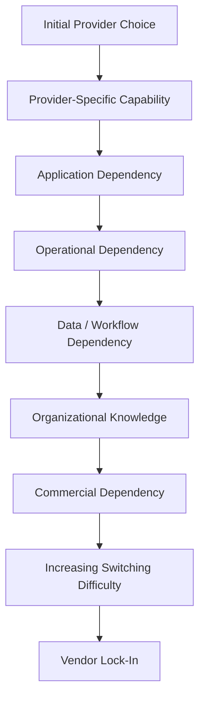
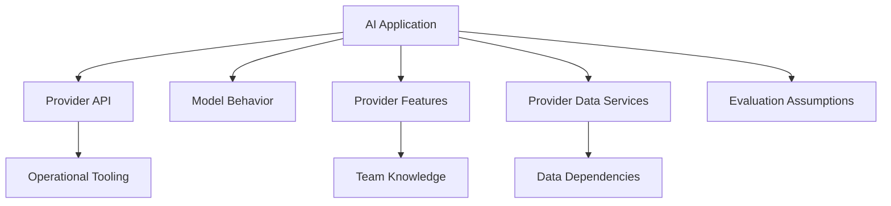

# ENT-07 — Provider Diversification, Portability and Vendor Lock-In

## Learning Objectives

By the end of this chapter, you should be able to:

- explain why AI portability is multidimensional
- distinguish model portability from provider portability
- explain how applications can become provider-dependent
- explain data portability as a strategic dependency concern
- explain operational and organizational portability
- identify how dependencies accumulate into vendor lock-in
- analyze provider concentration as a strategic dependency decision
- explain why diversification is a strategic choice rather than an automatic requirement
- evaluate the benefits and costs of different diversification strategies
- distinguish abstraction from genuine portability
- identify substitution barriers before a provider change becomes necessary
- reason about which dependencies should be reduced, accepted, or deliberately managed
- distinguish ENT-07 dependency strategy from ENT-09 resilience and continuity engineering
- evaluate portability as a practical ability to substitute, not merely an architectural property

---

## Prerequisites

You should be familiar with:

- enterprise application architecture
- APIs and service integrations
- basic AI model/provider concepts
- the model/provider selection principles from [File 01 — Enterprise Model and Provider Selection Strategy](./01-Enterprise-Model-and-Provider-Selection-Strategy.md)
- basic concepts of abstraction and architectural coupling

You do not need to know how to implement a technical migration to understand this chapter.

---

## Estimated Reading Time

**40–50 minutes**

---

## Before We Start

Imagine an enterprise has built several AI capabilities around one provider.

At first, everything looks efficient.

The provider offers:

- the required models
- useful APIs
- supporting services
- integration capabilities
- organizational familiarity

The applications work.

The teams are productive.

The architecture appears simple.

Then the enterprise asks a different question:

> **What would happen if we needed to replace this provider?**

The answer may be surprisingly difficult.

The application may depend on provider-specific interfaces.

The prompts may depend on a model's particular behavior.

The evaluation suite may assume specific outputs.

Data may be stored or transformed through provider-specific services.

Operational teams may rely on provider-specific tooling.

Business workflows may depend on provider-specific behavior.

Organizational knowledge may exist only within a small group of engineers familiar with that provider.

At that point, the enterprise has more than an API dependency.

It has a **strategic dependency system**.

This is the central problem of File 02.

---

## Why This Exists

Provider dependency is not created by one architectural decision.

It accumulates.

An enterprise may begin with a simple decision:

```text
Use Provider X
```

Over time, that decision can influence:

```text
Model
 ↓
API
 ↓
Application
 ↓
Data
 ↓
Operations
 ↓
Workflows
 ↓
People and Knowledge
```

Each dependency may appear manageable by itself.

The difficulty emerges when they reinforce one another.

This is why:

> **Portability is not simply the ability to change an API.**

An enterprise can have a technically replaceable API and still face substantial strategic lock-in.

The objective is therefore not to eliminate every dependency.

That would often be impractical and unnecessarily expensive.

The objective is to understand:

- where dependency exists
- how strongly it affects the enterprise
- which dependencies matter strategically
- what would make substitution difficult
- where portability is valuable
- where concentration is acceptable
- where diversification is justified
- where dependency should deliberately be accepted

---

# Mental Model

A useful mental model is to think of portability as a set of connected dimensions.

```text
                    Model Portability
                          +
                    Provider Portability
                          +
                   Application Portability
                          +
                       Data Portability
                          +
                   Operational Portability
                          +
              Organizational / Knowledge Portability
                          ↓
                 Overall Strategic Portability
```

Portability is therefore not one property.

An enterprise may be highly portable in one dimension and poorly portable in another.

For example:

```text
Provider API
    ↓
Easy to replace

BUT

Application behavior
    ↓
Highly provider-specific

AND

Operational tooling
    ↓
Provider-specific

AND

Evaluation
    ↓
Provider-specific
```

The enterprise may therefore have **low practical portability despite having a replaceable API**.

---

# Core Concepts

## 1. Portability Is Multidimensional

The first important question is:

> **Portable in what sense?**

A useful model is:

```text
Provider Portability
        +
Model Portability
        +
Application Portability
        +
Data Portability
        +
Operational Portability
        +
Organizational / Knowledge Portability
        ↓
Overall Strategic Portability
```

These dimensions are related but distinct.

An enterprise does not necessarily need maximum portability across every dimension.

The correct target depends on:

- business importance
- dependency exposure
- strategic alternatives
- switching difficulty
- capability requirements
- organizational capacity
- acceptable cost and effort

The goal is **meaningful strategic flexibility**, not portability for its own sake.

---

# Model Portability

## What Is Model Portability?

Model portability asks:

> **How difficult is it to replace one model with another while preserving the required outcomes?**

This is more useful than asking whether the new model behaves identically.

Two models may produce different outputs while both satisfying the enterprise's required outcome.

Therefore:

```text
Exact Behavioral Compatibility
            ≠
Required Outcome Compatibility
```

For example, an extraction model may produce slightly different wording or formatting while still producing information that satisfies the application's business requirements.

Conversely, two models may expose similar interfaces while producing materially different results for the application's use case.

Model portability is therefore concerned with preserving **required behavior and outcomes**, not necessarily identical internal or observable behavior.

---

## Sources of Model Dependency

Model portability can be affected by:

- model-specific capabilities
- model-specific prompting
- structured-output behavior
- context behavior
- tool-use behavior
- modality differences
- evaluation assumptions
- safety and control characteristics
- output behavior

For example, an application may rely on a model consistently returning a particular structured response.

Replacing the model with another model may preserve the API shape while changing the actual output behavior.

The interface is portable.

The **behavioral assumptions** are not necessarily portable.

---

## Model Portability Example

Suppose:

```text
Application
    ↓
Prompt
    ↓
Model A
    ↓
Structured Output
    ↓
Business Logic
```

The enterprise replaces Model A with Model B:

```text
Application
    ↓
Prompt
    ↓
Model B
    ↓
Different Output Behavior
    ↓
Business Logic Assumptions
```

No infrastructure migration may be required.

Yet the application may still require substantial adaptation.

The important question becomes:

> **Can the replacement model satisfy the required application outcomes, and what changes are necessary to establish confidence in that?**

This is a model-portability question.

---

# Provider Portability

## What Is Provider Portability?

Provider portability asks:

> **How difficult is it to move from one provider to another while preserving required enterprise capabilities?**

The obvious dependency is the provider API.

But provider dependency can exist far beyond the API.

Potential sources include:

- provider-specific APIs
- provider-specific features
- provider-specific tooling
- provider-specific data services
- provider-specific identity/integration
- provider-specific observability
- provider-specific workflow dependencies
- provider-specific configuration
- contractual restrictions

A provider may become embedded across several architectural layers.

```text
Application
     ↓
Provider API
     ↓
Provider Features
     ↓
Provider Tooling
     ↓
Provider Data Services
     ↓
Provider Operational Ecosystem
```

Replacing the provider may therefore require more than changing an endpoint.

---

# Application Portability

## What Is Application Portability?

Application portability asks:

> **How difficult is it to move the application to another model/provider environment while preserving required application behavior and outcomes?**

An application can become provider-dependent through:

- provider-specific interfaces
- provider-specific semantics
- provider-specific features
- provider-specific workflows
- provider-specific error behavior
- provider-specific configuration
- provider-specific evaluation assumptions

This creates an important distinction:

```text
Portable Interface
        ≠
Portable Application
```

An application may expose a clean internal interface while still depending heavily on provider-specific behavior behind that interface.

---

## Example

Consider:

```text
Application
     ↓
Internal AI Interface
     ↓
Provider Adapter
     ↓
Provider
```

This looks portable.

But suppose the application also depends on:

- provider-specific tool behavior
- provider-specific response semantics
- provider-specific safety behavior
- provider-specific evaluation thresholds
- provider-specific observability
- provider-specific workflows

The internal interface may be portable while the application remains strategically dependent.

The lesson is:

> **Portability must be evaluated at the level of behavior and dependencies, not only interface shape.**

---

# Data Portability

## What Is Data Portability?

Data portability asks:

> **Can the enterprise preserve the usability of required data and supporting artifacts when changing providers or services?**

This is a strategic concern because provider relationships can introduce dependencies around:

- data formats
- data ownership
- data location
- provider-specific data services
- transformation dependencies
- exportability
- data movement constraints
- governance constraints that affect movement or reuse

Data portability is therefore more than:

> “Can we download the data?”

The enterprise may also need to understand:

- whether the data remains usable outside the provider environment
- whether transformations are provider-specific
- whether metadata is preserved
- whether supporting artifacts can be exported
- whether movement is constrained by enterprise requirements

The question in this chapter is specifically:

> **Would provider-specific data dependencies materially reduce the enterprise's ability to substitute or change providers?**

Detailed information governance belongs to ENT-05, and technical data migration belongs outside this chapter.

---

## Operational Portability

## What Is Operational Portability?

Operational portability asks:

> **Can the organization continue operating the AI capability effectively after changing providers?**

This is often overlooked.

A provider change may alter:

- monitoring
- operational workflows
- tooling
- support models
- operational runbooks
- staff expertise
- knowledge requirements

The technical system may be replaceable while the operating model is not.

---

## Example

Imagine an enterprise has:

```text
Provider A
   ↓
Provider-specific monitoring
   ↓
Provider-specific dashboards
   ↓
Provider-specific operational workflows
   ↓
Team expertise
```

Moving to Provider B may require changes to every layer.

The problem is not simply the provider interface.

The organization has also developed an **operational dependency**.

Operational portability is therefore a strategic concern.

It is not a request to redesign production operations in this chapter.

---

# Organizational and Knowledge Portability

Operational portability often depends on organizational knowledge.

Consider:

```text
Provider
   ↓
Specialized Tooling
   ↓
Specialized Practices
   ↓
Specialized Team Knowledge
```

If only a small group understands how the AI capability works with a provider, substitution may become harder.

Knowledge can become a dependency when:

- provider-specific behavior is poorly documented
- operational practices are informal
- evaluation knowledge is concentrated in a few people
- provider-specific architecture decisions are not recorded
- replacement assumptions exist only in individual experience

This creates an important principle:

> **A dependency can exist in organizational knowledge even when the technology itself appears portable.**

---

# Vendor Lock-In

## What Is Vendor Lock-In?

Vendor lock-in can be understood as **accumulated dependency that makes substitution increasingly difficult**.

A useful model is:

```text
Technical Dependency
        +
Data Dependency
        +
Application Dependency
        +
Operational Dependency
        +
Commercial Dependency
        +
Organizational Dependency
        ↓
Vendor Lock-In
```

Lock-in is therefore not one feature.

It is the combined effect of multiple dependencies.

---

## Lock-In Can Exist Without a Difficult API

Consider:

```text
API
↓
Easy to replace

BUT

Prompts
↓
Model-specific

Evaluation
↓
Provider-specific

Data
↓
Provider-specific

Operations
↓
Provider-specific

Knowledge
↓
Provider-specific
```

The API may be easy to replace.

The overall system may still be difficult to substitute.

Therefore:

> **Technical replaceability does not automatically imply strategic portability.**

---

# How Lock-In Accumulates

Lock-in often develops gradually.



No individual decision necessarily creates severe lock-in.

The problem is cumulative.

This means enterprises should evaluate dependencies **before they become difficult to unwind**.

---

# Substitution Barriers

## What Is a Substitution Barrier?

A substitution barrier is a dependency that materially limits the enterprise's ability to replace a model or provider while preserving required outcomes.

This is different from switching cost.

```text
Switching Cost
→ Effort, resources, time, or money required to change

Substitution Barrier
→ A dependency that materially limits, constrains,
  or may prevent acceptable substitution
```

A switching cost can exist even when substitution is straightforward.

A substitution barrier is more significant because it can make substitution impractical, excessively risky, or unable to preserve required capabilities.

The important question is therefore not:

> “Can we technically connect another provider?”

It is:

> **“What could prevent us from achieving acceptable required outcomes after replacement?”**

---

## Common Substitution Barriers

Substitution barriers can arise from:

### Behavioral Differences

The replacement model may behave differently in ways that affect required outcomes.

### Provider-Specific Capabilities

The existing application may depend on capabilities that alternatives do not provide in equivalent form.

### Application Assumptions

Business logic may depend on provider-specific outputs, semantics, errors, or configuration.

### Data Dependencies

Data may depend on provider-specific services, formats, transformations, or constraints.

### Operational Dependencies

Monitoring, workflows, tooling, support practices, and runbooks may be provider-specific.

### Evaluation Dependencies

The enterprise may have evaluation criteria or test suites designed around the current model/provider behavior.

### Organizational Dependencies

Teams may lack the knowledge or experience required to operate the alternative environment.

### Commercial Dependencies

Commercial or contractual conditions may constrain practical substitution.

These barriers can reinforce one another.

---

# Substitution Difficulty Is Not Binary

An enterprise should avoid thinking:

```text
Portable
    OR
Locked-In
```

A better model is:

```text
Easy to Substitute
        ↓
Moderately Difficult
        ↓
Difficult
        ↓
Highly Constrained
```

Different dimensions may sit at different levels.

For example:

| Dependency | Substitution Difficulty |
|---|---|
| API endpoint | Low |
| Prompt behavior | Medium |
| Application semantics | High |
| Data services | High |
| Operational tooling | Medium |
| Organizational knowledge | Medium |
| Contractual conditions | Depends on the agreement |

This helps the enterprise identify where the real barriers exist.

---

# Portability vs Abstraction

This distinction is fundamental.

```text
Abstraction
    ↓
Hides implementation differences

Portability
    ↓
Provides practical ability to move
with acceptable cost, effort, and risk
```

An abstraction layer can reduce coupling.

But abstraction alone does not guarantee portability.

---

## Why Abstraction Is Not Enough

Suppose an enterprise creates:

```text
Application
    ↓
AI Abstraction Layer
    ↓
Provider
```

The application now avoids directly calling provider APIs.

That is useful.

But the application may still depend on:

- provider-specific model behavior
- provider-specific tools
- provider-specific context behavior
- provider-specific safety behavior
- provider-specific evaluation
- provider-specific operational tooling
- provider-specific data services

Therefore:

```text
Abstraction
    ↓
Potentially Reduces Some Dependency

BUT

Does Not Automatically Remove
Behavioral, Data, Operational,
Organizational, or Commercial Dependency
```

Abstraction should therefore be evaluated by **which dependencies it actually hides or isolates**, rather than treated as proof that the system is portable.

---

# Practical Enterprise Example

## Scenario

An enterprise operates a large internal AI assistant.

The original architecture is:

```text
Employees
    ↓
AI Application
    ↓
Provider A
    ↓
Model A
```

Over time, the application adopts:

- provider-specific tool integration
- provider-specific structured output
- provider-specific monitoring
- provider-specific data services
- provider-specific evaluation assumptions

The organization also trains its team around the provider's tooling.

After several years, leadership asks:

> “Could we move this capability to another provider?”

The team initially answers:

> “Yes. We only need to change the API endpoint.”

That answer is incomplete.

---

## Step 1 — Identify Dependencies

The team maps:

```text
Model
Provider
API
Application
Data
Operations
Knowledge
Commercial Conditions
```

The resulting dependency map is:



The team discovers that the API is only one dependency among many.

---

## Step 2 — Evaluate Portability

The team evaluates each dimension:

| Portability Dimension | Question |
|---|---|
| Model | Can another model preserve required outcomes? |
| Provider | Can another provider supply the capability? |
| Application | Can the application preserve required behavior and outcomes? |
| Data | Can required data and supporting artifacts remain usable elsewhere? |
| Operational | Can the team operate the replacement environment? |
| Knowledge | Does the organization have sufficient transferable knowledge? |

The result is not a simple yes/no answer.

It becomes a map of strategic dependencies.

---

## Step 3 — Identify the Important Barriers

The team discovers:

```text
API replacement
→ Easy

Model behavior replacement
→ Moderate

Application behavior replacement
→ Difficult

Provider-specific data services
→ Difficult

Operational replacement
→ Moderate

Organizational readiness
→ Moderate
```

The enterprise now understands the real substitution problem.

---

## Step 4 — Determine the Strategic Response

The enterprise then asks which dependencies actually matter enough to reduce.

For example:

```text
Provider-specific data dependency
→ High strategic exposure
→ Reduce dependency where practical

Provider-specific specialized capability
→ High business value
→ Accept dependency deliberately

Provider-specific operational tooling
→ Moderate exposure
→ Improve transferable operational knowledge

API dependency
→ Low exposure
→ Existing abstraction is sufficient
```

This produces a more useful decision than simply declaring the system “portable” or “locked in.”

The resulting principle is:

```text
Dependency
    ↓
Strategic Exposure
    ↓
Required Portability
    ↓
Reduce / Accept / Manage
```

The goal is not perfect portability.

The goal is **strategically useful portability**.

---

# Provider Concentration

## What Is Provider Concentration?

Provider concentration describes how much of the enterprise's AI capability depends on one provider or a small number of providers.

Concentration can exist at several levels.

### Model Concentration

Many workloads depend on models supplied by one provider.

### Capability Concentration

Multiple AI capabilities depend on the same provider.

### Domain Concentration

Several business domains depend on one provider.

### Platform Concentration

Multiple enterprise AI applications depend on a common provider platform or ecosystem.

These forms can overlap.

---

## Why Enterprises Concentrate Providers

Concentration is not automatically a mistake.

A single-provider strategy can provide:

- consistency
- standardization
- simpler integration
- organizational familiarity
- operational simplicity
- commercial leverage
- reduced supplier-management complexity

For some enterprises, these benefits may be substantial.

The question is therefore not:

> “Should we always use multiple providers?”

It is:

> **“Is the current level of provider concentration strategically justified by the value it provides and the dependency it creates?”**

---

## Strategic Exposure From Concentration

Concentration can also create:

- increased provider dependency
- reduced bargaining power
- correlated exposure to provider changes
- greater substitution difficulty
- strategic exposure if provider direction changes

The enterprise should therefore understand both sides:

```text
Concentration
    ↓
Simplicity + Standardization
    +
Dependency + Strategic Exposure
```

Neither side should be ignored.

---

# ENT-07 vs ENT-09: Concentration Boundary

Provider concentration and enterprise resilience are related, but they answer different questions.

ENT-07 asks:

> **How should provider concentration be strategically managed?**

ENT-09 asks:

> **How critical is the affected dependency, and what continuity or resilience requirements follow from its failure?**

Therefore, this chapter may discuss:

- concentration
- dependency
- diversification
- substitution options

It should not turn those concepts into:

- enterprise criticality analysis
- continuity planning
- degraded operating modes
- recovery engineering
- disaster recovery
- technical failover

Those belong to ENT-09 and the relevant production domains.

---

## Diversification

## What Is Diversification?

Diversification means deliberately distributing AI dependency across multiple providers, models, capabilities, or domains to reduce concentration.

It is a **strategic choice**.

It is not an automatic requirement.

A useful model is:

```text
Dependency
    ↓
Concentration
    ↓
Potential Strategic Exposure
    ↓
Diversification Benefit
    ↓
Additional Complexity
    ↓
Net Strategic Value
    ↓
Decision
```

---

# Diversification Strategies

## 1. Single-Provider Strategy

The enterprise intentionally concentrates on one provider.

Potential benefits:

- simpler architecture
- consistent interfaces
- easier operations
- standardized skills
- reduced integration complexity

Potential drawback:

- greater provider dependency

This strategy can be reasonable when the dependency is understood and acceptable.

---

## 2. Primary + Secondary Provider

One provider remains primary while another is maintained as a strategic alternative.

The purpose may be to preserve substitution options rather than operate every workload across both providers.

Potential benefits:

- reduced concentration
- stronger negotiating position
- greater substitution readiness

Potential costs:

- additional evaluation
- additional integration
- additional organizational knowledge
- additional operational complexity

---

## 3. Multi-Provider by Capability

Different providers are selected for different AI capabilities.

For example:

```text
Capability A → Provider A
Capability B → Provider B
Capability C → Provider A
Capability D → Provider C
```

This can reduce dependence on one provider for every capability.

However, it can increase complexity.

---

## 4. Multi-Provider by Business Domain

Different business domains may use different providers.

For example:

```text
Customer Service → Provider A
Internal Knowledge → Provider B
Research → Provider C
```

This can reduce enterprise-wide concentration.

It can also create fragmented architecture and operational knowledge.

---

## 5. Selective Diversification

The enterprise diversifies only where dependency exposure is strategically significant.

For example:

```text
Low strategic exposure
→ Single provider acceptable

High strategic exposure
→ Secondary option maintained
```

This often provides a more targeted approach than attempting to make everything multi-provider.

---

## 6. Abstraction-Driven Substitution

The enterprise uses abstraction to reduce direct application dependency and preserve the ability to substitute providers where practical.

However, abstraction does not eliminate behavioral or operational dependency.

Therefore, abstraction should be treated as an enabling architectural technique, not as proof of portability.

---

# Diversification Trade-offs

Diversification can reduce concentration.

But it can also introduce:

- integration complexity
- operational complexity
- governance complexity
- evaluation burden
- skills requirements
- additional cost

This produces a fundamental trade-off:

```text
More Diversification
        ↓
Lower Concentration
        +
Higher Complexity
```

The correct question is therefore:

> **Does the reduction in dependency justify the additional complexity?**

---

# When Diversification Is Not Worth It

Consider an internal low-risk capability.

Suppose:

```text
Provider Concentration
→ High

Strategic Exposure
→ Low

Alternative Providers
→ Available

Diversification Cost
→ Very High
```

Introducing a second provider may create more engineering complexity than strategic value.

Now consider:

```text
Provider Concentration
→ High

Strategic Exposure
→ High

Alternative Providers
→ Credible

Diversification Cost
→ Moderate
```

Diversification may now be justified.

The decision depends on the **dependency being reduced**, not on the abstract idea that multi-provider is always better.

---

# Strategic Portability

Portability should ultimately be evaluated as a business and engineering capability.

A useful question is:

> **If the current provider or model became unsuitable, could the enterprise move to an acceptable alternative without unacceptable disruption?**

That requires more than technical compatibility.

Consider:

```text
Behavioral Compatibility
        +
Application Compatibility
        +
Data Portability
        +
Operational Portability
        +
Organizational Readiness
        +
Commercial Feasibility
        ↓
Practical Substitution Capability
```

This is why portability is best understood as a **strategic capability** rather than merely an architectural property.

---

# Portability Does Not Mean Zero Switching Cost

An enterprise may have good portability and still incur switching cost.

For example:

```text
Current Provider
     ↓
Alternative Provider
     ↓
Evaluation
     ↓
Application Adjustment
     ↓
Operational Adjustment
     ↓
Knowledge Transfer
```

Some effort is normal.

The strategic question is whether that effort is:

- understood
- acceptable
- proportionate
- achievable within the required timeframe
- justified by the dependency being managed

Therefore:

> **Good portability does not mean free substitution.**

It means substitution remains practically viable.

---

# Dependency Analysis

A useful dependency analysis asks:

```text
What are we dependent on?
        ↓
Why are we dependent on it?
        ↓
How deeply is the dependency embedded?
        ↓
What would replacement require?
        ↓
What capability could be lost?
        ↓
What alternatives exist?
        ↓
What portability is actually required?
```

This prevents the enterprise from treating every dependency equally.

---

# Practical Dependency Map

An enterprise can classify dependencies like this:

| Dependency | Example | Strategic Question |
|---|---|---|
| Model | Model-specific behavior | Can another model preserve required outcomes? |
| Provider | Provider-specific API | Can another provider supply the capability? |
| Application | Provider-specific semantics | Can the application preserve required behavior elsewhere? |
| Data | Provider-specific data service | Can required data remain usable elsewhere? |
| Operations | Provider-specific tooling | Can the team operate another environment? |
| Knowledge | Specialized provider expertise | Is knowledge transferable? |
| Commercial | Provider-specific conditions | Would commercial conditions constrain substitution? |

The purpose is not to eliminate every dependency.

It is to make important dependencies visible.

---

## Engineering Decisions That Increase or Reduce Portability

Architecture decisions can influence future portability.

## Decisions That May Increase Portability

Examples include:

- stable internal interfaces
- explicit dependency boundaries
- documented provider assumptions
- workload-specific evaluation criteria
- portable data representations where practical
- transferable operational knowledge
- avoiding unnecessary provider-specific coupling
- maintaining credible alternatives for strategically important capabilities

These decisions can reduce the difficulty of future substitution.

---

## Decisions That May Reduce Portability

Examples include:

- deep dependence on provider-specific features
- embedding provider-specific semantics throughout application logic
- relying on provider-specific data services without understanding alternatives
- allowing operational knowledge to remain provider-specific
- building evaluations that cannot compare alternatives
- adopting multiple tightly coupled provider-specific services without considering substitution

These decisions may still be justified.

The important principle is:

> **Reduced portability is acceptable when the value of the dependency is understood and intentionally chosen.**

---

## Engineering Decisions and Trade-offs

## Trade-off 1 — Portability vs Capability

A highly portable design may avoid provider-specific features.

That can reduce dependency.

But it may also prevent the enterprise from using valuable capabilities.

Therefore:

> **Portability should be optimized where its strategic value exceeds the capability cost of preserving it.**

---

## Trade-off 2 — Standardization vs Diversification

Standardization can simplify enterprise architecture.

Diversification can reduce concentration.

```text
Standardization
    ↓
Simplicity

Diversification
    ↓
Reduced Concentration
```

The enterprise must decide which problem is more important for the capability.

---

## Trade-off 3 — Abstraction vs Native Capability

Abstraction can make substitution easier at the interface level.

Provider-specific functionality may provide greater capability.

The enterprise should therefore ask:

> **Which provider-specific capabilities are valuable enough to justify the dependency they create?**

---

## Trade-off 4 — Simplicity vs Strategic Flexibility

A single provider may simplify engineering today.

Multiple providers may preserve more options tomorrow.

Neither is automatically superior.

The correct decision depends on:

- dependency exposure
- strategic importance
- alternatives
- organizational capacity
- complexity tolerance

---

## Trade-off 5 — Portability vs Engineering Cost

Portability requires engineering attention.

Examples include:

- maintaining interfaces
- testing alternatives
- preserving evaluation coverage
- documenting dependencies
- maintaining transferable knowledge

If the dependency has little strategic significance, this investment may not be justified.

---

# Common Mistakes and Misconceptions

## Mistake 1 — “We Can Change the API, So We Are Portable”

**Why it fails:**

API compatibility does not guarantee behavioral, application, data, operational, or organizational portability.

**Better approach:**

Evaluate portability across the relevant dependency dimensions.

---

## Mistake 2 — “Abstraction Eliminates Lock-In”

**Why it fails:**

An abstraction can hide interface differences while leaving model behavior, data, operational, or organizational dependencies intact.

**Better approach:**

Treat abstraction as one portability mechanism, not proof of portability.

---

## Mistake 3 — “Multi-Provider Is Always Better”

**Why it fails:**

Diversification can reduce concentration while increasing integration, operations, evaluation, governance, skills, and cost complexity.

**Better approach:**

Justify diversification by the dependency it reduces.

---

## Mistake 4 — “Single Provider Is Always Bad”

**Why it fails:**

Concentration can provide meaningful standardization, simplicity, and operational benefits.

**Better approach:**

Evaluate the value and strategic exposure created by concentration.

---

## Mistake 5 — “Portability Means Zero Switching Cost”

**Why it fails:**

Even a portable system may require evaluation, adaptation, operational changes, and organizational effort.

**Better approach:**

Define portability as practical substitution at acceptable cost, effort, and risk.

---

## Mistake 6 — “Only the Application Can Be Locked In”

**Why it fails:**

Data, operations, organizational knowledge, commercial conditions, and model behavior can also create lock-in.

**Better approach:**

Analyze dependency across multiple dimensions.

---

## Mistake 7 — “Provider-Specific Features Should Never Be Used”

**Why it fails:**

Provider-specific features may provide substantial business or technical value.

**Better approach:**

Use them deliberately and understand the dependency they create.

---

## Mistake 8 — “Portability Should Be Maximized Everywhere”

**Why it fails:**

Maximum portability can introduce unnecessary engineering complexity.

**Better approach:**

Identify where strategic portability actually matters.

---

## Mistake 9 — “Provider Concentration Is the Same as Resilience”

**Why it fails:**

Concentration describes dependency strategy. Resilience asks what happens when a critical dependency fails and what continuity requirements follow.

**Better approach:**

Keep provider concentration in ENT-07 and criticality/continuity consequences in ENT-09.

---

## Mistake 10 — “Technical Portability Is Enough”

**Why it fails:**

An enterprise may be technically able to connect another provider but lack evaluation confidence, operational knowledge, data portability, or organizational readiness.

**Better approach:**

Evaluate practical strategic portability.

---

## Interview Questions with Expected Answers

## 1. What does portability mean in an enterprise AI system?

**Expected answer:**

Portability is the practical ability to substitute a model, provider, application environment, data dependency, or operational ecosystem while preserving required outcomes at acceptable cost, effort, and risk. It is multidimensional rather than limited to API compatibility.

---

## 2. What are the major dimensions of AI portability?

**Expected answer:**

Model portability, provider portability, application portability, data portability, operational portability, and organizational/knowledge portability can all contribute to overall strategic portability.

---

## 3. Why is model portability difficult?

**Expected answer:**

Models can differ in capabilities, prompting behavior, structured output, context behavior, tool use, modalities, evaluation characteristics, safety/control behavior, and output behavior. Replacing a model may therefore change application behavior even when the surrounding API remains similar. The goal is not necessarily identical behavior, but preservation of required outcomes.

---

## 4. Why does provider portability go beyond API compatibility?

**Expected answer:**

Provider dependency can also exist through provider-specific features, tooling, data services, identity/integration, observability, workflows, configuration, and contractual conditions.

---

## 5. Can an application have a portable interface but still be locked into a provider?

**Expected answer:**

Yes. The interface may be stable while application behavior, model assumptions, evaluation, provider-specific features, data services, or operational tooling remain provider-dependent.

---

## 6. What is data portability in the context of ENT-07?

**Expected answer:**

It is the strategic ability to preserve the usability of required data and supporting artifacts when changing providers or services. It includes formats, location, transformations, exportability, movement constraints, and governance constraints that affect substitution.

---

## 7. What is operational portability?

**Expected answer:**

Operational portability is the organization's ability to operate the AI capability effectively after changing providers. It includes monitoring, tooling, workflows, support models, runbooks, staff expertise, and operational knowledge.

---

## 8. What is vendor lock-in?

**Expected answer:**

Vendor lock-in is accumulated dependency that makes substitution increasingly difficult. It can result from technical, data, application, operational, commercial, and organizational dependencies.

---

## 9. Why can lock-in exist even when an API is easy to replace?

**Expected answer:**

Because the API is only one dependency. Model behavior, application semantics, evaluation, data services, operational tooling, workflows, contracts, and organizational knowledge may still make substitution difficult.

---

## 10. What is the difference between a switching cost and a substitution barrier?

**Expected answer:**

A switching cost is the effort, resources, time, or money required to change. A substitution barrier is a dependency that materially limits, constrains, or may prevent acceptable substitution. A system can have switching costs without having a serious substitution barrier.

---

## 11. Is provider concentration always bad?

**Expected answer:**

No. Concentration can provide standardization, simplicity, consistency, and organizational benefits. It becomes a strategic concern when the dependency and resulting exposure are not justified by those benefits.

---

## 12. Is multi-provider architecture always better?

**Expected answer:**

No. Diversification can reduce concentration but increase integration, operational, governance, evaluation, skills, and cost complexity. It should be justified by the dependency it is intended to reduce.

---

## 13. What is the difference between abstraction and portability?

**Expected answer:**

Abstraction hides implementation differences. Portability is the practical ability to move with acceptable cost, effort, and risk. Abstraction may support portability but does not guarantee it.

---

## 14. What would you examine before deciding that an AI capability is portable?

**Expected answer:**

I would examine model behavior and required outcomes, provider interfaces and features, application assumptions, data dependencies, operational tooling, evaluation compatibility, organizational readiness, and commercial constraints that could affect substitution.

---

## 15. How should an enterprise decide whether to diversify providers?

**Expected answer:**

It should compare the dependency and concentration being reduced against the additional integration, operational, governance, evaluation, skills, and cost complexity introduced by diversification.

---

## 16. When is single-provider strategy reasonable?

**Expected answer:**

When the benefits of standardization and simplicity are valuable and the resulting provider dependency is understood, proportionate, and strategically acceptable for the affected capabilities.

---

## 17. What is the difference between ENT-07 provider concentration and ENT-09 resilience?

**Expected answer:**

ENT-07 evaluates provider concentration as a dependency and strategy decision. ENT-09 evaluates the criticality of the dependency and the continuity or resilience requirements that follow if it fails.

---

## 18. How can organizational knowledge create lock-in?

**Expected answer:**

If provider-specific behavior, tooling, evaluation methods, operational practices, or architecture knowledge exists only within a small group, replacing the provider may require significant knowledge transfer or rebuilding organizational capability.

---

## Quick Revision

## Core Question

> **How can an enterprise maintain meaningful flexibility when AI capabilities depend on models, providers, applications, data, operations, and organizational knowledge?**

## Portability Model

```text
Model
   +
Provider
   +
Application
   +
Data
   +
Operations
   +
Organizational Knowledge
   ↓
Strategic Portability
```

## Lock-In Model

```text
Technical Dependency
        +
Data Dependency
        +
Application Dependency
        +
Operational Dependency
        +
Commercial Dependency
        +
Organizational Dependency
        ↓
Vendor Lock-In
```

## Abstraction vs Portability

```text
Abstraction
→ Hides implementation differences

Portability
→ Enables practical substitution
  at acceptable cost, effort, and risk
```

## Concentration

```text
Concentration
    ↓
Standardization + Simplicity
    +
Dependency + Strategic Exposure
```

## Diversification

```text
Dependency
    ↓
Concentration
    ↓
Strategic Exposure
    ↓
Diversification Benefit
    ↓
Added Complexity
    ↓
Net Strategic Value
```

## Substitution

```text
Current Dependency
        ↓
Replacement Difficulty
        ↓
Substitution Barriers
        ↓
Alternative Capability
        ↓
Practical Portability
```

---

# Key Takeaways

1. **AI portability is multidimensional.**
2. **Model portability is different from provider portability.**
3. **Model substitution does not require identical behavior if required outcomes remain acceptable.**
4. **A portable interface does not necessarily make the application portable.**
5. **Data portability is a strategic dependency concern, not merely a data-export problem.**
6. **Operational and organizational knowledge can become portability constraints.**
7. **Vendor lock-in is accumulated dependency across multiple dimensions.**
8. **An easily replaceable API does not guarantee strategic portability.**
9. **Provider concentration is a dependency strategy, not automatically a resilience problem.**
10. **Concentration can provide simplicity and standardization while increasing strategic dependency.**
11. **Diversification is not automatically better than concentration.**
12. **Diversification should be justified by the dependency it reduces.**
13. **Abstraction can reduce some coupling but does not automatically create portability.**
14. **A switching cost is not necessarily a substitution barrier.**
15. **Substitution barriers can arise from behavior, applications, data, operations, evaluation, knowledge, and commercial conditions.**
16. **Good portability does not mean zero switching cost; it means substitution remains practically viable.**
17. **The goal is meaningful strategic flexibility, not maximum portability everywhere.**
18. **ENT-07 manages provider dependency and concentration strategy; ENT-09 manages criticality, continuity, and resilience consequences.**
19. **Technical migration is a separate implementation concern and does not belong in this chapter.**

---

## Further Reading

For the broader ENT-07 progression:

- [ENT-07 README](./README.md)
- [01 — Enterprise Model and Provider Selection Strategy](./01-Enterprise-Model-and-Provider-Selection-Strategy.md)
- [03 — AI Vendor Risk, Procurement and Exit Strategy](./03-AI-Vendor-Risk-Procurement-and-Exit-Strategy.md)

For adjacent enterprise context:

- ENT-06 — Enterprise Integration and Platform Architecture
- ENT-08 — AI Economics, FinOps and Portfolio Governance
- ENT-09 — AI Criticality, Resilience and Dependency Governance

> **File 01 answers: “Which model/provider should we strategically choose?”**
>
> **File 02 answers: “How do we manage the dependency and lock-in created by that choice?”**
>
> **File 03 answers: “How do we manage vendor risk and preserve substitution or exit options?”**
