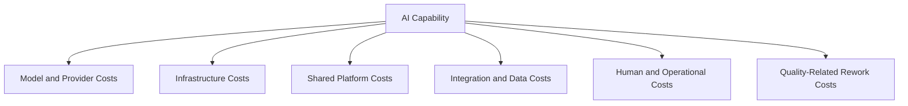
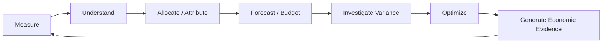

# 01 — AI Cost Models, FinOps and Unit Economics

## Learning Objectives

After completing this chapter, you should be able to:

- explain why AI economics cannot be reduced to model or token pricing;
- identify the major cost components of an enterprise AI capability;
- distinguish fixed, variable, direct, and shared AI costs;
- distinguish provider price from enterprise economic cost and broader total economic impact;
- identify the economic drivers that cause AI costs to change;
- distinguish cost allocation from cost attribution;
- understand AI-specific FinOps as a discipline for visibility, allocation, accountability, forecasting, optimization, and economic decision support;
- reason about AI cost forecasts, budgets, actuals, variance, and corrective decisions;
- distinguish unit cost from unit economics;
- distinguish an AI activity/unit, successful task, operational outcome, business outcome, and economic value;
- define meaningful economic units for different AI workloads;
- understand why cost per request can be a misleading economic measure;
- reason about cost-to-outcome relationships using success and quality evidence as economic inputs;
- evaluate the economic consequences of retries, human intervention, and downstream rework;
- distinguish economic optimization from technical optimization;
- reason about total economic impact as a decision-oriented economic boundary rather than a standardized accounting measure;
- compare AI workloads using economic evidence without reducing the decision to a single metric;
- understand how Lesson 01's economic evidence feeds the investment reasoning developed in Lesson 02.

---

## Prerequisites

You should already understand:

- the difference between an AI initiative, AI capability, and AI system/solution;
- the basic role of models, inference, AI platforms, and enterprise applications;
- the distinction between an enterprise capability and its implementation;
- basic enterprise architecture concepts;
- the idea that enterprise AI systems consume shared resources.

This chapter does not require accounting expertise.

It also does not teach:

- financial statement analysis;
- corporate accounting;
- procurement;
- vendor negotiation;
- cloud administration;
- GPU scheduling;
- model serving;
- batching implementation;
- KV-cache implementation;
- infrastructure performance engineering;
- production observability implementation;
- technical model evaluation methodology.

Those topics may influence AI economics, but they are not the primary subject here.

---

## Estimated Reading Time

**60–75 minutes**

The reading time assumes careful study of the examples, diagrams, decision models, and revision questions.

---

## Before We Start

Consider two AI systems.

### System A

A model provider charges less per request.

It appears inexpensive.

However:

- the system frequently fails;
- failed requests are retried;
- human reviewers handle many failures;
- users abandon some workflows;
- downstream teams perform additional work.

### System B

The model costs more per request.

However:

- task success is substantially higher;
- fewer requests require retries;
- less human intervention is required;
- the workflow completes more reliably;
- the business outcome is achieved more consistently.

Which system is cheaper?

The answer is:

> **We cannot determine that from the model price alone.**

This is the fundamental idea behind AI economics.

An enterprise does not ultimately pay only for tokens or model requests.

It bears the **economic consequences of operating an AI capability**.

Provider charges are one component.

Infrastructure, shared platforms, integration, human intervention, rework, operational support, and other downstream consequences can also matter.

Therefore:

```text
Provider Price
      ↓
Direct AI Consumption
      ↓
Enterprise Cost Structure
      ↓
Total Economic Impact
      ↓
Economic Evidence
```

The goal of this chapter is to build the reasoning required to move through these layers.

---

# Why This Exists

Traditional software often has relatively predictable cost structures.

An application may have:

- development cost;
- licensing cost;
- infrastructure cost;
- maintenance cost;
- support cost.

AI introduces additional economic variables.

For example:

- inference demand can vary significantly;
- model selection changes cost;
- input and output volume can change consumption;
- context size can affect consumption;
- workloads may have different success rates;
- retries can create additional inference;
- human review may be required;
- shared AI platforms may serve multiple consumers;
- different workloads may have very different economic outcomes.

This creates an important engineering problem:

> **How do we understand what an AI capability actually costs, what drives that cost, and whether the resulting economics are efficient for the required outcome?**

That question cannot be answered by looking at one invoice.

It requires a cost model.

---

## 1. Mental Model: AI Economics Is a System

A useful mental model is:

```text
AI Workload
    ↓
Resource Consumption
    ↓
Direct + Shared Costs
    ↓
Economic Drivers
    ↓
Economic Measurement
    ↓
Unit Economics
    ↓
Economic Outcome
```

For example:

```text
Customer Support Assistant
        ↓
Requests
        ↓
Model Inference
        ↓
Tokens + Infrastructure + Platform
        ↓
Retries + Human Review
        ↓
Cost per Successful Resolution
        ↓
Customer Support Outcome
```

Notice what happened.

The analysis moved from:

> “How much does one model request cost?”

to:

> “How much economic consumption is required to successfully resolve a customer-support case?”

That change in framing is the foundation of AI unit economics.

---

# 2. What Is an AI Cost Model?

An **AI cost model** is a structured representation of the economic resources consumed by an AI workload or capability and the drivers that cause those costs to change.

A simplified model might look like:

```text
Total AI Cost
    =
Direct AI Costs
    +
Shared AI Costs
    +
Supporting Costs
    +
Relevant Downstream Economic Costs
```

The exact categories depend on the enterprise and the decision being made.

The important point is that the model should expose:

1. **what costs exist;**
2. **who or what consumes them;**
3. **what drives those costs;**
4. **how costs change with workload behavior;**
5. **how costs relate to meaningful outcomes.**

A cost model is therefore not merely a list of prices.

It is a reasoning model.

---

# 3. AI Cost Structure

A useful enterprise-level view is:



These categories are not universal accounting classifications.

They are a practical way to reason about the economic footprint of an AI capability.

## 3.1 Model and Provider Costs

These are costs directly associated with consuming an external or internally provided AI model or service.

Examples may include:

- inference consumption;
- model API usage;
- embedding generation;
- managed AI service consumption;
- other provider-metered AI operations.

The exact commercial mechanism varies by provider.

The durable concept is:

> **Model consumption creates an economic obligation that usually varies with workload behavior.**

---

## 3.2 Infrastructure Costs

AI workloads may consume infrastructure such as:

- compute;
- storage;
- networking;
- accelerators;
- databases;
- caching infrastructure;
- supporting services.

The important ENT-08 perspective is not how to optimize those resources technically.

The question is:

> **How does infrastructure consumption contribute to the economic footprint of the AI capability?**

For example:

```text
Higher Workload
      ↓
More Resource Consumption
      ↓
Potentially Higher Infrastructure Cost
```

The technical mechanism belongs elsewhere.

The economic consequence belongs here.

---

## 3.3 Shared Platform Costs

Enterprise AI commonly uses shared services.

For example:

```text
                Shared AI Platform
                 /      |       \
                /       |        \
        Support     HR Assistant   Document AI
        Assistant
```

The platform may contain:

- shared inference infrastructure;
- shared gateways;
- shared observability;
- shared vector infrastructure;
- shared orchestration;
- shared security services;
- shared integration services.

The enterprise therefore faces an economic question:

> **How should the cost of a shared capability be associated with its consumers?**

This becomes especially important when one business unit consumes significantly more shared capacity than another.

---

## 3.4 Integration and Data Costs

An AI capability rarely exists in isolation.

It may depend on:

- enterprise applications;
- databases;
- document stores;
- data pipelines;
- APIs;
- identity systems;
- integration services;
- data processing.

These costs may not appear on the AI provider invoice.

Yet they can still contribute to the economic footprint of the capability.

---

## 3.5 Human and Operational Costs

Some AI workflows require human participation.

Examples:

- human review;
- exception handling;
- escalation;
- manual correction;
- operational support;
- quality review.

This creates an important relationship:

```text
AI Consumption
+
Human Effort
=
Broader Economic Cost
```

An AI system that appears inexpensive at the model layer may become expensive when substantial human effort is required to make the workflow successful.

---

## 3.6 Quality-Related Rework Costs

AI systems can generate additional work when outcomes are unsuccessful.

For example:

```text
AI Output
    ↓
Unsuccessful
    ↓
Retry
    ↓
Human Review
    ↓
Correction
    ↓
Second Processing Step
```

The original inference cost is only part of the economic impact.

The enterprise may also incur:

- additional inference;
- additional compute;
- human labor;
- operational support;
- downstream rework;
- customer remediation.

Therefore:

> **Failure or poor success behavior can be an economic cost driver.**

This chapter uses quality and success evidence only to understand economic consequences. Technical evaluation methodology remains outside ENT-08.

---

# 4. Fixed and Variable AI Costs

One of the first useful distinctions is between **fixed** and **variable** costs.

## 4.1 Fixed Cost

A fixed cost does not change directly with each additional unit of workload over a relevant operating range.

Examples may include:

- baseline platform capability;
- committed infrastructure;
- platform engineering effort;
- standing operational support;
- certain licensing arrangements;
- dedicated foundational services.

Fixed does not mean:

> “The cost never changes.”

It means:

> **The cost is relatively insensitive to short-term workload volume within the relevant range.**

---

## 4.2 Variable Cost

Variable costs change with workload consumption.

Examples may include:

- model inference consumption;
- token consumption;
- per-request services;
- workload-dependent compute;
- storage growth;
- external API usage.

A simplified relationship is:

```text
Variable Cost
    ≈
Cost per Unit × Units Consumed
```

For example:

```text
Requests
    ×
Average Consumption per Request
    ×
Economic Rate
```

The actual commercial model may be more complicated, but the reasoning remains useful.

---

## 4.3 Capacity and Step-Function Economics

AI infrastructure does not always behave as simply fixed or variable.

A workload may remain within an existing capacity boundary for some period and then require additional capacity.

For example:

```text
Workload Growth
      ↓
Existing Capacity
      ↓
Capacity Threshold
      ↓
Additional Capacity Required
      ↓
Cost Step Increase
```

The resulting cost behavior may look conceptually like:

```text
Cost
 │
 │        ┌────────────
 │        │
 │   ┌────┘
 │   │
 └───┴──────────────── Workload
```

Therefore an AI cost can be:

- relatively fixed over one range;
- variable within another range;
- subject to step increases when capacity thresholds are crossed.

This is important when forecasting and budgeting at scale.

The implementation of capacity management belongs to technical domains; ENT-08 focuses on the economic behavior it creates.

---

## 4.4 Why the Distinction Matters

Suppose an enterprise builds a document-processing capability.

It has:

```text
Baseline platform cost = relatively stable

Document processing cost = increases with volume
```

At low volume, fixed costs may dominate.

At high volume, variable costs may dominate.

At certain thresholds, additional capacity may create step changes.

Therefore the same AI capability can have different economics at different scales.

---

# 5. Direct and Shared Costs

Another essential distinction is:

```text
Direct Cost
vs
Shared Cost
```

## 5.1 Direct Cost

A direct cost can reasonably be associated with a specific workload or capability.

For example:

```text
Capability A
    ↓
Dedicated AI service consumption
    ↓
Directly associated economic cost
```

If the enterprise can identify that a specific capability caused the consumption, attribution is relatively straightforward.

---

## 5.2 Shared Cost

A shared cost supports multiple consumers.

For example:

```text
                 Shared Platform
                /       |       \
               /        |        \
          Team A      Team B     Team C
```

The platform cost cannot simply be assigned to one consumer.

The enterprise needs a mechanism for allocating or attributing that cost.

---

# 6. Cost Allocation vs Cost Attribution

These terms are related but should not be treated as synonyms.

## 6.1 Cost Allocation

**Allocation** distributes shared costs using an agreed mechanism.

For example, a shared AI platform may allocate cost based on:

- usage;
- requests;
- compute consumption;
- tokens;
- business-unit proportions;
- another agreed allocation basis.

The mechanism is a policy and measurement decision.

Allocation does not prove that the assigned amount represents exact economic causality.

---

## 6.2 Cost Attribution

**Attribution** associates economic consumption with a workload, capability, consumer, service, or activity.

For example:

```text
Platform Consumption
       ↓
Service A
       ↓
Customer Support Capability
```

Attribution asks:

> **What economic consumption can reasonably be associated with this workload, capability, consumer, service, or activity?**

This is different from proving that the associated cost caused a particular business outcome.

---

## 6.3 Why the Difference Matters

Suppose a shared AI platform costs ₹10 lakh per month.

Three business units consume it.

An allocation mechanism might distribute the ₹10 lakh according to a predefined rule.

But attribution asks a different question:

> **What economic consumption can reasonably be associated with each workload or consumer?**

The two numbers may not be identical.

This matters because poor allocation can create misleading incentives.

For example, if every business unit receives an equal share despite highly unequal consumption:

```text
Actual Consumption
A = 70%
B = 20%
C = 10%

Equal Allocation
A = 33%
B = 33%
C = 33%
```

The allocation may be internally consistent while the economic signal is poor.

---

# 7. Cost Drivers

A **cost driver** is a factor that materially influences the economic cost of an AI workload or capability.

Common AI cost drivers include:

- model selection;
- token volume;
- context size;
- inference frequency;
- workload shape;
- concurrency;
- provider pricing;
- shared platform utilization;
- infrastructure utilization;
- retry rate;
- rework;
- task success behavior;
- human intervention;
- downstream operational cost.

These drivers interact.

For example:

```text
Larger Context
      ↓
More Input Consumption
      ↓
Potentially Higher Inference Cost
```

But another relationship may be:

```text
Larger Context
      ↓
Potentially Better Task Performance
      ↓
Fewer Failures
      ↓
Less Rework
      ↓
Potentially Lower Total Economic Impact
```

This is why AI economics cannot be reduced to one cost variable.

A cost driver can increase one cost while reducing another.

---

# 8. Token Economics

Tokens are an important AI cost driver.

But token economics should not become synonymous with AI economics.

A simplified model is:

```text
Token Consumption
      ×
Economic Rate
      =
Inference-Related Cost
```

Token consumption may depend on:

- input size;
- output size;
- context;
- conversation history;
- retrieved information;
- system instructions;
- workload design.

Therefore:

```text
More Tokens
    ↓
Potentially Higher Cost
```

But:

```text
Higher Token Cost
    ≠
Automatically Worse Economics
```

If additional context significantly improves task success and reduces downstream work, the broader economics may improve.

This is the beginning of quality-adjusted economic reasoning.

---

# 9. Cost vs Price

A provider's price is not necessarily the enterprise's total cost.

Consider:

```text
Provider Price
      ↓
Model Consumption
      ↓
+
Infrastructure
+
Platform
+
Integration
+
Human Review
+
Rework
+
Operations
      ↓
Enterprise Economic Impact
```

A provider may charge only for model consumption.

The enterprise absorbs the rest.

Therefore:

> **Price is an input to an economic model, not the model itself.**

This distinction becomes especially important when comparing different architectures or providers.

---

# 10. Total Economic Impact

A useful concept is **total economic impact**.

It considers the broader economic consequences relevant to a particular AI decision.

A conceptual model is:

```text
Total Economic Impact
    =
Provider / Model Costs
    +
Infrastructure
    +
Shared Platform
    +
Integration
    +
Data-Related Costs
    +
Human Effort
    +
Operational Support
    +
Rework
    +
Switching Costs
    +
Other Relevant Organizational Costs
```

This is **not a standardized accounting formula or universal metric**.

It is a decision-oriented economic boundary.

The relevant components depend on the question being asked.

For example, a short-term model comparison may need a narrower cost boundary than a multi-year enterprise capability investment decision.

The purpose is to avoid making decisions based on incomplete economic evidence.

---

# 11. Cost vs Value

Cost and value answer different questions.

### Cost asks:

> **What economic resources does this capability consume?**

### Value asks:

> **What useful outcome does this capability produce?**

These must not be collapsed into one concept.

For example:

```text
Capability A
Cost = ₹10 per successful workflow
Value = ₹100 economic benefit per workflow

Capability B
Cost = ₹5 per successful workflow
Value = ₹20 economic benefit per workflow
```

Capability B is cheaper.

But that does not automatically make it economically superior.

The relevant question is:

> **What relationship exists between economic consumption, successful outcomes, and the business context?**

That is where unit economics becomes important.

Detailed expected-value and investment reasoning belongs primarily to Lesson 02.

---

# 12. Cost Efficiency vs Business Value

A common mistake is:

> “The cheapest system is the best system.”

This is false.

Suppose:

```text
System A
Cost = ₹1 per request
Success = 60%

System B
Cost = ₹2 per request
Success = 95%
```

If the objective is simply to minimize cost per request, A looks better.

But if the business cares about successful outcomes, the comparison changes.

A simplified cost-per-success measure is:

```text
Cost per Successful Task
=
Cost per Attempt
÷
Success Rate
```

For A:

```text
₹1 ÷ 0.60
≈ ₹1.67
```

For B:

```text
₹2 ÷ 0.95
≈ ₹2.11
```

At this stage, A may still appear cheaper.

But now suppose B reduces human intervention by ₹1.50 per successful task.

The economic picture changes.

The lesson is not that one formula is universally correct.

The lesson is:

> **Economic comparison must reflect the actual cost structure and the meaningful outcome of the workload.**

---

# 13. Unit Cost vs Unit Economics

These concepts must be distinguished carefully.

## 13.1 Unit Cost

Unit cost measures the economic cost associated with one defined unit.

Examples:

- cost per request;
- cost per document;
- cost per workflow;
- cost per customer interaction.

For example:

```text
Total Relevant Cost
-------------------
Units Processed
```

If a system costs ₹50,000 and processes 10,000 documents:

```text
Unit Cost = ₹5 per document
```

This is useful.

But it may not be sufficient.

---

## 13.2 The Economic Measurement Hierarchy

The terms used in AI economics describe different levels of measurement and should not be treated as interchangeable.

A useful hierarchy is:

```text
AI Activity / Unit
        ↓
Successful Task
        ↓
Operational Outcome
        ↓
Business Outcome
        ↓
Economic Value
```

These levels are related, but each answers a different question.

### AI Activity / Unit

This is the measurable unit of AI work.

Examples:

- request;
- document submitted;
- workflow invocation;
- customer interaction.

It tells us how much work was attempted or processed.

---

### Successful Task

A successful task is an AI operation that satisfies the defined task-level success condition.

Examples:

- document correctly classified;
- requested information retrieved;
- translation completed and accepted;
- workflow step completed.

A successful task is more meaningful than a raw request count when failures have material economic consequences.

However, a successful task is not automatically a business outcome.

---

### Operational Outcome

An operational outcome describes the useful result produced within a business or technical workflow.

Examples:

- customer case resolved;
- document successfully processed;
- workflow completed;
- support ticket routed correctly.

An operational outcome may be directly measurable without being expressed in monetary terms.

---

### Business Outcome

A business outcome represents the result that matters to the enterprise or business function.

Examples:

- reduced handling time;
- increased completed transactions;
- improved customer retention;
- reduced operating cost;
- increased employee productivity.

A business outcome may be influenced by many factors beyond the AI capability.

Therefore, the existence of an AI-generated operational outcome does not automatically prove business causality.

---

### Economic Value

Economic value represents the economic significance associated with the business outcome.

Depending on context, it may be represented through:

- avoided cost;
- increased revenue;
- productivity benefit;
- reduced operational burden;
- other economically meaningful measures.

Not every business outcome can be reliably monetized.

Therefore, **unit economics does not require every useful unit to have a precise monetary value**.

The important requirement is that the economic unit and outcome relationship are appropriate for the decision being made.

---

## 13.3 Unit Economics

**Unit economics** examines the relationship between the economic consumption associated with a meaningful unit and the success, outcome, or other relevant economic consequences associated with that unit.

Examples include:

```text
Cost per Successful Task
Cost per Resolved Case
Cost per Completed Workflow
Cost per Business Outcome
Cost-to-Outcome Relationship
```

The appropriate measure depends on the workload.

For example:

```text
Request
   ↓
Successful Task
   ↓
Resolved Case
   ↓
Business Outcome
```

A request-level metric may be sufficient for one decision.

A successful-task or outcome-level metric may be more appropriate for another.

Therefore:

> **Unit economics asks what economic consumption is required to produce a meaningful unit of useful work or outcome, at the level relevant to the decision.**

---

# 14. Choosing the Right Economic Unit

Different AI capabilities require different units.

| AI Capability | Possible Economic Unit |
|---|---|
| Customer support assistant | Successful resolution |
| Document processing | Successfully processed document |
| Coding assistant | Accepted code change or completed engineering task |
| Fraud analysis | Investigated case |
| Enterprise search | Successful information retrieval task |
| Workflow automation | Successfully completed workflow |
| Translation | Accepted translated document |
| Contact-center assistant | Resolved customer interaction |

There is no universal AI economic unit.

The unit should reflect the meaningful outcome of the workload.

The hierarchy from the previous section helps determine the appropriate level:

```text
Request
   ↓
Successful Task
   ↓
Operational Outcome
   ↓
Business Outcome
   ↓
Economic Value
```

A decision may stop at any level when that level provides sufficiently reliable evidence.

For example:

- a platform-cost decision may use cost per request;
- a workflow-efficiency decision may use cost per successful task;
- an operational automation decision may use cost per completed workflow;
- an investment decision may require broader business-value evidence.

The key is not to force every AI workload into the same metric.

---

# 15. Why Cost per Request Can Mislead

Suppose an enterprise operates a customer-support assistant.

Two systems process the same number of requests.

```text
System A
1,000 requests
₹1/request
₹1,000 total

System B
1,000 requests
₹2/request
₹2,000 total
```

A appears better.

But suppose:

```text
System A
Successful resolutions = 500

System B
Successful resolutions = 900
```

Then:

```text
A:
₹1,000 / 500
= ₹2 per successful resolution

B:
₹2,000 / 900
≈ ₹2.22 per successful resolution
```

B still costs slightly more.

But suppose B reduces human intervention by ₹1 per successful resolution.

The broader economics may then change.

The important lesson:

> **A unit metric is only meaningful when the unit corresponds to the economic outcome that matters.**

---

# 16. Cost per Successful Task

A useful conceptual metric is:

```text
Cost per Successful Task
=
Total Relevant Cost
÷
Successful Tasks
```

The phrase **relevant cost** matters.

It may include more than inference.

For example:

```text
Relevant Cost
=
Inference
+
Infrastructure
+
Shared Platform
+
Human Review
+
Rework
```

The exact scope should depend on the decision being made.

This metric can reveal an important relationship:

```text
High Success
+
High Cost
```

may be economically acceptable for a high-value workflow.

Meanwhile:

```text
Low Cost
+
Low Success
```

may be economically poor.

---

# 17. Cost per Business Outcome

The most useful economic unit may be the business outcome rather than the technical operation.

For example:

```text
10,000 model requests
        ↓
8,000 completed workflows
        ↓
6,500 successful operational outcomes
```

If the enterprise measures cost per request, it sees one number.

If it measures cost per business outcome, it sees another.

The latter may be more useful when the outcome is reliably observable.

A conceptual metric is:

```text
Cost per Business Outcome
=
Relevant Economic Cost
÷
Business Outcomes Achieved
```

This measure should be used only when the business outcome is reliably observable and the attribution boundary is appropriate for the decision.

Importantly:

> **Counting or observing a business outcome does not by itself establish that the AI capability caused that outcome.**

A business outcome may be influenced by many factors, including:

- human decisions;
- process changes;
- other technology;
- market conditions;
- organizational changes;
- changes in customer behavior.

Therefore, cost per business outcome should be interpreted as an **economic measurement relationship**, not automatically as proof of AI-generated business value or causal ROI.

Where the outcome cannot be reliably observed or the attribution boundary is unclear, a lower-level unit such as cost per successful task or cost per operational outcome may provide more defensible economic evidence.

---

# 18. Quality and Success Evidence in Economic Analysis

A central ENT-08 principle is:

```text
Lower Cost
    ≠
Better Economics
```

Quality and success signals can materially affect economic analysis.

For example:

```text
Lower Provider Cost
        +
Lower Success
        +
More Retries
        +
More Human Review
        ↓
Potentially Worse Economics
```

The economic analysis may therefore use evidence such as:

- task success rate;
- failure rate;
- retry rate;
- human-review rate;
- rework rate;
- workflow completion rate.

These signals are **inputs to economic analysis**.

ENT-08 does not own:

- evaluation-set design;
- model benchmarking methodology;
- technical quality evaluation;
- model-quality monitoring frameworks.

Those remain within the appropriate technical domains.

The economic question is:

> **What economic consequence does the observed success or quality behavior create?**

---

# 19. Failure as an Economic Driver

Consider an AI document-processing workflow.

```text
1,000 Documents
      ↓
AI Processing
      ↓
900 Successful
100 Failed
```

If every failed document requires manual processing:

```text
100 Failures
    ↓
100 Manual Reviews
    ↓
Additional Labor Cost
```

If the failed documents are retried first:

```text
100 Failures
    ↓
100 Retries
    ↓
Additional AI Cost
    ↓
Some Still Fail
    ↓
Human Review
```

The economic cost of failure is therefore not limited to the original inference.

This creates a useful relationship:

```text
Failure Rate
      ↓
Retry / Rework
      ↓
Human Intervention
      ↓
Higher Economic Cost
```

---

# 20. Human-in-the-Loop Economics

Human intervention can be essential for an AI capability.

The mistake is to treat it as economically invisible.

Consider:

```text
AI Workflow
    ↓
95% Automated
    ↓
5% Human Review
```

If the 5% represents a small number of inexpensive exceptions, the economics may be excellent.

But suppose:

```text
5% of 1,000,000 cases
=
50,000 human reviews
```

The human workload may become economically significant.

Therefore:

> **Automation percentage alone is not an economic metric.**

The relevant question is:

> **What economic burden remains after AI automation?**

---

# 21. Retries and Rework

Retries are another important economic driver.

A simplified model:

```text
Original Request
      ↓
Failure
      ↓
Retry
      ↓
Success
```

The capability has now consumed resources twice.

If the retry rate increases:

```text
Higher Retry Rate
      ↓
Higher Consumption
      ↓
Higher Cost
```

But the enterprise should also investigate **why** retries occur.

For example:

- poor input quality;
- inappropriate model selection;
- workflow design;
- transient failures;
- insufficient context;
- downstream integration failures.

ENT-08 does not teach how to fix these technically.

It teaches that:

> **The economic model must account for their economic consequences.**

---

# 22. Forecasting AI Costs

AI costs should not only be measured after they occur.

Enterprises need to anticipate them.

A simplified process is:

```text
Expected Workload
        ↓
Expected Consumption
        ↓
Cost Forecast
        ↓
Budget Requirement
        ↓
Actual Consumption
        ↓
Actual Cost
        ↓
Variance
        ↓
Investigation
        ↓
Decision
```

This creates a feedback loop.

---

# 23. Forecast vs Budget vs Actual

These concepts should not be treated as synonyms.

### Forecast

A **forecast** is an expectation of future economic consumption based on assumptions.

```text
Expected Workload
      ↓
Expected Cost
```

### Budget

A **budget** is an approved economic spending or capacity boundary for a defined scope and period.

```text
Approved Economic Boundary
      ↓
Planned AI Spending / Capacity
```

### Actual

**Actual cost** is observed economic consumption.

```text
Observed Economic Consumption
```

These interact:

```text
Forecast
    ↓
Budget
    ↓
Actual
```

The exact relationship depends on enterprise financial practices.

ENT-08 focuses specifically on the AI-cost perspective rather than generic corporate budgeting.

---

# 24. AI Budget Planning

AI budget planning should begin with the economics of the workload.

A simplified reasoning process is:

```text
Expected Workload
        ↓
Cost Drivers
        ↓
Expected Consumption
        ↓
Cost Forecast
        ↓
Scenario Range
        ↓
AI Budget Requirement
```

Relevant assumptions may include:

- expected users;
- requests per user;
- average token consumption;
- model mix;
- retry rate;
- human-review rate;
- infrastructure requirements;
- shared-platform costs;
- expected workload growth.

For example:

```text
Expected Demand
      ↓
Expected Cost
      ↓
Low / Expected / High Scenario
      ↓
Budget Requirement
```

The objective is not to create false precision.

It is to make the economic assumptions behind an AI budget visible.

---

# 25. Forecasting Is a Model, Not a Promise

AI cost forecasts are uncertain.

A useful forecast should expose assumptions.

For example:

```text
Forecast
├── Expected Users
├── Requests per User
├── Average Consumption
├── Model Mix
├── Retry Rate
├── Human Review Rate
└── Shared Platform Cost
```

If one assumption changes significantly, the forecast may change.

Therefore:

> **A good AI cost forecast makes its drivers visible.**

A single number without assumptions is difficult to reason about.

---

# 26. Scenario-Based Cost Forecasting

AI workloads can grow unpredictably.

Instead of relying on one forecast:

```text
Single Forecast
₹10 lakh
```

an enterprise may reason about scenarios:

```text
Low Demand
₹7 lakh

Expected Demand
₹10 lakh

High Demand
₹15 lakh
```

The purpose is not to create false precision.

It is to understand how economics respond to workload changes.

For example:

```text
If usage doubles:
    What happens?

If retry rate increases:
    What happens?

If model mix changes:
    What happens?

If human review decreases:
    What happens?
```

These questions reveal economic sensitivity.

---

# 27. Variance Analysis

Variance analysis connects observed cost with economic investigation.

A useful mental model is:

```text
Forecast
    ↓
Actual
    ↓
Variance
    ↓
Driver Analysis
    ↓
Economic Interpretation
    ↓
Decision
```

For example:

```text
Actual Cost ↑ 25%

Possible Drivers:
- Requests ↑ 20%
- Average Tokens ↑ 10%
- Retry Rate ↑
- New Consumer Added
- Human Review ↑
```

The objective is not simply to identify that cost increased.

The objective is to identify **which economic drivers changed**.

---

# 28. AI-Specific FinOps

FinOps should not be reduced to:

> “Reduce cloud spending.”

In the context of AI, FinOps is better understood as a discipline for:

- visibility;
- allocation;
- accountability;
- forecasting;
- optimization;
- economic decision support.

A useful mental model is:

```text
Visibility
    ↓
Understanding
    ↓
Allocation / Attribution
    ↓
Forecasting
    ↓
Optimization
    ↓
Decision Support
```

The goal is not always to minimize cost.

The goal is to enable better economic decisions.

---

# 29. Visibility

You cannot manage AI economics that you cannot see.

Useful visibility may include:

- cost by capability;
- cost by workload;
- cost by consumer;
- cost by model;
- cost by environment;
- cost trends;
- usage trends;
- unit economics;
- shared-platform consumption.

The exact dimensions depend on the enterprise.

The principle is:

> **Economic evidence must be observable at a decision-relevant level.**

---

## 30. Allocation and Accountability

Suppose an enterprise has a shared AI platform.

Without reasonable cost allocation or attribution:

```text
Shared Platform
      ↓
Everyone Uses It
      ↓
Nobody Understands Their Economic Footprint
```

This creates weak accountability.

With useful economic visibility:

```text
Business Unit A
    ↓
Consumption
    ↓
Economic Impact

Business Unit B
    ↓
Consumption
    ↓
Economic Impact
```

Teams can then make better decisions about:

- workload design;
- model selection;
- adoption;
- scaling;
- investment.

Accountability does not mean punishing teams for consuming resources.

It means making economic consequences visible to decision-makers.

---

# 31. Optimization in AI FinOps

FinOps optimization asks:

> **Where can economic efficiency be improved without undermining the required outcome?**

Potential areas include:

- reducing unnecessary consumption;
- reducing waste;
- improving workload economics;
- improving cost allocation;
- improving utilization;
- selecting economically appropriate models;
- reducing unnecessary retries;
- reducing unnecessary human intervention.

The implementation details may belong elsewhere.

For example:

> “Reduce unnecessary inference volume.”

is an economic optimization statement.

But:

> “Implement batching with a particular serving framework.”

is a technical implementation topic.

The distinction matters.

---

## 32. Economic Optimization vs Technical Optimization

These concepts should not be confused.

## Technical Optimization

A technical engineer might ask:

> “How can I reduce latency or GPU utilization?”

## Economic Optimization

ENT-08 asks:

> “How can this workload become economically more efficient for its required outcome?”

A technical change can have economic consequences.

For example:

```text
Technical Improvement
        ↓
Lower Resource Consumption
        ↓
Potentially Lower Cost
```

But the technical implementation itself is not the subject of this chapter.

ENT-08 focuses on:

- economic drivers;
- economic consequences;
- economic trade-offs;
- decision implications.

---

# 33. Economic Optimization Is Not Always Cost Reduction

This is an important distinction.

Suppose a workload costs ₹1,000 per successful outcome.

An optimization increases cost to ₹1,100 but increases successful outcomes and reduces downstream human work.

If the total economic impact per useful outcome falls, the optimization may be economically better.

Therefore:

```text
Economic Optimization
    ≠
Minimum Provider Cost
```

Instead:

```text
Economic Optimization
    =
Better Economic Efficiency
for the Required Outcome
```

---

# 34. Shared AI Services and Economic Complexity

Shared services can improve enterprise efficiency while complicating cost reasoning.

Suppose three teams each operate independent AI infrastructure:

```text
Team A → Platform A
Team B → Platform B
Team C → Platform C
```

The enterprise may have:

- duplicated infrastructure;
- duplicated support;
- fragmented provider usage;
- fragmented platform capabilities.

A shared platform may instead look like:

```text
            Shared AI Platform
              /      |      \
             /       |       \
        Team A     Team B    Team C
```

Potential benefits:

- reuse;
- centralized capabilities;
- potentially improved utilization;
- reduced duplication.

But new economic questions appear:

- How should shared costs be allocated?
- How should consumption be attributed?
- Which workloads drive platform expansion?
- Who funds baseline capacity?
- Who pays for incremental consumption?

These are AI economic questions.

The architecture decision itself belongs to the appropriate architecture domain.

---

# 35. Example: Shared Platform Allocation

Assume a shared AI platform costs:

```text
₹12 lakh / month
```

Three consumers use it:

```text
Consumer A = 50% of measured usage
Consumer B = 30%
Consumer C = 20%
```

A usage-based allocation might produce:

```text
A = ₹6 lakh
B = ₹3.6 lakh
C = ₹2.4 lakh
```

But this does not necessarily mean that these consumers caused exactly those economic costs.

Suppose:

- A requires specialized baseline capacity;
- B uses bursty workloads;
- C creates expensive storage requirements.

A simple usage allocation may hide important economic differences.

Therefore:

> **Allocation is a distribution mechanism, not proof of economic causality.**

This is why allocation and attribution should remain conceptually distinct.

---

# 36. Unit Economics and Workload Shape

Two workloads can have identical request volume but different economics.

```text
Workload A
10,000 simple requests

Workload B
10,000 complex requests
```

If B requires:

- larger context;
- more processing;
- more retries;
- more human review;

then the economic footprint can differ substantially.

Therefore:

```text
Request Count
    ≠
Economic Consumption
```

The workload shape matters.

---

# 37. Example: Document Processing

Consider an enterprise processing 100,000 documents.

### Option A

```text
Cost per document = ₹2
Success rate = 80%
```

### Option B

```text
Cost per document = ₹3
Success rate = 98%
```

Option A appears cheaper.

But suppose failed documents require manual processing at ₹4 each.

For A:

```text
100,000 × ₹2
= ₹200,000 AI cost
```

Failures:

```text
20,000 × ₹4
= ₹80,000 manual cost
```

Total:

```text
₹280,000
```

For B:

```text
100,000 × ₹3
= ₹300,000 AI cost
```

Failures:

```text
2,000 × ₹4
= ₹8,000 manual cost
```

Total:

```text
₹308,000
```

Option A still has lower total cost in this simplified example.

But now suppose manual processing costs ₹8:

A:

```text
₹200,000 + ₹160,000
= ₹360,000
```

B:

```text
₹300,000 + ₹16,000
= ₹316,000
```

Now B is economically better.

The lesson is not the specific numbers.

The lesson is:

> **The economic conclusion depends on the complete relevant cost structure and the outcome that matters.**

---

# 38. Cost-to-Outcome Relationships

A useful economic analysis often compares:

```text
Cost
    ↓
Outcome
```

rather than cost alone.

Possible measures include:

- cost per successful task;
- cost per resolved case;
- cost per processed document;
- cost per completed workflow;
- cost per accepted output;
- cost per business outcome.

The appropriate measure depends on the capability.

The hierarchy provides a useful decision aid:

```text
AI Activity / Unit
        ↓
Successful Task
        ↓
Operational Outcome
        ↓
Business Outcome
        ↓
Economic Value
```

The enterprise should use the lowest level that adequately represents the decision being made without creating a misleading economic signal.

---

# 39. Business Outcome Is Not Always Revenue

An important misconception is:

> “Value only means revenue.”

Enterprise AI value may include:

- reduced operational cost;
- faster processing;
- improved customer experience;
- reduced manual work;
- increased employee productivity;
- reduced processing time;
- improved service availability;
- avoided operational cost;
- improved decision quality.

ENT-08 does not prescribe a universal value model.

The important economic principle is:

> **The measurable outcome should reflect what the enterprise actually cares about and can observe with reasonable confidence.**

Some outcomes can be counted directly.

Others may require broader evidence.

Some can be monetized with reasonable confidence.

Others cannot.

Therefore, the economic analysis should distinguish:

```text
Observed Outcome
      ↓
Economic Significance
      ↓
Monetized Value
```

rather than assuming that every useful outcome must immediately be converted into money.

---

# 40. Economic Trade-Offs

AI economic decisions frequently involve trade-offs.

Examples:

```text
Higher Model Cost
        ↓
Higher Success
        ↓
Lower Rework
```

or:

```text
Lower Model Cost
        ↓
Lower Success
        ↓
Higher Human Review
```

or:

```text
Shared Platform
        ↓
Potentially Lower Duplication
        +
Potentially Higher Coupling
```

or:

```text
More Context
        ↓
Higher Consumption
        +
Potentially Better Outcome
```

There is therefore no universal rule such as:

> “Always choose the cheapest model.”

Engineering judgment requires understanding the economic system.

---

# 41. Economic Decision Boundaries

AI economics interacts with several other enterprise disciplines.

## Model / Provider Strategy

Provider strategy asks:

> Which provider or model strategy should the enterprise adopt?

ENT-08 asks:

> What economic consequences does that choice create for the investment or capability?

Provider selection itself belongs to ENT-07.

---

## Production Engineering

Production engineering asks:

> How should the production system meet technical performance, reliability, and operational requirements?

ENT-08 asks:

> What are the economic consequences of those operating requirements?

Implementation belongs to PROD.

---

## Risk

Risk disciplines ask:

> What risks exist and how should they be assessed and governed?

ENT-08 asks:

> How does the risk context affect the economic or investment decision?

Risk ownership does not move into ENT-08.

---

## Governance

Enterprise governance asks:

> Who has authority, accountability, and decision rights?

ENT-08 asks:

> What economic decision needs to be made and what evidence should inform it?

Governance authority remains outside ENT-08.

---

## 42. From Cost Model to Economic Evidence

The central output of Lesson 01 is **economic evidence**.

The progression is:

```text
Cost Structure
      ↓
Cost Drivers
      ↓
Cost Measurement
      ↓
Unit Cost
      ↓
Unit Economics
      ↓
Cost-to-Outcome Evidence
      ↓
Economic Evidence
```

Economic evidence may include:

- actual cost;
- cost trends;
- cost drivers;
- unit economics;
- cost-to-outcome relationships;
- forecast;
- variance;
- shared-cost information;
- quality/success consequences;
- human intervention;
- rework;
- total economic impact.

This evidence does not by itself determine whether an initiative should be funded.

That investment decision is developed in Lesson 02.

---

# 43. Practical AI Cost Model

Consider an enterprise customer-support assistant.

A useful conceptual cost model might be:

```text
Total Economic Cost
│
├── Model / Provider
│   ├── Input Consumption
│   └── Output Consumption
│
├── Infrastructure
│   ├── Compute
│   ├── Storage
│   └── Networking
│
├── Shared Platform
│   ├── Gateway
│   ├── Orchestration
│   └── Shared Services
│
├── Integration / Data
│   ├── APIs
│   ├── Data Processing
│   └── Retrieval
│
├── Human / Operations
│   ├── Review
│   ├── Escalation
│   └── Support
│
└── Rework
    ├── Retries
    ├── Corrections
    └── Downstream Processing
```

The enterprise can then ask:

- Which components are fixed?
- Which are variable?
- Which are shared?
- What drives each component?
- Which components can be attributed?
- Which components must be allocated?
- What is the cost per successful resolution?
- What is the total relevant economic impact?

---

# 44. From Economic Evidence to Lesson 02

Lesson 01 and Lesson 02 have deliberately different responsibilities.

Lesson 01 asks:

> **What does the AI capability cost, what drives that cost, and what does the resulting economic evidence tell us about its efficiency?**

Lesson 02 asks:

> **Given economic evidence and other investment dimensions, should the enterprise prioritize, fund, or scale the opportunity?**

Therefore:

```text
Lesson 01
Economic Understanding
        ↓
Economic Evidence
        ↓
Lesson 02
Investment Reasoning
```

Lesson 01 does not own:

- universal prioritization formulas;
- portfolio ranking;
- funding decisions;
- investment stage gates;
- expected-value methodology.

Those are developed in Lesson 02.

---

# 45. Practical FinOps Operating Loop

A useful AI FinOps mental model is:



The loop is continuous.

For example:

```text
Measure
   ↓
AI workload cost increased
   ↓
Understand
   ↓
Request volume increased
   ↓
Forecast / Budget
   ↓
Expected demand remains high
   ↓
Optimize
   ↓
Improve workload economics
   ↓
Economic Evidence
   ↓
Inform subsequent decision-making
```

The subsequent investment decision belongs to the appropriate portfolio process.

---

# 46. Scenario: Cheap Model, Expensive Workflow

An enterprise replaces a model with a cheaper alternative.

Provider cost decreases by 30%.

Management celebrates the saving.

After deployment:

```text
Failure Rate ↑
Retry Rate ↑
Human Review ↑
Customer Escalations ↑
```

The enterprise discovers:

```text
Provider Cost ↓ 30%

But:

Human Cost ↑
Rework Cost ↑
Operational Cost ↑
```

Total economic impact increases.

### Engineering lesson

Do not ask only:

> “Did model cost decrease?”

Ask:

> **“Did the economic efficiency of the workload improve?”**

---

# 47. Scenario: Expensive Model, Valuable Workflow

An enterprise operates an AI system for a high-value workflow.

A more expensive model:

- increases inference cost;
- improves successful completion;
- reduces manual review;
- reduces downstream correction.

The provider bill increases.

But:

```text
Total Economic Impact per Useful Outcome ↓
```

This may be a better economic decision.

### Engineering lesson

> **Higher component cost can produce better system economics.**

---

# 48. Scenario: Shared Platform

Five business units operate independent AI services.

Each has:

- separate platform costs;
- separate operational support;
- separate integrations.

The enterprise considers a shared AI platform.

Potential benefits:

- reduced duplication;
- increased reuse;
- potentially better utilization.

Potential economic complications:

- shared-cost allocation;
- attribution;
- baseline capacity funding;
- incremental consumption;
- cross-business-unit accountability.

### Engineering lesson

> **Shared architecture changes the cost structure and therefore changes the economic model.**

---

## 49. Scenario: Forecast Variance

A document-processing workload was forecast at:

```text
₹5 lakh/month
```

Actual cost:

```text
₹8 lakh/month
```

A weak response is:

> “The system is too expensive.”

A stronger analysis asks:

```text
Why did cost increase?

Volume?
Token consumption?
Model mix?
Retries?
Human review?
Shared platform?
New consumers?
Integration?
```

Suppose analysis reveals:

```text
Document Volume      +30%
Retry Rate           +20%
Human Review         +15%
```

The enterprise now has evidence.

The next decision can target the actual economic drivers.

### Engineering lesson

> **Variance is a signal for investigation, not a conclusion.**

---

# 50. Scenario: Cost per Request Is Falling but Economics Are Worsening

Suppose an optimization reduces average cost per request:

```text
₹2.00 → ₹1.50
```

Management assumes economics improved.

But the success rate changes:

```text
95% → 75%
```

and human review increases.

The cost per request improved.

The cost per successful outcome may worsen.

### Engineering lesson

> **Optimizing the wrong unit can improve a metric while degrading the economics of the capability.**

---

# 51. Economic Decision Checklist

When evaluating an AI workload, ask:

### Cost Structure

- What costs exist?
- Which are fixed?
- Which are variable?
- Which are direct?
- Which are shared?
- Are any costs step-function or capacity-driven?

### Cost Drivers

- What causes cost to increase or decrease?
- Which drivers are controllable?
- Which are demand-driven?
- Which are external?

### Allocation and Attribution

- Can the cost be reasonably attributed?
- If not, how should it be allocated?
- Does the allocation create useful economic signals?
- Are allocation and causality being kept distinct?

### Unit Economics

- What is the meaningful economic unit?
- Is the relevant level an AI activity, successful task, operational outcome, or business outcome?
- Cost per request?
- Cost per successful task?
- Cost per workflow?
- Cost per business outcome?
- Is the unit reliably observable?
- Does the chosen unit adequately represent the decision being made?

### Quality and Success Evidence

- What happens when the system fails?
- Are retries required?
- Is human intervention required?
- Is downstream rework required?
- What economic consequence does the observed success behavior create?

### Forecasting and Budget Planning

- What assumptions drive the forecast?
- What spending or capacity boundary is required?
- What changed from forecast to actual?
- What explains the variance?

### Optimization

- What economic inefficiencies exist?
- Can consumption be reduced?
- Can success be improved?
- Can waste be reduced?
- Can shared costs be better understood?

### Decision

- What economic evidence should inform the subsequent investment or portfolio decision?

---

## 52. Common Mistakes and Misconceptions

## Mistake 1 — “AI economics means token pricing.”

Tokens are only one cost driver.

A complete economic model may include:

- infrastructure;
- shared platforms;
- integration;
- human effort;
- rework;
- operational support;
- downstream consequences.

---

## Mistake 2 — “The cheapest model is always best.”

Lower provider cost can create:

- lower success;
- more retries;
- more human intervention;
- worse downstream economics.

Cost reduction is not automatically economic optimization.

---

## Mistake 3 — “Cost per request is enough.”

A request may fail.

A request may require human review.

A request may produce little useful work.

Measure the unit that corresponds to the meaningful outcome.

---

## Mistake 4 — “Cost allocation equals true cost.”

Allocation is a mechanism for distributing shared cost.

It does not necessarily prove economic causality.

---

## Mistake 5 — “FinOps means reducing cloud bills.”

AI FinOps includes:

- visibility;
- allocation;
- accountability;
- forecasting;
- optimization;
- decision support.

The objective is better economic decision-making.

---

## Mistake 6 — “Forecast equals budget.”

A forecast is an expectation based on assumptions.

A budget is an approved economic boundary.

Actual usage can differ from both.

The important practice is to understand the variance and its drivers.

---

## Mistake 7 — “Any technical optimization belongs in AI economics.”

No.

ENT-08 may explain the economic consequence of a technical optimization.

It should not teach the implementation itself.

---

## Mistake 8 — “Higher model cost means worse economics.”

A more expensive model can produce:

- higher success;
- fewer retries;
- less human work;
- better outcomes.

Economic judgment must consider the whole relevant cost structure.

---

## Mistake 9 — “Automation percentage equals economic efficiency.”

A system can automate 95% of cases while making the remaining 5% extremely expensive.

The economics of exceptions matter.

---

## Mistake 10 — “One metric can describe AI economics.”

No single metric is universally sufficient.

Different decisions may require:

- unit cost;
- cost per successful task;
- cost per business outcome;
- total economic impact;
- cost trajectory;
- variance;
- human effort.

---

## Mistake 11 — “Unit economics always requires monetized business value.”

Not necessarily.

A useful unit-economic measure may be:

```text
Cost per Successful Workflow
```

even when the business value of that workflow is difficult to express precisely in monetary terms.

The important requirement is that the unit and outcome are meaningful for the decision being made.

---

## Mistake 12 — “Successful task, business outcome, and economic value are the same thing.”

They are not.

A useful distinction is:

```text
AI Activity / Unit
        ↓
Successful Task
        ↓
Operational Outcome
        ↓
Business Outcome
        ↓
Economic Value
```

A successful AI task may contribute to an operational outcome.

An operational outcome may contribute to a business outcome.

A business outcome may have economic value.

But each transition involves additional assumptions and evidence.

Do not claim economic value merely because an AI task succeeded.

---

# 53. Engineering Decision Framework

When faced with an AI economics question, use this reasoning sequence:

```text
1. Define the capability
        ↓
2. Define the economic question
        ↓
3. Identify cost components
        ↓
4. Identify cost drivers
        ↓
5. Separate direct and shared costs
        ↓
6. Determine allocation / attribution approach
        ↓
7. Define the meaningful economic unit
        ↓
8. Identify the relevant outcome level
        ↓
9. Connect cost to success / outcome
        ↓
10. Include failure / retry / human consequences
        ↓
11. Forecast and budget the expected economics
        ↓
12. Compare forecast with actual
        ↓
13. Identify economic inefficiencies
        ↓
14. Generate economic evidence
        ↓
15. Inform the appropriate subsequent decision
```

The outcome level selected in step 8 may be:

```text
Successful Task
       ↓
Operational Outcome
       ↓
Business Outcome
       ↓
Economic Value
```

Do not automatically force the analysis to the highest level.

Use the level supported by reliable evidence and relevant to the decision.

This sequence prevents premature conclusions.

---

# 54. What Good AI Economic Reasoning Looks Like

Weak reasoning:

> “Model A costs less per token, so we should use Model A.”

Better reasoning:

> “Model A has a lower provider price, but we need to compare relevant economic impact, including success behavior, retry behavior, human intervention, and downstream cost.”

Weak reasoning:

> “Our AI platform costs ₹20 lakh per month.”

Better reasoning:

> “The platform costs ₹20 lakh per month, of which some costs are baseline shared costs and some vary with consumption. We need appropriate allocation and attribution to understand the economics of individual capabilities.”

Weak reasoning:

> “AI cost increased 25%.”

Better reasoning:

> “AI cost increased 25%, primarily due to workload growth and higher retry rates. We should determine whether those drivers are expected, temporary, or economically inefficient.”

Weak reasoning:

> “This capability has positive value, so we should fund it.”

Better reasoning:

> “The capability has evidence of useful outcomes and a defined economic profile. Lesson 02 can combine that economic evidence with strategic alignment, expected value, feasibility, capacity, and other investment dimensions to determine whether the opportunity should be prioritized or funded.”

That is the difference between **cost reporting** and **economic engineering**.

---

## 55. Interview Questions with Expected Answers

## 1. What is AI unit economics?

**Expected answer:**

AI unit economics examines the relationship between the economic consumption associated with a meaningful unit of AI work and the success, outcome, or other relevant economic consequences associated with that unit.

Examples include:

- cost per successful task;
- cost per resolved case;
- cost per completed workflow;
- cost per business outcome.

It is broader than simply measuring cost per request and does not require every outcome to be monetized.

---

## 2. Why is token cost insufficient for understanding AI economics?

**Expected answer:**

Token cost captures only one component of economic consumption.

A complete model may also include:

- infrastructure;
- shared platform costs;
- integration;
- human review;
- retries;
- rework;
- operational support;
- downstream costs.

A lower token cost can therefore produce worse total economics.

---

## 3. What is the difference between cost allocation and cost attribution?

**Expected answer:**

Allocation distributes shared cost according to an agreed mechanism.

Attribution associates economic consumption with a workload, capability, consumer, service, or activity.

Allocation is a distribution mechanism; attribution is about associating economic consumption with economic activity. Neither automatically proves causality for business value.

---

## 4. Why can a cheaper model produce worse economics?

**Expected answer:**

A cheaper model may have lower provider cost but cause:

- more failures;
- more retries;
- more human intervention;
- more rework;
- worse downstream outcomes.

Therefore total relevant economic impact can increase even when provider cost decreases.

---

## 5. What does FinOps mean in an AI context?

**Expected answer:**

AI FinOps is a discipline for economic visibility, allocation, accountability, forecasting, optimization, and decision support.

It is not simply reducing cloud spending.

---

## 6. What is the difference between unit cost and unit economics?

**Expected answer:**

Unit cost measures economic consumption per defined unit.

Unit economics examines that consumption in relation to success, outcome, or other relevant economic consequences.

For example, cost per request is a unit-cost measure, while cost per successful resolution is a more outcome-oriented unit-economic measure.

---

## 7. Why can cost per request be misleading?

**Expected answer:**

Because requests can have different success rates, human-review requirements, retry rates, and downstream consequences.

A cheaper request can result in a more expensive successful outcome.

---

## 8. What is the difference between a successful task and a business outcome?

**Expected answer:**

A successful task means the AI completed a defined task successfully.

A business outcome is the result that matters to the enterprise or business function.

A successful AI task may contribute to a business outcome, but it does not automatically prove that the business outcome occurred or that the AI caused it.

---

## 9. Does unit economics require monetized business value?

**Expected answer:**

No.

Unit economics can use measures such as cost per successful task, cost per completed workflow, or cost per resolved case when those are meaningful and observable.

Monetized value can be useful where it can be measured reliably, but it should not be fabricated merely to create a universal ROI number.

---

## 10. What is total economic impact?

**Expected answer:**

It is a decision-oriented view of the broader economic consequences relevant to an AI decision. It may include provider/model costs, infrastructure, shared platforms, integration, data-related costs, human effort, operational support, rework, switching costs, and other relevant organizational costs.

It is not a standardized accounting formula.

---

## 11. What should happen when actual AI cost differs significantly from forecast?

**Expected answer:**

The organization should investigate the variance and identify the drivers.

Possible drivers include:

- demand;
- consumption;
- model mix;
- retries;
- human intervention;
- new consumers;
- platform utilization.

The variance should lead to an informed economic response rather than simply being labeled as overspending.

---

## 12. Is economic optimization the same as technical optimization?

**Expected answer:**

No.

Economic optimization focuses on improving economic efficiency for the required outcome.

Technical optimization focuses on implementation characteristics such as performance, latency, resource utilization, or serving behavior.

Technical optimization may produce economic benefits, but ENT-08 focuses on the economic consequences and decisions.

---

## 56. Scenario Interview: Two Models

You are comparing two AI systems.

```text
System A
Provider Cost: Low
Success Rate: 75%
Human Review: High

System B
Provider Cost: High
Success Rate: 95%
Human Review: Low
```

### Question

Which system should the enterprise choose?

### Expected reasoning

Do not immediately choose A or B.

First identify:

- meaningful operational outcome;
- provider cost;
- infrastructure cost;
- retry behavior;
- human review cost;
- downstream rework;
- total relevant economic impact;
- business context.

Then compare economic efficiency at the relevant unit.

The correct answer is therefore:

> **The system with the lower provider price is not automatically the system with the better economics.**

---

# 57. Scenario Interview: Shared Platform

Three business units use a shared AI platform.

Business Unit A consumes 60% of usage.

Business Unit B consumes 25%.

Business Unit C consumes 15%.

The platform team proposes equal cost allocation.

### Question

What should you investigate?

### Expected reasoning

Investigate:

- why the platform is shared;
- baseline versus incremental cost;
- actual consumption;
- cost drivers;
- whether usage is a reasonable allocation basis;
- whether some costs are genuinely shared;
- whether attribution is possible;
- what incentives the allocation creates.

Do not assume equal allocation is correct simply because it is simple.

---

## 58. Scenario Interview: Cost Reduction

An engineering team reduces inference cost by 40%.

However, successful outcomes fall by 20%.

### Question

Did the team successfully optimize economics?

### Expected answer

Not necessarily.

The provider or inference cost may have improved, but the meaningful economic unit may have worsened.

The team should evaluate:

- cost per successful task;
- retry cost;
- human intervention;
- downstream impact;
- business outcome.

The correct engineering question is:

> **Did economic efficiency improve for the required outcome?**

---

## 59. Quick Revision

## Core Mental Model

```text
AI Workload
    ↓
Resource Consumption
    ↓
Direct + Shared Costs
    ↓
Cost Drivers
    ↓
Economic Measurement
    ↓
Unit Economics
    ↓
Economic Outcome
```

## Economic Measurement Hierarchy

```text
AI Activity / Unit
        ↓
Successful Task
        ↓
Operational Outcome
        ↓
Business Outcome
        ↓
Economic Value
```

These are related but not interchangeable.

## Important Distinctions

```text
Cost ≠ Value

Price ≠ Enterprise Economic Cost

Allocation ≠ Attribution

Unit Cost ≠ Unit Economics

Forecast ≠ Budget

Successful Task ≠ Business Outcome

Business Outcome ≠ Automatically Monetized Value

FinOps ≠ Technical Optimization

Lower Cost ≠ Better Economics
```

## AI FinOps

```text
Visibility
    ↓
Allocation / Attribution
    ↓
Accountability
    ↓
Forecasting / Budget Planning
    ↓
Optimization
    ↓
Economic Evidence
```

## Forecasting and Budgeting

```text
Expected Workload
    ↓
Forecast
    ↓
Budget
    ↓
Actual
    ↓
Variance
    ↓
Investigation
```

## Economic Optimization

```text
Economic Optimization
        ↓
Better Economic Efficiency
        ↓
For the Required Outcome
```

Not:

```text
Economic Optimization
        ↓
Always Minimize Provider Cost
```

---

# 60. Key Takeaways

1. **AI economics is broader than token pricing.**

2. **Provider price is only one input into enterprise economic reasoning.**

3. **AI cost models should expose cost components and their drivers.**

4. **Fixed and variable costs behave differently, and AI infrastructure may also exhibit step-function cost behavior.**

5. **Direct and shared costs create different allocation and attribution problems.**

6. **Allocation distributes shared cost; attribution associates economic consumption with a workload, capability, consumer, service, or activity.**

7. **Neither allocation nor attribution automatically proves causality for business value.**

8. **Unit cost is not the same as unit economics.**

9. **An AI activity, successful task, operational outcome, business outcome, and economic value are related but distinct levels of analysis.**

10. **Unit economics does not require every business outcome to be monetized.**

11. **The correct economic unit should reflect a meaningful and observable unit of work or outcome.**

12. **Cost per request can be misleading when success, retries, human intervention, or downstream work differ.**

13. **Lower provider cost does not automatically mean better economics.**

14. **Quality and success signals can be economic inputs without turning ENT-08 into a technical evaluation chapter.**

15. **Human intervention and rework can materially change AI economics.**

16. **A forecast is an expectation; a budget is an approved economic boundary; actuals are observed consumption.**

17. **Forecasts should expose assumptions and be compared with actuals.**

18. **Variance is a signal for investigation, not a conclusion.**

19. **AI FinOps is about visibility, allocation, accountability, forecasting, optimization, and economic decision support.**

20. **Economic optimization is not the same as technical optimization.**

21. **Economic optimization does not mean minimizing every cost.**

22. **Total economic impact is a decision-oriented economic boundary, not a universal accounting formula.**

23. **Good AI economic reasoning connects cost with meaningful success and outcomes.**

24. **Lesson 01 produces economic evidence; Lesson 02 uses that evidence within broader AI investment reasoning.**

25. **The purpose of AI economics is better enterprise decision-making, not simply lower bills.**

---

## 61. Further Reading

For deeper study, consult authoritative material on the following durable topics:

- FinOps principles and operating models;
- cloud cost allocation and cost attribution;
- AI workload economics;
- unit economics;
- cost-to-outcome measurement;
- enterprise financial governance for technology;
- AI infrastructure economics;
- economic measurement of automation.

When researching current provider pricing, commercial terms, infrastructure prices, or FinOps products, use current authoritative sources rather than relying on static documentation.

Current pricing should be treated as a **market example**, not as the foundation of the AI economics mental model.

---

## 62. Final Mental Model

The most important idea from this chapter is:

```text
                AI Capability
                     │
                     ▼
              Cost Structure
                     │
                     ▼
               Cost Drivers
                     │
                     ▼
          Economic Measurement
                     │
          ┌──────────┴──────────┐
          ▼                     ▼
      Unit Cost            Unit Economics
          │                     │
          └──────────┬──────────┘
                     ▼
             Cost-to-Outcome
                     │
                     ▼
              Economic Evidence
                     │
                     ▼
          Subsequent AI Decision
                     │
                     ▼
             Lesson 02 Investment
                Reasoning
```

The enterprise should therefore move beyond:

> **“How much does the AI cost?”**

toward:

> **“What economic resources does this capability consume, what drives those costs, what success or outcome does that consumption produce, and what does the resulting economic evidence tell us?”**

That is the foundation for the investment reasoning developed in **Lesson 02**.

## Next Chapter

Continue with:

[02 — AI Portfolio Intake, Prioritization, Funding and Value →](./02-AI-Portfolio-Intake-Prioritization-Funding-and-Value.md)
