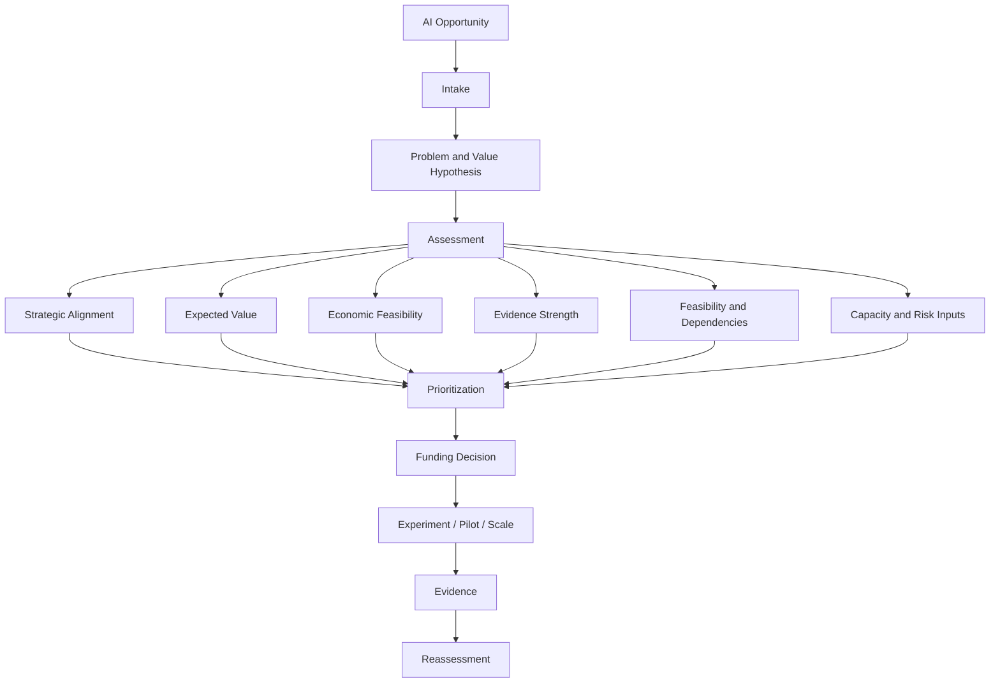

# 02 — AI Portfolio Intake, Prioritization, Funding and Value

## Learning Objectives

After completing this chapter, you should be able to:

- explain why enterprises need a structured intake process for AI opportunities;
- distinguish an AI opportunity, AI initiative, AI capability, and AI system/solution;
- frame an AI opportunity around a business problem rather than around a technology;
- distinguish a value hypothesis from an established business outcome;
- assess strategic alignment, expected value, feasibility, evidence strength, capacity, and dependencies;
- distinguish economic feasibility from simple cost reduction;
- prioritize competing AI initiatives without relying on a fake universal scoring formula;
- reason about scarce AI investment capacity;
- compare centralized, business-unit, shared-platform, capability-based, experimental, stage-gated, and outcome-oriented funding approaches;
- understand why funding should often be staged according to evidence and uncertainty;
- distinguish experimentation funding from scale funding;
- reason about sequencing and portfolio balancing;
- handle strategically important but economically immature opportunities;
- distinguish expected value from realized value;
- understand how File 01 economic evidence contributes to investment decisions;
- understand how risk and governance requirements can influence investment decisions without turning this chapter into risk or governance methodology;
- explain why local optimization of an individual AI initiative can produce a worse portfolio outcome;
- make investment decisions using multiple evidence dimensions rather than a single metric;
- understand the relationship between intake, assessment, prioritization, funding, and scaling.

---

## Prerequisites

You should already understand:

- the distinction between an AI initiative, AI capability, and AI system/solution;
- basic enterprise AI concepts;
- the economic concepts introduced in File 01;
- cost structure, unit economics, cost-to-outcome relationships, and AI FinOps;
- the difference between economic optimization and technical optimization.

You should also be comfortable reasoning about:

- business problems;
- expected outcomes;
- organizational constraints;
- competing priorities;
- uncertainty;
- trade-offs.

This chapter does not require:

- corporate finance expertise;
- investment banking knowledge;
- generic project portfolio management;
- Scrum or Agile methodology;
- workforce planning;
- procurement expertise;
- vendor negotiation;
- technical architecture design;
- detailed AI risk assessment;
- technical model evaluation.

Those areas may influence an AI investment decision, but they are not the primary subject of this chapter.

---

## Estimated Reading Time

**60–75 minutes**

The reading time assumes careful study of the decision models, enterprise scenarios, trade-offs, and interview questions.

---

## Before We Start

Imagine an enterprise receives ten AI proposals in one quarter.

They include:

1. an employee knowledge assistant;
2. an AI customer-support capability;
3. an automated document-processing system;
4. a coding assistant;
5. an AI fraud-analysis capability;
6. an AI translation service;
7. an internal meeting assistant;
8. an AI forecasting capability;
9. an AI claims-processing initiative;
10. a proposed shared enterprise AI platform.

All ten sound useful.

The enterprise has limited:

- funding;
- engineering capacity;
- data availability;
- organizational attention;
- platform capacity;
- implementation bandwidth.

It cannot simply say:

> “Build everything.”

It also cannot reliably decide:

> “Choose the project with the highest ROI.”

Why?

Because many proposals do not yet have reliable ROI evidence.

Some have:

- strong strategic importance;
- uncertain short-term value;
- strong technical feasibility;
- weak business evidence;
- high reuse potential;
- significant dependencies;
- high implementation complexity;
- low immediate adoption;
- substantial uncertainty.

The real question is:

> **Which AI opportunities deserve scarce enterprise investment capacity, at what level of commitment, and based on what evidence?**

That is the purpose of this chapter.

---

## Why This Exists

Enterprise AI investment is rarely constrained only by ideas.

The bigger problem is often **selection**.

An enterprise may have more AI opportunities than it can responsibly pursue.

Therefore, an AI portfolio needs a mechanism to move opportunities through progressively stronger decisions:

```text
Opportunity
    ↓
Intake
    ↓
Assessment
    ↓
Prioritization
    ↓
Funding
    ↓
Evidence
    ↓
Scale / Reassess / Stop
```

The key idea is:

> **Not every AI opportunity should receive the same level of investment at the same time.**

A low-evidence opportunity may deserve a small experiment.

A high-evidence opportunity may deserve significant scale investment.

A strategically important capability may deserve funding even when its short-term economics are uncertain.

A technically impressive solution may deserve little investment if it solves a problem with weak business value.

This requires structured reasoning.

---

# 1. Mental Model: AI Investment Is a Decision Process

The core ENT-08 File 02 progression is:

```text
Discover
   ↓
Assess
   ↓
Prioritize
   ↓
Fund
   ↓
Scale
```

A more detailed view is:


This is not intended to imply that every initiative follows a perfectly linear lifecycle.

An initiative may:

- return to assessment;
- pause;
- receive additional evidence funding;
- change scope;
- split into multiple initiatives;
- merge with another capability;
- be replaced;
- stop before scale.

Therefore, the lifecycle is better understood as a **decision progression** rather than a rigid project workflow.

---

# 2. AI Opportunity vs AI Initiative vs AI Capability vs AI System

These terms must remain distinct.

## AI Opportunity

An **AI opportunity** is a potentially valuable problem, use case, or capability improvement that may justify investigation.

Example:

> Customer-support agents spend significant time searching multiple knowledge sources before responding to customers.

This is an opportunity.

It is not yet necessarily an approved initiative.

---

## AI Initiative

An **AI initiative** is a proposed or active investment effort intended to create, improve, adopt, or scale an AI capability.

Example:

> Build an AI-assisted customer-support workflow that retrieves relevant knowledge and drafts responses for support agents.

This is an initiative.

It has:

- scope;
- investment assumptions;
- expected outcomes;
- dependencies;
- evidence requirements.

---

## AI Capability

An **AI capability** is an enduring enterprise capability that provides a defined AI-enabled business or technical function.

For example:

> Enterprise customer-support assistance.

A capability can outlive an individual project or implementation.

---

## AI System / Solution

An **AI system or solution** is a concrete implementation that delivers the capability.

For example:

> A production application integrating a retrieval system, model provider, enterprise knowledge sources, identity, and support workflows.

The relationship is:

```text
AI Opportunity
      ↓
AI Initiative
      ↓
Creates / Improves
      ↓
AI Capability
      ↓
Delivered Through
      ↓
AI System / Solution
```

This distinction matters because portfolio decisions may happen at different levels.

An enterprise might:

- reject an initiative;
- fund an experiment;
- prioritize a capability;
- scale a solution.

The decision level should always be explicit.

---

# 3. Why Intake Matters

Without structured intake, AI investment decisions often become demand-driven.

For example:

```text
Executive Request
       ↓
Immediate Project
```

or:

```text
Technology Demonstration
       ↓
Production Investment
```

or:

```text
Team Has Capacity
       ↓
Team Builds AI Solution
```

These are weak decision mechanisms.

They can cause:

- duplicated solutions;
- weak business alignment;
- fragmented investment;
- uncontrolled experimentation;
- poor evidence;
- competing platforms;
- low adoption;
- underfunded high-value opportunities.

A structured intake process creates a common starting point.

---

# 4. AI Intake Is Not a Project Intake Form

A common mistake is to treat AI intake as generic project administration.

The purpose is not simply to collect:

- project name;
- owner;
- deadline;
- estimated effort.

The deeper purpose is to understand:

> **What problem or opportunity is being proposed, why does it matter, what evidence supports it, and what type of investment decision is being requested?**

A useful AI intake therefore begins with the problem.

---

## 5. Problem-First Intake

Consider two proposals.

### Proposal A

> “We want to deploy a large language model for our support team.”

### Proposal B

> “Support agents spend approximately 20 minutes per complex case searching multiple knowledge systems. We believe AI-assisted retrieval and response drafting could reduce this effort while maintaining required review controls.”

Proposal B is stronger as an investment starting point.

Why?

Because it describes:

- a problem;
- affected users;
- current behavior;
- expected improvement;
- an initial hypothesis.

The technology remains an implementation possibility rather than becoming the reason for investment.

---

## 6. Value Hypothesis

At intake, value is usually uncertain.

Therefore the enterprise should distinguish:

```text
Value Hypothesis
        ↓
Expected Outcome
        ↓
Evidence
        ↓
Investment Decision
```

A **value hypothesis** is a reasoned belief that an AI initiative could create meaningful value.

For example:

> If AI-assisted document classification reduces manual handling time while maintaining acceptable accuracy, the organization may reduce processing effort and improve throughput.

This is not established value.

It is a hypothesis.

The enterprise must determine what evidence would support or weaken it.

---

# 7. Expected Value vs Realized Value

This distinction is central to ENT-08.

## Expected Value

Expected value is the value the organization believes an initiative could produce based on available assumptions and evidence before or during investment.

Examples:

- expected reduction in handling time;
- expected increase in completed transactions;
- expected reduction in manual work;
- expected customer-service improvement.

---

## Realized Value

Realized value is the value actually observed after the capability operates in the relevant environment.

Examples:

- measured reduction in handling time;
- observed adoption;
- observed workflow completion;
- observed operational savings;
- observed business outcomes.

The relationship is:

```text
Expected Value
      ↓
Investment Decision
      ↓
Implementation / Adoption
      ↓
Evidence
      ↓
Realized Value
```

File 02 primarily owns **expected value and investment reasoning**.

File 03 later owns the portfolio-level review of **realized value** and the resulting lifecycle decisions for established capabilities.

---

# 8. Opportunity Assessment

Once an AI opportunity enters intake, the enterprise needs to assess whether it deserves further attention.

A useful assessment can consider:

```text
Strategic Alignment
        +
Expected Value
        +
Evidence Strength
        +
Economic Feasibility
        +
Feasibility
        +
Capacity
        +
Dependencies
        +
Risk Input
        ↓
Investment Assessment
```

These dimensions are not a universal scoring formula.

Different enterprises may weight them differently.

The purpose is to create a structured reasoning space.

---

# 9. Strategic Alignment

An AI opportunity may be technically attractive but strategically irrelevant.

Consider:

```text
Opportunity A
High technical novelty
Low strategic relevance

Opportunity B
Moderate technical novelty
High strategic relevance
```

The enterprise should not automatically choose A because it is more technologically interesting.

Strategic alignment asks:

> **How directly does this opportunity support important enterprise or business priorities?**

Examples may include:

- improving customer experience;
- reducing operational burden;
- improving employee productivity;
- enabling a strategic product;
- improving decision support;
- strengthening an important enterprise capability.

Strategic alignment is context-dependent.

It should not become a vague justification that every proposal receives.

---

# 10. Expected Value

Expected value asks:

> **What useful outcome could this initiative reasonably produce if successful?**

Possible outcomes include:

- reduced processing effort;
- increased throughput;
- improved customer experience;
- reduced response time;
- increased employee productivity;
- improved service quality;
- new product capability;
- avoided operational cost;
- increased revenue opportunity.

The value hypothesis should identify:

1. the problem;
2. the expected outcome;
3. the mechanism by which AI may contribute;
4. the evidence needed to validate the assumption.

---

## 11. Economic Feasibility

Economic feasibility is not the same as:

> “Is this cheap?”

The question is:

> **Does the expected economic profile justify further investment relative to the available alternatives and uncertainty?**

Economic feasibility can use evidence from File 01:

- expected cost;
- unit economics;
- cost trajectory;
- cost drivers;
- expected workload;
- human intervention;
- rework;
- potential outcome relationships.

For example:

```text
Expected Value
      ↓
Compared With
      ↓
Expected Economic Consumption
      ↓
Economic Feasibility
```

This does not require a universal ROI formula.

Different initiatives may have different evidence quality and different value structures.

---

# 12. Evidence Strength

Not all claims about an AI opportunity are equally reliable.

Consider:

### Evidence Level A

> “Employees believe this could save time.”

### Evidence Level B

> “A controlled pilot showed a 15% reduction in handling time.”

### Evidence Level C

> “Production deployment across three business units has demonstrated sustained reduction in handling time with measurable adoption.”

These represent different evidence maturity.

The enterprise should therefore distinguish:

```text
Hypothesis
    ↓
Early Evidence
    ↓
Pilot Evidence
    ↓
Operational Evidence
    ↓
Realized Outcome Evidence
```

The exact evidence stages vary by organization.

The durable principle is:

> **Investment commitment should reflect the strength of the evidence supporting the expected value.**

---

# 13. Feasibility

An opportunity can have high expected value and still be difficult to execute.

Feasibility may include:

- data readiness;
- technical feasibility;
- integration complexity;
- organizational readiness;
- operational implications;
- dependency burden;
- regulatory or governance requirements;
- available enterprise capability.

Feasibility is not identical to architecture design.

This chapter uses feasibility as an investment input.

Detailed technical architecture remains owned by the appropriate domains.

---

## 14. Data Readiness

AI initiatives often depend on data.

An opportunity may appear valuable but have weak data readiness.

For example:

```text
Expected Value = High
        ↓
Data Required
        ↓
Data Unavailable / Poor Quality
        ↓
Feasibility ↓
```

This does not necessarily mean:

> “Reject the initiative.”

It may instead mean:

- fund a data-readiness experiment;
- narrow the initial scope;
- sequence the initiative later;
- pursue an alternative approach.

The investment decision should account for the dependency.

---

# 15. Risk as an Investment Input

Risk can influence AI investment decisions.

For example:

```text
High Expected Value
        +
High Risk Exposure
        ↓
Different Investment Decision
```

Risk may affect:

- prioritization;
- funding;
- sequencing;
- evidence requirements;
- scale timing.

However, ENT-08 does not own risk methodology.

It does not teach:

- risk classification;
- risk treatment;
- residual risk calculation;
- assurance methodology;
- human oversight frameworks.

Those belong to the appropriate enterprise risk and governance domains.

ENT-08 asks:

> **How should risk-related evidence influence the economic and investment decision?**

---

# 16. Capacity Allocation

AI investment decisions involve scarce enterprise capacity.

Capacity may include:

- funding;
- platform capacity;
- organizational attention;
- approved AI investment slots;
- shared enterprise AI resources.

This is not generic workforce management.

The question is:

> **Which AI opportunities should receive scarce enterprise AI investment capacity?**

For example:

```text
Available Investment Capacity
          │
     ┌────┼────┐
     ▼    ▼    ▼
    A     B    C
```

If the enterprise can only materially support three initiatives, selecting those three becomes a portfolio decision.

---

# 17. Prioritization

Prioritization asks:

> **Which opportunities deserve attention and investment relative to competing opportunities?**

A useful conceptual model is:

```text
Strategic Alignment
        +
Expected Value
        +
Evidence Strength
        +
Economic Feasibility
        +
Feasibility
        +
Capability Reuse
        +
Capacity
        +
Dependencies
        +
Risk Input
        ↓
Prioritization Decision
```

The dimensions are intentionally broad.

Do not convert them into a universal formula such as:

```text
Priority Score
=
0.30 × Value
+
0.20 × Cost
+
...
```

Such weights may be appropriate for one enterprise and completely inappropriate for another.

The engineering skill is understanding **why** a dimension matters and how it affects the decision.

---

# 18. Why There Is No Universal AI Prioritization Formula

Consider two enterprises.

### Enterprise A

Its primary objective is:

> reduce operating cost.

### Enterprise B

Its primary objective is:

> build a strategic AI-enabled product capability.

The same AI opportunity may receive different priority in each enterprise.

Similarly:

```text
Opportunity A
High immediate value
Low strategic differentiation

Opportunity B
Lower immediate value
High strategic importance
```

A universal score cannot reliably resolve every context.

Therefore:

> **Portfolio prioritization should be structured, evidence-based, and context-sensitive rather than mathematically performative.**

A scorecard may be useful.

A scorecard is not the decision.

---

# 19. Prioritization Dimensions

The following dimensions may be useful.

## Strategic Alignment

Does the opportunity support important enterprise priorities?

## Expected Value

What meaningful outcomes could it produce?

## Economic Feasibility

Does the expected economic profile justify investment?

## Evidence Strength

How reliable is the evidence behind the value hypothesis?

## Feasibility

Can the enterprise realistically execute the initiative?

## Capability Reuse

Can the resulting capability be reused across multiple business contexts?

## Time to Value

How quickly could useful outcomes reasonably appear?

## Uncertainty

How much is still unknown?

## Dependencies

What other capabilities, data, platforms, or organizational changes are required?

## Capacity

Can the enterprise support the initiative now?

## Risk Input

Do risk considerations change the investment or sequencing decision?

## Differentiation

Could the capability create meaningful strategic differentiation?

## Scalability

Could successful results extend to broader enterprise use?

These dimensions should be adapted to context.

---

## 20. Evidence Strength vs Expected Value

High expected value does not mean high evidence.

Consider:

```text
Initiative A
Expected Value = Very High
Evidence = Weak

Initiative B
Expected Value = Moderate
Evidence = Strong
```

The enterprise might choose B for immediate investment while funding a smaller experiment for A.

This creates an important investment pattern:

```text
High Value + Low Evidence
        ↓
Evidence-Building Investment
```

rather than:

```text
High Value + Low Evidence
        ↓
Immediate Full Scale
```

This is one reason staged funding is useful.

---

# 21. Strategic Importance vs Short-Term Economics

Some AI initiatives may have uncertain short-term economics but strong strategic importance.

For example:

> The enterprise wants to develop an AI capability that may become foundational to a future product strategy, but current adoption and economics are uncertain.

A simplistic framework might say:

> “Low current ROI → reject.”

A stronger approach asks:

- Is the strategic opportunity credible?
- What evidence is missing?
- What is the minimum investment needed to learn?
- What future capability does the initiative enable?
- What alternatives exist?
- What is the cost of waiting?
- What evidence would justify further funding?

This can lead to:

```text
Small Initial Investment
        ↓
Evidence
        ↓
Reassessment
        ↓
Scale / Change / Defer / Stop Further Investment
```

---

# 22. Experimentation vs Scale

Not every initiative deserves production-scale funding immediately.

There is an important difference between:

### Experimentation Funding

Purpose:

> Learn whether the opportunity is viable and valuable.

Typical characteristics:

- limited scope;
- controlled investment;
- explicit learning objectives;
- evidence milestones;
- defined reassessment point.

### Scale Funding

Purpose:

> Expand a capability with sufficient evidence of value and feasibility.

Typical characteristics:

- larger investment;
- broader adoption;
- stronger operational commitments;
- greater organizational dependency;
- longer-term economic implications.

The progression can be:

```text
Hypothesis
    ↓
Experiment
    ↓
Evidence
    ↓
Scale Decision
```

This reduces the need to make irreversible investment decisions under high uncertainty.

---

# 23. Stage-Gated Investment

Stage-gated investment links funding to evidence.

A simplified model is:

```text
Stage 1
Explore
   ↓
Evidence Gate
   ↓
Stage 2
Pilot
   ↓
Evidence Gate
   ↓
Stage 3
Scale
```

The exact number of stages is organization-specific.

The principle is:

> **Investment commitment can increase as uncertainty decreases and evidence strengthens.**

A stage gate should not become bureaucratic approval theater.

It should answer:

> **What did we learn, what remains uncertain, and does the next investment level remain justified?**

---

# 24. Funding Models

Different AI initiatives may require different funding approaches.

## Centralized AI Funding

A central enterprise function funds AI initiatives.

### Advantages

- coordinated enterprise priorities;
- easier portfolio-level visibility;
- potentially stronger capability reuse;
- reduced duplication.

### Trade-offs

- central decision-making may be slower;
- business units may feel less ownership;
- local priorities may be underrepresented.

---

## Business-Unit Funding

A business unit funds its own AI initiative.

### Advantages

- strong business ownership;
- close connection to local outcomes;
- faster local decisions.

### Trade-offs

- duplicated capabilities;
- fragmented investment;
- inconsistent enterprise economics;
- weaker cross-business prioritization.

---

## Shared-Platform Funding

A shared AI platform receives funding separately from individual business capabilities.

This can distinguish:

```text
Shared Enterprise Capability
```

from:

```text
Business-Specific AI Use Case
```

This can improve economic visibility when shared services support many consumers.

However, the funding model must clarify:

- baseline platform funding;
- incremental consumption;
- consumer contribution;
- shared capability investment.

---

## Capability-Based Funding

Investment is directed toward enduring enterprise AI capabilities rather than isolated projects.

For example:

```text
Enterprise Document Intelligence
```

may support multiple use cases.

Potential benefits:

- reuse;
- consistency;
- reduced duplication;
- longer-term capability development.

Trade-offs may include:

- higher initial investment;
- broader coordination;
- less local autonomy;
- greater dependency on enterprise-level decisions.

---

## Experimentation Funding

A smaller investment is provided specifically to reduce uncertainty.

The decision is not:

> “Will this become a successful enterprise capability?”

Instead:

> “Is this opportunity sufficiently promising to justify learning more?”

This is particularly useful when evidence is weak.

---

## Scale Funding

Scale funding supports expansion after sufficient evidence exists.

The evidence may include:

- adoption;
- realized outcomes;
- acceptable economics;
- operational feasibility;
- strategic relevance.

---

## Outcome-Oriented Funding

Funding may be tied to achieving defined outcomes.

For example:

> funding continues when agreed measurable outcomes are demonstrated.

This can strengthen accountability.

However, outcome-oriented funding can become problematic when:

- outcomes are difficult to observe;
- attribution is uncertain;
- external factors dominate;
- measurement costs become excessive.

Therefore it should be used where outcome evidence is sufficiently reliable.

---

# 25. Funding Trade-Offs

Funding structure influences enterprise behavior.

For example:

```text
Central Funding
    ↓
Higher Coordination
    +
Potentially Lower Local Autonomy
```

while:

```text
Business-Unit Funding
    ↓
Higher Local Ownership
    +
Potentially Higher Duplication
```

Similarly:

```text
Immediate Scale Funding
    ↓
Faster Expansion
    +
Higher Exposure to Uncertainty
```

while:

```text
Staged Funding
    ↓
Lower Initial Exposure
    +
Potentially Slower Expansion
```

There is no universally correct funding model.

The model should match:

- enterprise structure;
- strategic objectives;
- uncertainty;
- capability reuse;
- investment capacity;
- evidence maturity.

---

# 26. Sequencing

Prioritization determines what deserves attention.

Sequencing determines:

> **What should happen first, second, and later?**

Two initiatives may both deserve investment but cannot be executed simultaneously.

For example:

```text
Initiative A
Data foundation required
        ↓
Initiative B
AI capability depends on A
```

Therefore:

```text
A
↓
B
```

Sequencing can be influenced by:

- dependencies;
- time to value;
- strategic urgency;
- capacity;
- evidence maturity;
- opportunity windows;
- capability reuse.

Sequencing is not the same as project scheduling.

The ENT-08 question is investment ordering.

---

# 27. Portfolio Balancing

A portfolio should not necessarily contain only the highest immediate-value initiatives.

Consider:

```text
Portfolio
├── Near-Term Value
├── Strategic Bets
├── Capability Foundations
├── Experiments
└── Scale Investments
```

A balanced portfolio may contain different types of investment.

For example:

```text
High Certainty
    +
Near-Term Value
```

can coexist with:

```text
High Uncertainty
    +
High Strategic Potential
```

The balance depends on enterprise objectives and capacity.

---

# 28. Avoiding Local Optimization

Suppose Business Unit A develops an AI document-processing capability.

It is economically efficient for A.

Business Unit B independently builds a similar capability.

Both teams optimize locally.

Individually:

```text
A → Good Economics
B → Good Economics
```

Collectively:

```text
A + B
    ↓
Duplicated Investment
Duplicated Maintenance
Duplicated Capability
```

The portfolio may therefore be worse even though each initiative appears successful independently.

This is a critical enterprise principle:

> **A locally optimal AI investment can be globally suboptimal for the enterprise portfolio.**

Portfolio prioritization must therefore consider:

- reuse;
- duplication;
- shared capability potential;
- enterprise dependencies;
- cumulative investment.

---

# 29. Capability Reuse

Capability reuse can change the economics of an investment.

Suppose:

```text
Capability A
Supports one business unit
```

versus:

```text
Capability B
Supports four business units
```

The second may have greater enterprise potential even if its initial investment is larger.

However:

> **Reuse is not automatically better.**

A shared capability may introduce:

- coupling;
- governance complexity;
- coordination overhead;
- slower local change;
- broader failure impact.

Therefore the investment question is:

> **Does the expected reuse justify the additional enterprise complexity and investment?**

---

# 30. Investment Capacity

Enterprise AI capacity is finite.

Suppose an enterprise has:

```text
Available Capacity = 100 units
```

and opportunities require:

```text
A = 40
B = 30
C = 25
D = 20
E = 15
```

The enterprise cannot fund everything at full scale.

The decision is not merely:

> “Which initiatives are good?”

It is:

> **“Which combination of investments creates the strongest portfolio given the available capacity and enterprise objectives?”**

This is portfolio reasoning.

---

# 31. Capacity Is More Than Money

Investment capacity may include:

- funding;
- engineering attention;
- AI platform capacity;
- data access;
- organizational change capacity;
- executive attention;
- approved investment slots;
- shared enterprise resources.

Therefore:

```text
Investment Capacity
≠
Budget Alone
```

An initiative can have funding available and still be constrained by:

- data;
- engineering;
- integration;
- adoption;
- organizational readiness.

---

# 32. Expected Value and Uncertainty

Expected value should be considered alongside uncertainty.

A useful conceptual model is:

```text
Expected Value
        +
Evidence Strength
        +
Uncertainty
        ↓
Investment Commitment
```

For example:

| Opportunity | Expected Value | Evidence | Possible Decision |
|---|---|---|---|
| A | High | Strong | Scale investment |
| B | High | Weak | Evidence-building investment |
| C | Moderate | Strong | Targeted investment |
| D | Low | Strong | Deprioritize |
| E | Strategic | Uncertain | Staged investment |

This table is illustrative.

It is not a universal decision matrix.

---

# 33. Strategic but Uncertain Investments

Some initiatives cannot be judged purely by current economics.

For example:

> An AI capability may be strategically important because it enables a future product direction, but current demand is uncertain.

A reasonable response may be:

```text
Strategic Importance
        +
High Uncertainty
        ↓
Limited Initial Funding
        ↓
Evidence Milestones
        ↓
Reassessment
```

This avoids two extremes:

### Extreme A

> “We are uncertain, so we should never invest.”

### Extreme B

> “It is strategic, so fund it indefinitely.”

A better approach is:

> **Fund learning at a level proportional to the strategic opportunity and uncertainty, then reassess using evidence.**

---

# 34. Time to Value

Two initiatives may have similar expected value but different time horizons.

```text
Initiative A
Expected Value = High
Time to useful outcome = 3 months

Initiative B
Expected Value = High
Time to useful outcome = 3 years
```

This difference can affect prioritization.

However, short time to value should not automatically dominate.

A strategically important long-term capability may justify investment despite a longer horizon.

The relevant question is:

> **How does time to value interact with strategic importance, uncertainty, capacity, and alternatives?**

---

# 35. Dependencies

An initiative may depend on:

- enterprise data;
- identity;
- platform services;
- integration;
- another AI capability;
- organizational adoption;
- governance decisions.

A dependency can affect:

- feasibility;
- sequencing;
- cost;
- time to value;
- investment risk.

For example:

```text
Data Foundation
      ↓
Document AI
      ↓
Customer Workflow
```

The enterprise may need to invest in the foundation first.

This is not simply project scheduling.

It is investment sequencing based on dependency structure.

---

# 36. Evidence-Based Funding

A useful principle is:

> **The level of investment should be proportional to the evidence and uncertainty appropriate to the decision.**

This can be represented as:

```text
Low Evidence
     ↓
Small / Controlled Investment
     ↓
Evidence
     ↓
Higher Evidence
     ↓
Larger Investment
```

This does not mean:

> “Never invest heavily under uncertainty.”

Some strategic opportunities legitimately require significant early investment.

The decision should instead make uncertainty explicit.

---

# 37. Investment Decision Types

An enterprise does not have only two choices:

```text
Fund
or
Reject
```

Useful investment-stage decision types include:

- explore;
- experiment;
- defer;
- fund;
- pilot;
- scale;
- change direction;
- stop further investment.

These terms describe decisions about **investment commitment to an opportunity, experiment, pilot, or scaling effort**.

For example:

```text
Opportunity
    ↓
Investment Assessment
    ↓
Explore / Experiment / Pilot
    ↓
Evidence
    ↓
Funding Decision
    ├── Scale
    ├── Change Direction
    ├── Defer
    └── Stop Further Investment
```

This chapter uses these terms in the context of investment-stage decision-making.

Portfolio lifecycle decisions for an established AI capability—such as:

- continue;
- reduce;
- consolidate;
- sunset;

belong to File 03.

---

# 38. Decision Evidence

A good investment decision should be explainable.

Possible evidence includes:

```text
Strategic Alignment
Expected Value
Economic Evidence
Evidence Strength
Feasibility
Adoption Potential
Capability Reuse
Dependencies
Risk Inputs
Capacity
Time to Value
```

No single metric should be treated as sufficient.

For example:

> High expected value + poor feasibility

may not justify immediate scale.

Similarly:

> Low short-term value + high strategic importance

may justify a small staged investment.

---

# 39. Economic Evidence from File 01

File 01 provides an important input to File 02.

For example:

```text
File 01
    ↓
Cost Structure
    ↓
Unit Economics
    ↓
Forecast
    ↓
Cost-to-Outcome Evidence
    ↓
Economic Evidence
```

File 02 then combines that evidence with:

```text
Strategic Alignment
Expected Value
Evidence Strength
Feasibility
Capacity
Dependencies
Risk Inputs
Capability Reuse
```

The relationship is:

```text
Economic Evidence
        +
Investment Evidence
        +
Strategic Context
        ↓
Prioritization / Funding Decision
```

File 02 does not re-teach the detailed cost model from File 01.

---

# 40. Cost vs Expected Value

A low-cost initiative is not automatically high priority.

Consider:

```text
Initiative A
Cost = Low
Expected Value = Low

Initiative B
Cost = High
Expected Value = High
```

B may deserve more investment.

Conversely:

```text
Initiative C
Cost = Very High
Expected Value = Uncertain
Evidence = Weak
```

may deserve only limited exploratory funding.

Therefore:

> **Cost is one investment dimension, not the investment decision itself.**

---

# 41. Business Value vs Technical Quality

An AI system can perform technically well and still have weak business value.

For example:

```text
Excellent Model Performance
        ↓
Low User Adoption
        ↓
Weak Business Impact
```

Conversely:

```text
Moderate Technical Performance
        ↓
Excellent Workflow Integration
        ↓
High Adoption
        ↓
Meaningful Business Outcome
```

Technical evaluation remains outside ENT-08.

The portfolio question is:

> **Does the technical evidence support the expected business outcome strongly enough to justify investment?**

---

# 42. Adoption as Investment Evidence

A capability can exist without being meaningfully used.

Therefore adoption may be an important **future investment signal**.

For example, during a pilot or initial deployment, the enterprise may define:

```text
Expected Adoption
        ↓
Observed Adoption Evidence
        ↓
Assessment of Investment Hypothesis
```

The investment question is not simply:

> “Is adoption high?”

It is:

> **“Does observed adoption provide sufficient evidence that the expected value hypothesis is plausible enough to justify the next level of investment?”**

Low adoption may indicate:

- poor user fit;
- workflow mismatch;
- insufficient change management;
- low perceived value;
- difficult integration;
- limited awareness.

These signals may change the next funding decision.

Detailed portfolio decisions about continuing, reducing, consolidating, or sunsetting an established capability belong to File 03.

---

# 43. Experimentation as an Investment Strategy

Suppose an initiative has:

```text
Expected Value = High
Evidence = Weak
Feasibility = Uncertain
```

The enterprise may choose:

```text
Small Experiment
        ↓
Measure Evidence
        ↓
Reassess
```

rather than:

```text
Full Enterprise Deployment
```

This is a form of **investment uncertainty management**.

The experiment should have:

- a clear question;
- a bounded investment;
- evidence criteria;
- a decision point.

The goal is learning, not experimentation for its own sake.

---

# 44. Example: Customer Support AI

Suppose an enterprise proposes:

> AI-assisted customer-support response drafting.

Initial assessment:

```text
Strategic Alignment
High

Expected Value
High

Economic Feasibility
Promising

Evidence
Weak

Data Readiness
Moderate

Adoption Uncertain
```

A reasonable investment decision may be:

```text
Pilot Funding
     ↓
Measure Adoption + Workflow Outcome
     ↓
Measure Economic Evidence
     ↓
Reassess
     ↓
Scale / Change / Defer / Stop Further Investment
```

The enterprise does not need to pretend it already knows the final value.

---

# 45. Example: AI Coding Assistant

Suppose an enterprise considers an AI coding assistant.

Potential value:

- faster development;
- reduced repetitive work;
- improved developer productivity.

But uncertainties may include:

- actual adoption;
- code-review burden;
- rework;
- security implications;
- integration;
- measurable productivity impact.

A weak decision is:

> “Developers like it, so scale it.”

A stronger decision asks:

- What outcome are we trying to improve?
- How will productivity be observed?
- What economic evidence exists?
- What additional review effort occurs?
- What investment capacity is required?
- What evidence would justify broader deployment?

---

## 46. Example: Shared Enterprise Capability

Suppose three business units independently request document-processing AI.

```text
Business Unit A → Document AI
Business Unit B → Document AI
Business Unit C → Document AI
```

The enterprise should ask:

> Are these genuinely different capabilities, or are they variants of the same underlying capability opportunity?

Possible investment options:

### Option A — Fund Independently

Advantages:

- local ownership;
- fast local decisions.

Trade-offs:

- duplication;
- fragmented investment;
- repeated platform cost.

### Option B — Build Shared Capability

Advantages:

- reuse;
- potentially lower duplication;
- enterprise capability development.

Trade-offs:

- coordination;
- shared ownership;
- coupling;
- potentially slower local change.

### Option C — Stage Both Approaches

Start with bounded experiments and evaluate whether a shared capability is justified.

This may be appropriate when the reuse hypothesis is uncertain.

---

# 47. Example: Strategic but Economically Immature

Suppose an enterprise wants to build a strategic AI capability.

Current evidence:

```text
Strategic Importance = High
Expected Short-Term Value = Uncertain
Cost = Significant
Evidence = Weak
```

A simplistic decision would be:

> Reject because ROI is uncertain.

Another simplistic decision would be:

> Fund indefinitely because it is strategic.

A stronger decision is:

```text
Strategic Importance
        +
High Uncertainty
        ↓
Bounded Investment
        ↓
Evidence Milestones
        ↓
Reassessment
```

The enterprise can then make an updated **investment decision** to:

- increase funding;
- maintain funding;
- change scope;
- defer;
- stop further investment.

The detailed portfolio treatment of an already-established capability belongs to File 03.

---

# 48. Portfolio Balancing Example

Suppose the enterprise has capacity for five major investments.

Candidates:

```text
A — High value, high evidence
B — Moderate value, high evidence
C — High strategic importance, low evidence
D — High value, high dependency burden
E — Moderate value, low cost
F — High value, high risk input
G — High reuse potential
```

A simplistic ranking might choose only the initiatives with the highest expected value.

A portfolio view asks:

- Are we over-concentrated in one business area?
- Are we funding enough strategic bets?
- Are foundational capabilities missing?
- Are dependencies blocking future opportunities?
- Are we investing too much in similar capabilities?
- Do we have enough evidence-building initiatives?
- Can the organization absorb all selected investments?

This is portfolio reasoning rather than project ranking.

---

# 49. Portfolio Prioritization vs Individual Optimization

Individual initiative optimization asks:

> **How do we make this initiative as successful as possible?**

Portfolio prioritization asks:

> **Is this initiative the best use of scarce enterprise investment capacity relative to alternatives?**

These are different questions.

An initiative may be excellent on its own but still receive lower priority because:

- another initiative has stronger strategic value;
- another initiative creates reusable enterprise capability;
- the organization lacks capacity;
- the initiative duplicates an existing capability;
- dependencies make the timing poor.

Therefore:

```text
Local Optimization
        ≠
Portfolio Optimization
```

---

# 50. Investment Sequencing Example

Suppose:

```text
Initiative A
Build enterprise document intelligence capability

Initiative B
Build claims-processing workflow using document intelligence
```

B may have high business value.

But A creates a reusable capability required by B.

The enterprise may therefore sequence:

```text
A
↓
B
```

However, if A is expensive and B has an alternative implementation path, the dependency should be challenged rather than assumed.

The investment question becomes:

> **Is funding A justified by the value of B and other future consumers?**

This is a portfolio decision.

---

# 51. Decision Gates Should Produce Evidence

A useful stage gate asks:

```text
What did we believe?
        ↓
What did we test?
        ↓
What did we learn?
        ↓
What changed?
        ↓
What should we invest next?
```

This is better than:

```text
Gate Meeting
    ↓
Approve / Reject
```

without evidence.

The objective is to improve decision quality over time.

---

# 52. Investment Assumptions

Every AI initiative contains assumptions.

Examples:

- users will adopt the capability;
- data will be available;
- cost will remain within expected range;
- workflow integration will be feasible;
- expected outcomes will occur;
- required organizational change will happen;
- the capability will be reusable.

These assumptions should be made explicit.

A useful structure is:

```text
Assumption
    ↓
Evidence Needed
    ↓
Investment Decision
```

For example:

```text
Assumption:
Agents will use AI-generated response drafts.

Evidence:
Observed adoption during pilot.

Decision:
Scale / modify / stop investment.
```

---

# 53. Uncertainty as an Investment Variable

Uncertainty is not automatically a reason to reject an initiative.

Instead, ask:

> **What uncertainty exists, how material is it, and how cheaply can we reduce it?**

For example:

```text
High Uncertainty
        ↓
Can we reduce it cheaply?
        ↓
Yes → Experiment
No  → Reconsider / Defer / Limit Investment
```

This creates a useful relationship between uncertainty and funding.

---

# 54. Cost of Learning

An experiment has economic value if it produces useful decision evidence at an acceptable investment level.

For example:

```text
Full Deployment Cost = ₹50 lakh

Evidence Experiment = ₹3 lakh
```

If the experiment can meaningfully determine whether the full investment is justified, the ₹3 lakh may be strategically useful.

The purpose is not simply to spend less.

It is to:

> **Improve the quality of a larger investment decision by reducing uncertainty before committing more resources.**

---

# 55. AI Investment Decision Framework

A practical reasoning sequence is:

```text
1. Define the problem
        ↓
2. Define the opportunity
        ↓
3. Identify expected outcomes
        ↓
4. State the value hypothesis
        ↓
5. Identify evidence supporting the hypothesis
        ↓
6. Identify major uncertainties
        ↓
7. Assess strategic alignment
        ↓
8. Assess economic feasibility
        ↓
9. Assess implementation feasibility
        ↓
10. Identify dependencies
        ↓
11. Consider capability reuse
        ↓
12. Consider risk inputs
        ↓
13. Assess available investment capacity
        ↓
14. Determine priority
        ↓
15. Select funding approach
        ↓
16. Define evidence milestones
        ↓
17. Decide experiment, pilot, scale, defer, or stop further investment
```

This is a reasoning framework, not a mandatory enterprise process.

---

# 56. Decision Quality

A good investment decision is not necessarily one that produces a positive outcome.

A good decision is one that:

- used the best available evidence;
- made assumptions explicit;
- recognized uncertainty;
- considered alternatives;
- considered opportunity cost;
- matched investment level to evidence;
- made trade-offs visible;
- defined what evidence would change the decision.

This is especially important in AI because uncertainty can be high.

Therefore:

> **Good AI portfolio management is partly the management of uncertainty.**

---

## 57. Portfolio Opportunity Cost

Every investment consumes capacity that could have been used elsewhere.

Suppose:

```text
Initiative A
Requires 40 capacity units

Initiative B
Requires 30 capacity units

Initiative C
Requires 20 capacity units
```

Funding A means some combination of B and C may be delayed.

Therefore the decision should consider:

> **What are we giving up by funding this initiative?**

This is opportunity cost.

It is one reason portfolio prioritization cannot be performed by evaluating each initiative independently.

---

# 58. Investment Evidence and Reassessment

Investment decisions should not be treated as permanent commitments.

A useful model is:

```text
Initial Decision
      ↓
Evidence
      ↓
Reassessment
      ↓
Updated Investment Decision
```

The updated investment decision may be:

- increase funding;
- maintain funding;
- change direction;
- defer;
- stop further investment.

This creates a learning-oriented investment process.

Portfolio-level continuation, consolidation, reduction, and sunset decisions for established capabilities are addressed in File 03.

---

# 59. What File 02 Owns

File 02 owns the reasoning around:

```text
Discover
   ↓
Assess
   ↓
Prioritize
   ↓
Fund
   ↓
Scale
```

Specifically:

- AI initiative intake;
- opportunity assessment;
- problem/value framing;
- strategic alignment;
- value hypotheses;
- expected outcomes;
- investment assumptions;
- expected value;
- economic feasibility;
- prioritization;
- funding;
- investment-capacity allocation;
- sequencing;
- balancing;
- experimentation;
- stage-gated investment;
- evidence-based funding decisions.

---

# 60. What File 02 Does Not Own

File 02 does not own:

- detailed AI cost modeling;
- token economics;
- AI FinOps implementation;
- production cost optimization;
- model/provider selection;
- procurement;
- vendor negotiation;
- enterprise architecture;
- technical implementation planning;
- risk methodology;
- governance authority;
- technical model evaluation;
- production operations;
- portfolio sunset mechanics;
- technical decommissioning.

These remain with their appropriate domains or ENT-08 File 01/File 03.

---

## 61. Relationship to File 03

File 02 asks:

> **Should we prioritize and fund this opportunity?**

File 03 asks:

> **Once AI capabilities exist in the portfolio, how should realized evidence influence their portfolio position?**

The distinction is:

```text
File 02
Expected Value
Investment Hypothesis
Prioritization
Funding
        ↓
Capability / Solution Proceeds
        ↓
File 03
Realized Value
Portfolio Review
Continue
Scale
Reduce
Consolidate
Sunset
```

This prevents File 02 from becoming a duplicate of File 03.

---

# 62. Final Mental Model

The core idea of File 02 can be summarized as:



The enterprise should therefore move beyond:

> **“Should we build this AI project?”**

toward:

> **“What problem are we solving, what value do we expect, what evidence supports that belief, what uncertainty remains, how does this opportunity compare with competing investments, what scarce capacity should we commit, and what evidence should determine the next investment level?”**

That is the foundation of AI portfolio investment reasoning.

---

# 63. Quick Revision

## Core Progression

```text
Discover
   ↓
Assess
   ↓
Prioritize
   ↓
Fund
   ↓
Scale
```

## Value Progression

```text
Value Hypothesis
      ↓
Expected Outcome
      ↓
Evidence
      ↓
Investment Decision
```

## Investment Evidence

```text
Strategic Alignment
        +
Expected Value
        +
Economic Feasibility
        +
Evidence Strength
        +
Feasibility
        +
Capability Reuse
        +
Dependencies
        +
Capacity
        +
Risk Inputs
        ↓
Investment Decision
```

These are decision dimensions, not universal scoring weights.

## Funding Progression

```text
Uncertainty
    ↓
Experimentation
    ↓
Evidence
    ↓
Pilot
    ↓
Evidence
    ↓
Scale
```

## Capacity Principle

```text
Enterprise Capacity
        ↓
Competing Opportunities
        ↓
Portfolio Choice
```

Capacity is broader than money.

## Important Distinctions

```text
Opportunity ≠ Initiative

Initiative ≠ Capability

Capability ≠ System / Solution

Expected Value ≠ Realized Value

Technical Quality ≠ Business Value

Economic Feasibility ≠ Low Cost

Prioritization ≠ Project Management

Investment Capacity ≠ Workforce Capacity

Experimentation ≠ Scale

Strategic Importance ≠ Unlimited Funding

Local Optimization ≠ Portfolio Optimization

Investment-Stage Stop ≠ Portfolio Sunset
```

---

# 64. Key Takeaways

1. **AI portfolio management begins with disciplined opportunity intake.**

2. **An AI opportunity should be framed around a problem or opportunity, not merely around a technology.**

3. **An AI initiative is an investment effort; an AI capability is an enduring enterprise capability; an AI system/solution is its concrete implementation.**

4. **A value hypothesis is not established business value.**

5. **Expected value informs investment decisions; realized value informs later portfolio decisions.**

6. **AI investment decisions should consider multiple dimensions rather than a single metric.**

7. **Strategic alignment matters because technical attractiveness alone does not determine enterprise priority.**

8. **Economic feasibility is broader than low cost.**

9. **Evidence strength matters because expected value can be high while supporting evidence is weak.**

10. **Low evidence does not always mean reject; it may justify a bounded evidence-building investment.**

11. **Staged funding allows investment commitment to increase as uncertainty decreases and evidence strengthens.**

12. **Experimentation funding and scale funding serve different purposes.**

13. **Funding models create trade-offs between enterprise coordination, local ownership, reuse, and duplication.**

14. **Investment capacity includes funding, platform capacity, organizational attention, approved investment slots, and shared enterprise resources.**

15. **Prioritization should be context-sensitive rather than based on a fake universal formula.**

16. **Portfolio balancing may require a mix of near-term value, strategic bets, foundational capabilities, experiments, and scale investments.**

17. **Capability reuse can increase enterprise value but can also introduce coupling and coordination costs.**

18. **Local optimization of an AI initiative can produce a worse enterprise portfolio.**

19. **Dependencies can affect investment sequencing.**

20. **Risk can influence investment decisions without becoming an ENT-08 risk-management methodology.**

21. **Economic evidence from File 01 is an input to File 02 investment reasoning.**

22. **File 02 owns expected value and investment decisions; File 03 owns realized-value review and portfolio evolution.**

23. **A good investment decision makes assumptions, uncertainty, evidence, alternatives, and opportunity cost visible.**

24. **Strategic importance can justify staged investment under uncertainty, but it does not justify unlimited funding.**

25. **The objective of AI portfolio prioritization is not to select the most exciting AI project; it is to allocate scarce enterprise AI investment capacity where the expected strategic and economic value, evidence, feasibility, and portfolio position justify the commitment.**

---

## 65. Further Reading

For deeper study, explore authoritative material on:

- portfolio investment decision-making;
- technology investment governance;
- stage-gated investment;
- evidence-based decision-making;
- business-case development;
- value realization;
- innovation portfolio management;
- enterprise capability investment;
- FinOps and technology economics;
- strategic portfolio balancing.

When researching current AI investment practices, commercial models, or market-specific examples, distinguish:

```text
Durable Investment Principle
        vs
Current Market Practice
```

Current market practices should not become foundational dependencies of the curriculum.

---

## Next Chapter

Continue with:

[03 — AI Portfolio Governance, Optimization and Sunset Decisions →](./03-AI-Portfolio-Governance-Optimization-and-Sunset-Decisions.md)
