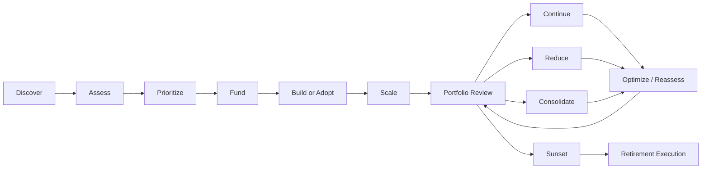
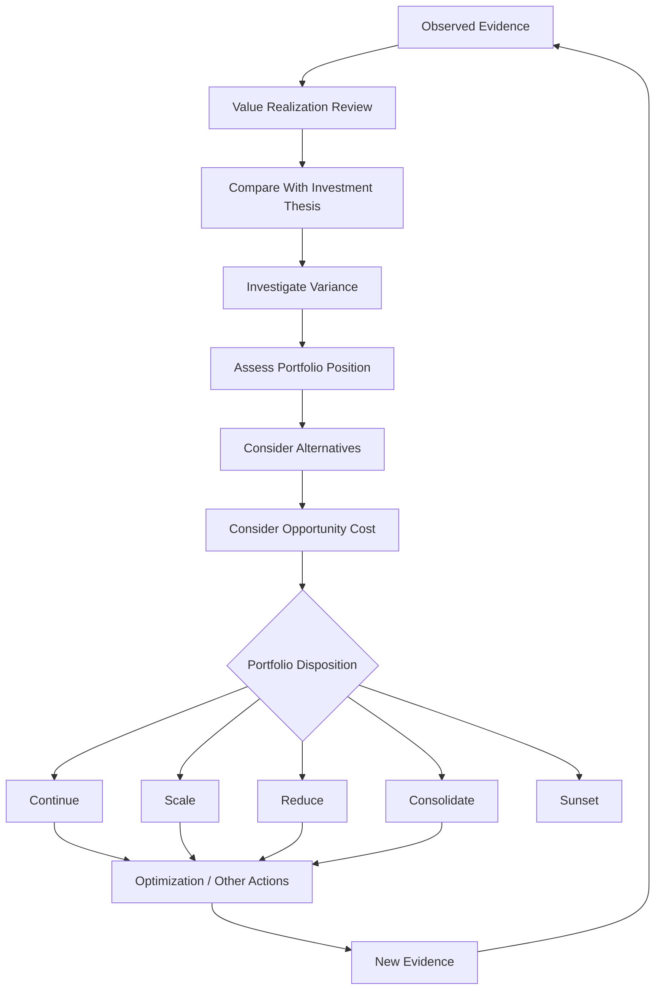
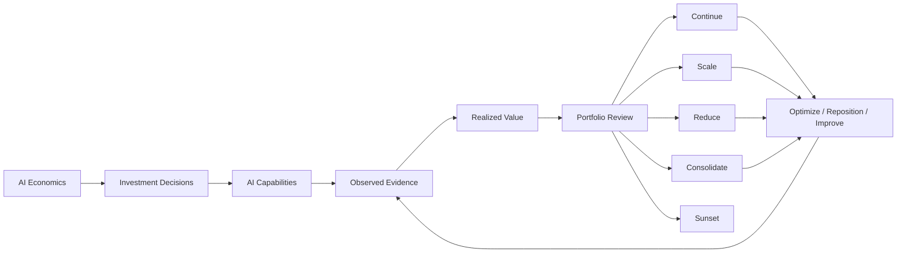

# ENT-08 — AI Portfolio Governance, Optimization and Sunset Decisions

## Learning Objectives

By the end of this chapter, you should be able to:

- explain what AI investment and portfolio decision governance means in an enterprise context;
- distinguish an AI initiative, AI capability, and AI system or solution when making portfolio decisions;
- distinguish expected value from realized value;
- explain why an investment decision does not guarantee realized business value;
- evaluate AI portfolio health using multiple evidence sources;
- identify duplicated or overlapping AI capabilities;
- distinguish economic optimization from portfolio optimization;
- reason about when consolidation creates value and when it creates undesirable coupling;
- identify signals that an AI capability may require continued investment, scaling, reduction, consolidation, optimization, or sunset;
- reason about portfolio rebalancing as enterprise investment allocation rather than individual system optimization;
- use evidence to support continuation, scale, reduction, consolidation, optimization, or sunset decisions;
- distinguish portfolio decision governance from enterprise governance authority;
- distinguish portfolio decisions from technical decommissioning or retirement execution;
- explain how realized evidence should influence the evolution of an AI portfolio.

---

## Prerequisites

Before studying this chapter, you should understand:

- basic AI economics and FinOps concepts from [File 01](./01-AI-Cost-Models-FinOps-and-Unit-Economics.md);
- AI initiative intake, prioritization, funding, expected value, and investment decisions from [File 02](./02-AI-Portfolio-Intake-Prioritization-Funding-and-Value.md);
- the distinction between an AI initiative, capability, and system;
- the difference between expected value and realized value;
- the difference between economic optimization and technical optimization.

This chapter does not re-teach those concepts in full. It uses them as inputs to portfolio-level decisions.

---

## Estimated Reading Time

Approximately 60–75 minutes.

---

## 1. Before We Start

An enterprise can make good individual investment decisions and still end up with a poor AI portfolio.

For example, imagine that four business units independently invest in AI document-processing capabilities.

Each initiative may have been individually justified:

- each solved a real business problem;
- each had an expected value;
- each had funding approval;
- each achieved reasonable adoption;
- each had a business owner.

Yet the enterprise may eventually discover that the four capabilities:

- solve substantially overlapping problems;
- consume similar AI services;
- maintain separate integrations;
- duplicate platform costs;
- require separate teams;
- create inconsistent experiences;
- and produce similar outcomes.

The problem is no longer:

> "Is each AI system individually reasonable?"

The problem becomes:

> "Is the portfolio as a whole making good use of enterprise AI investment capacity?"

That is the central concern of this chapter.

---

## 2. Why This Exists

File 02 answers a forward-looking investment question:

> **Which AI opportunities should receive investment?**

File 03 answers a portfolio-evolution question:

> **Now that AI capabilities exist and evidence is available, what should the enterprise do with them?**

An investment decision is made under uncertainty.

After implementation, adoption, operation, and business use, the enterprise obtains additional evidence.

That evidence may:

- confirm the original investment thesis;
- weaken it;
- reveal an unexpected opportunity;
- reveal duplication;
- show that a capability should be consolidated with another;
- show that continued investment is no longer justified.

Therefore:

```text
Investment Decision
        ↓
Capability Exists
        ↓
Evidence Accumulates
        ↓
Portfolio Review
        ↓
Portfolio Decision
```

The decision may involve:

```text
Continue
Scale
Reduce
Consolidate
Sunset
```

Optimization may be used as an action before or alongside these portfolio dispositions.

---

# 3. The Core Mental Model

The central mental model for ENT-08 is:

```text
Expected Value
      ↓
Investment
      ↓
Capability
      ↓
Observed Evidence
      ↓
Realized Value
      ↓
Portfolio Review
      ↓
Portfolio Decision
```

The important transition is:

> **Expected value becomes an evidence question once the capability exists.**

An enterprise should not continue funding a capability merely because its original business case predicted value.

Likewise, an enterprise should not automatically sunset a capability simply because its early results are weak.

The correct question is:

> **What does the accumulated evidence imply about the capability's position in the portfolio?**

---

# 4. Initiative, Capability and System

Portfolio decisions can operate at different levels.

These terms must remain distinct.

## AI Initiative

An AI initiative is a proposed or active investment effort intended to create, improve, adopt, or scale an AI capability.

An initiative has an investment dimension.

For example:

> "Build an AI-assisted customer support capability."

## AI Capability

An AI capability is an enduring enterprise capability that provides a defined AI-enabled business or technical function.

For example:

> "AI-assisted customer support."

The capability may continue beyond an individual implementation project.

## AI System / Solution

An AI system or solution is a concrete implementation delivering the capability.

For example:

> A production customer-support assistant using an enterprise model gateway, retrieval system, workflow engine, and agent interface.

The relationship is:

```text
AI Initiative
      ↓
Creates / Improves
      ↓
AI Capability
      ↓
Delivered Through
      ↓
AI System / Solution
```

This distinction matters because portfolio decisions may differ by level.

For example:

- an initiative may stop receiving additional funding;
- a capability may continue;
- one implementation may be replaced;
- several systems may be consolidated into one shared capability.

Do not assume:

```text
Initiative = Capability = System
```

They are related, but they are not interchangeable.

---

# 5. What Is AI Portfolio Governance?

In ENT-08, portfolio governance means:

> **The disciplined process of reviewing AI investments and capabilities and making portfolio-level decisions about their continued investment, scale, reduction, consolidation, optimization, or retirement.**

It is not generic enterprise governance.

It is also not generic project portfolio management.

The focus is specifically:

```text
AI Investment
       +
AI Capability
       +
Economic Evidence
       +
Business Evidence
       +
Portfolio Context
       ↓
Portfolio Decision
```

The portfolio perspective matters because individual capabilities do not exist in isolation.

They consume shared:

- funding;
- enterprise attention;
- platform capacity;
- organizational capacity;
- data access;
- technical support;
- governance attention;
- operational capacity.

Therefore a decision about one capability can affect the economics and opportunity cost of the entire portfolio.

---

# 6. Portfolio Decision Governance vs Enterprise Governance

These concepts must not be confused.

## Portfolio Decision Governance

ENT-08 asks:

> What portfolio decision should be made about this AI investment or capability?

Examples:

- continue;
- scale;
- reduce;
- consolidate;
- optimize;
- sunset.

## Enterprise Governance

ENT-02 asks questions such as:

- Who has authority?
- Who is accountable?
- What decision rights exist?
- What governance mechanisms apply?
- How are lifecycle governance responsibilities structured?

Therefore:

```text
ENT-08
Decision Subject + Economic / Portfolio Evidence
                ↓
"What should happen to this AI capability?"
```

while:

```text
ENT-02
Authority + Accountability + Decision Rights + Governance Mechanisms
                ↓
"Who is authorized to make this decision and under what governance structure?"
```

File 03 should define the portfolio decision problem without becoming a second enterprise governance chapter.

---

# 7. Expected Value vs Realized Value

One of the most important distinctions in this chapter is:

```text
Expected Value
      ≠
Realized Value
```

## Expected Value

Expected value belongs primarily to File 02.

It represents what the enterprise expects an investment to produce.

For example:

> "The support assistant is expected to reduce average handling effort by 20%."

That is an investment hypothesis.

## Realized Value

Realized value asks:

> "What happened after the capability was deployed and used?"

The evidence might show:

- 5% reduction instead of 20%;
- 25% reduction;
- no measurable reduction;
- improvement only for certain workflows;
- improvement offset by increased human review.

The realized result becomes evidence for portfolio decision-making.

```text
Expected Outcome
       ↓
Actual Evidence
       ↓
Variance
       ↓
Portfolio Interpretation
       ↓
Decision
```

The existence of variance does not automatically determine the decision.

The enterprise must understand why the variance exists.

---

# 8. Why Realized Value Matters

A business case is an argument about the future.

Portfolio governance operates with increasing evidence about the present and past.

Suppose an enterprise funded an AI document-processing capability with an expected annual benefit of ₹50 lakh.

After deployment:

- adoption is lower than expected;
- processing volume is lower than forecast;
- cost per successful document is higher than expected;
- human review remains significant;
- business teams still use the previous workflow.

The original investment case does not disappear.

But the enterprise now has better evidence.

The relevant question becomes:

> **Does the evidence still justify the capability's position in the portfolio?**

Possible directions include:

- continue with current investment;
- optimize the capability;
- reduce investment;
- consolidate it with another capability;
- change its scope;
- increase investment because a larger opportunity has emerged;
- sunset it.

The decision should be evidence-based rather than predetermined.

---

## 9. Portfolio Health

Portfolio health is an assessment of whether the enterprise AI portfolio remains economically, strategically, and operationally sensible as a whole.

It is not a single score.

A portfolio review may consider:

- investment performance;
- realized value;
- cost trajectory;
- adoption;
- strategic alignment;
- duplication;
- capability overlap;
- dependency burden;
- lifecycle position;
- evidence quality;
- organizational capacity;
- continued business relevance.

The goal is not to produce a perfect number.

The goal is to identify where portfolio decisions may be required.

A useful mental model is:

```text
Portfolio Health
      ↓
Evidence Across Multiple Dimensions
      ↓
Interpretation
      ↓
Decision
```

Avoid:

```text
Portfolio Health Score = 82
Therefore everything is fine.
```

A single aggregate score can hide important differences between capabilities.

---

# 10. Evidence for Portfolio Decisions

Portfolio decisions should use multiple evidence sources.

Possible evidence includes:

- actual usage;
- adoption trends;
- cost trends;
- unit economics;
- realized business outcomes;
- strategic alignment;
- operational burden;
- duplication;
- stakeholder demand;
- dependency patterns;
- risk inputs;
- capability reuse;
- lifecycle position;
- evidence quality.

No single metric is sufficient in every situation.

For example:

> Low adoption may indicate weak value.

But it may also indicate:

- poor onboarding;
- workflow mismatch;
- insufficient training;
- limited integration;
- organizational resistance;
- an intentionally narrow user population.

Therefore:

```text
Signal
  ↓
Investigation
  ↓
Interpretation
  ↓
Decision
```

is better than:

```text
Signal
  ↓
Automatic Action
```

---

# 11. Portfolio Evidence Is Not the Same as Technical Evaluation

ENT-08 may use technical or quality evidence when it affects economic or portfolio decisions.

For example:

> A lower-cost model has a higher failure rate, causing additional human review and rework.

That quality signal matters economically.

However, ENT-08 does not own the methodology for:

- benchmark construction;
- evaluation-set design;
- model evaluation;
- technical quality measurement;
- production observability;
- model benchmarking.

Those belong to the appropriate technical and evaluation domains.

ENT-08 consumes relevant evidence as an input to portfolio decisions.

---

## 12. Economic Optimization vs Portfolio Optimization

This distinction is mandatory.

## File 01 — Economic Optimization

File 01 asks:

> **How can this AI workload or capability become economically efficient?**

Examples include:

- reducing unnecessary consumption;
- improving cost per successful task;
- improving cost-to-outcome relationships;
- understanding cost drivers;
- improving cost allocation or attribution.

The focus is the economics of an individual workload or capability.

## File 03 — Portfolio Optimization

File 03 asks:

> **Is this capability still the right use of enterprise AI investment capacity given the other capabilities in the portfolio?**

Examples include:

- reducing duplicated investment;
- reallocating funding;
- consolidating overlapping capabilities;
- reducing investment in weak-value capabilities;
- increasing investment in high-value capabilities;
- balancing strategic and economic opportunities.

Therefore:

```text
Economic Optimization
        ↓
Individual Workload / Capability Economics
```

while:

```text
Portfolio Optimization
        ↓
Enterprise AI Portfolio Composition
```

An individually efficient capability can still be a poor portfolio investment.

---

# 13. Portfolio Optimization

Portfolio optimization means improving the composition and allocation of the AI portfolio.

It can involve:

- increasing investment in strong opportunities;
- reducing investment in weak opportunities;
- consolidating overlapping capabilities;
- reallocating funding;
- changing capability scope;
- replacing duplicated solutions;
- preserving strategically important capabilities despite short-term economics;
- balancing mature capabilities with emerging opportunities.

Portfolio optimization is therefore not:

> "Make every AI system cheaper."

It is:

> **"Improve the overall use of scarce enterprise AI investment capacity."**

The objective is portfolio-level value, not local system perfection.

---

## 14. Portfolio Rebalancing

A portfolio changes over time.

New opportunities emerge.

Existing capabilities mature.

Some capabilities underperform.

Some become strategically more important.

Some become obsolete.

Therefore the portfolio may need rebalancing.

For example:

```text
Before Rebalancing

Capability A   █████████
Capability B   ███████
Capability C   ██████
Capability D   █████
```

After evidence review:

```text
Capability A   ███████
Capability B   █████████
Capability C   ███
Capability D   ██████████
```

The exact allocation is enterprise-specific.

The important principle is:

> **Investment allocation should evolve as evidence and strategic context evolve.**

Rebalancing does not necessarily mean cutting budgets.

It can mean:

- increasing investment;
- reducing investment;
- changing scope;
- consolidating;
- redirecting investment;
- delaying investment;
- replacing a capability.

---

# 15. Capability Duplication

Duplication is one of the most important portfolio signals.

Two capabilities may be technically different while serving substantially similar enterprise needs.

Duplication can occur at several levels.

## Functional duplication

Two systems solve similar business problems.

## Platform duplication

Multiple teams maintain separate AI services performing similar functions.

## Provider duplication

Different teams use separate providers for similar workloads without a strong business reason.

## Data duplication

Multiple capabilities independently process or maintain similar datasets.

## Organizational duplication

Multiple teams maintain overlapping AI expertise and operational responsibilities.

Duplication does not automatically mean consolidation is correct.

The correct question is:

> **What value is created by keeping these capabilities separate, and does that value justify the duplication?**

---

## 16. Consolidation

Consolidation means combining or rationalizing overlapping AI capabilities.

For example:

```text
Business Unit A
      ↓
Document AI A
      \
       \
Business Unit B → Document AI B
       /
      /
Business Unit C
      ↓
Document AI C
```

A portfolio review may determine that a shared enterprise capability could replace the three overlapping capabilities:

```text
Business Unit A ─┐
Business Unit B ─┼──> Shared Document AI Capability
Business Unit C ─┘
```

Potential benefits include:

- reduced duplication;
- shared investment;
- reusable integrations;
- consistent experience;
- potentially lower total cost;
- centralized capability improvement;
- improved reuse.

But consolidation also creates trade-offs.

---

# 17. Consolidation Trade-offs

Consolidation is not automatically beneficial.

Potential disadvantages include:

- increased coupling;
- lower local autonomy;
- centralized bottlenecks;
- more complex governance;
- larger blast radius;
- conflicting business requirements;
- slower local experimentation;
- migration costs;
- concentration around one shared capability.

The decision should therefore consider:

```text
Benefits of Consolidation
        +
Costs of Consolidation
        +
Strategic Considerations
        +
Dependencies
        +
Business Requirements
        ↓
Consolidation Decision
```

A simplistic rule such as:

> "If two systems overlap, consolidate them."

is insufficient.

---

# 18. Consolidation Decision Questions

Before recommending consolidation, ask:

### Business overlap

Do the capabilities solve substantially similar problems?

### Value

What value does each capability currently create?

### Differentiation

Does either capability provide a meaningful business advantage that would be lost through consolidation?

### Cost

What duplication exists today?

### Migration

What would it cost to move users, workflows, integrations, and data?

### Coupling

Would consolidation create excessive dependency on one shared capability?

### Autonomy

Would business units lose necessary local flexibility?

### Scale

Can the proposed shared capability support the combined demand?

### Governance

Would ownership and decision-making become clearer or more complicated?

### Evidence

Is the consolidation case supported by actual usage and economics, or merely by architectural preference?

This turns consolidation into an enterprise decision rather than an architectural reflex.

---

## 19. Underperforming Capabilities

An underperforming capability is one whose observed results do not sufficiently justify its current position in the portfolio.

Possible signals include:

- weak realized value;
- declining adoption;
- excessive cost;
- poor cost-to-outcome relationship;
- declining business relevance;
- persistent operational burden;
- duplicated functionality;
- weak strategic alignment;
- replacement by a better capability.

However, underperformance must be interpreted in context.

For example:

> Low adoption may be a temporary onboarding problem.

while:

> Low adoption combined with weak business value, persistent cost, and availability of a superior shared alternative

provides a much stronger portfolio signal.

Therefore:

```text
Underperformance Signal
        ↓
Contextual Investigation
        ↓
Evidence Assessment
        ↓
Portfolio Decision
```

---

# 20. Value-Realization Review

A value-realization review asks:

> **What value has the capability actually produced, and how does that compare with the investment assumptions?**

A review may compare:

| Dimension | Expected | Observed |
|---|---|---|
| Adoption | Planned user base | Actual active usage |
| Cost | Forecast | Actual trajectory |
| Outcome | Expected improvement | Observed improvement |
| Workflow impact | Expected | Observed |
| Human effort | Expected reduction | Actual effort |
| Business relevance | Assumed | Current relevance |

The purpose is not merely to calculate variance.

The purpose is to understand what the evidence means for the portfolio.

```text
Expected Value
      ↓
Observed Value
      ↓
Gap Analysis
      ↓
Interpretation
      ↓
Portfolio Decision
```

---

# 21. Realized Value Does Not Automatically Mean Continue

A capability can produce positive value and still require portfolio reconsideration.

For example:

- Capability A produces positive value.
- Capability B produces greater value at lower enterprise cost.
- Both solve overlapping problems.
- Enterprise capacity is constrained.

Capability A is not necessarily a bad capability.

But the portfolio may still decide to:

- consolidate it;
- reduce investment;
- transfer its functionality;
- change its scope.

This illustrates an important principle:

> **Positive individual value does not guarantee optimal portfolio position.**

Portfolio decisions are comparative.

---

## 22. Realized Value Does Not Automatically Mean Scale

Similarly, a capability may produce strong value but not be ready for immediate scaling.

Possible constraints include:

- insufficient enterprise capacity;
- unresolved dependencies;
- limited organizational readiness;
- high concentration risk;
- integration limitations;
- insufficient operational support;
- uncertain economics at larger scale.

Therefore:

```text
Strong Realized Value
        ≠
Automatic Scale
```

Instead:

```text
Strong Realized Value
        +
Scale Feasibility
        +
Portfolio Capacity
        +
Strategic Fit
        ↓
Scale Decision
```

This is a portfolio decision, not a technical scaling procedure.

---

# 23. Continuation Decisions

A continuation decision asks:

> **Does the capability remain justified as part of the enterprise AI portfolio?**

Continuation may be appropriate when:

- realized value remains meaningful;
- adoption is healthy;
- economics remain acceptable;
- strategic relevance continues;
- no superior replacement exists;
- duplication is manageable;
- enterprise capacity supports continued investment.

Continuation does not mean:

> "Do nothing."

The capability may continue while still undergoing:

- optimization;
- scope refinement;
- investment adjustment;
- architectural improvement;
- integration changes.

This distinction is important:

```text
Portfolio Disposition
        ↓
Continue
        ↓
Possible Actions
   ├── Optimize
   ├── Refine Scope
   ├── Adjust Investment
   └── Improve Capability
```

Optimization is therefore an action that can occur within a continuation decision.

---

# 24. Scale Decisions

A scale decision asks:

> **Should the enterprise increase investment or adoption of this capability?**

Evidence supporting scale may include:

- strong realized value;
- strong adoption;
- favorable economics;
- repeatability across business units;
- clear strategic relevance;
- reusable capability design;
- sufficient enterprise capacity.

But scale also introduces new considerations.

A capability that works for 500 users may behave differently at enterprise scale.

The portfolio question is therefore:

> **Does the evidence justify additional enterprise investment, and can the portfolio absorb that investment?**

This is different from the technical question:

> "How should the system be scaled?"

The latter belongs to the relevant production and engineering domains.

---

## 25. Reduction Decisions

Reduction means decreasing investment, scope, or portfolio commitment without necessarily retiring the capability.

Reduction may be appropriate when:

- value is positive but lower than expected;
- adoption is limited;
- strategic relevance has decreased;
- another capability provides overlapping value;
- economics have deteriorated;
- enterprise capacity must be redirected.

Reduction can be a deliberate portfolio strategy.

It does not necessarily mean failure.

For example:

> A capability may remain available to a small high-value user population while broader expansion is stopped.

This can be preferable to either:

- indefinite full-scale investment;
- immediate sunset.

---

## 26. Optimization as a Portfolio Action

Optimization should be understood as an **intervention used to improve a capability's portfolio position**, rather than as a mutually exclusive lifecycle disposition.

Optimization may include:

- improving the capability's economic efficiency;
- reducing unnecessary scope;
- improving reuse;
- removing duplicated components;
- improving adoption;
- changing the capability's operating model;
- addressing a known value-realization gap.

For example:

```text
Portfolio Review
      ↓
Capability Underperforms
      ↓
Optimization Action
      ↓
New Evidence
      ↓
Reassessment
```

Optimization may therefore occur alongside:

- continuation;
- scaling;
- reduction;
- consolidation.

It may also fail to produce sufficient improvement, leading to a later sunset decision.

This preserves the distinction between:

```text
Portfolio Disposition
Continue / Scale / Reduce / Consolidate / Sunset
```

and:

```text
Portfolio Action
Optimize / Reposition / Improve / Reuse
```

---

# 27. Sunset Decisions

Sunset means the enterprise decides that an AI capability should no longer remain an active portfolio investment.

A sunset decision should be evidence-based.

Possible signals include:

- persistent underperformance;
- weak value realization;
- declining business relevance;
- excessive cost;
- duplicated capability;
- unacceptable risk;
- strategic misalignment;
- obsolete technology;
- insufficient adoption;
- unsustainable dependency;
- replacement by a better shared capability.

The important principle is:

> **A capability should not be sunset simply because it is old.**

Age is not a sufficient decision criterion.

A mature capability can remain strategically valuable.

Likewise, a recently deployed capability can be sunset if evidence demonstrates that it is not justified.

---

## 28. Sunset Is a Portfolio Decision, Not a Technical Runbook

ENT-08 owns the question:

> **Should this capability be sunset?**

It does not cover:

> **How do we technically shut down every component?**

Technical retirement may involve:

- application decommissioning;
- infrastructure shutdown;
- database handling;
- contract changes;
- data retention;
- migration;
- dependency removal;
- user communication;
- operational runbooks.

Those are implementation consequences handled by the appropriate domains.

Therefore:

```text
Sunset Decision
        ↓
Retirement Planning
        ↓
Technical / Operational Execution
```

The first belongs to ENT-08.

The latter belongs to the relevant execution domains.

---

# 29. Sunset Decision Framework

A useful reasoning sequence is:

```text
Evidence
   ↓
Is Value Still Relevant?
   ↓
Is the Capability Still Strategically Justified?
   ↓
Is the Economics Still Defensible?
   ↓
Is Duplication Significant?
   ↓
Is There a Better Alternative?
   ↓
Is Continued Investment Justified?
   ↓
Portfolio Decision
```

The answer does not need to be binary.

Possible outcomes include:

```text
Continue
Scale
Reduce
Consolidate
Sunset
```

Optimization may be selected as an action before a final disposition or as part of an existing disposition.

---

# 30. Portfolio Decision Matrix

A matrix can help structure reasoning without becoming a universal scoring formula.

| Realized Value | Strategic Relevance | Portfolio Position | Possible Direction |
|---|---|---|---|
| High | High | Strong | Continue / Scale |
| High | High | Duplicated | Consolidate / Reposition |
| High | Low | Strong economics | Continue selectively / Optimize |
| Low | High | Emerging | Optimize / Reassess |
| Low | Low | Duplicated | Reduce / Sunset |
| Low | High | Critical strategic role | Reassess before sunset |
| High | Low | High cost | Optimize / Reduce |
| Low | Low | Obsolete | Sunset |

These are decision patterns, not automatic rules.

Realized value and strategic relevance are only part of the analysis. Portfolio decisions may also depend on:

- economic trajectory;
- opportunity cost;
- duplication;
- dependencies;
- alternatives;
- enterprise capacity;
- evidence quality;
- implementation consequences.

---

## 31. Portfolio Rebalancing Example

Suppose an enterprise has six AI capabilities:

```text
A — Customer Support
B — Document Processing
C — Coding Assistance
D — Sales Intelligence
E — Enterprise Search
F — Duplicate Document Processing
```

After review:

- A has strong adoption and strong realized value;
- B has moderate value;
- C has high strategic importance;
- D has weak adoption;
- E is strategically important;
- F overlaps substantially with B.

The enterprise may decide:

```text
A → Scale
B → Continue / Optimize
C → Continue / Strategic Investment
D → Reduce / Reassess
E → Scale Carefully
F → Consolidate with B
```

Notice what happened.

The enterprise did not simply ask:

> "Which system is cheapest?"

It evaluated the portfolio as a whole.

---

# 32. Example — Duplicate Document AI

Three business units independently operate document-processing capabilities.

### Evidence

Capability A:

- high adoption;
- strong business value;
- moderate cost.

Capability B:

- moderate adoption;
- overlapping functionality;
- high maintenance burden.

Capability C:

- low adoption;
- substantial overlap;
- expensive to operate.

A portfolio review identifies a strong consolidation opportunity.

However, before deciding, the enterprise investigates:

- differences in business requirements;
- integration dependencies;
- data boundaries;
- local autonomy requirements;
- migration cost;
- shared-capability scalability;
- ownership;
- risk inputs.

The resulting decision may be:

```text
A → Retain as foundation
B → Consolidate
C → Sunset
```

The important lesson is:

> **Consolidation decisions should be evidence-based and capability-aware, not based solely on technical similarity.**

---

# 33. Example — Expensive but Strategic Capability

An AI capability has:

- high cost;
- low current adoption;
- weak short-term economics;
- strong strategic relevance;
- no mature alternative;
- significant future potential.

A simplistic portfolio process might sunset it immediately.

A stronger process asks:

- Is the current adoption limitation temporary?
- Is the strategic opportunity sufficiently important?
- Is there a credible path to improved economics?
- What evidence would justify continued investment?
- Can investment be bounded?
- What is the opportunity cost of continuing?
- What would be lost if the capability disappeared?

The resulting decision might be:

> Continue with bounded investment and explicit evidence requirements.

This is different from indefinite funding.

---

## 34. Example — Positive Value but Excessive Duplication

Suppose two business units each operate highly successful AI customer-service capabilities.

Both generate measurable value.

However:

- they use overlapping functionality;
- both maintain separate integrations;
- both require separate platform investment;
- their capabilities are increasingly similar.

The enterprise should not conclude:

> "Both are successful, so nothing should change."

Instead it should ask:

> **Could the enterprise preserve the valuable outcomes while reducing unnecessary duplication?**

Possible decisions include:

- maintain both;
- consolidate;
- create a shared platform capability;
- preserve differentiated components while sharing common services;
- reduce one capability's scope.

The answer depends on enterprise context.

---

## 35. Example — Replacement by a Better Capability

Suppose an enterprise has Capability A.

A newer shared capability, Capability B, now provides:

- similar functionality;
- lower total economic burden;
- higher adoption;
- broader reuse;
- better strategic alignment.

Capability A may still produce positive value.

Nevertheless, the portfolio may decide to:

```text
Capability A
    ↓
Reduce
    ↓
Migrate / Consolidate
    ↓
Capability B
```

This demonstrates why portfolio decisions are comparative.

A capability does not need to be "bad" to be replaced.

It may simply no longer be the best portfolio allocation.

---

# 36. Evidence Quality and Causality

Not all evidence has equal strength.

For example:

### Weak evidence

> "Users seem to like the system."

### Stronger evidence

> "Active usage increased 40% over three quarters."

### Stronger still

> "Usage increased 40%, task completion improved 18%, and the measured operational cost per successful task decreased 12%."

Even strong quantitative evidence requires context.

The enterprise should consider:

- measurement quality;
- attribution boundaries;
- time period;
- comparison baseline;
- changing business conditions;
- confounding factors.

Observed business improvement also does not automatically prove that AI caused the improvement.

For example:

> Customer support resolution time decreased after deploying an AI assistant.

Possible contributing factors include:

- AI assistance;
- employee training;
- process redesign;
- staffing changes;
- seasonality;
- improved tooling;
- changes in customer behavior.

Therefore:

```text
Observed Outcome
        ≠
Automatically Proven Causal Impact
```

Where attribution is uncertain, decision-makers should make that uncertainty explicit.

---

# 37. Portfolio Decision Governance Loop

A mature enterprise should treat portfolio governance as a recurring loop:


Optimization may occur between these stages as an intervention:

```text
Portfolio Review
      ↓
Optimization Action
      ↓
New Evidence
      ↓
Reassessment
```

The portfolio therefore evolves continuously.

Governance is not a one-time annual exercise.

The review cadence should depend on:

- investment size;
- capability criticality;
- rate of change;
- uncertainty;
- business volatility;
- strategic importance.

---

# 38. AI Portfolio Lifecycle

The broader ENT-08 lifecycle can be represented as:



This is a conceptual model.

Real portfolios are not perfectly linear.

A capability may:

- return to assessment;
- pause;
- change direction;
- reduce funding;
- merge with another capability;
- be replaced;
- be sunset.

The model represents decision flow, not a mandatory lifecycle implementation.

---

# 39. Portfolio Decisions Under Uncertainty

Portfolio decisions are often made with incomplete evidence.

The enterprise may know:

- cost reasonably well;
- adoption partially;
- business value approximately;
- strategic relevance strongly;
- long-term outcomes poorly.

The correct response is not necessarily to wait for perfect evidence.

Instead, the enterprise should ask:

> **What decision can be justified with the evidence available, and what uncertainty must remain explicit?**

Possible responses include:

- continue with monitoring;
- scale cautiously;
- reduce investment;
- optimize and reassess;
- consolidate;
- sunset.

Good portfolio governance manages uncertainty rather than pretending it does not exist.

---

## 40. Portfolio Decision Trade-offs

Portfolio decisions often involve competing objectives.

For example:

```text
Lower Cost
     ↕
Higher Capability Breadth

Local Autonomy
     ↕
Enterprise Standardization

Short-Term Value
     ↕
Strategic Long-Term Value

Specialization
     ↕
Capability Reuse

Experimentation
     ↕
Operational Stability
```

There is no universal correct position.

The enterprise must decide based on:

- strategy;
- evidence;
- economics;
- organizational context;
- dependencies;
- risk inputs;
- available capacity.

---

# 41. Common Mistakes

## "Always Consolidate"

Consolidation can create value.

But automatic consolidation can create:

- excessive coupling;
- centralized bottlenecks;
- reduced autonomy;
- larger failure domains;
- conflicting requirements;
- slower experimentation.

Therefore:

> **Overlap is a signal for investigation, not an automatic consolidation command.**

## "Always Sunset Underperformers"

Underperformance is also a signal.

An underperforming capability may have:

- fixable adoption problems;
- temporary market conditions;
- strategic importance;
- immature operating processes;
- a valuable underlying capability that needs repositioning.

Therefore:

```text
Underperformance
      ↓
Investigate
      ↓
Understand Cause
      ↓
Choose Appropriate Portfolio Action
```

## "Positive ROI Means Continue"

A capability can produce positive economic value while another capability provides greater value for the same scarce enterprise capacity.

Therefore:

> **Positive value does not guarantee optimal portfolio position.**

## "Cost Reduction Is Portfolio Optimization"

Reducing the cost of every capability may damage strategic capabilities, weaken future opportunities, or simply move costs elsewhere.

Portfolio optimization asks:

> **Where should the enterprise place its scarce AI investment capacity?**

not merely:

> **How can every AI capability spend less?**

## "Sunset Means Delete"

Sunset is a portfolio decision.

It does not automatically specify:

- deletion;
- immediate shutdown;
- data destruction;
- infrastructure termination;
- contract termination.

Technical retirement execution belongs to the appropriate domains.

## "Every Capability Must Scale"

Scaling is not the default destination.

Some capabilities should:

- remain small;
- serve a specialized population;
- remain experimental;
- be consolidated;
- be reduced;
- be replaced;
- be sunset.

The goal is not maximum capability count.

The goal is:

> **A portfolio whose capabilities collectively justify the enterprise investment committed to them.**

## "Portfolio Governance Is a Dashboard"

A dashboard can provide evidence.

It does not make portfolio governance effective by itself.

The actual reasoning loop is:

```text
Evidence
    ↓
Interpretation
    ↓
Decision
    ↓
Action
    ↓
Review
```

---

# 42. Common Mistake: Ignoring Opportunity Cost

A portfolio decision always has an opportunity-cost dimension.

If the enterprise allocates additional funding to Capability A, that capacity cannot simultaneously be used elsewhere.

Therefore:

```text
Investment in A
        ↓
Available Capacity for B, C, D decreases
```

This is why positive value alone is insufficient.

A portfolio must consider:

- relative value;
- strategic importance;
- evidence strength;
- economics;
- dependencies;
- enterprise capacity.

---

# 43. Common Mistake: Sunk-Cost Thinking

One dangerous portfolio failure mode is:

> "We already invested so much that we cannot stop."

Past investment is not a sufficient reason for future investment.

The relevant question is:

> **Given the evidence available today, is additional investment justified?**

This does not mean ignoring previous investment.

Previous investment may explain:

- switching cost;
- migration cost;
- organizational impact;
- technical dependency.

But it should not create an automatic requirement to continue funding a weak capability.

The enterprise must distinguish:

```text
Past Cost
    ≠
Future Value
```

---

# 44. Portfolio Decision Framework

A practical portfolio review can follow this sequence:

### Step 1 — Identify the decision subject

Is the decision about:

- an initiative;
- a capability;
- a system;
- a group of overlapping capabilities;
- the portfolio as a whole?

### Step 2 — Review evidence

Examine:

- realized value;
- adoption;
- cost trajectory;
- strategic relevance;
- duplication;
- dependencies;
- operational burden;
- business demand.

### Step 3 — Compare against the investment thesis

Ask:

> What did the enterprise expect?

Then:

> What actually happened?

### Step 4 — Understand variance

Do not stop at:

> "The outcome is lower."

Ask:

> Why?

### Step 5 — Consider alternatives

Could the outcome be improved through:

- optimization;
- scope change;
- consolidation;
- investment increase;
- investment reduction;
- replacement?

### Step 6 — Consider portfolio opportunity cost

Ask:

> What other capabilities compete for the same enterprise capacity?

### Step 7 — Select the portfolio disposition

Possible outcomes:

```text
Continue
Scale
Reduce
Consolidate
Sunset
```

### Step 8 — Define actions and evidence for the next review

The disposition may require actions such as:

- optimize;
- reposition;
- consolidate;
- improve adoption;
- migrate;
- reduce scope.

A decision should create a new evidence cycle.

---

# 45. Portfolio Decision Framework Diagram



The disposition is contextual.

The diagram does not prescribe a universal decision algorithm.

---

# 46. Relationship to File 01

File 01 teaches:

> **What does this capability cost, what drives the cost, and how should its economics be understood?**

File 03 consumes that economic evidence.

For example:

```text
File 01
Cost per Successful Task
        ↓
Economic Evidence
        ↓
File 03
Portfolio Review
        ↓
Continue / Scale / Reduce / Consolidate / Sunset
```

File 03 should not re-teach token economics, cost allocation, FinOps, or unit-economic formulas in depth.

It should use those concepts when they inform portfolio decisions.

---

# 47. Relationship to File 02

File 02 asks:

> **Should this opportunity receive investment?**

File 03 asks:

> **Now that evidence exists, what should happen to the capability in the portfolio?**

The relationship is:

```text
FILE 02

Expected Value
      ↓
Investment Decision
      ↓
Build / Adopt / Experiment

FILE 03

Observed Evidence
      ↓
Realized Value
      ↓
Portfolio Review
      ↓
Continue / Scale / Reduce / Consolidate / Sunset
```

File 03 should not re-teach the entire intake and prioritization methodology.

---

# 48. Relationship to ENT-07

ENT-07 owns model/provider/vendor strategy.

File 03 may encounter provider-related evidence during portfolio review.

For example:

> Several capabilities depend on different providers for similar workloads.

ENT-08 may ask:

> "Does this provider fragmentation create portfolio-level economic or strategic consequences?"

But ENT-08 should not re-teach:

- provider selection;
- vendor strategy;
- vendor negotiation;
- portability architecture;
- exit strategy.

Those belong to ENT-07.

---

## 49. Relationship to ENT-09

ENT-09 owns:

- criticality;
- resilience;
- dependencies;
- continuity.

File 03 may use those considerations as portfolio inputs.

For example:

> A capability has modest economic value but supports a highly critical business process.

That fact can materially influence the portfolio decision.

But ENT-08 should not redefine criticality or resilience methodology.

The boundary is:

```text
ENT-08
"Is continued investment justified?"

ENT-09
"How critical is this capability, and what resilience/dependency
requirements follow?"
```

A capability's economic value and criticality are related decision inputs, but they are not the same concept.

---

# 50. Relationship to PROD

ENT-08 asks:

> **Should the enterprise continue investing in this capability?**

PROD and technical engineering domains ask:

> **How should the production system operate, scale, perform, and remain reliable?**

For example:

```text
ENT-08
"The capability's cost trajectory is unfavorable."
        ↓
Portfolio Decision
        ↓
PROD
"How can the production implementation improve its
cost/performance characteristics?"
```

Do not turn portfolio optimization into GPU optimization, serving optimization, caching, batching, or infrastructure engineering.

---

# 51. Relationship to ENT-01

ENT-01 owns enterprise AI capability architecture and operating models.

File 03 owns economic and portfolio decisions about those capabilities.

Architecture may inform:

- duplication analysis;
- consolidation;
- dependency analysis;
- investment consequences.

But File 03 does not become a generic architecture chapter.

---

## 52. Relationship to ENT-02

ENT-02 owns:

- governance authority;
- accountability;
- decision rights;
- lifecycle governance;
- governance mechanisms;
- enterprise policy governance.

ENT-08 owns:

- the economic and portfolio decision subject;
- the evidence relevant to that decision;
- the resulting portfolio disposition.

Therefore:

```text
ENT-02
Who can decide?
        +
How is governance structured?

ENT-08
What portfolio decision is being considered?
        +
What evidence informs it?
```

---

# 53. Relationship to ENT-03

ENT-03 owns:

- risk;
- impact;
- human oversight;
- assurance.

File 03 may use risk-related evidence as an input.

For example:

> A capability has positive economics but its risk profile has materially changed.

That can affect the portfolio decision.

However, File 03 should not re-teach risk assessment, impact assessment, residual-risk methodology, or assurance.

Risk remains an input rather than an ENT-08-owned methodology.

---

## 54. Portfolio Review Cadence

Portfolio review frequency should depend on context.

Factors may include:

- investment magnitude;
- uncertainty;
- strategic importance;
- rate of change;
- business volatility;
- adoption maturity;
- dependency concentration;
- economic sensitivity.

A high-uncertainty experimental capability may require more frequent evidence review than a mature, stable capability.

The principle is:

> **Review cadence should match decision risk and uncertainty, not merely the calendar.**

This does not prescribe a universal monthly, quarterly, or annual schedule.

---

## 55. What Good Portfolio Governance Looks Like

Good AI portfolio governance has several characteristics.

### Evidence-driven

Decisions are based on observed evidence rather than enthusiasm or sunk cost.

### Comparative

Capabilities are considered relative to alternatives and competing investments.

### Contextual

The enterprise recognizes that the same evidence can imply different decisions in different contexts.

### Economically aware

Cost and value are considered together.

### Strategically aware

Short-term economics do not completely override strategic considerations.

### Explicit about uncertainty

Unknowns are recorded rather than hidden.

### Reversible where possible

Investment can be staged when uncertainty is high.

### Portfolio-oriented

The enterprise considers the effect of one capability on the overall portfolio.

---

## 56. Portfolio Decision Record

A portfolio decision should be explainable.

A useful decision record can capture:

```text
Decision Subject
        ↓
Current Evidence
        ↓
Expected vs Realized Position
        ↓
Key Assumptions
        ↓
Portfolio Context
        ↓
Alternatives Considered
        ↓
Portfolio Disposition
        ↓
Rationale
        ↓
Actions
        ↓
Evidence Required for Reassessment
```

This supports organizational learning.

It also reduces decisions based purely on memory or executive intuition.

The exact decision-record format belongs to the enterprise's governance processes; ENT-08 focuses on the economic and portfolio reasoning that should inform it.

---

# 57. Engineering Decision Checklist

Before recommending a portfolio decision, ask:

### Decision subject

- What exactly are we deciding about?
- Initiative, capability, system, or portfolio?

### Evidence

- What has actually happened?
- What evidence supports the conclusion?
- How reliable is the evidence?

### Value

- What value has been realized?
- Is the value attributable with reasonable confidence?
- Is the value still strategically relevant?

### Economics

- What is the current economic trajectory?
- Are costs increasing or decreasing?
- Is the capability economically efficient relative to alternatives?

### Portfolio position

- Is the capability duplicated?
- Does another capability overlap?
- What enterprise capacity does it consume?
- What alternatives compete for that capacity?

### Strategic context

- Is the capability strategically important?
- Has strategic relevance changed?

### Alternatives

- Continue?
- Scale?
- Reduce?
- Consolidate?
- Sunset?

### Actions

- Does the capability need optimization?
- Does scope need to change?
- Is migration or consolidation required?
- What action follows the portfolio disposition?

### Consequences

- What happens if we continue?
- What happens if we reduce?
- What happens if we consolidate?
- What happens if we sunset?

### Uncertainty

- What do we still not know?
- What evidence would change the decision?

---

## 58. Interview Questions with Expected Answers

## Conceptual Understanding

### 1. What is AI portfolio optimization?

**Expected answer:**

AI portfolio optimization is the process of improving the composition and allocation of enterprise AI investments and capabilities. It considers realized value, economics, strategic relevance, duplication, dependencies, capacity, and alternatives rather than optimizing each AI system independently.

---

### 2. What is the difference between expected and realized value?

**Expected answer:**

Expected value is what an investment is forecast or hypothesized to produce. Realized value is the value observed after the capability is deployed and used. Realized evidence informs later portfolio decisions.

---

### 3. Why can a capability with positive value still be consolidated?

**Expected answer:**

Because positive individual value does not guarantee optimal portfolio position. Another capability may provide similar value with lower duplication, greater reuse, or better enterprise economics. Consolidation may preserve value while improving the portfolio.

---

### 4. What is the difference between economic optimization and portfolio optimization?

**Expected answer:**

Economic optimization improves the economics of an individual workload or capability. Portfolio optimization determines whether that capability is the right use of enterprise investment capacity relative to other capabilities and alternatives.

---

### 5. What does portfolio decision governance mean in ENT-08?

**Expected answer:**

It means governing decisions about AI investments and capabilities—such as continue, scale, reduce, consolidate, optimize, or sunset—using economic, business, strategic, and portfolio evidence. It does not mean governance authority or enterprise decision rights, which belong to ENT-02.

---

## Engineering Judgment

### 6. When should an enterprise consider consolidating two AI capabilities?

**Expected answer:**

When there is meaningful functional or capability overlap and the benefits of reducing duplication outweigh the costs and risks of consolidation. The analysis should consider value, cost, dependencies, migration effort, local autonomy, coupling, scalability, and strategic differences.

---

### 7. When should an AI capability be sunset?

**Expected answer:**

When evidence indicates that continued portfolio investment is no longer justified—for example because of persistent underperformance, weak value realization, declining relevance, excessive cost, duplication, obsolete technology, insufficient adoption, or replacement by a better capability. Sunset should be an evidence-based portfolio decision.

---

### 8. Why should a company not automatically sunset a low-adoption capability?

**Expected answer:**

Low adoption is only a signal. It may result from onboarding problems, workflow mismatch, organizational resistance, or a deliberately narrow target population. The enterprise should investigate the cause before deciding whether to optimize, reduce, consolidate, or sunset.

---

### 9. Why is consolidation not always beneficial?

**Expected answer:**

Consolidation can reduce duplication but increase coupling, reduce local autonomy, create centralized bottlenecks, enlarge the blast radius of failures, and make business requirements harder to satisfy independently.

---

### 10. Why is positive ROI insufficient for portfolio continuation?

**Expected answer:**

Because portfolio decisions are comparative. Another capability may produce greater value or better strategic returns for the same scarce enterprise capacity. A positively valued capability can still have a weaker portfolio position than alternatives.

---

## Scenario Question

### 11. Two business units built similar AI systems. Both are successful. What should you analyze before consolidating them?

**Expected answer should include:**

- functional overlap;
- realized value;
- cost;
- adoption;
- capability reuse;
- ownership;
- dependencies;
- integration complexity;
- local autonomy;
- strategic differences;
- migration cost;
- shared-capability scalability;
- risk inputs;
- coupling consequences;
- opportunity cost.

A simplistic answer such as:

> "Always consolidate duplicate systems."

is insufficient.

---

### 12. An AI capability is expensive but strategically important. Should it be sunset?

**Expected answer:**

Not automatically. The enterprise should examine realized value, strategic relevance, alternatives, economic improvement potential, opportunity cost, and uncertainty. A bounded continuation or staged investment may be appropriate if the strategic case is strong but evidence is immature.

---

### 13. A capability has strong realized value but poor economics. What should happen?

**Expected answer:**

Investigate the cost drivers and whether the value justifies them. Possible actions include economic optimization, scope adjustment, consolidation, selective continuation, or increased investment if the value is sufficiently strategic. Strong value does not automatically mean unlimited scale.

---

## 59. Quick Revision

## Core progression

```text
Investment
    ↓
Capability
    ↓
Evidence
    ↓
Realized Value
    ↓
Portfolio Review
    ↓
Portfolio Disposition
```

## Portfolio dispositions

```text
Continue
Scale
Reduce
Consolidate
Sunset
```

## Portfolio actions

```text
Optimize
Reposition
Improve
Reuse
Change Scope
```

Actions can support or precede a portfolio disposition.

## Economic vs portfolio optimization

```text
Economic Optimization
→ Improve economics of a workload/capability

Portfolio Optimization
→ Improve composition and allocation of the enterprise AI portfolio
```

## Expected vs realized

```text
Expected Value
→ Investment Hypothesis

Realized Value
→ Observed Evidence
```

## Consolidation principle

```text
Overlap
    ≠
Automatic Consolidation
```

## Sunset principle

```text
Old
    ≠
Sunset

Evidence
    ↓
Portfolio Review
    ↓
Sunset Decision
```

## Governance boundary

```text
ENT-08
"What should happen to the AI investment/capability?"

ENT-02
"Who has authority and accountability for the decision?"
```

---

# 60. Key Takeaways

1. **AI portfolio governance is about investment and capability decisions, not generic enterprise governance.**

2. **Expected value and realized value are different.**

3. **Once a capability exists, evidence should influence its portfolio position.**

4. **Portfolio decisions are comparative, not merely absolute.**

5. **A successful capability can still be a poor portfolio investment if duplication or opportunity cost is significant.**

6. **Economic optimization improves individual capability economics.**

7. **Portfolio optimization improves the composition and allocation of enterprise AI investment.**

8. **Optimization is an action or intervention; it is not necessarily a mutually exclusive lifecycle disposition.**

9. **Consolidation can reduce duplication but can also increase coupling and reduce autonomy.**

10. **Underperformance is a signal for investigation, not an automatic sunset command.**

11. **Positive value does not automatically imply continued investment or scale.**

12. **Sunset is an evidence-based portfolio decision, not a technical deletion procedure.**

13. **Portfolio governance should explicitly account for uncertainty.**

14. **Portfolio decisions should consider strategic relevance alongside economics.**

15. **Enterprise capacity is scarce, so every investment decision has an opportunity-cost dimension.**

16. **Good portfolio governance creates a continuous evidence → decision → action → review loop.**

The central mental model is:

```text
Expected Value
      ↓
Investment
      ↓
Capability
      ↓
Realized Evidence
      ↓
Portfolio Review
      ↓
Continue / Scale / Reduce / Consolidate / Sunset
             ↘
          Optimize / Reposition / Improve
```

And the overall ENT-08 progression is:

```text
Economics
    ↓
Investment Decisions
    ↓
Portfolio Evolution
```

---

# 61. Further Reading

For deeper study, revisit the preceding ENT-08 files:

- [01 — AI Cost Models, FinOps and Unit Economics](./01-AI-Cost-Models-FinOps-and-Unit-Economics.md)
- [02 — AI Portfolio Intake, Prioritization, Funding and Value](./02-AI-Portfolio-Intake-Prioritization-Funding-and-Value.md)

The most important concepts to carry forward are:

- AI cost and unit economics;
- expected value;
- investment assumptions;
- evidence-based investment decisions;
- economic optimization;
- enterprise AI investment capacity.

These concepts are inputs to portfolio evolution rather than topics to be re-taught here.

---

## 62. Chapter Completion Check

Before considering this chapter complete, you should be able to answer:

1. What is the difference between expected value and realized value?
2. Why can a successful AI capability still be a consolidation candidate?
3. What is the difference between economic optimization and portfolio optimization?
4. Why is portfolio optimization not simply cost reduction?
5. What evidence should inform a continuation decision?
6. When might reduction be better than immediate sunset?
7. Why is consolidation not always the right answer to duplication?
8. What makes a sunset decision evidence-based?
9. How does portfolio decision governance differ from enterprise governance?
10. How does ENT-08 differ from ENT-07, ENT-09, ENT-02, ENT-03, and PROD?
11. Why is opportunity cost important in portfolio decisions?
12. How should an enterprise handle a strategically important but economically immature capability?
13. Why does positive realized value not automatically imply scale?
14. Why should technical retirement execution remain outside this file?
15. How does realized evidence change the AI portfolio over time?
16. Why should optimization be treated differently from the primary portfolio dispositions?

If you can answer these questions clearly and defend your reasoning in an enterprise scenario, you have understood the core purpose of ENT-08.

---

## ENT-08 Complete Mental Model



The objective is not to maximize the number of AI capabilities.

The objective is not to minimize AI spending.

The objective is to build and maintain an AI portfolio whose **economic, strategic, and realized value justify the enterprise investment and capacity committed to it**.
