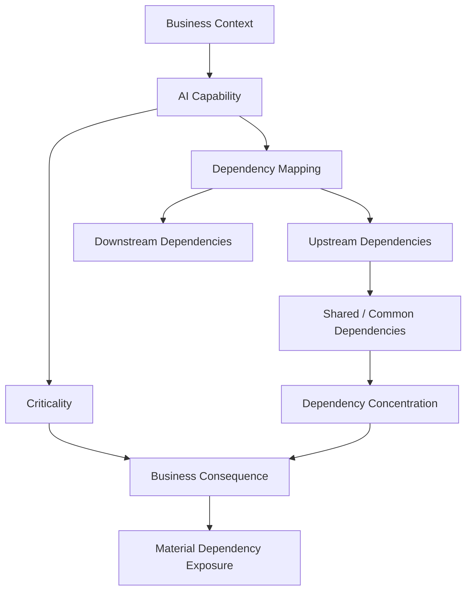

# ENT-09 — AI Criticality, Dependency Mapping and Concentration Risk

## Learning Objectives

By completing this file, you should be able to:

- explain AI capability criticality in an enterprise context;
- distinguish criticality from AI risk and impact assessment;
- reason about criticality without relying on a universal numeric score;
- identify upstream and downstream dependencies;
- distinguish shared, common, important, critical, and concentrated dependencies;
- construct a useful dependency map for an enterprise AI capability;
- explain how dependency concentration can create correlated or systemic exposure;
- identify concentration across providers, models, platforms, infrastructure, data sources, shared services, external APIs, and organizational capabilities;
- evaluate whether dependency concentration is acceptable in context; and
- explain how criticality and dependency structure inform later continuity and resilience decisions.

## Prerequisites

Before starting this file, you should understand:

- **ENT-02 — Enterprise AI Governance**;
- **ENT-03 — AI Risk, Impact and Assurance**;
- **ENT-06 — Enterprise AI Architecture and Integration**;
- **ENT-07 — AI Provider, Model and Vendor Strategy**; and
- the overall purpose and progression of **ENT-09**.

These provide the governance, risk, architecture, provider-strategy, and resilience context required for this file.

## Estimated Reading Time

Approximately **20–25 minutes**.

---

## Before We Start

Consider an enterprise customer-service assistant used by thousands of customers.

The assistant depends on:

- an AI application;
- a model;
- a model provider;
- a shared AI gateway;
- enterprise knowledge sources; and
- supporting services.

At the same time, customer-service workflows depend on the assistant.

Now imagine the model provider becomes unavailable.

The immediate technical question is:

> “Is the model service down?”

The enterprise engineering questions are broader:

- How important is the AI capability?
- Which business processes depend on it?
- Which other AI capabilities depend on the same provider?
- Is the dependency shared across business units?
- Would several apparently independent AI systems be affected together?
- Are meaningful alternatives available?

These questions establish the foundation for ENT-09.

---

## Why This Exists

AI capabilities rarely operate in isolation.

A production capability may have an upstream dependency chain:

```text
Business Capability
        ↓
AI Capability
        ↓
AI Application / Service
        ↓
Model / Provider
        ↓
Shared AI Platform
        ↓
External Service / Infrastructure
```

It may also have downstream relationships:

```text
AI Capability
        ↓
Business Process
        ↓
Customer / Employee / Operational Outcome
```

This creates two foundational questions:

1. **How important is the AI capability?**
2. **What does it depend on, and where do important capabilities share those dependencies?**

The first is **criticality reasoning**.

The second is **dependency mapping and concentration analysis**.

---

# Mental Model

Use this mental model throughout the file:

> **Criticality tells us how important an AI capability is. Dependency mapping tells us what it relies on and what relies on it. Dependency concentration tells us where multiple important capabilities depend on the same thing.**

```text
How Important?
      ↓
Criticality
      ↓
What Does It Depend On?
      ↓
Dependency Mapping
      ↓
What Do Important Capabilities Share?
      ↓
Dependency Concentration
```

These concepts must remain distinct.

A capability can be highly critical without having concentrated dependencies.

A dependency can be highly concentrated without every capability depending on it being highly critical.

The engineering task is to understand their interaction.

---

# Core Concepts

## 1. AI Capability Criticality

AI capability criticality describes:

> **How important an AI-enabled capability is to the enterprise and what happens if it becomes unavailable, degraded, or unreliable.**

Consider two capabilities.

### Capability A — Internal Writing Assistant

Employees use it to draft internal communications.

If it becomes unavailable:

- employees can continue working;
- manual alternatives exist;
- disruption is inconvenient but tolerable.

### Capability B — AI-Assisted Fraud Detection

The capability supports a time-sensitive financial process.

If it becomes unavailable:

- downstream processing may be affected;
- manual processing may be difficult;
- delays may become material;
- several business functions may be exposed.

The two capabilities therefore have different criticality.

The difference is not the sophistication of their models.

It comes from the **business capability and consequence associated with disruption**.

---

## 2. Criticality vs Risk

This distinction is fundamental.

### Risk asks:

> **What could go wrong, how severe could the consequence be, how likely is it, and what uncertainty exists?**

### Criticality asks:

> **How important is the AI capability to the enterprise, and what happens if it becomes unavailable, degraded, or unreliable?**

They interact but are not interchangeable.

For example:

| Situation | Risk | Criticality |
|---|---|---|
| Internal experimental chatbot | Potential information-quality risk | Low business criticality |
| Financial decision-support capability | Moderate technical risk | High business criticality |
| Reliable employee assistant | Low operational risk | Potentially high criticality if heavily relied upon |
| Experimental model with uncertain behavior | High model risk | Low enterprise criticality if no important process depends on it |

Therefore, a capability may be:

- high risk and low criticality;
- low risk and high criticality;
- high risk and high criticality;
- low risk and low criticality.

### Ownership boundary

**ENT-03** owns:

- AI risk;
- impact assessment;
- risk treatment;
- residual risk;
- risk acceptance;
- assurance.

**ENT-09** owns:

- capability criticality;
- dependency importance;
- dependency concentration;
- continuity and resilience implications.

A risk assessment may inform criticality reasoning, but it does not replace it.

---

## 3. Criticality Reasoning

Start with the business capability rather than the model.

Ask:

> **What business capability does this AI capability enable or support?**

Then:

> **What happens to that business capability if the AI capability becomes unavailable or degraded?**

A useful reasoning chain is:

```text
AI Capability
      ↓
Business Function
      ↓
Business Outcome
      ↓
Consequence of Disruption
      ↓
Criticality
```

Relevant questions include:

### Business dependency

- What business capability depends on the AI capability?
- Is the AI capability essential, supportive, or optional?
- How many business functions depend on it?

### Disruption consequence

- What happens if it becomes unavailable?
- What happens if it becomes degraded?
- What happens if its outputs become unreliable?
- What downstream processes are affected?

### Time sensitivity

- How quickly does disruption become significant?
- Can the business tolerate minutes, hours, or days of disruption?
- Does delay accumulate over time?

### Substitutability

- Is another capability available?
- Can the process be performed manually?
- How difficult would substitution be?

### Enterprise scope

- Is the capability used by one team?
- One business unit?
- Multiple business units?
- The wider enterprise?

### Propagation

- Does failure affect one application?
- Multiple applications?
- A critical dependency chain?
- Multiple downstream business functions?

These questions explain **why** a capability receives a particular criticality classification.

---

## 4. Criticality Is Contextual

Criticality is not an intrinsic property of a model.

The same model can support capabilities with very different criticality:

```text
Same Model
   ├── Internal Writing Assistant
   │       ↓
   │    Low Criticality
   │
   ├── Customer Support Assistant
   │       ↓
   │    Moderate Criticality
   │
   └── Critical Decision-Support Capability
           ↓
        High Criticality
```

The model is identical.

The enterprise consequences are not.

Criticality should therefore be assessed at the **AI capability and business-context level**.

---

## 5. Why Universal Scores Are Insufficient

An enterprise may classify capabilities as:

```text
Low
Medium
High
Critical
```

or use a numeric scale.

That can support governance and reporting, but the number is not the engineering insight.

A classification should be explainable through factors such as:

- business impact;
- customer impact;
- operational impact;
- financial consequence;
- regulatory consequence;
- safety consequence where relevant;
- time sensitivity;
- dependency propagation;
- substitutability;
- manual alternatives;
- tolerance for capability disruption;
- scope of affected business functions.

There is no universal criticality formula that should be imposed across enterprises.

The important requirement is:

> **The classification must be explainable and tied to business consequence.**

---

# 2. Dependency Mapping

## Dependency Mapping

A dependency exists when an AI capability requires another component, service, capability, information source, provider, or organizational capability to perform its function.

For example:

```text
AI Application
      ↓
Model Provider
```

Other dependencies may include:

- identity services;
- data sources;
- AI gateways;
- shared platforms;
- external APIs;
- infrastructure services;
- organizational capabilities.

The existence of a dependency does not by itself tell us whether the dependency is important or critical.

That requires additional reasoning.

---

## Dependency Map

Dependency mapping makes relationships visible.

A simplified map may look like:

```text
Business Capability
        ↓
AI Capability
        ↓
AI Application
        ↓
Model / Provider
        ↓
Shared AI Platform
        ↓
External Service
```

And in the opposite direction:

```text
AI Capability
        ↓
Business Process
        ↓
Customer / Employee / Operational Outcome
```

The goal is not to build a perfect technical topology.

The goal is to answer:

> **What depends on what, how important are those relationships, and what happens when a dependency changes or fails?**

Dependency mapping is therefore an **enterprise reasoning activity**, not primarily a tooling exercise.

---

## Upstream Dependencies

An upstream dependency is a component, capability, service, provider, or information source required by the AI capability.

```text
AI Application
      ↓
Model Provider
```

From the AI application's perspective, the model provider is upstream.

---

## Downstream Dependencies

A downstream dependency is a business capability, workflow, system, or process that relies on the AI capability.

```text
AI Capability
      ↓
Customer Support Workflow
      ↓
Customer Outcome
```

The customer-support workflow is downstream of the AI capability.

The distinction is:

```text
Upstream
What does the AI capability depend on?
        ↑
        │
AI Capability
        │
        ↓
Downstream
What depends on the AI capability?
```

Both directions matter because criticality depends on what the AI capability supports, while dependency analysis depends on what the AI capability requires.

---

## Dependency Importance

Not every dependency deserves the same level of attention.

A dependency may be:

- incidental;
- useful;
- important;
- critical;
- shared;
- concentrated.

The classification should follow the consequence of dependency disruption rather than the technical visibility of the dependency.

A small external service can be more consequential than a large internal platform if a critical AI capability cannot function without it.

---

# 3. Dependency Types

## Shared Dependencies

A **shared dependency** is used by multiple AI capabilities.

```text
AI Capability A ──┐
AI Capability B ──┤
AI Capability C ──┼──> Shared AI Platform
AI Capability D ──┤
AI Capability E ──┘
```

Sharing can provide:

- standardization;
- lower operating cost;
- centralized governance;
- reuse;
- consistent controls;
- simpler integration.

But it also creates a relationship between capabilities that may otherwise appear independent.

If the shared dependency fails, several capabilities may be affected.

---

## Common Dependencies

A **common dependency** is a dependency whose disruption can affect multiple otherwise independent capabilities.

```text
Capability A ──┐
Capability B ──┼──> Common Dependency
Capability C ──┘
```

The applications may have:

- separate teams;
- separate codebases;
- separate deployments;
- separate databases.

They may still share a common dependency.

Therefore:

> **Application-level independence does not necessarily imply enterprise-level independence.**

Dependency independence must be considered at the level of the dependency that can fail.

---

## Critical Dependencies

A dependency becomes critical when disruption of that dependency creates unacceptable consequences for an important AI capability.

For example:

```text
Critical AI Capability
        ↓
Critical Model Dependency
        ↓
Provider Dependency
```

Criticality should therefore be considered across the dependency chain rather than assigned only to the top-level AI application.

---

## Concentrated Dependencies

A dependency is concentrated when a significant portion of important enterprise AI capability depends on it.

This is more than simply saying that the dependency is shared.

A dependency can be shared by several low-impact applications without creating material enterprise concentration.

Concentration becomes significant when the dependency supports a substantial portion of important capability.

---

# 4. Dependency Concentration

## What Concentration Means

Dependency concentration occurs when a significant portion of enterprise AI capability depends on the same dependency.

For example:

```text
AI Capability A ──┐
AI Capability B ──┤
AI Capability C ──┼──> Provider X
AI Capability D ──┤
AI Capability E ──┘
```

The important question is not simply:

> “How many applications use Provider X?”

It is:

> **How much important enterprise capability depends on Provider X, and what would happen if that dependency became unavailable or degraded?**

This makes concentration a resilience-relevant enterprise concern.

---

## Where Concentration Exists

Dependency concentration can occur at multiple levels.

### Provider concentration

Many capabilities depend on one external provider.

### Model concentration

Many capabilities depend on the same model.

### Platform concentration

Many applications depend on one shared AI platform.

### Infrastructure concentration

Multiple AI platforms depend on a common infrastructure dependency.

### Data-source concentration

Multiple capabilities depend on the same critical data source.

### Shared-service concentration

Multiple capabilities depend on one enterprise service such as:

- identity;
- authorization;
- API gateway;
- shared retrieval service;
- policy service.

### External API concentration

Multiple AI capabilities depend on the same external API.

### Organizational concentration

Multiple capabilities depend on the same specialized organizational capability.

For example:

```text
Multiple AI Capabilities
        ↓
Specialized Team
        ↓
Operational Dependency
```

The dependency does not have to be technological.

---

## Common Failure Exposure

Consider several apparently independent applications:

```text
Application A ──┐
Application B ──┤
Application C ──┼──> Same Provider
Application D ──┤
Application E ──┘
```

Each application may have:

- separate code;
- separate deployment;
- separate teams.

But a provider-level disruption can affect all of them.

This creates **common failure exposure**.

The key enterprise principle is:

> **Local application independence does not guarantee enterprise dependency independence.**

Dependency mapping reveals this hidden coupling.

---

## Concentration Is Not Automatically Bad

It is tempting to conclude:

> “Concentration is dangerous, therefore it should always be eliminated.”

That is incorrect.

Concentration may provide:

- standardization;
- cost efficiency;
- centralized governance;
- supportability;
- reuse;
- architectural simplicity.

It may also create:

- common failure exposure;
- correlated disruption;
- substitution difficulty;
- provider dependency;
- change propagation;
- systemic impact.

Therefore:

> **The existence of concentration is not itself the decision. The decision is whether the concentration is acceptable in context.**

---

## Criticality + Concentration

Consider two organizations.

### Organization A

Twenty low-criticality internal assistants depend on one provider.

### Organization B

Three highly critical business capabilities depend on one provider.

Organization A has more applications.

Organization B may have greater enterprise exposure because the concentrated dependency supports more critical business capability.

A useful reasoning model is:

```text
Capability Criticality
        +
Dependency Concentration
        +
Dependency Consequence
        ↓
Material Dependency Exposure
```

This is a reasoning model, not a universal scoring formula.

The purpose is to understand **why the same dependency concentration can be acceptable in one context and concerning in another**.

---

# 5. Enterprise Scenario

## Shared Provider Scenario

An enterprise operates five customer-service AI capabilities:

```text
Capability A — FAQ Assistant
Capability B — Agent Assistance
Capability C — Case Summarization
Capability D — Customer Email Generation
Capability E — Complaint Classification
```

All five use the same model provider.

```text
FAQ Assistant ────────┐
Agent Assistance ─────┤
Case Summarization ───┤
Email Generation ─────┼──> Same Provider
Complaint Classifier ─┘
```

The provider offers:

- strong reliability;
- competitive pricing;
- consistent APIs;
- centralized support.

There are therefore legitimate reasons for the shared dependency.

Now classify the capabilities.

Suppose:

- FAQ Assistant → moderate criticality;
- Email Generation → moderate criticality;
- Case Summarization → high criticality;
- Agent Assistance → high criticality;
- Complaint Classification → high criticality.

The dependency is therefore not merely shared.

It represents concentration across several important capabilities.

The engineering analysis should ask:

1. How much important business capability depends on the provider?
2. What happens if the provider becomes unavailable?
3. How significant is the resulting business consequence?
4. Are meaningful alternatives available?
5. How difficult would substitution be?
6. Are the most critical capabilities exposed to the same dependency?
7. Does the concentration remain acceptable given the enterprise context?

The correct conclusion is **not automatically**:

> “Add another provider.”

Nor is it:

> “The provider is reliable, so there is no concern.”

The correct conclusion is:

> **Make the concentration visible, evaluate it against capability criticality and business consequence, and use the resulting exposure to inform the continuity and resilience requirements developed in later ENT-09 files.**

---

## Analysis

The scenario contains three distinct observations:

### Observation 1 — Shared dependency

Multiple AI capabilities use the same provider.

### Observation 2 — Concentration

Several important capabilities depend on that provider.

### Observation 3 — Potential common failure exposure

A provider-level disruption could affect several important capabilities simultaneously.

These observations do not yet determine the required resilience treatment.

They establish the dependency exposure that later continuity and resilience analysis must address.

---

## Engineering Decision

At this stage, the engineering decision is **not**:

> “Which provider should replace the current provider?”

That belongs to provider strategy.

Nor is it:

> “What exact failover architecture should we implement?”

That belongs to production engineering and later resilience planning.

The Lesson 01 decision is:

> **Is this dependency concentration material enough to require further continuity and resilience analysis?**

That keeps the decision within Lesson 01 ownership.

---

# 6. Dependency Visibility and Change

## Enterprise Visibility

Enterprise dependency visibility means being able to understand:

- which AI capabilities exist;
- which dependencies they use;
- which dependencies are shared;
- which dependencies are concentrated;
- which business capabilities depend on those AI capabilities;
- where common failure exposure exists.

The objective is not perfect real-time topology.

The objective is useful decision support.

For example:

```text
Critical AI Capability
        ↓
Important Dependencies
        ↓
Shared Dependencies
        ↓
Dependency Concentration
        ↓
Material Dependency Exposure
```

Without sufficient visibility, enterprise-level concentration can remain hidden inside individual application teams.

---

## Why Dependency Structure Changes

Dependency posture can change as the enterprise evolves.

```text
New Provider
    ↓
New Dependency

Shared Platform Adoption
    ↓
Higher Dependency Concentration

Capability Consolidation
    ↓
Fewer Platforms
    +
Potentially Greater Shared Dependency

Provider Migration
    ↓
New Dependency Structure
```

The same architecture can therefore move from low concentration to high concentration without any individual application becoming more complex.

---

## What Should Trigger Reassessment

Material changes that may warrant reassessment include:

- new critical capabilities;
- new providers;
- architecture changes;
- shared-platform adoption;
- portfolio consolidation;
- increased AI adoption;
- increased capability criticality;
- loss of meaningful alternatives;
- changed continuity requirements;
- material dependency changes.

The important principle is:

> **A dependency posture that was acceptable yesterday may become unacceptable when the enterprise context changes.**

Detailed dependency governance and continuous review belong primarily to Lesson 03.

---

# Production / Enterprise Perspective

Lesson 01 establishes the **enterprise dependency and criticality picture**.

The reasoning chain is:

```text
AI Capability
      ↓
Criticality
      ↓
Dependency Mapping
      ↓
Dependency Importance
      ↓
Shared / Common Dependencies
      ↓
Dependency Concentration
      ↓
Material Dependency Exposure
```

This is an enterprise reasoning layer.

Later ENT-09 files use this understanding to define continuity, recovery, and resilience requirements.

Production engineering determines how those requirements are technically implemented.

For example:

```text
ENT-09
"What resilience outcome is required?"
        ↓
PROD
"How should the production system technically achieve it?"
```

Lesson 01 therefore does not become a tutorial on:

- retries;
- timeouts;
- backpressure;
- failover;
- backup;
- replication;
- Kubernetes recovery;
- incident response;
- operational runbooks.

Those mechanisms belong to production engineering.

---

# Engineering Decisions and Trade-offs

## Should a Dependency Be Centralized?

Centralization may improve:

- standardization;
- cost efficiency;
- supportability;
- governance;
- reuse.

But it can also increase dependency concentration.

Ask:

> **What important capabilities will become dependent on the centralized service?**

---

## Should Multiple AI Capabilities Share One Provider?

Sharing may reduce:

- cost;
- integration complexity;
- operational fragmentation.

But it can increase common dependency exposure.

Ask:

> **How critical are the capabilities sharing the provider, and what consequences would follow from provider disruption?**

Strategic provider diversification belongs to **ENT-07**.

---

## Should Dependency Concentration Be Reduced?

Not automatically.

Concentration reduction may increase:

- cost;
- architectural complexity;
- operational burden;
- governance overhead;
- behavioral inconsistency;
- duplicated capabilities.

Ask:

> **Is the existing concentration acceptable given the criticality and consequence of the dependent capabilities?**

The resulting resilience strategy belongs to Lesson 03.

---

## Should Every Critical Dependency Have an Alternative?

Not necessarily.

The existence or absence of an alternative is a relevant input to criticality and dependency analysis, but Lesson 01 does not determine the detailed fallback design.

Ask:

> **Does the dependency structure create a material exposure that requires further continuity analysis?**

Detailed fallback, degraded-mode, and substitution requirements belong to Lesson 02.

---

## Common Mistakes and Misconceptions

## Mistake 1 — Treating criticality as risk

> “This capability is high risk, therefore it is highly critical.”

Risk and criticality answer different questions.

---

## Mistake 2 — Assessing criticality from the model alone

> “This is our most advanced model, so it is our most critical AI asset.”

Criticality belongs to the business capability and its consequences, not model sophistication.

---

## Mistake 3 — Treating every dependency as critical

The existence of a dependency does not establish its criticality.

Criticality depends on consequence.

---

## Mistake 4 — Looking only upstream

Mapping:

```text
AI Application
    ↓
Model
    ↓
Provider
```

is insufficient.

You must also understand:

```text
AI Capability
    ↓
Business Process
    ↓
Business Outcome
```

---

## Mistake 5 — Assuming application independence means enterprise independence

Separate applications can share:

- providers;
- models;
- platforms;
- infrastructure;
- data;
- external APIs;
- organizational capabilities.

Shared dependencies can create correlated exposure.

---

## Mistake 6 — Assuming concentration is automatically bad

Concentration can create efficiency and governance benefits.

The question is whether the resulting exposure is acceptable.

---

## Mistake 7 — Assuming multiple providers automatically create independence

Two providers may still depend on:

- the same infrastructure;
- the same critical data;
- the same shared platform;
- the same external service.

Apparent diversification does not necessarily eliminate common dependency.

---

## Mistake 8 — Trying to eliminate all concentration

Complete elimination may be:

- expensive;
- impractical;
- unnecessary;
- less efficient;
- more complex.

The objective is proportionate resilience, not zero concentration.

---

## Mistake 9 — Turning Lesson 01 into provider strategy

If the discussion becomes:

- provider selection;
- vendor negotiation;
- portability strategy;
- lock-in management;
- strategic exit;

the discussion belongs to **ENT-07**.

Lesson 01 asks what criticality and concentration exposure arise from those dependencies.

---

## Mistake 10 — Turning Lesson 01 into continuity design

If the discussion becomes:

- detailed degraded modes;
- fallback workflows;
- minimum viable AI capability;
- recovery targets;
- technical recovery mechanisms;

the discussion has moved into Lesson 02 or PROD.

---

# Interview Questions with Expected Answers

## 1. What is AI capability criticality?

AI capability criticality describes how important an AI-enabled capability is to the enterprise and what happens if it becomes unavailable, degraded, or unreliable.

---

## 2. How is criticality different from risk?

Risk evaluates what could go wrong, its consequence, likelihood, and uncertainty.

Criticality evaluates the importance of a capability and the consequence of its unavailability or degradation.

They interact but should not be collapsed into one score.

---

## 3. What is an upstream dependency?

A component, capability, service, provider, or information source required by the AI capability.

---

## 4. What is a downstream dependency?

A business capability, workflow, system, or process that relies on the AI capability.

---

## 5. What is dependency concentration?

Dependency concentration occurs when a significant portion of important enterprise AI capability depends on the same dependency.

---

## 6. Why can application-level independence be misleading?

Applications may have separate codebases, teams, and deployments while sharing the same provider, platform, infrastructure, or service.

A shared dependency can therefore create correlated disruption.

---

## 7. Is dependency concentration always bad?

No.

Concentration can improve standardization, cost efficiency, governance, reuse, and supportability.

It becomes concerning when the resulting exposure is disproportionate to the criticality and consequence of the dependent capabilities.

---

## 8. Should every enterprise use multiple model providers?

No.

Provider diversification should be justified by the enterprise's criticality, concentration, consequence, substitutability, continuity requirements, cost, and complexity.

Strategic provider diversification belongs primarily to ENT-07.

---

## 9. How would you determine whether an AI capability is critical?

Start with the business capability it supports and evaluate:

- business consequence;
- customer and operational impact;
- financial/regulatory/safety consequence where relevant;
- time sensitivity;
- downstream propagation;
- substitutability;
- manual alternatives;
- tolerance for capability disruption;
- scope of affected functions.

The exact classification method may vary by enterprise.

---

## 10. What is the difference between a shared dependency and a concentrated dependency?

A shared dependency is used by multiple AI capabilities.

A concentrated dependency is one on which a significant portion of important enterprise AI capability depends.

Sharing does not automatically imply significant concentration.

---

## Enterprise Decision Scenario

## Scenario

An enterprise has 15 AI capabilities.

All 15 use one model provider because it offers:

- low cost;
- strong performance;
- consistent APIs;
- centralized support.

The provider has excellent historical reliability.

An engineer proposes immediately adding another provider.

### Reason about the decision

Do not answer:

> “Yes, because single-provider dependency is always bad.”

Instead examine:

1. **Criticality** — How many capabilities are highly critical?
2. **Concentration** — What proportion of important capability depends on the provider?
3. **Consequence** — What happens if the provider becomes unavailable?
4. **Substitutability** — Are meaningful alternatives available?
5. **Continuity implications** — Would the concentration create a material continuity concern?
6. **Cost** — What would diversification cost?
7. **Complexity** — What operational burden would it introduce?
8. **Independence** — Would another provider actually remove the common dependency?
9. **Enterprise context** — Are there contractual, technical, regulatory, or business constraints?

A strong engineering answer is:

> **Provider diversification may be justified, but the decision should follow from criticality, dependency concentration, business consequence, substitutability, continuity implications, and cost/complexity trade-offs rather than from a universal multi-provider rule.**

The detailed provider strategy belongs to ENT-07, while the continuity and resilience treatment belongs to the later ENT-09 files.

---

## Quick Revision

### Criticality

> How important is this AI capability, and what happens if it becomes unavailable or degraded?

### Risk

> What could go wrong, how severe could the consequence be, how likely is it, and what uncertainty exists?

### Upstream Dependency

> What does the AI capability depend on?

### Downstream Dependency

> What depends on the AI capability?

### Shared Dependency

> Which dependency is used by multiple AI capabilities?

### Common Dependency

> Which dependency can affect multiple otherwise independent capabilities?

### Critical Dependency

> Which dependency failure creates unacceptable consequences for an important capability?

### Dependency Concentration

> How much important enterprise AI capability depends on the same dependency?

### Core Principle

> **Application-level independence does not necessarily imply enterprise-level independence.**

---

## Key Takeaways

1. **Criticality is not the same as risk.**
2. Criticality is about the importance and consequences of losing or degrading an AI-enabled business capability.
3. Criticality should be reasoned from business context rather than model sophistication.
4. There is no universal criticality scoring formula.
5. Dependency mapping makes important relationships visible.
6. Upstream dependencies support an AI capability; downstream dependencies rely on it.
7. Shared and common dependencies can create correlated enterprise exposure.
8. Dependency existence, importance, criticality, and concentration are different concepts.
9. Dependency concentration can exist across providers, models, platforms, infrastructure, data, services, APIs, and organizational capabilities.
10. Concentration can provide significant enterprise benefits as well as create resilience exposure.
11. Application-level independence does not guarantee enterprise dependency independence.
12. The correct question is not whether concentration exists, but whether it is acceptable in context.
13. Lesson 01 establishes the criticality and dependency foundation for the continuity and recovery reasoning developed in Lesson 02.
14. Strategic provider diversification belongs to ENT-07; detailed fallback and degraded-mode design belongs to Lesson 02; technical implementation belongs to PROD.

The central engineering question is:

> **How important is this AI capability, what does it depend on, and where can dependency concentration create material enterprise exposure?**

---

## Further Reading

Continue with:

[02 — AI Continuity, Degraded Modes and Recovery Requirements](./02-AI-Continuity-Degraded-Modes-and-Recovery-Requirements.md)

For strategic provider, model, diversification, portability, and exit considerations:

[ENT-07 — AI Provider, Model and Vendor Strategy](../ENT-07-Model-Provider-and-Vendor-Strategy/README.md)

For AI risk, impact, treatment, residual risk, and assurance:

[ENT-03 — AI Risk, Impact and Assurance](../ENT-03-Enterprise-AI-Risk-Impact-Oversight-and-Assurance/Readme.md)

For enterprise AI architecture and integration:

[ENT-06 — Enterprise AI Architecture and Integration](../ENT-06-Enterprise-AI-Integration-and-Platform-Architecture/Readme.md)

---

## Final Mental Model



The purpose of Lesson 01 is not to eliminate every dependency or concentration.

It is to make the enterprise dependency structure and capability criticality visible enough to support **proportionate, defensible continuity and resilience analysis in the later ENT-09 files**.
