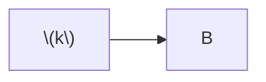

# Math Fixture

Currency examples: The cost is $50 per month. Budget from $50 to $75. Standalone $100.

Inline paren math: \(k\) and \(O(Nd)\).

Inline dollar math: $x + y$.

Single-line display:

\[ O(Nd) \]

Multi-line display with Setext trap:

\[
\operatorname{ANNRecall@5}
=
\frac{|\{A,C,D,F,G\}\cap\{A,B,C,D,E\}|}{5}
=
\frac{3}{5}=0.6
\]

Dollar display:

$$
\|v\|_2 = 1
$$

## Complexity \(O(Nd)\)

A real heading after math.

Fenced code must stay literal:

```latex
\(O(Nd)\)
```

Inline code: `\(x\)`.



Escapes inside math: \(\operatorname{ANNRecall@5}\) and \(\{A,C,D,F,G\}\) and \(\|x\|_2\).
